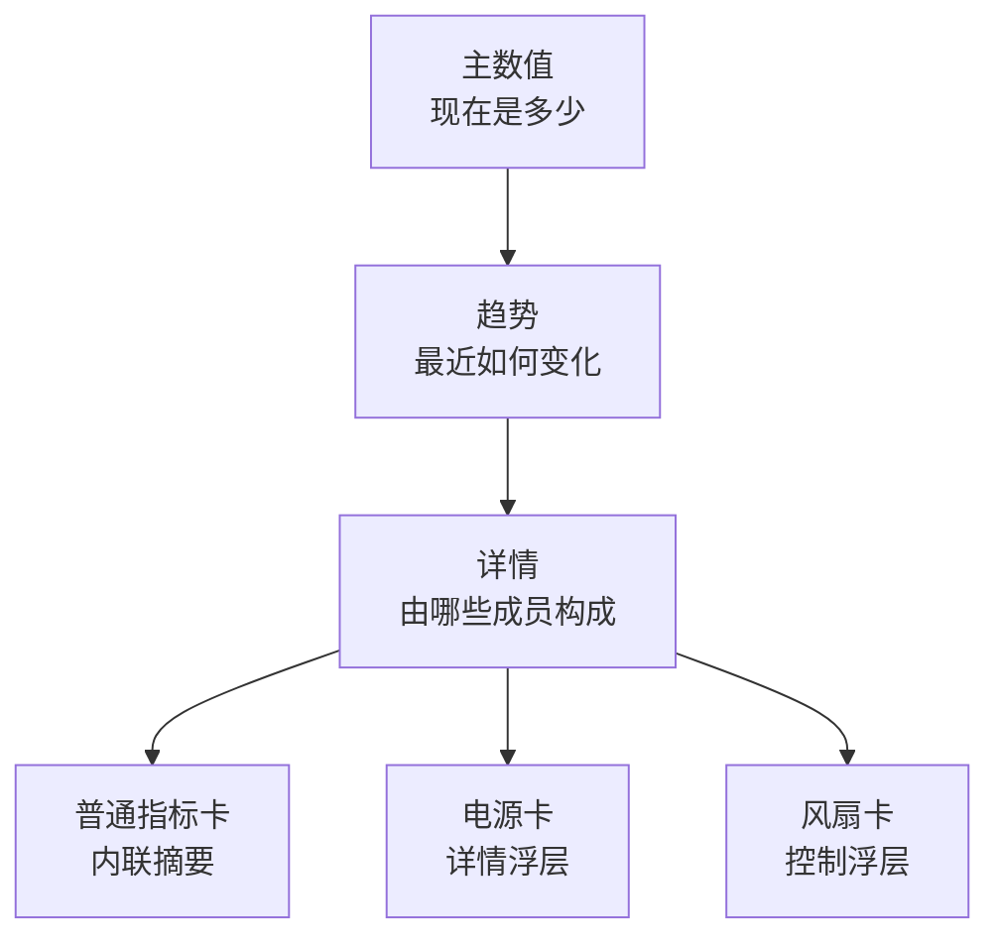
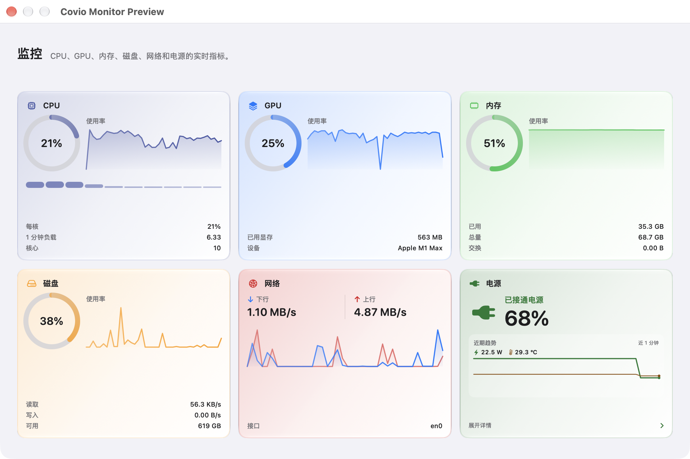
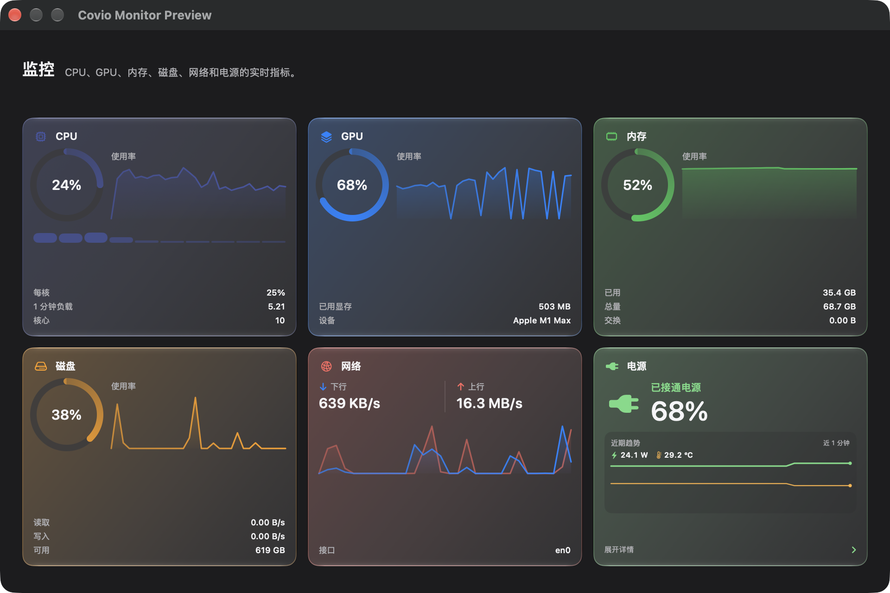

# Monitor 七卡通用设计

## 文档状态

| 项目 | 内容 |
| --- | --- |
| 文档版本 | `2.0` |
| 状态 | 待评审 |
| 日期 | `2026-10-28` |
| 适用范围 | macOS 的 Hub Monitor 概览 |
| 设计依据 | [设计合同](../covio-design-contract.json) |
| 当前实现 | `macosApp/src/Hub/Monitor/MonitorTabView.swift` |
| 当前快照 | `macosApp/src/Hub/Monitor/MonitorSnapshot.swift` |
| 数据依据 | [硬件信息监听能力研究](../research/hardware-monitoring-capability/README.md) |

Monitor 概览使用七张实时指标卡片。
所有卡片遵循主数值、趋势和详情三层阅读顺序。
普通指标卡使用内联摘要。
电源卡和风扇卡使用卡片专属详情浮层。
本文定义通用规则。
电源卡和风扇卡的专项字段由对应设计文档定义。

## 1. 三层阅读模型

用户先看当前值。
用户再看近期变化。
用户需要时再查看具体成员或执行卡片操作。

| 层级 | 回答的问题 | 通用内容 | 显示规则 |
| --- | --- | --- | --- |
| 主数值 | 现在是多少？ | 大号数值、单位、状态或比例读数 | 始终显示 |
| 趋势 | 最近如何变化？ | 最近 60 个采样点的 Sparkline | 始终显示 |
| 详情 | 具体成员是什么？ | 1 至 3 行摘要，或卡片专属浮层 | 摘要始终显示；浮层按需打开 |

比例环和 Sparkline 只帮助比较。
文字数值是精确值的依据。
趋势线不显示坐标轴。
趋势线不替代精确数值。

## 2. 当前预览

无风扇数据的普通指标卡和电源卡如下。
电源卡与风扇卡的详情状态见专项文档。

| 浅色 | 深色 |
| --- | --- |
|  |  |

预览来源是 #405 的真机截图。
此主机不显示风扇卡。
风扇数量为 0 或 SMC 读数不可用时，页面不显示风扇卡。

## 3. 卡片外壳与状态

每张卡片使用相同的 `MonitorCardShell`。

| 成员 | 规则 |
| --- | --- |
| 图标 | 使用卡片类型的 SF Symbol |
| 标题 | 使用设计合同的 `copy/monitor/title/*` 文案 |
| 强调色 | 使用 `MonitorCardKind.accent` |
| 材质 | 使用玻璃表面和统一卡片圆角 |
| 边框 | 使用 1 点强调色边框 |
| 高度 | 使用 `HubMetrics.monitorCardHeight`，当前为 236 点 |

页面状态行保留高度，但暂时不显示内容。
普通指标卡不显示 `LIVE` 胶囊。
电源卡在自己的内容区显示供电状态。
风扇卡只在存在真实控制状态时显示状态胶囊。

## 4. 布局

概览使用三列自适应网格。

| 项目 | 规则 |
| --- | --- |
| 列数 | 3 |
| 最小列宽 | 170 点 |
| 卡片间距 | `MacTheme.space3` |
| 滚动 | 纵向滚动 |
| 顺序 | CPU、GPU、内存、磁盘、网络、电源、风扇 |
| 卡片高度 | 固定为 `HubMetrics.monitorCardHeight` |

普通指标卡收到不可用状态时仍占一个网格单元。
电源卡始终占一个网格单元。
风扇卡没有有效风扇时退出网格。

## 5. 采样与历史

Monitor 页面可见时才运行采样任务。
页面离开后，SwiftUI 取消采样任务。

| 项目 | 规则 |
| --- | --- |
| 接电源采样 | 1 秒 |
| 使用电池采样 | 5 秒 |
| 普通指标历史 | 每类保留最近 60 个采样点 |
| 电源折叠态历史 | 最近 60 个一秒样本 |
| 电源详情历史 | 最近 30 个一分钟聚合点 |
| 新样本 | 历史满额后删除最旧样本 |

趋势线不固定代表 60 秒。
接电源时，60 个普通采样点约为 60 秒。
使用电池时，60 个普通采样点约为 300 秒。
专项卡片的独立采样规则由对应设计文档定义。

## 6. 七张卡片

### 6.1 卡片总表

| 卡片 | 主数值 | 趋势 | 详情层 | 显示条件 |
| --- | --- | --- | --- | --- |
| CPU | 总使用率 | 总使用率 60 点 | 每核平均、1 分钟负载、核心数；内联摘要 | CPU 读数可用 |
| GPU | 总使用率 | 总使用率 60 点 | 已用显存、设备；内联摘要 | GPU 读数可用 |
| 内存 | 已用占总量的比例 | 内存使用率 60 点 | 已用、总量、交换；内联摘要 | 总量大于 0 |
| 磁盘 | 已用占总容量的比例 | 读写总速率 60 点 | 读取、写入、可用；内联摘要 | 总容量大于 0 |
| 网络 | 下行和上行速率 | 下行与上行 60 点 | 当前接口；内联摘要 | 网络计数器可用 |
| 电源 | 电池电量 | 功耗与温度趋势 | 状态、功耗、温度；打开详情浮层 | 始终显示 |
| 风扇 | 控制温度、CPU 占用和控制状态 | 温度、CPU、风扇 RPM 趋势 | 风扇读数；打开控制浮层 | 存在有效风扇 |

### 6.2 普通指标卡

CPU、GPU、内存、磁盘和网络使用 `MonitorGaugeCard` 或 `MonitorNetworkCard`。
这类卡片没有展开控件。
摘要最多显示 3 行。
摘要只重排已有数据，不增加新的取数来源。

内存当前传入 4 个详情成员。
`MonitorDetailRows` 只显示前 3 项。
因此压力成员当前不显示。

### 6.3 电源卡

电源卡使用独立的三段式结构。
主数值是电池电量。
趋势同时显示功耗和温度。
详情浮层显示耗电 Top3、历史、预计时间、充电信息、供电事件和充电上限。
台式机没有电池时，电源卡仍显示供电与功耗信息。
电池专属成员显示 `—` 或隐藏。

完整规则见 [Monitor 电源卡片](monitor-power-card.md)。

### 6.4 风扇卡

风扇卡显示控制温度、CPU 占用、风扇转速和控制状态。
详情入口打开固定尺寸控制浮层。
浮层承载系统自动、曲线、手动转速、传感器选择和恢复系统控制。
风扇写入走现有 root helper。

完整规则和安全边界见 [Monitor 风扇卡片](monitor-fan-card.md)。

## 7. 详情交互差异

| 卡片类型 | 详情入口 | 浮层尺寸 | 状态保持 |
| --- | --- | --- | --- |
| 普通指标卡 | 无 | 无 | 无 |
| 电源卡 | 卡片底部「展开详情」 | 宽 480 点，高度按屏幕限制 | `monitor.power.detailsExpanded` |
| 风扇卡 | 卡片底部「风扇控制」按钮 | 420 × 760 点 | popover 打开状态 |

电源卡和风扇卡的浮层不改变卡片高度。
浮层不移动卡片网格。
浮层打开期间，工作台保持展开。
最后一个浮层关闭后，工作台恢复普通收起规则。
所有可点击控件命中区不小于 24 点。

## 8. 不可用状态

CPU、GPU、内存、磁盘和网络读取失败时显示不可用卡。
不可用卡保留图标、标题和卡片外壳。
不可用卡显示「不可用」，并隐藏主数值、趋势和摘要。

电源卡保留外壳。
缺失的电源读数显示 `—`。
缺失的电池成员隐藏或显示不可用。

风扇卡没有有效风扇或 SMC 读数失败时不显示。
Helper 不可用时仍可显示风扇读数；用户不能写入风扇控制。

## 9. 无障碍

普通指标卡把标题、主数值、趋势摘要和详情合并为一个 VoiceOver 元素。
电源卡和风扇卡使用容器语义，并由内部按钮提供操作。
比例环、Sparkline 和核心柱形是视觉装饰，对 VoiceOver 隐藏。
详情文字必须提供可读数值。

详情入口必须是可聚焦按钮。
详情入口必须提供打开或关闭动作的标签。
焦点顺序必须与视觉顺序一致。
趋势线不能承载唯一信息。

## 10. 实现边界

本文只记录当前设计和行为。
本文不新增指标、不修改采样逻辑，也不实现新的展开交互。
设计合同是文案和颜色的唯一来源。
电源卡和风扇卡的专项字段以对应文档为准。
页面副标题 `copy/hub/tab/devices/summary` 仍只列出六类指标。
修改该文案需要变更设计合同。

## 11. 依据

- 需求来源：#133
- 前置交付：#131
- 状态行调整：#405
- 当前实现：`macosApp/src/Hub/Monitor/MonitorTabView.swift`
- 当前快照：`macosApp/src/Hub/Monitor/MonitorSnapshot.swift`
- 电源卡规范：[monitor-power-card.md](monitor-power-card.md)
- 风扇卡规范：[monitor-fan-card.md](monitor-fan-card.md)
- 能力口径：[硬件信息监听能力研究](../research/hardware-monitoring-capability/README.md)
