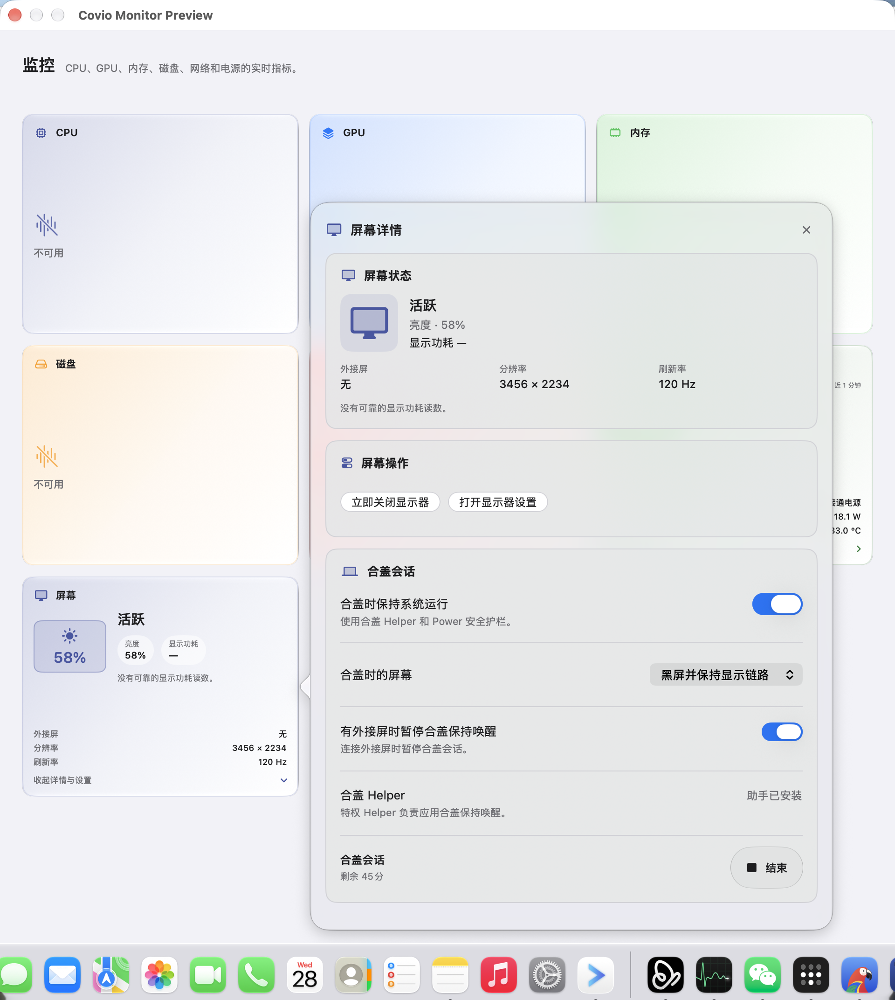
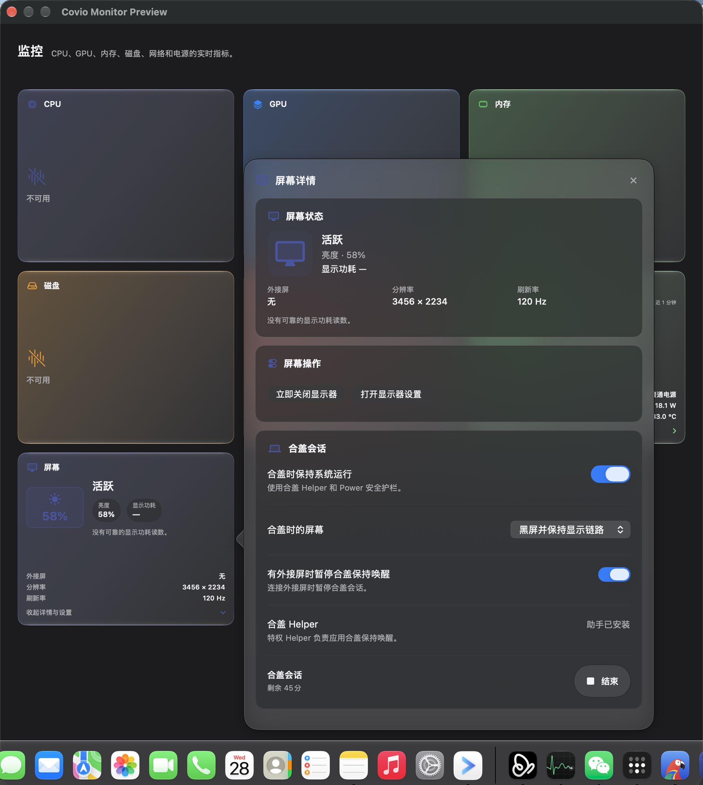
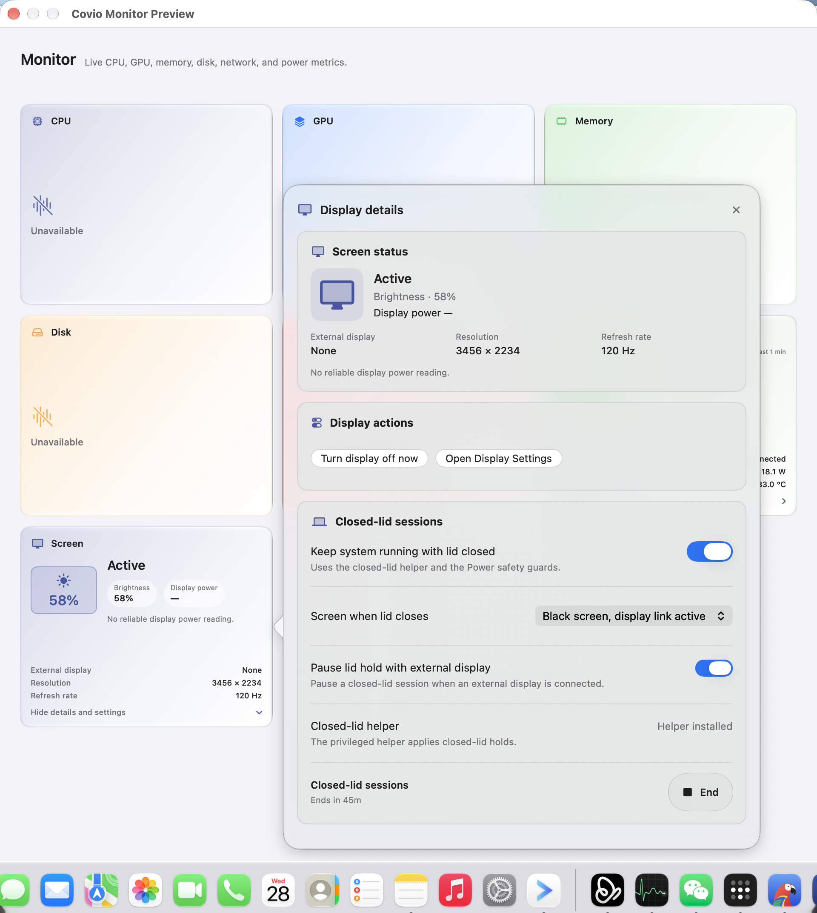

# Monitor 屏幕卡片

## 文档状态

| 项目 | 内容 |
| --- | --- |
| 文档版本 | `1.0` |
| 状态 | 已实现；等待真机视觉验收 |
| 日期 | `2026-10-28` |
| Issue | #441 |
| 上游决策 | ADR-0024 |

## 目标

`Monitor` 页签提供独立的屏幕 card。
用户可以先查看内建屏状态、亮度和显示功耗，再从第三段 popover 管理合盖屏幕行为。

Power card 继续管理电池、适配器、热状态、低电量模式、安全阈值和历史。
屏幕 card 不再把电源规则和显示行为混在同一个设置入口。

## 三段结构

| 段 | 内容 |
| --- | --- |
| 第一段 | 屏幕状态、亮度、显示功耗 |
| 第二段 | 外接屏数量、分辨率、刷新率 |
| 第三段 | “详情与设置”入口和 popover |

## 数据口径

| 数据 | 来源 | 缺失行为 |
| --- | --- | --- |
| 屏幕状态 | `CoreGraphics` | 显示“未知” |
| 亮度 | 已验证的 `DisplayServices` 路径 | 显示“不可用” |
| 外接屏数量 | `ExternalDisplayReader` | 显示“不可用” |
| 分辨率与刷新率 | `CGDisplayMode` | 显示“不可用” |
| 显示功耗 | 可靠的单屏功耗源 | 显示“不可用” |

当前没有可靠的公开显示功耗瓦数来源。
屏幕 card 不显示系统总功耗。
屏幕 card 不使用背光电流估算瓦数。

## Popover

### 当前屏幕

- 显示内建屏状态、亮度、显示功耗。
- 显示外接屏数量、分辨率和刷新率。
- 显示功耗不可用时给出文字说明。

### 屏幕操作

- 立即关闭显示器。
- 打开 macOS 显示器设置。

### 合盖行为

- `合盖时保持系统运行`使用一个开关。
- `合盖时的屏幕`使用一个互斥菜单。
- `有外接屏时暂停合盖保持唤醒`使用一个开关。
- `合盖 Helper`显示安装、审批和修复状态。
- 零亮度失败时就地显示错误和公开关屏回退说明。

### 材质

- popover 外层使用 regular Liquid Glass。
- 内容卡使用标准材质，避免多层玻璃叠加。
- 减少透明度或增强对比时，popover 外层回退为不透明 surface。
- 开始和结束按钮使用 interactive Liquid Glass。

| 模式 | 行为 |
| --- | --- |
| 跟随系统 | 不启动合盖保持运行，由 macOS 执行默认行为 |
| 关闭显示器 | 保持系统运行，显示器进入关闭状态 |
| 黑屏并保持显示链路 | 面板亮度为零，framebuffer 保持活动 |

## 持久化

屏幕设置保存在独立、版本化的 `DisplayConfig`。

| 字段 | 默认值 |
| --- | --- |
| `keepAwakeWhenLidClosed` | 由旧 `PowerConfig.allowClosedLid` 迁移 |
| `closedLidDisplayMode` | 由旧 `PowerConfig.closedLidZeroBrightness` 迁移 |
| `pauseWhenExternalDisplayConnected` | 由旧 `PowerConfig.pauseClosedLidWithExternalDisplay` 迁移 |

`PowerConfig` 继续保存运行时兼容镜像。
屏幕 card 修改设置时，两处同步写入同一个配置事务。
旧配置缺少 `display` 键时，从 `power` 推导并保持当前行为。

## 交互与无障碍

- 点击 card 或第三段入口打开 popover。
- 按 Enter 或 Space 打开或关闭 popover。
- popover 打开期间，Hub 保持展开。
- 开始和结束按钮使用 regular interactive Liquid Glass。
- 开始、结束和操作按钮至少有 44 点命中高度。
- 状态同时使用文字和图标。
- 减少透明度或增强对比时，内容卡使用不透明表面。

## 异常

| 情况 | 行为 |
| --- | --- |
| 亮度读取失败 | 显示“不可用”，其它字段继续刷新 |
| 无内建屏 | 状态显示“离线” |
| 显示功耗无可靠来源 | 显示“不可用”和原因 |
| Helper 缺失 | 禁止启动合盖会话，显示安装入口 |
| Helper 待审批 | 显示打开系统设置入口 |
| 外接屏存在且暂停规则开启 | 合盖会话不能获得特权租约 |
| 零亮度失败 | 恢复原亮度，回退公开关屏，显示错误 |

## 视觉验收

亮色：

深色：

英文：

