# Monitor 风扇卡片

本文定义 Monitor 页风扇卡片的结构、控制行为和故障边界。
多点曲线参考 [MacFanControl](https://github.com/skydeadpeng/MacFanControl)。
自动、手动和同步控制参考 [Stats](https://github.com/exelban/stats)。

## 1. 目标

风扇卡片有四个目标。

1. 用户不用打开其他应用就能看到控制温度和风扇转速。
2. 用户能使用系统自动、曲线和手动转速。
3. 用户能选择参与控制温度的 SMC 传感器。
4. Covio 退出、崩溃或丢失 helper 租约后，系统风扇控制自动恢复。

## 2. 预览

| 亮色 | 深色 |
| --- | --- |
|  |  |
|  |  |
|  |  |
|  |  |
|  |  |
| 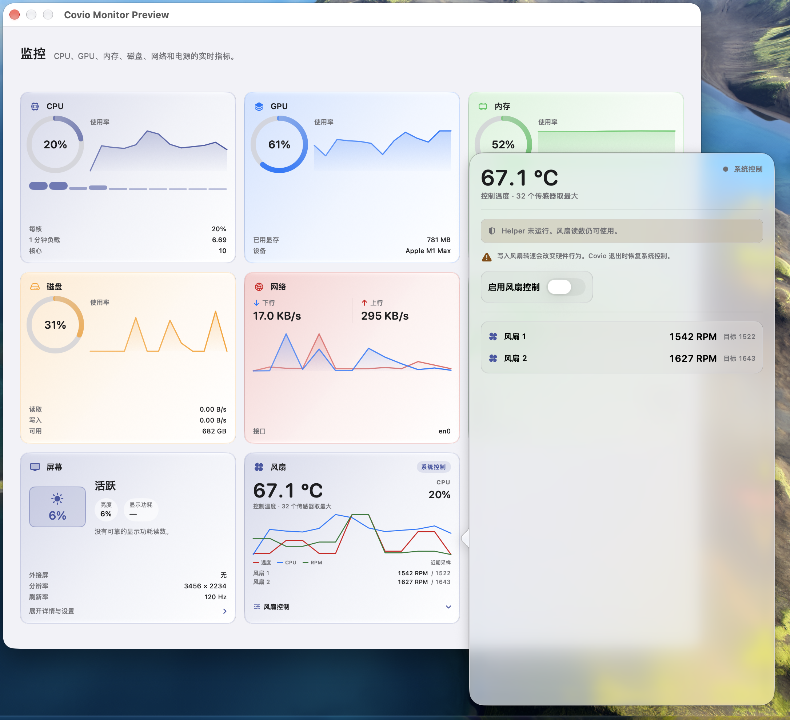 | 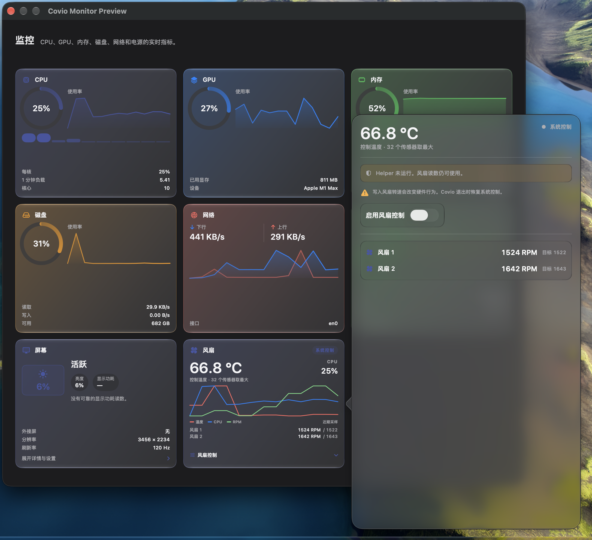 |
| 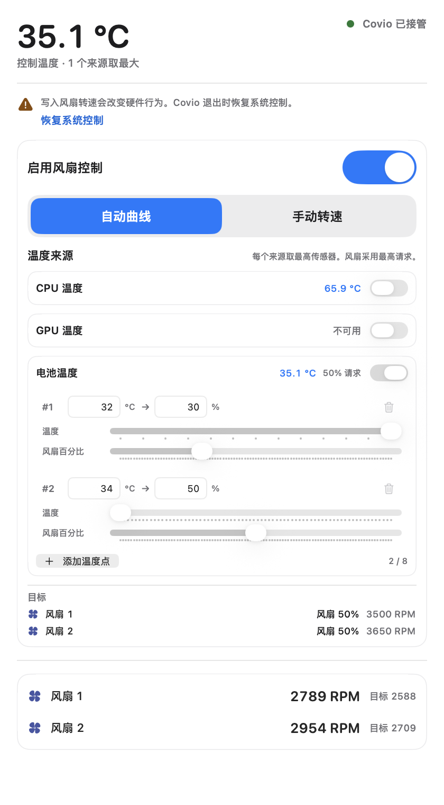 | 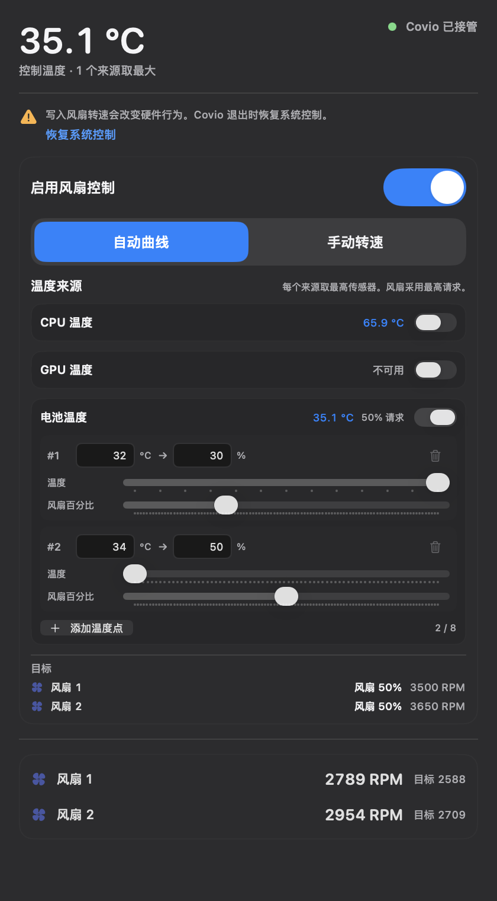 |
| 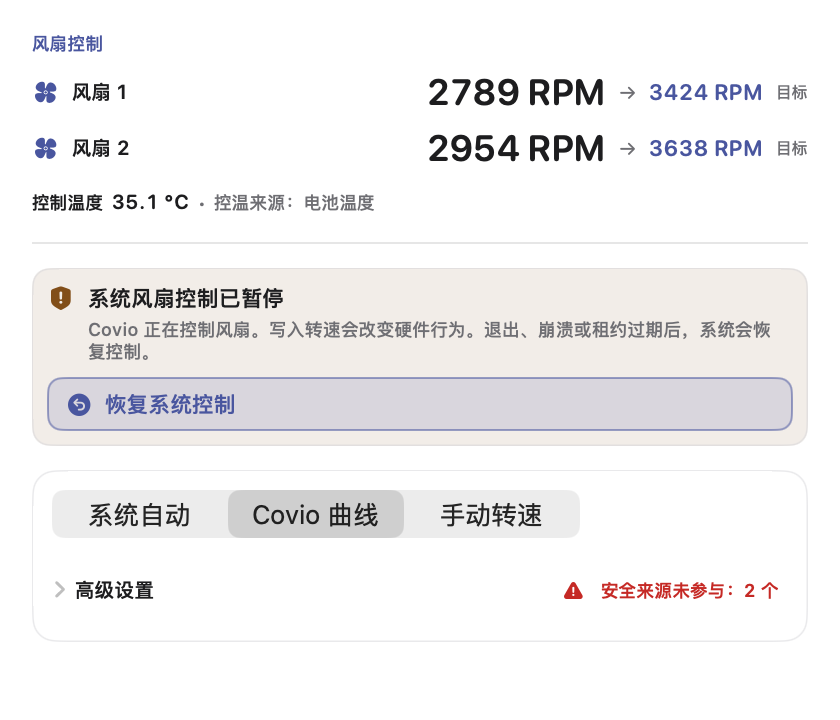 | 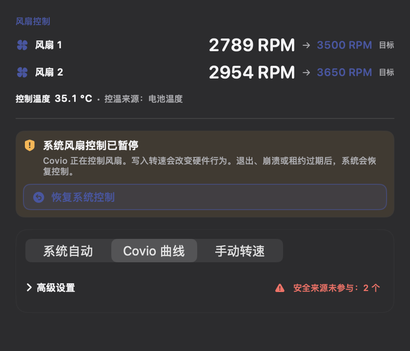 |
| 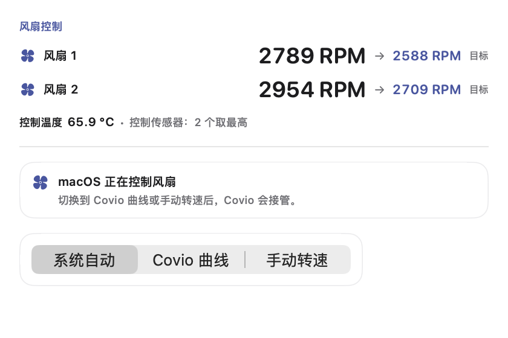 | 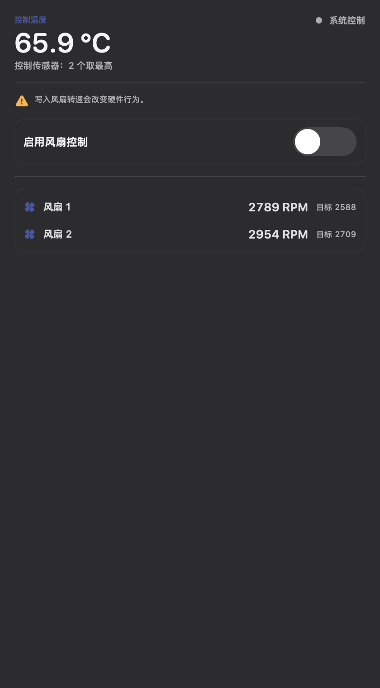 |
| 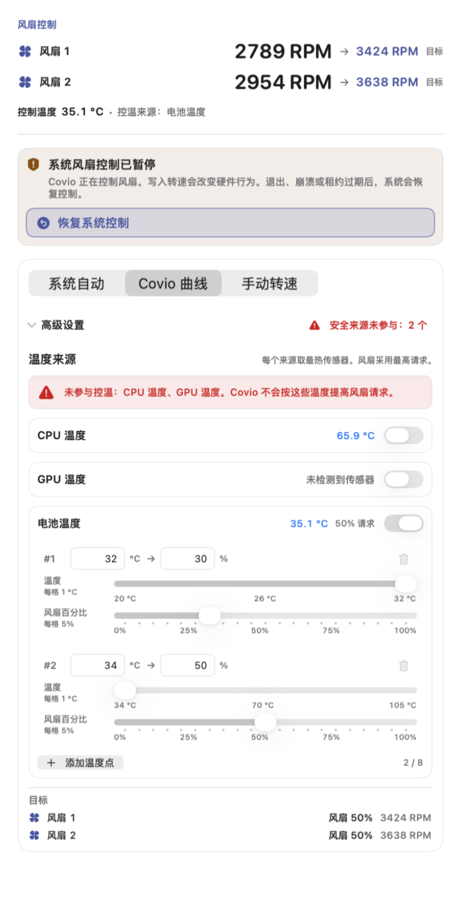 | 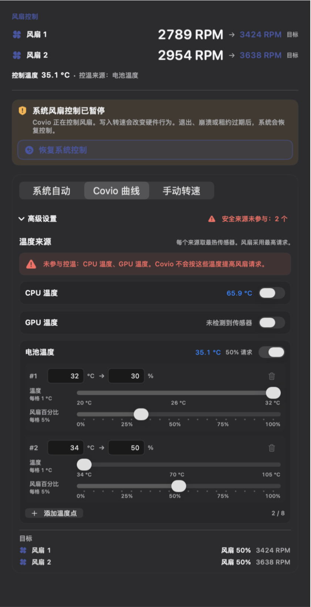 |
| 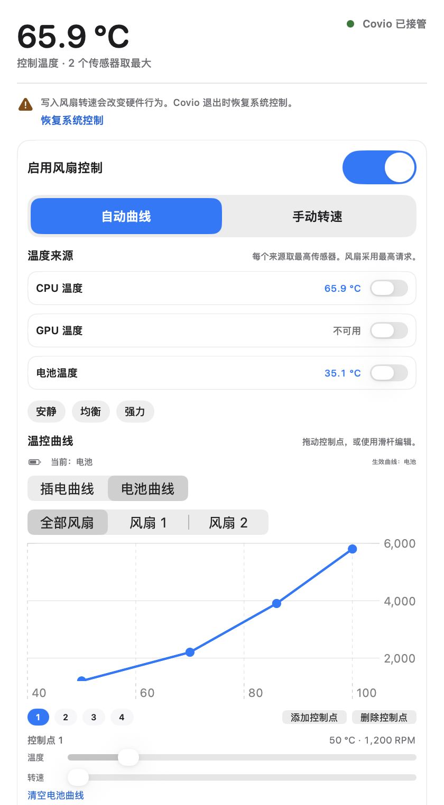 | 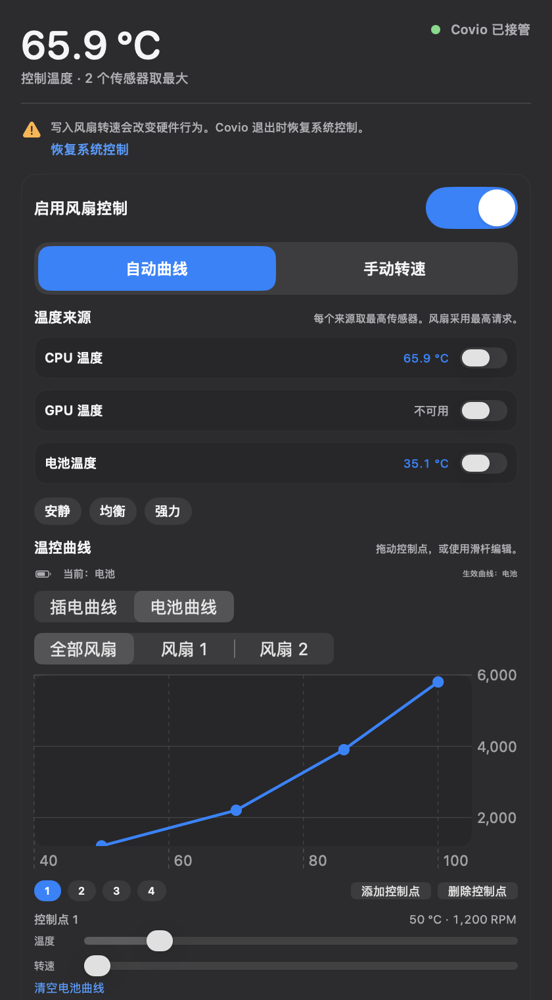 |
| 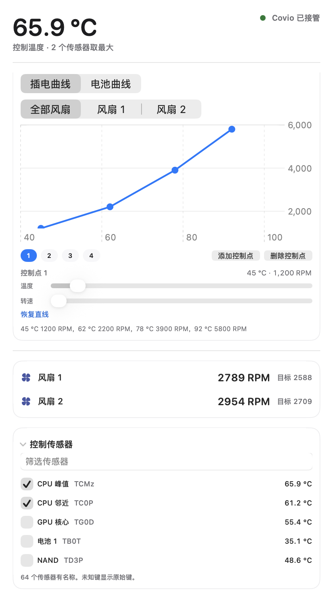 | 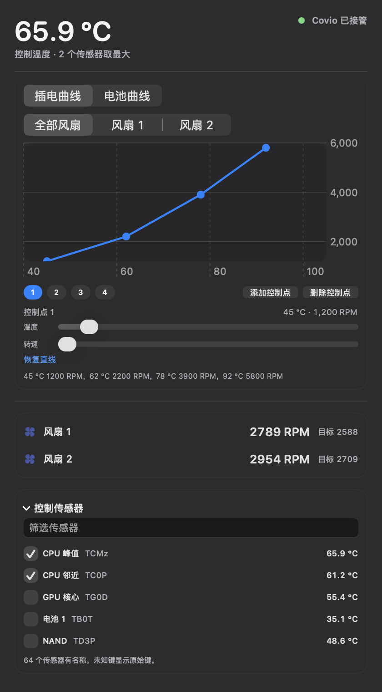 |

## 3. 三段式结构

| 段 | 折叠态 | 展开态 |
| --- | --- | --- |
| 主数值 | 控制温度、CPU 占用、控制状态 | 保留 |
| 趋势 | 温度、CPU 和风扇 RPM 的历史线 | 保留 |
| 详情入口 | 显示「风扇控制」和 chevron | 打开固定尺寸 popover |

popover 不改变卡片高度，也不移动网格。
popover 打开期间，工作台保持展开。最后一个 popover 关闭后，工作台恢复普通的指针移出收起规则。
风扇数量为 0 时，页面不显示风扇卡片。

## 4. 数据

| 数据 | 来源 | 刷新 |
| --- | --- | --- |
| 温度传感器 | AppleSMC 的 `T` 键 | 最多每 2 秒 |
| 风扇当前转速 | `F%dAc` | 最多每 2 秒 |
| 风扇目标转速 | `F%dTg` | 最多每 2 秒 |
| 风扇最小和最大转速 | `F%dMn`、`F%dMx` | 最多每 2 秒 |
| 控制温度 | 已启用温度来源的最热读数；没有来源时使用已选传感器最大值 | 跟随采样 |
| CPU 占用 | `host_processor_info` | 接入 Monitor 页采样周期 |

SMC 键只在读取器初始化时枚举一次。
后续采样使用缓存键表，不反复扫描全部 SMC 键。

## 5. popover

popover 固定宽度 420 点。
系统自动状态高度为 300 点。
Covio 曲线折叠状态高度为 470 点。
高级区展开高度为 820 点。
手动状态高度为 760 点。
popover 外壳使用系统原生 regular Liquid Glass。
警告区、控制区和传感器区使用标准 thin material。
Liquid Glass 不用于内容层。
减少透明度或增强对比时，内容区回退为不透明 surface。
头部固定，详情内容在头部下方滚动。

1. 每台风扇的当前转速和目标转速。
2. 控制温度和控温来源。
3. Covio 特权支持不可用时的能力级提示。
4. 接管安全提示和恢复系统控制。
5. 系统自动、Covio 曲线和手动转速三选一模式。
6. 默认折叠的高级设置。
7. 曲线控制点或手动转速。
8. 控制传感器。

系统自动模式只释放风扇控制，不运行温度曲线。
曲线模式才持有风扇并写入目标转速。
曲线模式使用 SwiftUI 和 Apple Swift Charts。

曲线模式保存插电曲线和电池曲线。
编辑器显示当前电源来源和生效曲线。
电池曲线缺少某台风扇时，该风扇沿用插电曲线。
用户可以把插电曲线复制到电池曲线。
电源状态变化后，Covio 自动应用对应曲线。
温度来源规则存在时，来源规则优先于插电和电池曲线。

| 项目 | 规范 |
| --- | --- |
| 图表组件 | `Chart`、`LineMark`、`PointMark`、`AxisMarks` |
| 拖动 | `chartOverlay` + `ChartProxy` |
| 风扇范围 | 全部风扇、每个风扇独立视图 |
| 控制点数量 | 2 到 8 |
| 温度范围 | 40 °C 到 105 °C，步长 1 °C |
| 转速范围 | 每个风扇的硬件范围，步长 50 RPM |
| 数值编辑 | 拖动控制点或使用原生 Slider |

全部风扇模式把同一条曲线写入每台风扇。
单风扇模式只修改当前风扇。
每个风扇的写入值仍夹在该风扇的 `Mn` 和 `Mx` 之间。

预设提供以下两点直线。应用预设时清除自定义曲线，恢复全局两点直线。

| 项目 | 起转温度 | 全速温度 |
| --- | --- | --- |
| 安静预设 | 80 °C | 100 °C |
| 均衡预设 | 70 °C | 95 °C |
| 强力预设 | 55 °C | 85 °C |

起转温度和全速温度继续作为旧配置的兼容回退。
旧配置没有 `curves` 时使用这两点生成直线。

手动模式为每个风扇提供独立自动或手动模式。
自动模式的风扇交还 macOS。
手动模式的风扇显示转速滑杆。
目标转速限制在该风扇的 `Mn` 和 `Mx` 之间。
滑杆变化等待 `300 ms` 后提交，连续变化只写最后一个值。

手动模式在多风扇设备上提供同步开关。
同步开关默认关闭。
开启后，一次滑杆修改按转速百分比映射到每台风扇自己的硬件范围。
开启后，自动和手动模式变化也同步到全部风扇。
同步规则来自 Stats 的 `Synchronize fan's control`。

手动模式提供全速快捷动作。
单风扇全速只把该风扇切到手动模式，并写入该风扇的 `F%dMx`。
同步开启时，单风扇全速也应用到全部风扇。
全部风扇全速逐台写入各自硬件上限。
恢复自动曲线切回 Covio 曲线模式。
恢复系统控制仍是单独动作，不把曲线模式当作系统自动。

| 亮色 | 深色 |
| --- | --- |
| 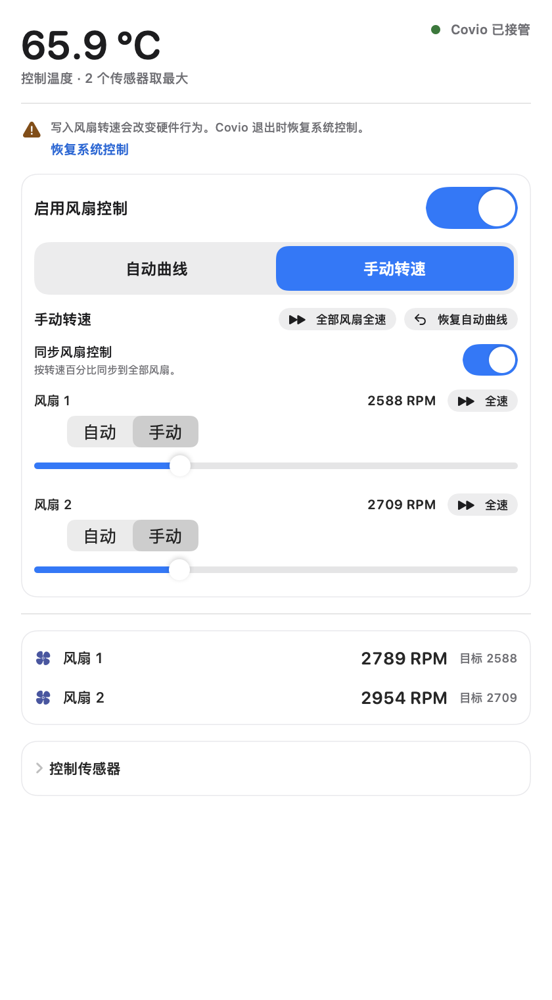 | 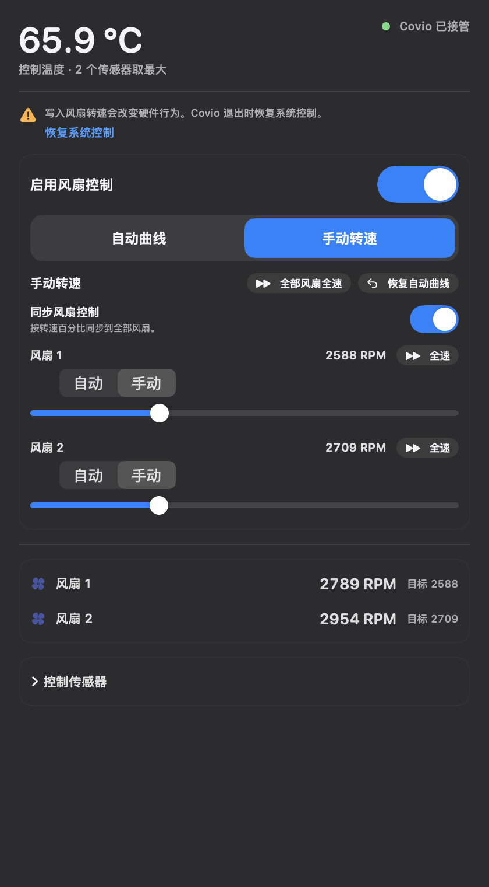 |

控制温度下降不超过 1.5 °C 时保留前一控制温度。
温度上升立即生效。此规则减少阈值附近的转速抖动。

控制传感器列表包含 64 个显式键名的中英文名称。
未知键继续使用前缀名称，无法推断时显示原始键名。
传感器区支持按名称或四个字符的键名筛选。

### 温度来源规则

曲线模式可以配置 `CPU`、`GPU` 和 `battery` 三个温度来源。
每个来源保存 2 到 8 个温度控制点。每个控制点包含摄氏度和风扇百分比。

编辑区为每个来源显示开关、当前温度和可用状态。
启用来显示该来源计算出的百分比请求。
每个启用来显示独立温度与百分比滑杆，也可直接输入数值。
不可用来源显示「不可用」，不显示 `0°C`。
来源没有有效控制点时，首次启用写入默认两点。

| 来源 | 默认控制点 |
| --- | --- |
| CPU | `60°C → 30%`、`80°C → 60%` |
| GPU | `40°C → 20%`、`60°C → 50%` |
| 电池 | `32°C → 30%`、`34°C → 50%` |

启用至少一个来源后，旧 RPM 曲线隐藏。
关闭全部来源后，旧 RPM 曲线恢复显示。
目标摘要显示每台风扇合并后的请求百分比和 RPM。
目标摘要不把结果归因于单一来源。

每个来源取该组有效 SMC 传感器的最大值。
相邻控制点至少相差 2 °C。
控制点在相邻点之间线性插值。

温度来源百分比范围为 `0%` 到 `100%`。
百分比滑杆以 `5%` 为一格。
百分比输入和存储值对齐到最近的 `5%`。
滑杆下方标注 `0%`、`25%`、`50%`、`75%`、`100%`。

原生快照使用 MacBook Pro `MacBookPro18,2` 的实测范围。

| 风扇 | 最小转速 | 最大转速 | 50% 目标 |
| --- | ---: | ---: | ---: |
| 风扇 1 | `1500 RPM` | `5348 RPM` | `3424 RPM` |
| 风扇 2 | `1500 RPM` | `5776 RPM` | `3638 RPM` |

SMC 最大转速读取失败时先重试。
重试失败后使用该风扇最近一次有效上限。
首次读取没有有效上限时，不生成该风扇的可写范围。

多个来源同时启用时，每台风扇取各来源请求百分比的最大值。
百分比按该风扇的 `Mn + (Mx - Mn) × 百分比` 换算为 RPM。

来源规则为空时，继续使用旧的控制传感器和多点 RPM 曲线。
来源规则存在时，规则优先于旧的多点 RPM 曲线。

### 控制层级与恢复

Popover 首屏逐台风扇显示当前 RPM 和目标 RPM。
控制温度和控温来源显示在风扇转速下方。
单一温度来源显示来源名称，多来源显示来源数量。
首屏不再显示重复的接管状态圆点。

控制区使用一个三选一模式选择器。
模式为「系统自动」、「Covio 曲线」和「手动转速」。
切换到系统自动会恢复系统控制。
不再使用「启用风扇控制」开关。
不再显示与首屏重复的底部风扇汇总。

接管状态下，详情区显示「系统风扇控制已暂停」。
提示说明 Covio 退出、崩溃或租约过期后恢复系统控制。
「恢复系统控制」显示为高对比完整按钮。
按钮位于接管提示内，并支持键盘聚焦。

未接管状态下，详情区显示「macOS 正在控制风扇」。
未接管状态不显示硬件行为警告。
未接管状态不显示「恢复系统控制」按钮。
切换到 Covio 曲线或手动转速后，Covio 开始接管。

温度来源规则启用后，高级区默认折叠。
高级区标题显示当前 Covio 曲线或手动转速。
展开高级区后，用户可以编辑温度来源、控制点和同步设置。

CPU 或 GPU 没有参与温度来源规则时，高级区显示警告。
警告列出未参与控温的来源。
警告说明 Covio 不会按这些温度提高风扇请求。

## 6. Helper 与安全

风扇写入走 Covio 唯一的全局 root helper。
Covio 不安装 MacFanControl 的第二个守护进程。
UI 不提供 helper 的独立安装、版本或修复入口。

```text
Covio UI
  -> helper socket
  -> FanControlRuntime
  -> AppleSMC
  -> fan hardware

Covio UI --每 5 秒续租--> FanControlRuntime
FanControlRuntime --20 秒无续租--> 恢复系统控制
```

曲线和手动模式每秒执行一次控制循环。
系统自动模式不启动控制循环。
连续 3 次写入失败时，helper 停止控制并恢复系统风扇模式。

以下操作会恢复系统控制。

- 用户点击「恢复系统控制」。
- 用户关闭风扇控制。
- Covio 正常退出。
- Covio 崩溃或 helper 租约过期。
- helper 收到终止信号。
- 用户卸载 helper。

Apple Silicon 使用 `F%dMd` 和 `F%dTg`。
Intel 使用 `F%dTg`，并用 `FS! ` 位掩码切换模式。
写入前记录原模式或原最小转速，恢复时写回。

## 7. 故障状态

| 状态 | 卡片表现 | 可用动作 |
| --- | --- | --- |
| 没有风扇 | 不显示卡片 | 无 |
| SMC 读取失败 | 不显示卡片 | 无 |
| Covio 系统支持不可用 | 显示读数；详情区显示能力级提示 | 重新安装 Covio |
| 系统支持版本不匹配 | 显示读数；详情区显示能力级提示 | 升级 Covio |
| 系统支持未运行 | 显示读数；详情区显示能力级提示 | 重新打开 Covio |
| 写入失败 | 恢复系统控制并显示错误 | 重试 |

读数失败不得显示 0。
未知值显示 `—`。

## 8. 无障碍

- 卡片详情入口使用按钮语义。
- 状态同时显示颜色、圆点和文字。
- 所有开关有可见标签和读屏标签。
- 可点击控件命中区不小于 24 点。
- popover 的焦点顺序与视觉顺序一致。
- 曲线图表提供可读的完整控制点摘要。
- 控制点拖动同时提供温度与转速滑杆，键盘用户不依赖拖动。
- 趋势线不承载唯一信息；数值在折叠态和详情区同时可读。

## 9. 范围外

- 不实现高温通知。
- 不接管 MacFanControl 的开机自启和诊断包。
- 不引入 MacFanControl 的应用图标或文案品牌。

## 10. 依据

- 需求来源：[#313](https://github.com/wyz541/kmp-Covio/issues/313)
- SMC 设备的底层读写：MacFanControl `d26184f`，MIT 许可
- 风扇模式、目标转速、恢复和睡眠逻辑：Stats `7d3f70d`，MIT 许可
- 自动模式与同步控制：Stats `7d3f70d`，MIT 许可
- 现有监控页：`macosApp/src/Hub/Monitor/MonitorTabView.swift`
- 现有快照：`macosApp/src/Hub/Monitor/MonitorSnapshot.swift`
- 功耗卡片三段式规范：[monitor-power-card.md](monitor-power-card.md)
