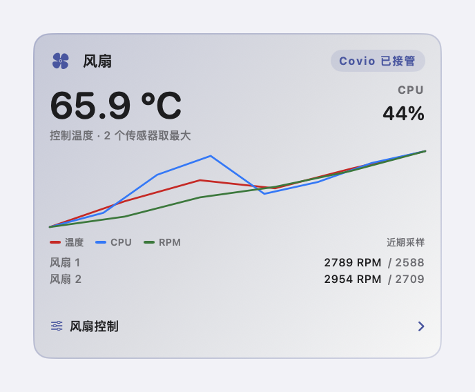
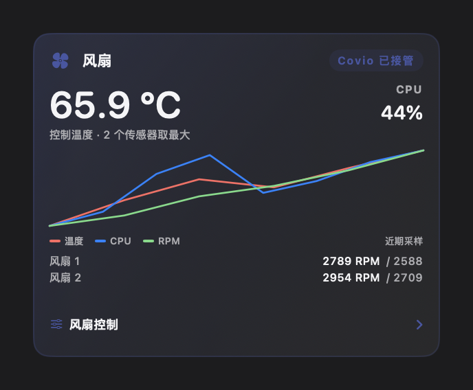
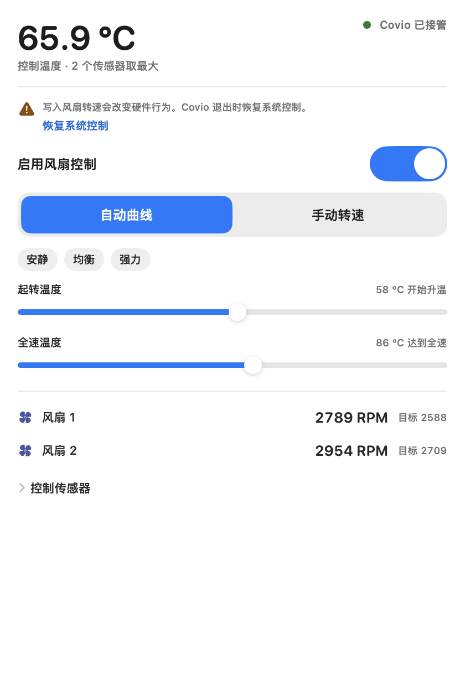
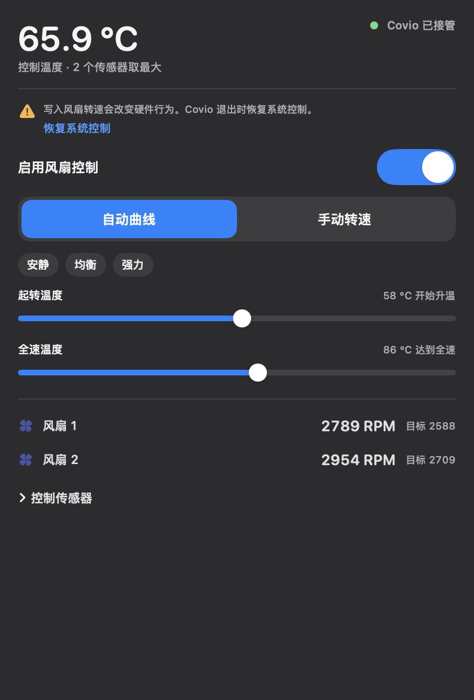
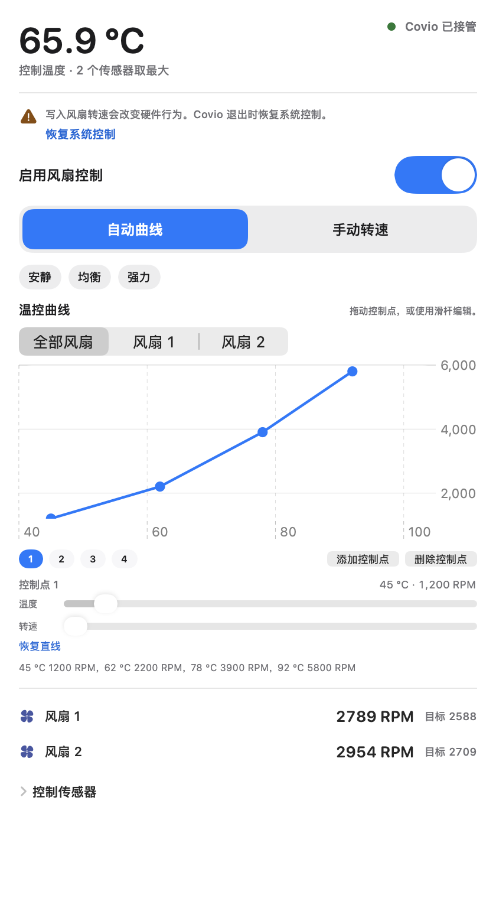
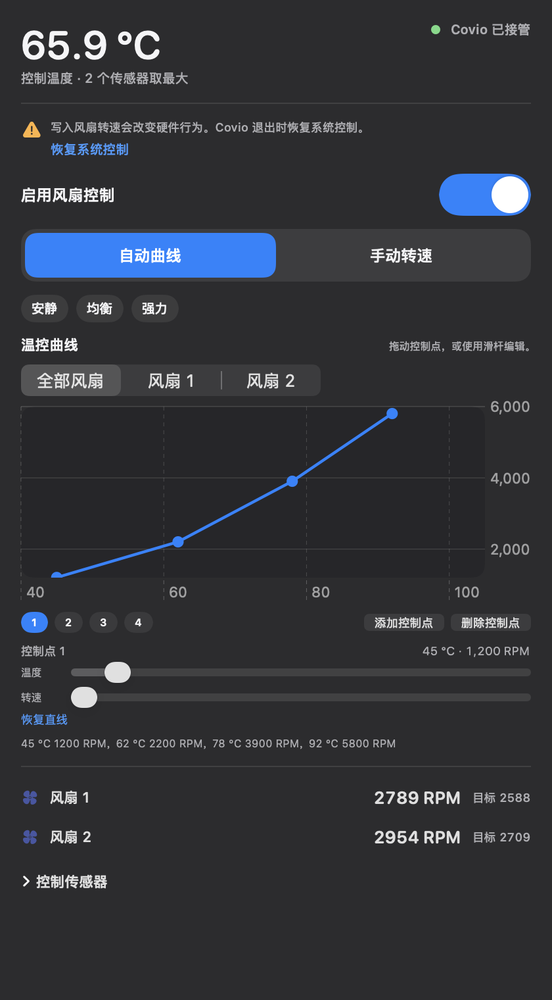
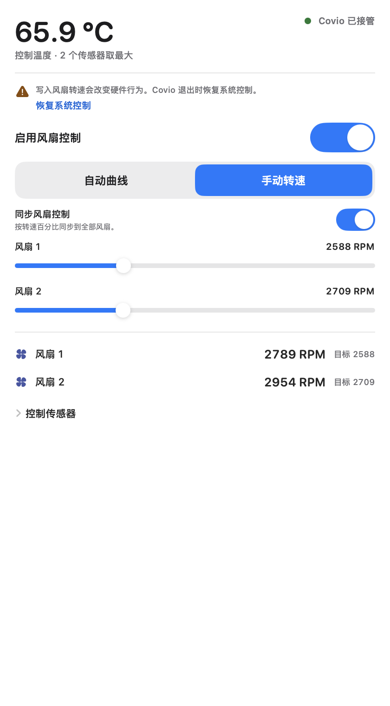
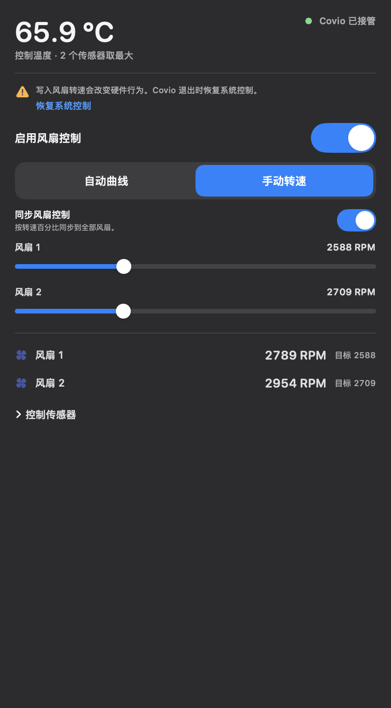
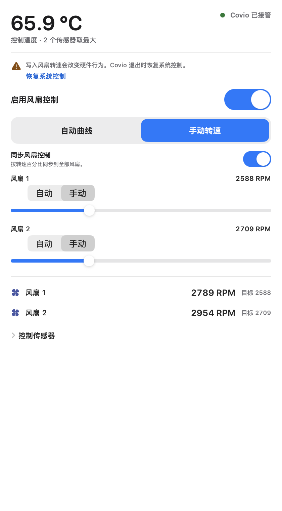
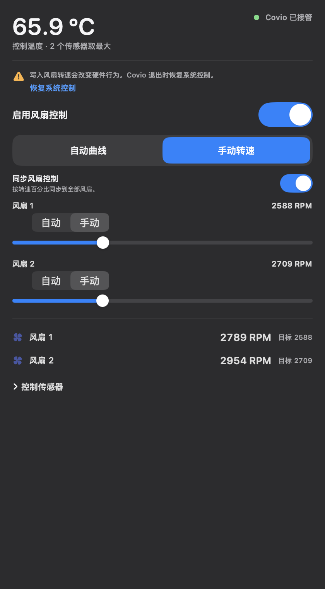

# Monitor 风扇卡片

本文定义 Monitor 页风扇卡片的结构、控制行为和故障边界。
多点曲线参考 [MacFanControl](https://github.com/skydeadpeng/MacFanControl)。
自动、手动和同步控制参考 [Stats](https://github.com/exelban/stats)。

## 1. 目标

风扇卡片有四个目标。

1. 用户不用打开其他应用就能看到控制温度和风扇转速。
2. 用户能使用系统自动、曲线和手动转速。
3. 用户能选择参与控制温度的 SMC 传感器。
4. Covio 退出、崩溃或丢失 helper 租约后，系统风扇控制自动恢复。

## 2. 预览

| 亮色 | 深色 |
| --- | --- |
|  |  |
|  |  |
|  |  |
|  |  |
|  |  |

## 3. 三段式结构

| 段 | 折叠态 | 展开态 |
| --- | --- | --- |
| 主数值 | 控制温度、CPU 占用、控制状态 | 保留 |
| 趋势 | 温度、CPU 和风扇 RPM 的历史线 | 保留 |
| 详情入口 | 显示「风扇控制」和 chevron | 打开固定尺寸 popover |

popover 不改变卡片高度，也不移动网格。
popover 打开期间，工作台保持展开。最后一个 popover 关闭后，工作台恢复普通的指针移出收起规则。
风扇数量为 0 时，页面不显示风扇卡片。

## 4. 数据

| 数据 | 来源 | 刷新 |
| --- | --- | --- |
| 温度传感器 | AppleSMC 的 `T` 键 | 最多每 2 秒 |
| 风扇当前转速 | `F%dAc` | 最多每 2 秒 |
| 风扇目标转速 | `F%dTg` | 最多每 2 秒 |
| 风扇最小和最大转速 | `F%dMn`、`F%dMx` | 最多每 2 秒 |
| 控制温度 | 已选传感器读数的最大值 | 跟随采样 |
| CPU 占用 | `host_processor_info` | 接入 Monitor 页采样周期 |

SMC 键只在读取器初始化时枚举一次。
后续采样使用缓存键表，不反复扫描全部 SMC 键。

## 5. popover

popover 固定宽度 420 点、固定高度 760 点。
头部固定，详情内容在头部下方滚动。

1. 控制温度和接管状态。
2. Helper 状态和修复入口。
3. 安全说明和恢复系统控制。
4. 启用风扇控制开关。
5. 曲线或手动转速。
6. 风扇实际转速和目标转速。
7. 控制传感器。

系统自动模式只释放风扇控制，不运行温度曲线。
曲线模式才持有风扇并写入目标转速。
曲线模式使用 SwiftUI 和 Apple Swift Charts。

| 项目 | 规范 |
| --- | --- |
| 图表组件 | `Chart`、`LineMark`、`PointMark`、`AxisMarks` |
| 拖动 | `chartOverlay` + `ChartProxy` |
| 风扇范围 | 全部风扇、每个风扇独立视图 |
| 控制点数量 | 2 到 8 |
| 温度范围 | 40 °C 到 105 °C，步长 1 °C |
| 转速范围 | 每个风扇的硬件范围，步长 50 RPM |
| 数值编辑 | 拖动控制点或使用原生 Slider |

全部风扇模式把同一条曲线写入每台风扇。
单风扇模式只修改当前风扇。
每个风扇的写入值仍夹在该风扇的 `Mn` 和 `Mx` 之间。

预设提供以下两点直线。应用预设时清除自定义曲线，恢复全局两点直线。

| 项目 | 起转温度 | 全速温度 |
| --- | --- | --- |
| 安静预设 | 80 °C | 100 °C |
| 均衡预设 | 70 °C | 95 °C |
| 强力预设 | 55 °C | 85 °C |

起转温度和全速温度继续作为旧配置的兼容回退。
旧配置没有 `curves` 时使用这两点生成直线。

手动模式为每个风扇提供独立自动或手动模式。
自动模式的风扇交还 macOS。
手动模式的风扇显示转速滑杆。
目标转速限制在该风扇的 `Mn` 和 `Mx` 之间。
滑杆变化等待 `300 ms` 后提交，连续变化只写最后一个值。

手动模式在多风扇设备上提供同步开关。
同步开关默认关闭。
开启后，一次滑杆修改按转速百分比映射到每台风扇自己的硬件范围。
开启后，自动和手动模式变化也同步到全部风扇。
同步规则来自 Stats 的 `Synchronize fan's control`。

控制温度下降不超过 1.5 °C 时保留前一控制温度。
温度上升立即生效。此规则减少阈值附近的转速抖动。

## 6. Helper 与安全

风扇写入走 Covio 现有 root helper。
Covio 不安装 MacFanControl 的第二个守护进程。

```text
Covio UI
  -> helper socket
  -> FanControlRuntime
  -> AppleSMC
  -> fan hardware

Covio UI --每 5 秒续租--> FanControlRuntime
FanControlRuntime --20 秒无续租--> 恢复系统控制
```

曲线和手动模式每秒执行一次控制循环。
系统自动模式不启动控制循环。
连续 3 次写入失败时，helper 停止控制并恢复系统风扇模式。

以下操作会恢复系统控制。

- 用户点击「恢复系统控制」。
- 用户关闭风扇控制。
- Covio 正常退出。
- Covio 崩溃或 helper 租约过期。
- helper 收到终止信号。
- 用户卸载 helper。

Apple Silicon 使用 `F%dMd` 和 `F%dTg`。
Intel 使用 `F%dMn`。
写入前记录原模式或原最小转速，恢复时写回。

## 7. 故障状态

| 状态 | 卡片表现 | 可用动作 |
| --- | --- | --- |
| 没有风扇 | 不显示卡片 | 无 |
| SMC 读取失败 | 不显示卡片 | 无 |
| Helper 未安装 | 显示读数；详情区提示安装 | 安装或修复 Helper |
| Helper 版本过旧 | 显示读数；详情区提示修复 | 安装或修复 Helper |
| Helper 未运行 | 显示读数；详情区显示不可用 | 重新打开详情重试 |
| 写入失败 | 恢复系统控制并显示错误 | 重试或修复 Helper |

读数失败不得显示 0。
未知值显示 `—`。

## 8. 无障碍

- 卡片详情入口使用按钮语义。
- 状态同时显示颜色、圆点和文字。
- 所有开关有可见标签和读屏标签。
- 可点击控件命中区不小于 24 点。
- popover 的焦点顺序与视觉顺序一致。
- 曲线图表提供可读的完整控制点摘要。
- 控制点拖动同时提供温度与转速滑杆，键盘用户不依赖拖动。
- 趋势线不承载唯一信息；数值在折叠态和详情区同时可读。

## 9. 范围外

- 不实现高温通知。
- 不接管 MacFanControl 的开机自启和诊断包。
- 不引入 MacFanControl 的应用图标或文案品牌。

## 10. 依据

- 需求来源：[#313](https://github.com/wyz541/kmp-Covio/issues/313)
- SMC 与风扇实现：MacFanControl `d26184f`，MIT 许可
- 自动模式与同步控制：Stats `7d3f70d`，MIT 许可
- 现有监控页：`macosApp/src/Hub/Monitor/MonitorTabView.swift`
- 现有快照：`macosApp/src/Hub/Monitor/MonitorSnapshot.swift`
- 功耗卡片三段式规范：[monitor-power-card.md](monitor-power-card.md)
