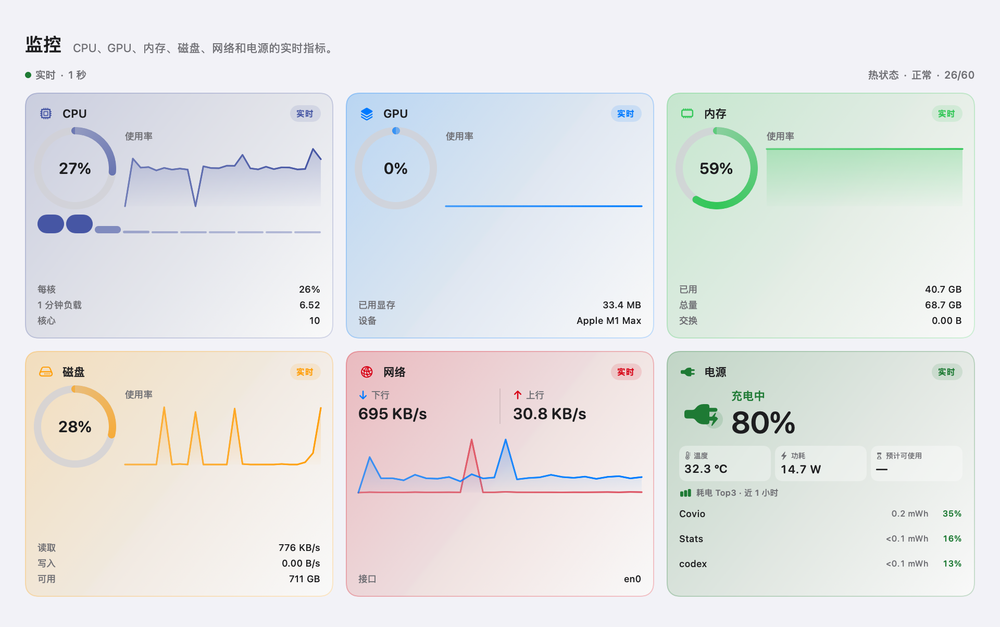
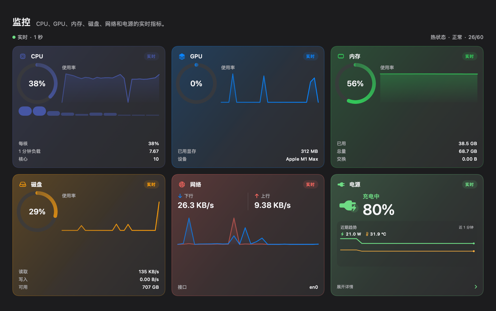
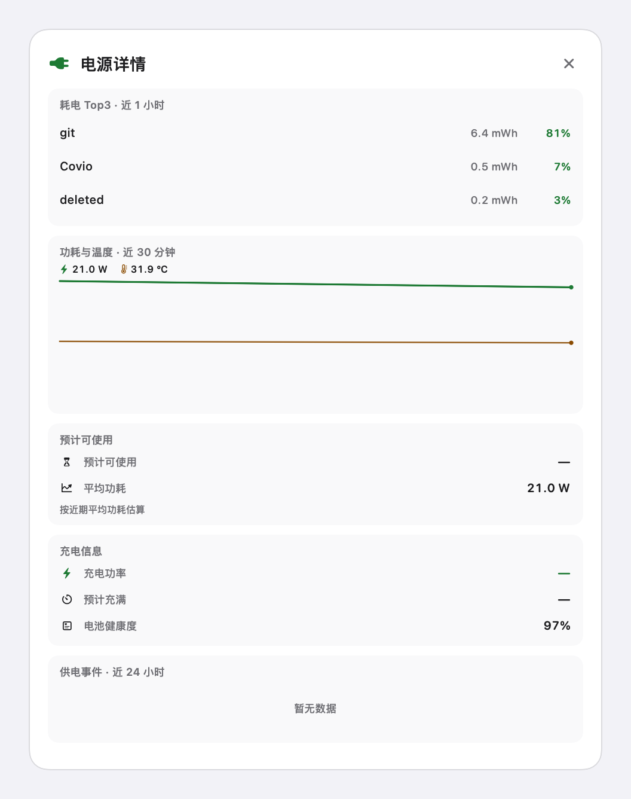
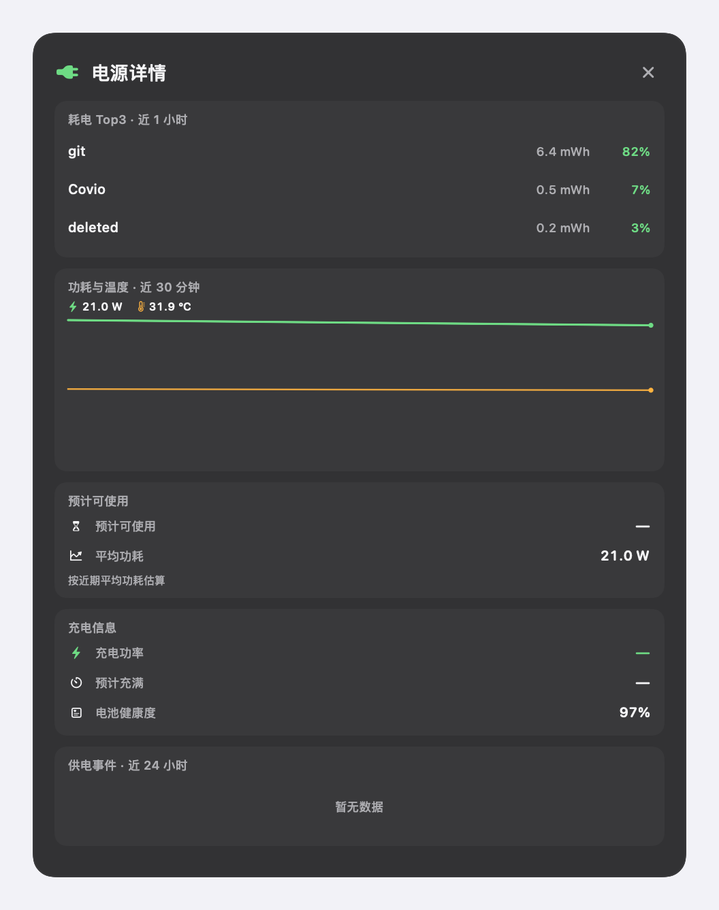
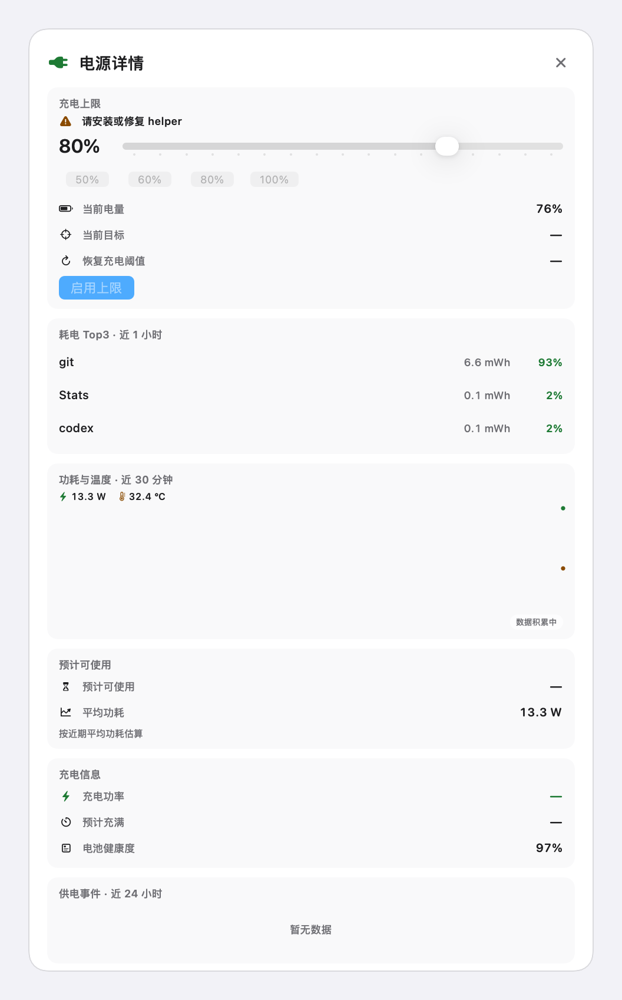
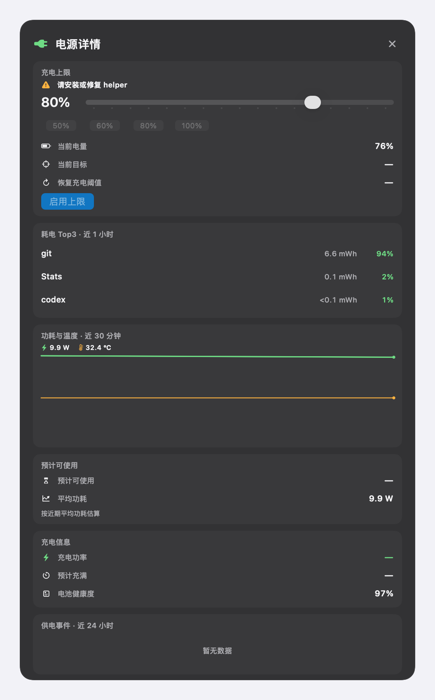

# Monitor 电源卡片

本文记录 Monitor 页电源卡片的三段式结构。
任务来源是 #135。

## 1. 三段式结构

| 段 | 职责 | 折叠态 | 展开态 |
| --- | --- | --- | --- |
| 主数值锚点 | 识别供电状态与电量 | 显示 | 保留在卡片 |
| Sparkline 趋势线 | 显示最近 60 秒功耗与温度 | 显示 | 保留在卡片 |
| 可展开详情区 | 按需查看细粒度数据 | 隐藏 | 显示在浮层 |

卡片默认收起。
点击卡片打开或关闭详情浮层。
浮层不改变卡片网格尺寸。

## 2. 供电状态

| 状态 | 判定 | 图标 | 文案 | 颜色 |
| --- | --- | --- | --- | --- |
| 电池供电 | 未接通适配器 | 电池图标；按电量换填充档位 | 电池供电 | 常规色；低于 20% 时用错误色 |
| 充电中 | 接通适配器；电量未满 | 插头与闪电 | 充电中 | 成功色 |
| 已接通电源 | 接通适配器；电量已满或未报告充电 | 静态插头 | 已接通电源 | 成功色 |

图标形态不同。颜色不是唯一提示。
开启“减少动态效果”后，充电闪电不再脉动。

## 3. 数据

| 数据 | 来源 | 换算 | 刷新 |
| --- | --- | --- | --- |
| 电量 | IOPS 的 `Current Capacity` 与 `Max Capacity` | 总剩余容量除以总最大容量 | 1 秒 |
| 温度 | `AppleSmartBattery` 或电池包的 `BatteryData.Temperature` | 原始值除以 100；多电池取最高值 | 1 秒 |
| 功耗 | 适配器用 `PowerTelemetryData.SystemLoad`，缺失时用 `SystemPowerIn`；电池用 `BatteryPower`，缺失时用 `Amperage × Voltage` | 从 `mW` 换算到 `W` | 1 秒 |
| 预计可使用时间 | 电池剩余容量除以近 10 个功耗样本的平均值 | `Wh` 除以 `W` | 10 秒以内 |
| 耗电 Top3 | `proc_pid_rusage` 的 `ri_energy_nj` | 按分钟桶保留 60 分钟；`3.6e9 nJ = 1 mWh` | 10 秒 |
| 充电功率 | `ChargerData.ChargingCurrent × ChargingVoltage` | 从 `mW` 换算到 `W` | 1 秒 |
| 预计充满 | IOPS 的 `Time to Full Charge` | 分钟换算为时长 | 10 秒以内 |
| 电池健康度 | `FullChargeCapacity / DesignCapacity` | 百分比 | 10 秒以内 |

应用分组先看可执行文件所在的 `.app` 包。
同一应用包内的 helper 进程合并到同一个应用。
无法归入应用包的进程保留为独立条目。

## 4. 折叠态

折叠态显示以下内容：

1. 供电状态。
2. 电量。
3. 当前功耗与温度。
4. 最近 60 秒的功耗和温度 Sparkline。
5. 展开入口和 chevron。

Sparkline 使用最近 60 个一秒样本。
温度缺失时只画功耗线。
样本少于 2 个时显示“数据积累中”。

## 5. 展开详情

详情浮层按以下顺序显示。

| 优先级 | 内容 | 口径 |
| --- | --- | --- |
| P0 | 耗电 Top3 明细 | 近 1 小时；应用名、`mWh`、占比；可点击打开应用 |
| P1 | 功耗与温度历史 | 近 30 分钟；一秒采样；一分钟聚合 |
| P2 | 预计可使用时间明细 | 当前估算值与近期平均功耗 |
| P3 | 充电信息 | 充电功率、预计充满、电池健康度 |
| P4 | 供电事件 | 近 24 小时接通、断开与充满事件 |

空间不足时，从 P4 向 P0 顺序隐藏。
P0 始终显示。
每个统计区块显示时间窗。

详情浮层使用固定尺寸。
新数据只更新浮层内容。
新数据不改变浮层尺寸。
新数据不移动卡片网格。

## 5.1 充电上限控制

详情区第一块是充电上限控制。
该区块在有电池时始终显示。

| 项目 | 规范 |
| --- | --- |
| 范围 | `40%` 到 `100%` |
| 步长 | `5%` |
| 快捷值 | `50%`、`60%`、`70%`、`80%`、`90%`、`100%` |
| 当前目标 | 显示 helper 实际执行的目标 |
| 恢复阈值 | 显示 `上限 - 5%`，最低为 `15%` |
| 启用 | 设置 helper 并保存本机配置 |
| 恢复默认 | 调用 helper 恢复原系统策略 |

状态文案必须同时使用图标和文字。
helper 缺失时显示“请安装或修复 helper”。
设备不支持 MCL 时显示“当前设备不支持充电上限”。
“已暂停充电”不得显示成“旁路供电”。

真机验证确认：macOS `27.0.1` build `26A434` 可以通过 root `defaults` 与 `notifyutil` 注册 `70%`。
`80%` 到 `100%` 使用原生 `PowerUI`。
`40%` 到 `79%` 使用直接偏好路径。

### 5.1.1 状态映射

| helper 阶段 | UI 文案 |
| --- | --- |
| `applying` | 正在应用充电上限 |
| `charging` | 充电中 |
| `holding` | 已暂停充电 |
| `sailing` | 保持当前电量 |
| `aboveLimit` | 高于上限 |
| `full` | 已充满 |
| `bypassEngaged=true` | 旁路供电 |
| `calibration` | 校准中 |
| `systemProtection` | 系统保护中 |
| `conflict` | 系统策略冲突 |
| `unplugged` | 请接通电源适配器 |
| `unsupported` | 当前设备不支持充电上限 |
| `error` | 充电上限错误 |

详情浮层打开时，每 `5` 秒刷新一次 helper 状态。
刷新不改变浮层尺寸。

## 6. 交互与状态保持

- 点击卡片打开或关闭详情。
- 聚焦卡片后，按 Enter 打开或关闭详情。
- 聚焦卡片后，按 Space 使用系统按钮行为。
- 展开状态写入本机 `UserDefaults`。
- 页面重新出现时，按上次展开状态恢复浮层。
- 展开与收起时，chevron 旋转 220 毫秒。
- 其他卡片位置不变。

## 7. 异常

| 情况 | 行为 |
| --- | --- |
| 电量读取失败 | 电量显示 `—`；卡片显示“部分读数不可用” |
| 温度读取失败 | 温度显示 `—` |
| 功耗读取失败 | 功耗显示 `—` |
| Top3 无数据 | 保留区块标题；正文显示“暂无数据” |
| 历史数据不足 | 显示已有曲线；提示“数据积累中” |
| 无电池设备 | 隐藏电量、温度、预计时间、充电上限与充电信息；保留功耗、历史和 Top3 |
| helper 缺失 | 充电上限控件禁用；显示安装或修复入口 |
| MCL 不支持 | 充电上限控件禁用；显示不支持原因 |
| 充电上限写入失败 | 保留标题；显示错误和恢复入口 |
| 电量低于 20% | 电量用错误色；显示“电量低”和警告图标 |
| 电量低于 5% | 电量用错误色；显示“电量极低”和警告图标 |
| 电池温度达到 45.0 ℃ | 温度用错误色；显示“电池温度高”和温度图标 |

单个读数失败不阻塞其他读数。

## 8. 隐私与开销

采样只在 Monitor 页可见时运行。
电源数据每秒读取。
进程扫描每 10 秒一次。
供电事件只保存在本机。
卡片不读取序列号，不申请权限，不上传数据。

## 9. 验收截图

浅色折叠态：

深色折叠态：

浅色详情态：

深色详情态：

截图使用真机电源数据。
详情中的进程名、能耗与占比来自截取时点的 60 分钟窗口。

充电上限详情：

深色充电上限详情：

