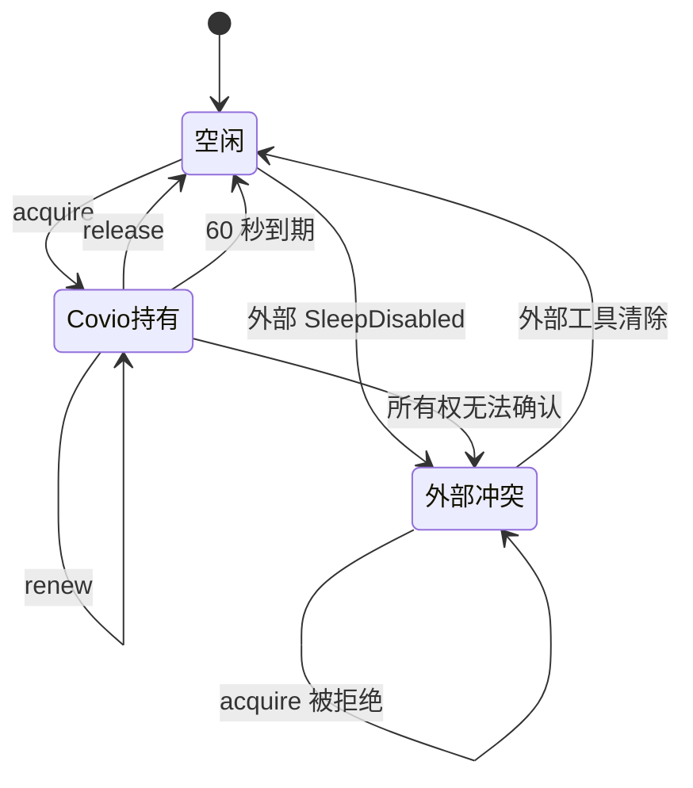

# Power helper 租约协议

## 文档状态

| 项目 | 内容 |
| --- | --- |
| 文档版本 | `1.0` |
| 状态 | 待评审 |
| 日期 | `2026-10-20` |
| Issue | #153 |
| Feature | #148 |
| 上游决策 | ADR-0006、ADR-0007 |

## 目标

helper 只在有效租约存在时保持 `SleepDisabled`。
应用每 15 秒续租。
租约 60 秒后过期。
helper 只清理 Covio 拥有的状态。
helper 不覆盖外部工具设置的 `SleepDisabled`。

## 生命周期

## 协议版本

| 项目 | 值 |
| --- | --- |
| 协议版本 | `2` |
| 租约有效期 | `60` 秒 |
| 续租间隔 | `15` 秒 |
| 所有权文件 | `sleep_owner` |
| 所有权值 | `covio-sleep-disabled-v2` |

旧版只允许用协议 `1` 调用 `version`。
旧版不能调用任何写命令。
新版 `version` 应答同时返回应用版本和协议版本。

## 命令

| 命令 | 必需字段 | helper 行为 |
| --- | --- | --- |
| `lidLeaseAcquire` | `leaseId`、`externalDisplayCount` | 检查外部屏和所有权，然后申请租约 |
| `lidLeaseRenew` | `leaseId`、`externalDisplayCount` | 延长租约，必要时重新建立状态 |
| `lidLeaseRelease` | `leaseId` | 结束一个租约 |
| `lidLeaseStatus` | 无 | 回读系统状态、所有权和最近到期时间 |

`leaseId` 最长 128 个字符。
同时有效的租约最多 16 个。
`externalDisplayCount` 必须是非负整数。

## 所有权

1. helper 先写所有权 marker。
2. helper 再运行 `pmset -a disablesleep 1`。
3. helper 回读 `SleepDisabled`。
4. 回读失败时，helper 清除新状态。
5. 最后一个租约结束或过期时，helper 只清除带 marker 的状态。
6. helper 启动时只清理带 marker 的陈旧状态。

## 故障恢复

| 故障 | 结果 |
| --- | --- |
| 应用崩溃 | 15 秒续租停止，60 秒内释放 |
| helper 崩溃 | LaunchDaemon 重启，启动恢复清理 marker |
| 外部工具已设置 `SleepDisabled` | helper 拒绝租约，不修改状态 |
| 外接屏在线 | helper 拒绝合盖租约 |
| 状态无法回读 | helper 拒绝成功应答，客户端显示真实错误 |
| 外部屏状态未知 | helper 拒绝合盖租约 |

## 客户端行为

1. `MacPrivilegedOps` 为每个应用进程生成一个 `leaseId`。
2. 开始合盖保持时调用 `lidLeaseAcquire`。
3. 续租定时器每 15 秒调用 `lidLeaseRenew`。
4. 结束合盖保持时调用 `lidLeaseRelease`。
5. Engine 每 5 秒读取 `lidLeaseStatus`。
6. `AppState.lidSleepAvailable` 使用真实 `SleepDisabled`。
7. helper 协议不兼容时，客户端用只读 `pmset -g` 显示真实 `SleepDisabled`。

## 验证

1. helper 租约申请、续租和释放有单元测试。
2. helper 到期释放有假时钟测试。
3. 外部 `SleepDisabled` 冲突有单元测试。
4. 外接屏拒绝有单元测试。
5. helper 启动恢复有单元测试。
6. 协议 v1 只读兼容有向量测试。
7. `bash scripts/test-all.sh` 通过。
