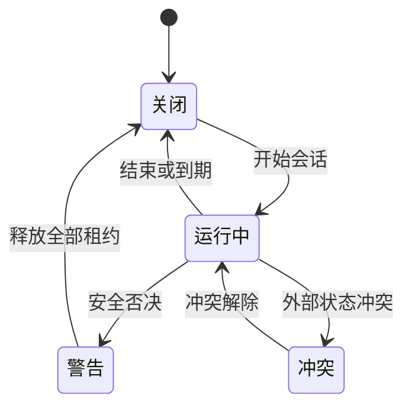
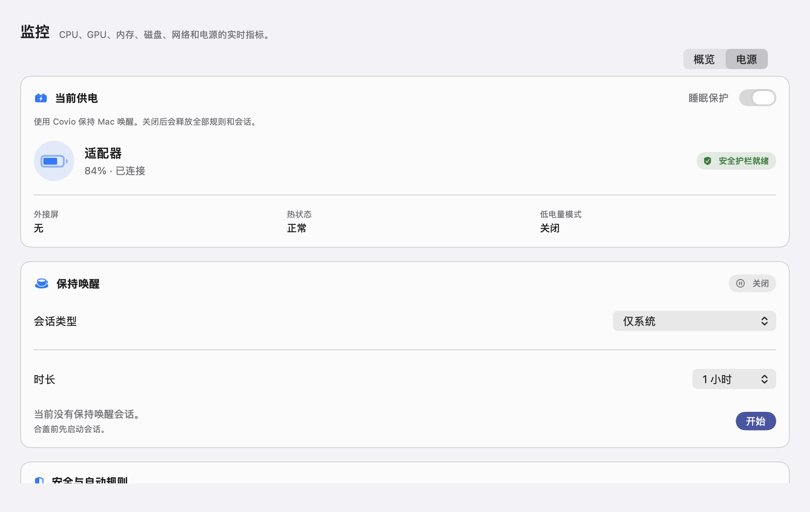
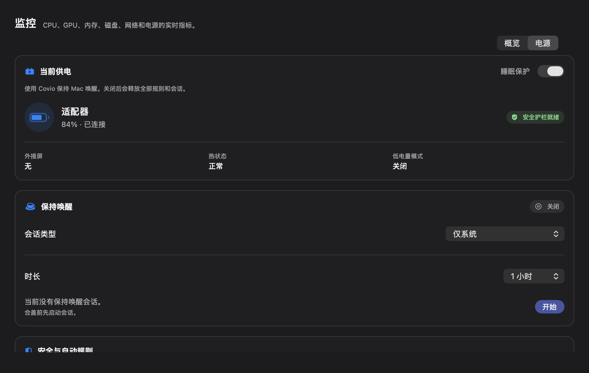
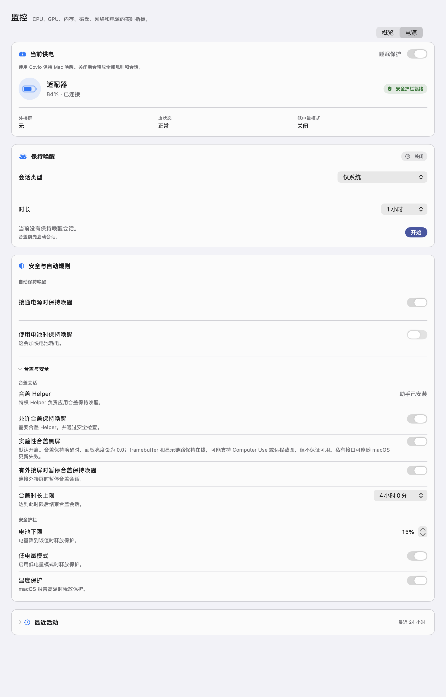
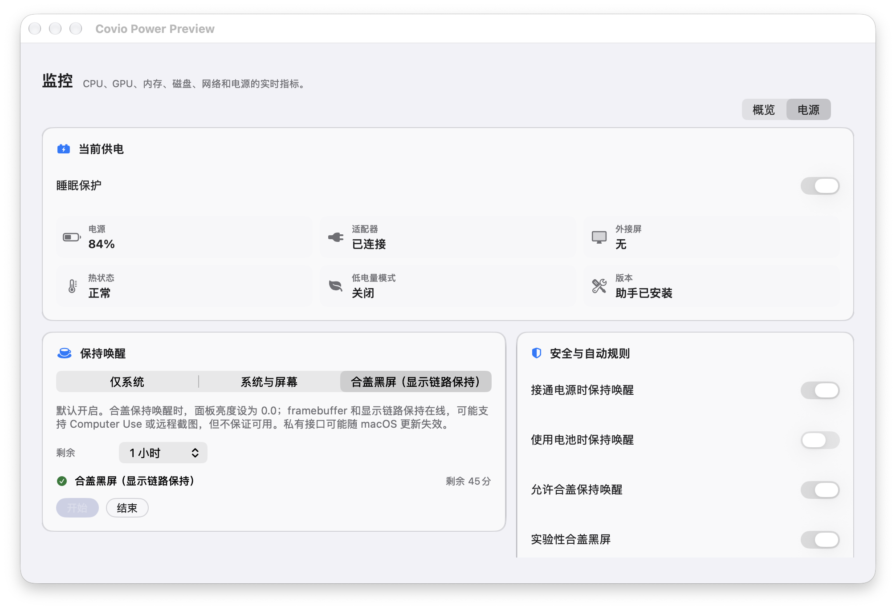
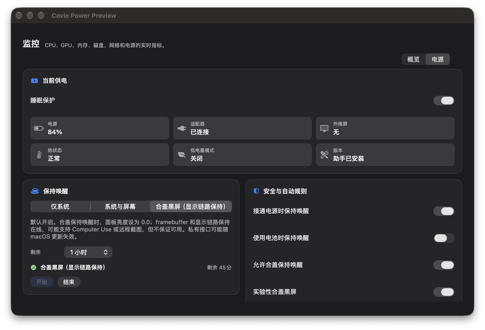

# Monitor 电源管理面

## 文档状态

| 项目 | 内容 |
| --- | --- |
| 文档版本 | `3.0` |
| 状态 | 已实现；单列设置布局与默认黑屏已完成真机视觉检查，合盖矩阵待验收 |
| 日期 | `2026-10-28` |
| Issue | #150、#154、#155、#190、#203、#398、#424、#434 |
| Feature | #148 |
| 上游决策 | ADR-0011、ADR-0012、ADR-0022 |
| 调研 | #145 |

## 目标

在现有 `Monitor` 页签中增加 `概览 / 电源` 二级切换。
用户在一个入口查看供电状态、启动保持唤醒、设置安全规则并检查历史。
页面按 macOS 设置页的阅读顺序组织，不使用并列设置卡。

本设计不增加第七个页签。
页面读取真实系统观察、策略结果与 helper 状态。
页面通过 `AppRuntime` 写入持久化的 `PowerConfig`。

`AppConfig.enabled` 是睡眠保护总开关。
Power 页面显示并写入同一个总开关。
启动时，旧配置中的 `PowerConfig.enabled` 会自动与总开关对齐。

## 实现接入

| 层 | 实现 | 来源 |
| --- | --- | --- |
| 系统观察 | `MacPowerObservationSource` | IOPS、IOKit、CoreGraphics、`ProcessInfo` |
| 持久化意图 | `PowerConfig` | `config.json` |
| 纯策略 | `PowerPolicy` | `kmpDomain` |
| 运行时租约 | `PowerRuntime` 与 `Engine` | IOKit 电源断言 |
| 合盖租约 | `PrivilegedOps` | 特权 helper v2 |
| 页面动作 | `AppRuntime` | 配置、helper 与运行时动作 |

页面只显示观察值与实际结果。
租约请求失败时，页面显示错误，不显示成功。
最近活动读取有界、原子写入的电源历史。
历史实现见 `power-history.md`。
实验零亮度默认开启。能力不可用或写入失败时，Covio 使用公开合盖关屏路径。

## 入口与层级

1. 用户进入 `Monitor` 页签。
2. 页标题右侧显示 `概览 / 电源` 分段控件。
3. `概览` 保留现有实时指标。
4. `电源` 显示本设计的四个区域。
5. 切换只改变页内内容，不改变页签。

## 布局

| 区域 | 位置 | 内容 |
| --- | --- | --- |
| 当前供电 | 顶部整行 | 总开关、供电方式、电量、外接屏、热状态、低电量模式 |
| 保持唤醒 | 第二段整行 | 会话类型、时长、活动原因、开始或结束动作 |
| 安全与自动规则 | 第三段整行 | 自动规则；合盖与安全规则使用展开区 |
| 最近活动 | 底部整行 | 最近 24 小时的供电、睡眠、唤醒和护栏事件 |

内容宽度沿用 `Monitor` 的 912 点内容列。
卡片间距使用 `token/space/3`。
卡片圆角使用 `token/radius/card`。
页面外边距使用 `token/space/6`。
卡片内边距使用 `token/space/4`。
页面只保留一个主要阅读列。
任何设置卡都不与其他设置卡并排。

### macOS 设计依据

| Apple 原则 | 页面做法 |
| --- | --- |
| 按重要程度排列 | 先显示当前供电，再显示当前会话，最后显示规则和历史 |
| 分组相关内容 | 规则分为自动规则、合盖会话和安全护栏 |
| 使用渐进披露 | 合盖与安全默认收起；历史默认收起 |
| 减少设置数量 | 会话类型和时长使用菜单选择，不使用两排胶囊选项 |
| 区分状态和设置 | 状态使用摘要和徽标；设置使用原生开关、菜单和步进器 |
| 保留键盘和读屏路径 | 所有控件使用可见标签、原生焦点顺序和无障碍名称 |

## 状态模型

| 状态 | 条件 | 表现 |
| --- | --- | --- |
| 关闭 | 无活动租约 | 显示开始动作 |
| 运行中 | 至少一个有效租约 | 显示活动原因和剩余时间 |
| 警告 | 热危险、低电量、低电量模式或合盖超时 | 显示具体原因，允许睡眠 |
| 冲突 | 外部设置与 Covio 所有权不一致 | 显示外部冲突，不自动清除 |
| 不可用 | helper 缺失或版本不符 | 禁用合盖保持唤醒，显示安装入口 |
| 无电池 | 台式机或无内置电池 | 隐藏电池百分比，保留供电和规则 |

## 交互

1. 点击模式只改变当前租约目标。
2. 点击时长只改变当前会话的到期时间。
3. 实验路径可用时，合盖会话的默认名称是“合盖黑屏（显示链路保持）”。
4. 实验路径不可用时，合盖会话的名称是“合盖关屏”。
5. 点击结束只结束当前会话。
6. 点击规则开关只改变一条自动化规则。关闭实验零亮度会立即恢复原亮度。
7. 总开关关闭时不能开始任何会话，页面显示原因。
8. 合盖模式在 helper 不可用时不能开始。
9. 合盖会话只有在 `SleepDisabled=1` 且 helper 拥有租约时才能返回成功。
10. 外部冲突不会阻止系统断言，但会阻止特权合盖动作。
11. 状态变化后，读屏要播报新状态和原因。
12. 当前会话运行时，主操作显示为结束按钮。
13. 合盖实验能力和三项安全阈值放在“合盖与安全”展开区。
14. 自动规则始终可见，避免高级设置隐藏常用开关。
15. 最近活动默认收起，展开后按时间顺序显示事件。

## 无障碍

1. 状态同时使用文字和形状。
2. 不只靠颜色区分供电、警告和失败。
3. 所有按钮命中区不小于 24 点，开始和结束按钮使用主操作尺寸。
4. 分段控件支持键盘焦点。
5. 规则开关有完整读屏名称。
6. 减少动态效果时停止非必要过渡。
7. 错误信息写出原因和下一步。
8. 分组标题使用辅助功能标题语义。
9. 摘要指标合并为一个可读条目。
10. 展开区保留标准 DisclosureGroup 键盘行为。

## 安全边界

1. 不显示通用内建屏亮度控制。只显示默认开启的实验零亮度开关。
2. 不显示外接屏 DDC 控制。
3. 不显示充电上限。
4. 不显示锁屏和屏保控制。
5. 不把 helper 缺失显示为“运行中”。
6. 不把未知状态显示为正常。
7. 不隐藏电池下限、温度保护和合盖时长。
8. 总开关关闭时，Power 页面必须显示原因并禁用会话启动。
9. helper 返回成功但系统状态未生效时，页面必须显示失败。
10. 实验性合盖黑屏开关显示“面板黑屏、framebuffer 保持活动”和“可能随 macOS 更新失效”。
11. 私有符号、版本、写入或回读失败时显示失败，并回退公开关屏。
12. helper 异常时，“合盖与安全”自动展开，并显示修复动作。
13. 零亮度已开启或处于失败态时，高级规则保持可见。

## 已验证范围

1. 概览与电源切换已接入 `Monitor` 页签。
2. 电池、适配器、外接屏、热状态和低电量模式已接入。
3. 系统与屏幕保持唤醒已接入 IOKit 断言。
4. 合盖保持唤醒已接入 helper v2 租约。
5. 手动会话、自动规则和安全否决使用同一份策略结果。
6. helper 缺失、外部 `SleepDisabled` 冲突和执行错误有可见提示。
7. 页面支持页内滚动，内容不因固定高度而裁切。
8. 合盖关屏模式会在合盖后请求显示器睡眠。
9. 内建屏最低亮度的公开 API 路径由 #191 调研，结论为不支持。
   公开 API 路径证据见 `docs/research/lid-display-minimum-brightness.md`。
   GitHub 私有 API 方案审计见 `docs/research/github-lid-brightness.md`。
10. #203 增加实验性合盖黑屏路径。ADR-0022 把该路径的默认值改为开启。面板亮度写为 0.0；framebuffer 和显示链路保持在线。Computer Use 或远程截图可能可用，但不保证。私有符号动态加载，失败时回退公开关屏。
    显示器必须 online、active 且未 asleep 才进入零亮度模式。显示器已经 asleep 时不能靠亮度写入恢复；应先开盖准备合盖会话，再合上上盖。
底层机制见 [合盖黑屏与 framebuffer 显示链路](../research/lid-framebuffer-mechanism/README.md)。
11. Apple M1 Max 真机完成合盖零亮度、6 次稳定采样、开盖恢复、结束恢复和 `SIGKILL` 后启动恢复。
12. 最近活动显示最近 24 小时的真实事件。
13. 历史文件最多保留 200 条事件和 7 天。
14. 合盖黑屏在写入零亮度前后都会验证显示状态。验证失败时恢复原亮度并回退公开关屏。
15. #424 修复了总开关与 Power 开关不同步导致的合盖会话假成功。
16. 合盖会话启动后会校验 `SleepDisabled` 和 helper 所有权。
17. #434 将页面重构为单列设置布局。
18. #434 使用原生菜单、开关和 DisclosureGroup，移除并排卡片与六宫格状态块。
19. 浅色、深色、中文和英文预览均完成布局检查。

## 预览

### 浅色

### 深色

### 展开高级规则

## 默认黑屏预览

浅色：

深色：

## 视觉验收

1. 页面只有一个主要阅读列。
2. `概览 / 电源` 可点击切换。
3. 首屏能看到当前供电、总开关、当前会话和主操作。
4. 三种会话模式和五种时长可点击。
5. “合盖与安全”可展开和收起。
6. 规则开关、步进器和菜单可点击。
7. 开始和结束动作能改变状态。
8. helper 缺失时不能开始合盖会话。
9. 外部冲突、热警告和无电池状态有明确文字。
10. 深色和浅色对比度可读。
11. 中文和英文无缺字、重叠或溢出。
12. 滚动区域没有横向裁切。

## 设计参考

- [Apple HIG: Settings](https://developer.apple.com/design/human-interface-guidelines/settings)
- [Apple HIG: Layout](https://developer.apple.com/design/human-interface-guidelines/layout)
- [Apple HIG: Designing for macOS](https://developer.apple.com/design/human-interface-guidelines/designing-for-macos)
- [Apple HIG: Accessibility](https://developer.apple.com/design/human-interface-guidelines/accessibility)

## 未决事项

| 项目 | 状态 | 确认方法 |
| --- | --- | --- |
| 真实剩余时间口径 | 已定稿 | 使用系统剩余时间，缺失时显示未知 |
| 合盖时长默认值 | 已定稿 | 默认 240 分钟 |
| helper 安装入口位置 | 已定稿 | Power 状态卡与设置页都可安装 |
| agent 会话是否进入首版 | 已定稿 | 不增加独立 agent 入口；运行时保留 `AGENT` 租约来源 |
| 电源历史 | 已实现 | 有界持久化与页面接入 |
| 实验零亮度 | 已实现 | 当前 Apple M1 Max 真机矩阵通过 |
