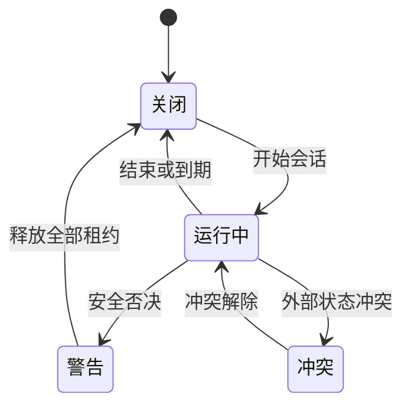
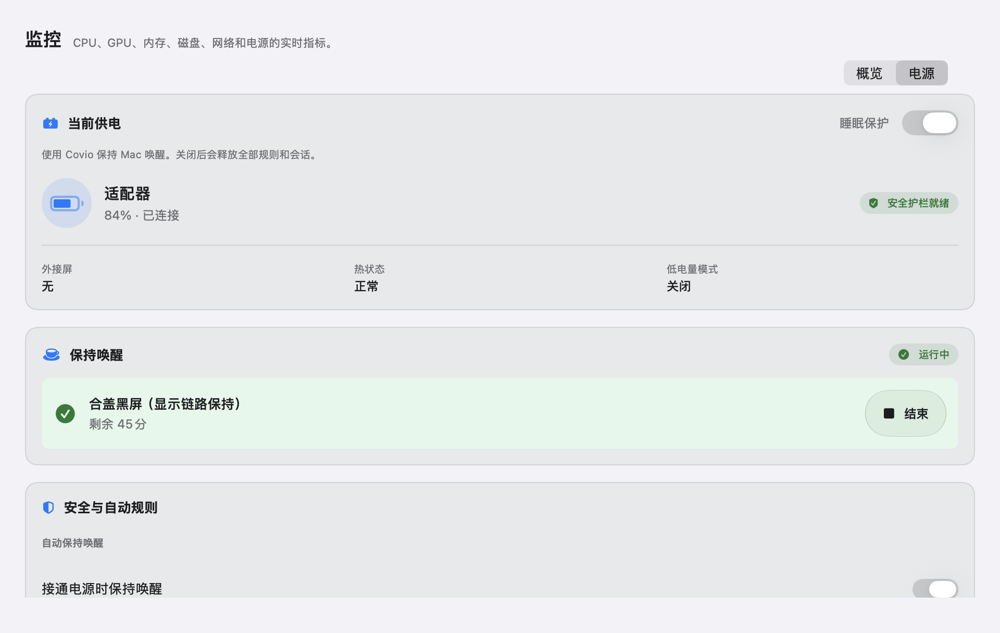
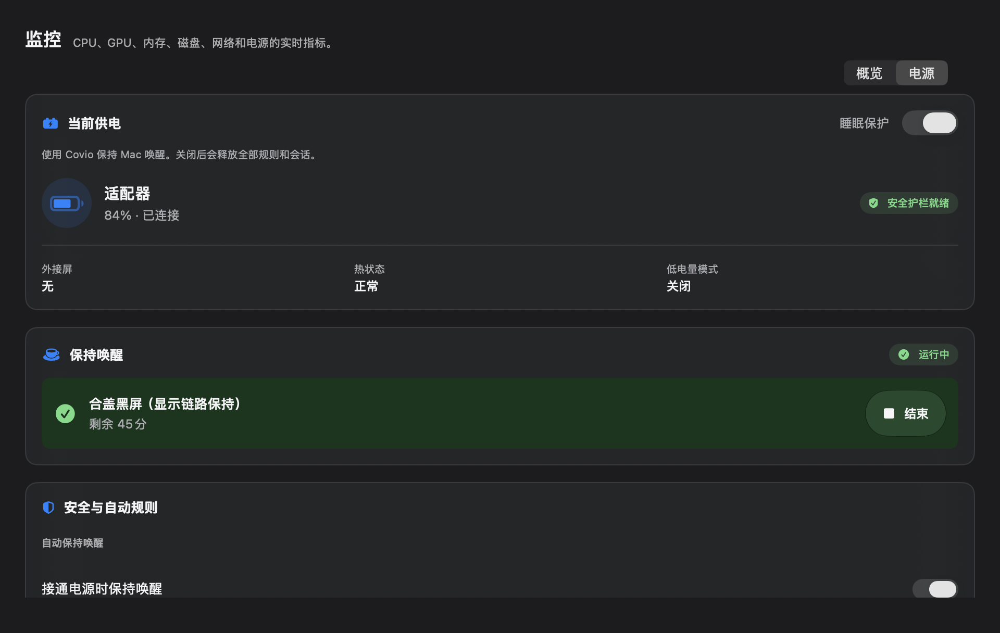
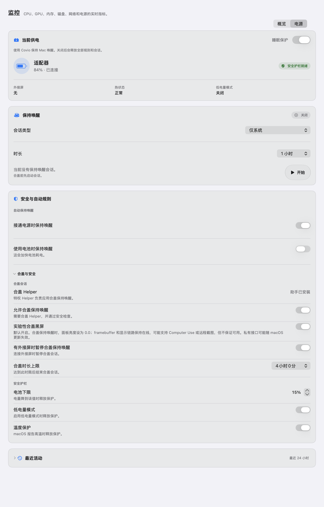
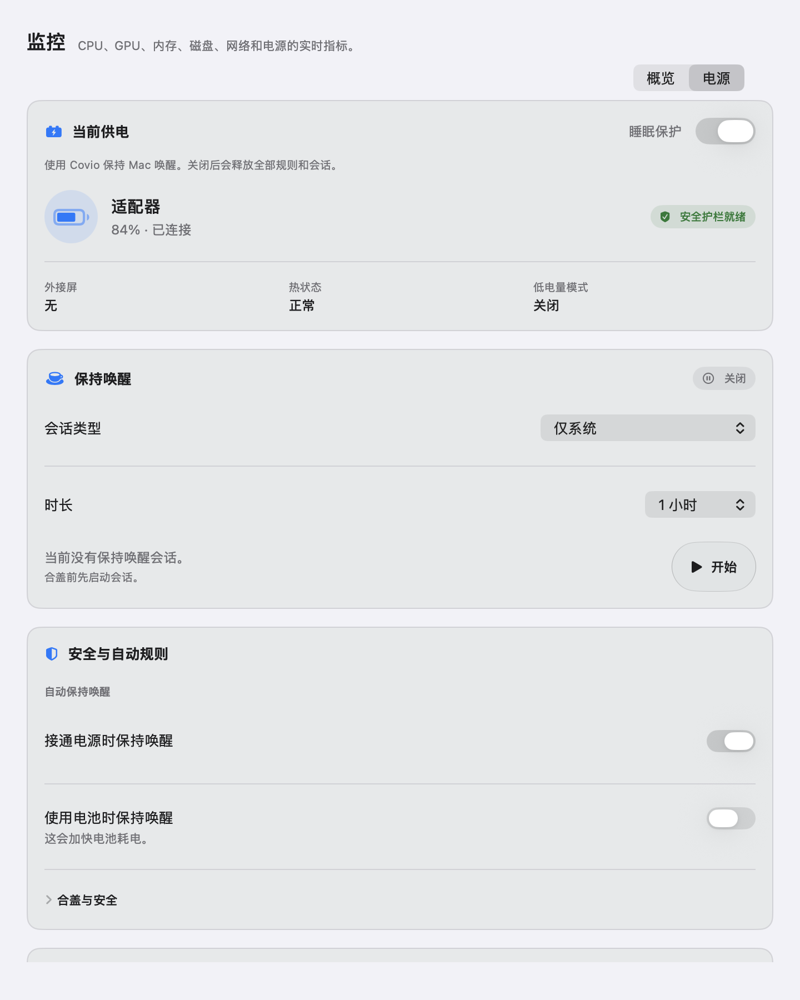
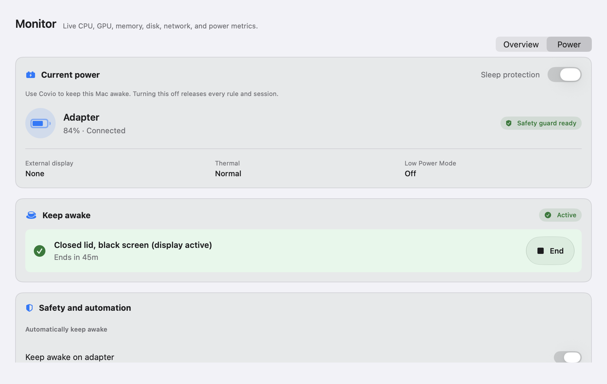
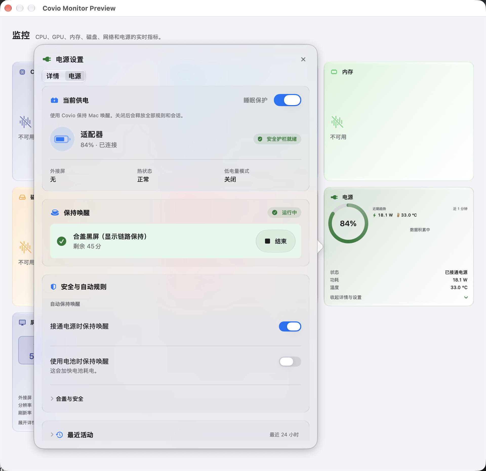

# Monitor 电源卡片设置浮层

## 文档状态

| 项目 | 内容 |
| --- | --- |
| 文档版本 | `5.0` |
| 状态 | 已实现；Power 与屏幕职责已拆分，等待组合视觉验收 |
| 日期 | `2026-10-28` |
| Issue | #150、#154、#155、#190、#203、#398、#424、#434、#441 |
| Feature | #148 |
| 上游决策 | ADR-0011、ADR-0012、ADR-0022、ADR-0024 |
| 调研 | #145 |

## 目标

Power 设置放在 `Monitor` 页签 Power card 的第三段浮层中。
用户从卡片打开浮层，在 `详情 / 电源` 之间切换。
`电源` 按 macOS 设置页的阅读顺序组织，不使用并列设置卡。
合盖屏幕行为和持久化屏幕配置由屏幕 card 管理，见 `monitor-display-card.md`。

本设计不增加第七个页签。
浮层读取真实系统观察、策略结果与 helper 状态。
浮层通过 `AppRuntime` 写入持久化的 `PowerConfig`。

`AppConfig.enabled` 是睡眠保护总开关。
`电源` 页显示并写入同一个总开关。
启动时，旧配置中的 `PowerConfig.enabled` 会自动与总开关对齐。

## 实现接入

| 层 | 实现 | 来源 |
| --- | --- | --- |
| 系统观察 | `MacPowerObservationSource` | IOPS、IOKit、CoreGraphics、`ProcessInfo` |
| 持久化意图 | `PowerConfig` | `config.json` |
| 纯策略 | `PowerPolicy` | `kmpDomain` |
| 运行时租约 | `PowerRuntime` 与 `Engine` | IOKit 电源断言 |
| 合盖租约 | `PrivilegedOps` | 特权 helper v2 |
| 浮层动作 | `AppRuntime` | 配置、helper 与运行时动作 |

`电源` 页只显示观察值与实际结果。
租约请求失败时，`电源` 页显示错误，不显示成功。
最近活动读取有界、原子写入的电源历史。
历史实现见 `power-history.md`。
合盖显示执行仍由 `PowerRuntime` 承担，但用户入口和 `DisplayConfig` 属于屏幕 card。

## 入口与层级

1. 用户进入 `Monitor` 页签。
2. 主页面只显示实时指标卡片。
3. 用户点击 Power card，或点击 Power card 第三段详情入口。
4. Power card 打开详情浮层。
5. 浮层显示 `详情 / 电源` 分段控件。
6. `详情` 保留原有电源详情。
7. `电源` 显示本设计的四个区域。
8. 关闭浮层后，Hub 恢复普通自动收起规则。

## 布局

| 区域 | 位置 | 内容 |
| --- | --- | --- |
| 当前供电 | 浮层顶部整行 | 总开关、供电方式、电量、外接屏、热状态、低电量模式 |
| 保持唤醒 | 浮层第二段整行 | 会话类型、时长、活动原因、开始或结束动作 |
| 安全与自动规则 | 浮层第三段整行 | 自动规则；安全护栏使用展开区 |
| 最近活动 | 浮层底部整行 | 最近 24 小时的供电、睡眠、唤醒和护栏事件 |

浮层宽度使用 `560` 点。
浮层高度受屏幕可见区域限制，内容在浮层内滚动。
卡片间距使用 `token/space/3`。
卡片圆角使用 `token/radius/card`。
浮层外边距使用 `token/space/4`。
卡片内边距使用 `token/space/4`。
`电源` 页只保留一个主要阅读列。
任何设置卡都不与其他设置卡并排。
popover 外层使用 regular Liquid Glass。
内容卡叠加 clear Liquid Glass。
clear 层提供细高光和空间层次，不重复外层模糊。
减少透明度或增强对比时，外层和内容卡改用不透明 `surface`。
增强对比时，外层描边使用 1.5 点，内容卡描边使用 1 点。
会话主操作使用 regular interactive Liquid Glass capsule。
玻璃材质用于 popover 外层和开始、结束功能控件。

### macOS 设计依据

| Apple 原则 | 浮层做法 |
| --- | --- |
| 按重要程度排列 | 先显示当前供电，再显示当前会话，最后显示规则和历史 |
| 分组相关内容 | 自动规则和安全护栏分组 |
| 使用渐进披露 | 安全护栏默认收起；历史默认收起 |
| 减少设置数量 | 会话类型和时长使用菜单选择，不使用两排胶囊选项 |
| 区分状态和设置 | 状态使用摘要和徽标；设置使用原生开关、菜单和步进器 |
| 保留键盘和读屏路径 | 所有控件使用可见标签、原生焦点顺序和无障碍名称 |
| 区分玻璃层级 | popover 使用 regular Liquid Glass；内容卡使用 clear Liquid Glass；开始和结束使用交互式 Liquid Glass |
| 区分主从开关 | 总开关使用常规 switch；单行子设置使用 mini switch |

## 状态模型

| 状态 | 条件 | 表现 |
| --- | --- | --- |
| 关闭 | 无活动租约 | 显示开始动作 |
| 运行中 | 至少一个有效租约 | 显示活动原因和剩余时间 |
| 警告 | 热危险、低电量、低电量模式或合盖超时 | 显示具体原因，允许睡眠 |
| 冲突 | 外部设置与 Covio 所有权不一致 | 显示外部冲突，不自动清除 |
| 不可用 | helper 缺失或版本不符 | 屏幕 card 禁用合盖会话并显示安装入口 |
| 无电池 | 台式机或无内置电池 | 隐藏电池百分比，保留供电和规则 |

## 交互

1. 点击会话类型只改变当前租约目标。
2. 点击时长只改变当前会话的到期时间。
3. 点击结束只结束当前会话。
4. 自动规则只改变接通电源或使用电池时的保持唤醒规则。
5. 总开关关闭时不能开始任何会话，`电源` 页显示原因。
6. 开始时先通过策略检查，再应用 IOKit 断言。
7. 外部 `SleepDisabled` 冲突不会阻止系统断言，但会显示冲突。
8. 状态变化后，读屏要播报新状态和原因。
9. 当前会话运行时，主操作显示为结束按钮。
10. 最近活动默认收起，展开后按时间顺序显示事件。
11. 开始、结束和 helper 修复按钮使用 44 点命中高度。
12. 自定义按钮提供 hover、pressed 和 keyboard focus 状态。
13. 自动保持规则生效时，会话状态显示“运行中”，不显示“没有会话”。
14. 开始和结束按钮使用 regular interactive Liquid Glass capsule。
15. 合盖屏幕设置、外接屏暂停和零亮度失败在屏幕 card popover 中显示。

## 无障碍

1. 状态同时使用文字和形状。
2. 不只靠颜色区分供电、警告和失败。
3. 所有按钮命中区不小于 24 点。
4. 开始、结束和 helper 修复按钮命中高度不小于 44 点。
5. 分段控件支持键盘焦点。
6. 规则开关有完整读屏名称。
7. 减少动态效果时停止非必要缩放和状态动画。
8. 错误信息写出原因和下一步。
9. 提示标签按当前界面语言显示。
10. 分组标题使用辅助功能标题语义。
11. 摘要指标合并为一个可读条目。
12. 展开区保留标准 DisclosureGroup 键盘行为。
13. 结束按钮与会话摘要保持独立焦点，不合并成单一无障碍元素。

## 安全边界

1. 不显示通用内建屏亮度控制。
2. 不显示外接屏 DDC 控制。
3. 不显示充电上限。
4. 不显示锁屏和屏保控制。
5. 不把 helper 缺失显示为“运行中”。
6. 不把未知状态显示为正常。
7. 不隐藏电池下限、温度保护和合盖时长。
8. 总开关关闭时，`电源` 页必须显示原因并禁用会话启动。
9. helper 返回成功但系统状态未生效时，页面必须显示失败。
10. 合盖时长、电池下限、低电量模式和温度保护继续由 Power 策略执行。
11. 合盖屏幕模式、外接屏暂停和零亮度失败由屏幕 card 显示。
12. 私有符号、版本、写入或回读失败时显示失败，并回退公开关屏。

## 已验证范围

1. Power 设置已接入 Power card 第三段浮层。
2. 电池、适配器、热状态和低电量模式已接入。
3. 系统与屏幕保持唤醒已接入 IOKit 断言。
4. 手动会话、自动规则和安全否决使用同一份策略结果。
5. helper 缺失、外部 `SleepDisabled` 冲突和执行错误有可见提示。
6. 页面支持页内滚动，内容不因固定高度而裁切。
7. 最近活动显示最近 24 小时的真实事件。
8. 历史文件最多保留 200 条事件和 7 天。
9. #424 修复了总开关与 Power 开关不同步导致的假成功。
10. #434 将 Power 设置重构为单列 popover。
11. #434 使用原生菜单、开关和 DisclosureGroup。
12. #434 将 Power 内容卡改为标准材质。
13. #434 增加增强对比、减少透明度和 44 点命中区。
14. #441 将合盖屏幕、外接屏暂停和零亮度设置迁入屏幕 card。
15. #441 为屏幕设置增加独立 `DisplayConfig` 和旧配置迁移。
16. #441 将所有 popover 改为分层 Liquid Glass，内容卡使用 clear 层。

## 预览

### 浅色

### 深色

### 展开高级规则

### 窄窗口

### 英文

### #441 后的 Power popover

Power popover 不再显示合盖屏幕、外接屏暂停和零亮度设置。

## 视觉验收

1. Power card 第三段可打开设置浮层。
2. `详情 / 电源` 可点击切换。
3. 浮层首屏能看到当前供电、总开关、当前会话和主操作。
4. 会话类型只显示“仅系统”和“系统与屏幕”。
5. 五种时长可点击。
6. “安全护栏”可展开和收起。
7. Power 页面不再显示合盖屏幕、外接屏暂停和零亮度开关。
8. Power 页面保留电池下限、低电量模式、温度保护和合盖时长。
9. 开始和结束动作能改变状态。
10. 外部冲突、热警告和无电池状态有明确文字。
11. 深色和浅色对比度可读。
12. 中文和英文无缺字、重叠或溢出。
13. 浮层滚动区域没有横向裁切。
14. `560` 点浮层宽度下没有横向滚动。
15. 增强对比和减少透明度模式使用不透明表面。
16. 键盘 focus ring 可见。
17. 开始和结束按钮呈现 Liquid Glass 交互反馈。

## 设计参考

- [Apple HIG: Settings](https://developer.apple.com/design/human-interface-guidelines/settings)
- [Apple HIG: Layout](https://developer.apple.com/design/human-interface-guidelines/layout)
- [Apple HIG: Designing for macOS](https://developer.apple.com/design/human-interface-guidelines/designing-for-macos)
- [Apple HIG: Accessibility](https://developer.apple.com/design/human-interface-guidelines/accessibility)
- [Apple HIG: Materials](https://developer.apple.com/design/human-interface-guidelines/materials)
- [Apple HIG: Buttons](https://developer.apple.com/design/human-interface-guidelines/buttons)
- [Apple HIG: Color](https://developer.apple.com/design/human-interface-guidelines/color)
- [Apple HIG: Toggles](https://developer.apple.com/design/human-interface-guidelines/toggles)
- [Apple HIG: Scroll views](https://developer.apple.com/design/human-interface-guidelines/scroll-views)

## 未决事项

| 项目 | 状态 | 确认方法 |
| --- | --- | --- |
| 真实剩余时间口径 | 已定稿 | 使用系统剩余时间，缺失时显示未知 |
| 合盖时长默认值 | 已定稿 | 默认 240 分钟 |
| helper 安装入口位置 | 已定稿 | 屏幕 card 与设置页都可安装 |
| agent 会话是否进入首版 | 已定稿 | 不增加独立 agent 入口；运行时保留 `AGENT` 租约来源 |
| 电源历史 | 已实现 | 有界持久化与页面接入 |
