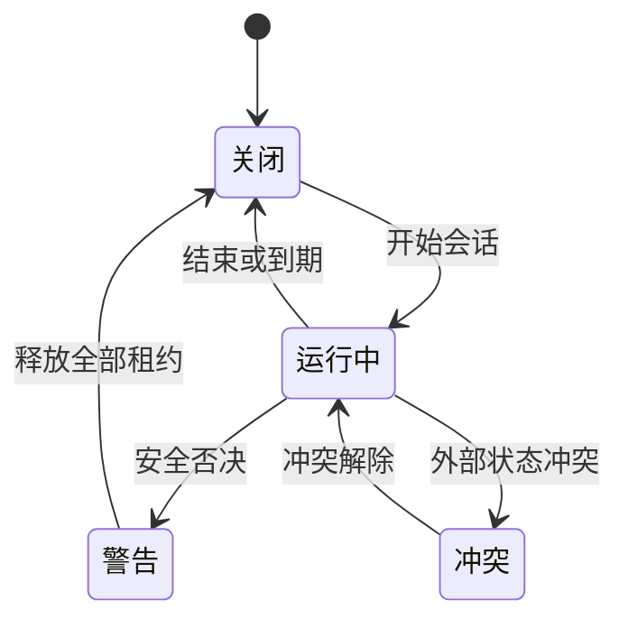

# Monitor 电源管理面

## 文档状态

| 项目 | 内容 |
| --- | --- |
| 文档版本 | `1.0` |
| 状态 | 待评审 |
| 日期 | `2026-10-20` |
| Issue | #150 |
| Feature | #148 |
| 上游决策 | ADR-0007 |
| 调研 | #145 |

## 目标

在现有 `Monitor` 页签中增加 `概览 / 电源` 二级切换。
用户在一个入口查看供电状态、启动保持唤醒、设置安全规则并检查历史。

本设计不增加第七个页签。
本设计不接真实系统状态。
本设计不接 `kmpDomain`。

## 入口与层级

1. 用户进入 `Monitor` 页签。
2. 页标题右侧显示 `概览 / 电源` 分段控件。
3. `概览` 保留现有实时指标。
4. `电源` 显示本设计的四个区域。
5. 切换只改变页内内容，不改变页签。

## 布局

| 区域 | 位置 | 内容 |
| --- | --- | --- |
| 当前供电 | 顶部整行 | 电池环、供电方式、剩余时间、热状态、低电量模式、外接屏 |
| 保持唤醒 | 第二行左侧 | 模式、时长、活动原因、开始或结束动作 |
| 安全与自动规则 | 第二行右侧 | 插电、电池、合盖、外接屏和三项安全阈值 |
| 最近活动 | 底部整行 | 最近 24 小时的供电、睡眠、唤醒和护栏事件 |

内容宽度沿用 `Monitor` 的 912 点内容列。
卡片间距使用 `token/space/3`。
卡片圆角使用 `token/radius/card`。
页面外边距使用 `token/space/6`。
卡片内边距使用 `token/space/4`。

## 状态模型



| 状态 | 条件 | 表现 |
| --- | --- | --- |
| 关闭 | 无活动租约 | 显示开始动作 |
| 运行中 | 至少一个有效租约 | 显示活动原因和剩余时间 |
| 警告 | 热危险、低电量、低电量模式或合盖超时 | 显示具体原因，允许睡眠 |
| 冲突 | 外部设置与 Covio 所有权不一致 | 显示外部冲突，不自动清除 |
| 不可用 | helper 缺失或版本不符 | 禁用合盖保持唤醒，显示安装入口 |
| 无电池 | 台式机或无内置电池 | 隐藏电池百分比，保留供电和规则 |

## 交互

1. 点击模式只改变当前租约目标。
2. 点击时长只改变当前会话的到期时间。
3. 点击开始创建一个会话。
4. 点击结束只结束当前会话。
5. 点击规则开关只改变一条自动化规则。
6. 合盖模式在 helper 不可用时不能开始。
7. 外部冲突不会阻止系统断言，但会阻止特权合盖动作。
8. 状态变化后，读屏要播报新状态和原因。

## 无障碍

1. 状态同时使用文字和形状。
2. 不只靠颜色区分供电、警告和失败。
3. 所有按钮命中区不小于 24 点。
4. 分段控件支持键盘焦点。
5. 规则开关有完整读屏名称。
6. 减少动态效果时停止非必要过渡。
7. 错误信息写出原因和下一步。

## 安全边界

1. 不显示内建屏亮度控制。
2. 不显示外接屏 DDC 控制。
3. 不显示充电上限。
4. 不显示锁屏和屏保控制。
5. 不把 helper 缺失显示为“运行中”。
6. 不把未知状态显示为正常。
7. 不隐藏电池下限、温度保护和合盖时长。

## 预览

### 浅色


### 深色


## 预览锚点

| 锚点 | 画面 |
| --- | --- |
| `#150-power` | 默认运行中，接通电源 |
| `#150-battery` | 电池供电 |
| `#150-dark` | 深色模式 |
| `#150-helper` | helper 缺失 |
| `#150-conflict` | 外部睡眠设置冲突 |
| `#150-no-battery` | 无内置电池 |
| `#150-thermal` | 热保护警告 |
| `#150-empty` | 无会话，无历史 |
| `#150-overview` | 概览页签 |

启动：

```bash
./kotlin run -m designPreview --port=8081 --no-open-browser
```

## 评审检查

1. 四个区域在 960 点面板内完整显示。
2. `概览 / 电源` 可点击切换。
3. 三种会话模式和五种时长可点击。
4. 规则开关可点击。
5. 开始和结束动作能改变状态。
6. helper 缺失时不能开始合盖会话。
7. 外部冲突、热警告和无电池状态有明确文字。
8. 深色和浅色对比度可读。
9. 中文无缺字。
10. 预览没有重叠、溢出和裁切。

## 未决事项

| 项目 | 状态 | 确认方法 |
| --- | --- | --- |
| 真实剩余时间口径 | pending | 在 #151 定稿 |
| 合盖时长默认值 | pending | ADR-0007 未决项 |
| helper 安装入口位置 | pending | 与设置页共同评审 |
| agent 会话是否进入首版 | pending | 产品评审 |
