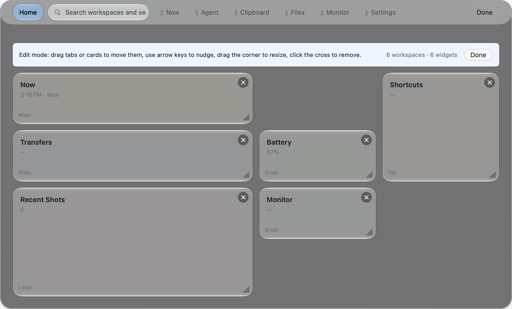
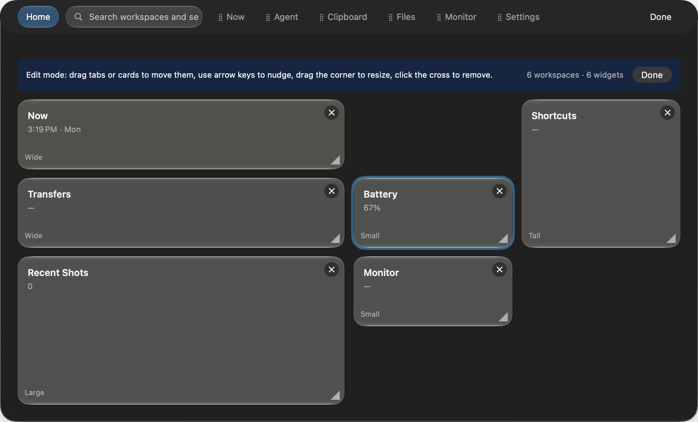
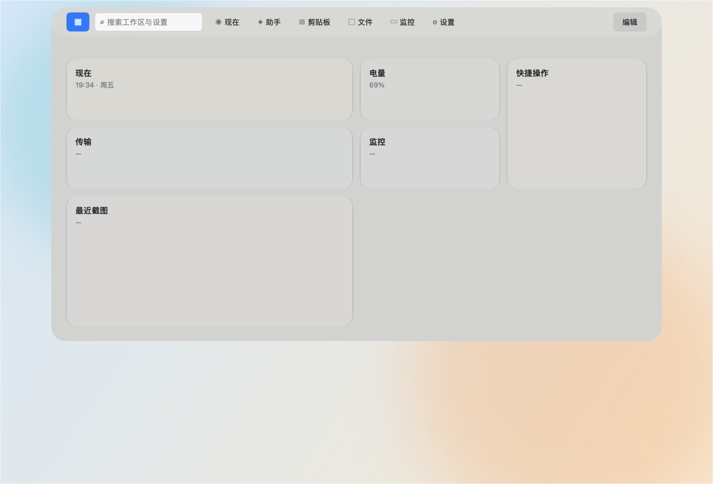
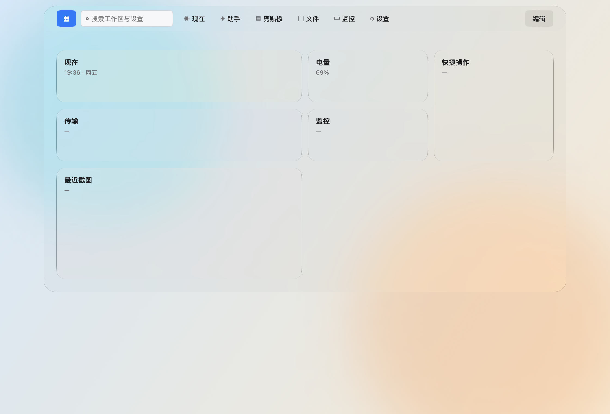
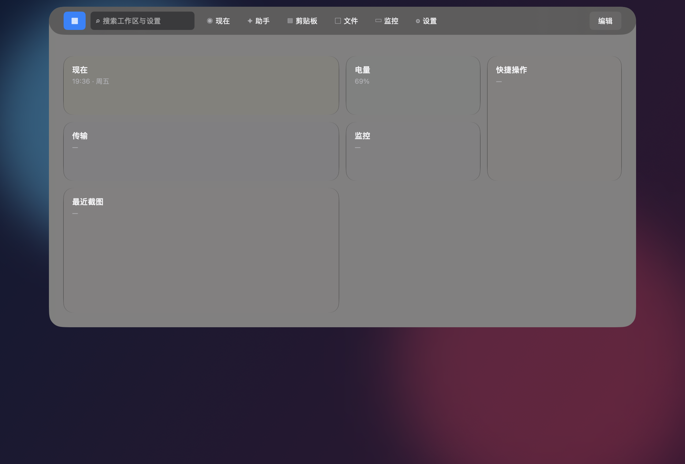
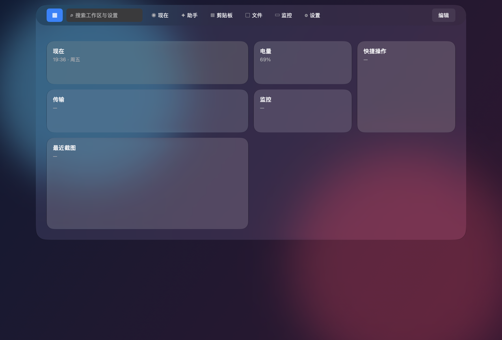

# 挂帘工作台需求规格

## 文档状态

| 项目 | 内容 |
| --- | --- |
| 文档版本 | `3.4` |
| 状态 | 已评审 |
| 日期 | `2026-10-26` |
| 适用范围 | macOS 宿主。Windows 与 iOS 只定义入口形态。 |
| 设计依据 | [设计合同](../covio-design-contract.json) |

本文写工作台的功能、设计与预期。

## 1. 目标与范围

**目标**：挂帘工作台是 Covio 的主工作区。用户从屏幕顶部唤出挂帘。用户在挂帘里切换工作区、搜索内容和操作组件。

读完本文能回答四个问题：

1. 工作台有哪些需求，怎么验收。
2. 有哪些功能，每项功能的预期结果是什么。
3. 有哪些画面，每个画面显示什么、能做什么。
4. 哪些内容不在范围内。

**本文不写**：函数签名、数据字段、状态迁移表和实现步骤。这些内容在 ADR 与实现类 issue 里定。

**范围外**：

1. Windows 与 iOS 的宿主实现。
2. 工作台配置的跨设备同步。
3. 移动端主屏手势。

## 2. 术语

| 术语 | 英文 | 说明 |
| --- | --- | --- |
| 挂帘工作台 | Workbench | 整个产品形态。 |
| 工作区 | Pane | 挂帘里的一个页签。默认六个。 |
| 组件 | Widget | 工作区首页网格上的一块。 |
| 共享暂存区 | Workspace | 跨设备传输的暂存内容。与工作区是两个概念。 |
| 截图库 | Screenshot Library | 记录 macOS 截图路径。截图内容显示在「文件」工作区。 |

界面文案可以继续使用「页签」。本文的「页签」与「工作区」指同一件事。

## 3. 需求

### 3.1 需求条目

编号 R1 到 R7 供 issue 引用。

| 编号 | 需求 | 验收标准 |
| --- | --- | --- |
| R1 | 触控板双指下滑打开工作台 | 手势完成后挂帘开始展开。连续一次手势只触发一次。普通双指滚动不触发。手势不可用时，刘海悬停、全局快捷键和菜单栏图标仍能打开。 |
| R2 | 指针悬停刘海热区打开工作台 | 指针进入热区后挂帘展开。展开用时 220 至 280 毫秒。 |
| R3 | 展开后是层级最高的组合式工作区域 | 挂帘盖住普通窗口与全屏窗口。挂帘出现在指针所在屏幕。 |
| R4 | 页签显示不同工作区，首页是 Widgets | 页签数量和顺序来自配置。首页显示组件网格。 |
| R5 | 每个工作区支持编辑和设置 | 用户能添加、删除、改名和排序工作区。每个工作区有自己的设置。 |
| R6 | Windows 用固定区域触发 | 指针进入固定区域后挂帘展开。工作区与组件的行为与 macOS 一致。 |
| R7 | iOS 用交互小组件 | 不做主屏手势。 |

R7 不做主屏手势。系统不向第三方应用开放 iOS 主屏手势入口。
替代入口见 [iOS 免打开入口](../research/mobile-ambient-entry/README.md)。

### 3.2 优先级

只列工作台范围内的条目。

| 等级 | 内容 |
| --- | --- |
| Must | 挂帘工作台（动态工作区与 Widgets 首页） |
| Should | 工作区编辑器、Widgets 网格布局、每工作区设置、快捷键 |
| Could | 自定义工作区布局 |

### 3.3 性能预期

| 项目 | 目标 | 前提 |
| --- | --- | --- |
| 挂帘打开 P95 | 不超过 150 毫秒 | 模块索引已加载 |
| 页签切换 P95 | 不超过 100 毫秒 | 页签内容已缓存 |

## 4. 功能

| 编号 | 功能 | 说明 | 预期 |
| --- | --- | --- | --- |
| F1 | 打开与收起 | 四个入口：触控板双指下滑、刘海热区、全局快捷键和菜单栏图标。 | 双指下滑只打开工作台，且保持展开。其他入口按现有点击语义打开或收起。连续触发不叠加动效。 |
| F2 | 页签导航 | 顶部页签栏列出工作区。首页和页签只显示文字。页签固定 72 × 30，文字超长时截断。 | 用户点选工作区，或指针进入某一项后，内容区切换，用时 160 毫秒。选中胶囊在原位淡入淡出，导航按钮不移动，也不改变宽度。选中态只切换一次，不触发重复抖动。每次展开完成后 0.5 秒内，指针不触发切换，也不补触发。换页签后 0.25 秒内，指针不再触发切换。 |
| F3 | 搜索 | 玻璃搜索栏过滤工作区与设置项。 | 输入即过滤。输入后显示清空动作。按 `Escape` 先清空搜索内容。 |
| F4 | 工作区编辑 | 添加、删除、改名和拖动排序。 | 只在编辑模式生效。退出编辑模式后顺序保存。 |
| F5 | 工作区设置 | 每个工作区有独立设置。 | 修改立即生效，立即保存。 |
| F6 | 组件网格 | 首页网格上添加、拖动、缩放和删除组件。 | 拖动后组件吸附到目标格。占用区与越界区拒绝放置。删除后其他组件不回流。 |
| F7 | 配置持久化 | 保存工作区列表、顺序、设置和组件布局。 | 重启应用后位置、尺寸与空位不变。配置损坏时回退默认布局，工作台仍可用。 |
| F8 | 离线本地服务 Agent | 在 Agent 页签中与本地模型对话，并调用 allowlist 本地服务。 | 只读服务可自动执行；副作用必须确认；运行时无远程 AI 请求。 |

## 5. 画面

依据列写设计合同的板号或状态键。

| 编号 | 画面 | 内容 | 主要动作 | 依据 |
| --- | --- | --- | --- | --- |
| S1 | 菜单栏与托盘 | 一级入口是原生菜单栏状态项。图标使用玻璃吊卡图形，位置由 macOS 排列。状态取合同 `menuBarAndNotchHub.statusItemStates`，共六种。 | 打开挂帘、打开托盘菜单 | 合同板 23、24 |
| S2 | 挂帘收起 | 没有面板。热区和菜单栏图标可用。 | 触发打开 | 合同板 25、`state/notch-hub/hidden` |
| S3 | 挂帘展开 · 页签 | 顶部页签栏（文字首页入口、玻璃搜索框、文字页签、动作位）、页标题行、内容区。设置只保留页签入口。 | 切换工作区、搜索、执行页动作 | 合同板 26、27；`component/tab-bar`、`component/page-title` |
| S4 | 挂帘展开 · 首页 | 组件卡片按网格排列。 | 打开组件、进入编辑模式 | 合同暂无条目 |
| S5 | 工作区内容页 | 各模块内容。默认六个工作区各一页。 | 模块动作 | 合同板 08 至 18、29 至 33；Agent 预览 207 |
| S6 | 编辑模式 | 组件可自由放到空格，也可缩放和删除。页签可拖动排序。 | 添加、移动、删除、退出编辑 | 合同暂无条目 |
| S7 | 工作区设置页 | 名称、图标、显示选项、删除。 | 改名、换图标、删除、重置 | 合同暂无条目 |
| S8 | 错误与恢复 | 原因文案加恢复动作。 | 重试、打开设置、回退默认布局 | 合同板 28 |

默认六个工作区，按顺序：`Now`、`Agent`、`Clipboard`、`Files`、`Monitor`、`Settings`。

截图、临时文件、文本和传输显示在「文件」工作区。
「文件」使用 ADR-0010 的单焦点与安静网格。
用户可以调整顺序。所有平台使用同一默认顺序。

「剪切板」使用时间列表和固定详情区。
顶部页签已经显示页面名称，页面内不再重复标题行。
暂停、全部清除和容量与类型筛选共用一行。
列表先显示置顶内容，再显示今天、昨天和更早的内容。
类型放在筛选菜单中：全部、文件、文本、图片、截图。
顶部搜索框在剪切板页签中直接过滤当前列表，页内不再重复显示搜索框。
选中条目后，详情区显示完整预览。主操作固定在详情区，次要动作放进更多菜单和右键菜单。
截图来自截图库，并在详情区标记「专有」。
文本详情按 Markdown 显示标题、强调、列表、引用和代码块。
普通文本保持原样。复制、粘贴、搜索和存储始终使用原始文本。
只有 `http` 和 `https` 链接可以打开。HTML、脚本和远程图片不会加载。
列表支持上下方向键选择，`Return` 粘贴，`Delete` 删除，双击粘贴，`Command-F` 聚焦搜索。
第一次 `Escape` 清空搜索，第二次清除选中项，第三次收起工作台。

内部键 `devices` 保留为 `Monitor` 工作区的稳定标识。旧配置不需要迁移。

`Monitor` 使用 `MonitorTabView` 显示 CPU、GPU、内存、磁盘、网络、电源和风扇。
普通指标卡的标题只显示图标和标题。
页面状态行暂时留空，并保留原高度。
电源卡片在自己的内容区显示供电状态。
风扇卡片提供真实控制状态时，才显示状态胶囊。
风扇卡片使用 AppleSMC 读取温度与转速。风扇写入走现有 root helper。
指标口径见 [硬件信息监听能力研究](../research/hardware-monitoring-capability/README.md)；
风扇卡片规范和故障边界见 [monitor-fan-card.md](monitor-fan-card.md)。

标记「合同暂无条目」的画面，实现前先在合同里加条目。
改完合同重跑 `scripts/generate-contract-constants.py`。

首页卡片保存 4 列网格的显式坐标。
拖动使用卡片左上角吸附目标格。
用户留下的空格保留。
旧配置没有坐标时，按原顺序生成紧凑布局。
首次编辑后，旧布局落成显式坐标。
键盘与 VoiceOver 用户可用方向操作移动卡片。

自由位置预览：

| 浅色 | 深色 |
| --- | --- |
|  |  |

合同板 19 至 22 是旧截图接管的静态设计记录，不进入运行时。
当前截图使用 macOS 原生捕获。
Covio 不修改系统截图设置。
截图的内容入口属于「文件」工作区。

## 6. 版式与动效

**版式**：

| 项目 | 规格 |
| --- | --- |
| 锚点 | 指针所在屏幕的顶部中央 |
| 宽度 | 最小 720 点，最大为屏幕宽度减 80 点。板宽 960 点。 |
| 高度 | 内容自适应，最大为屏幕高度减 120 点。 |
| 背景 | 内容层铺满面板。导航层叠在内容层上方。视觉关系参考 macOS 26 Tahoe 的 Apple Maps。 |
| 首屏内容留白 | 11 点。留白位于导航层底部与首屏内容之间，不是可见板间距。 |
| 顶栏与菜单栏之间的缝 | 11 点。 |
| 顶栏 | 圆角 23 点，胶囊形。高 46 点，宽 960 点。顶栏叠在内容层上方。 |
| 内容区 | 宽 960 点，高度覆盖整个面板。内容延伸到顶栏背后，底板圆角 23 点。 |
| 底板材质 | Liquid Glass 的 `.regular` 变体，不加着色。`GlassSurfaceMode.plateMode = .glass`，`plateTintOpacity = 0`。`.system` 与 `.hudWindow` 保留为调试对照。 |
| 卡片材质 | 叠在底板上，底材 `Glass.clear`。填充取色值乘 `MacTheme.tintedCardOpacity`，当前取 `0.1`。 |
| 顶栏材质 | 无边框超薄材质。`GlassSurfaceMode.topBarMode = .ultraThin`。 |
| 顶栏按钮 | 首页和页签只显示文字。页签固定 72 × 30，文字超长时截断，字重固定。未选中时透明。选中、悬停或键盘聚焦时显示淡强调色胶囊填充。选中胶囊不创建嵌套 Liquid Glass，也不参与外层 `GlassEffectContainer` 合并；切换只原位淡入淡出。默认六项直接显示，超过可用宽度时横向滚动。键盘焦点叠加高对比焦点环。|
| 顶栏搜索 | 单层原生 regular Liquid Glass 胶囊。包含搜索图标、输入框和系统清空动作。搜索框宽度固定，获得键盘焦点时显示高对比焦点环。|
| 顶栏动作位 | 宽度固定。首页显示“编辑”或“完成”。其他工作区留空，不重复显示“设置”。|
| 边框 | 内容底板保留 Liquid Glass 自带的镜面亮边。顶栏没有边框。卡片保留自己的亮边。 |
| 投影 | 顶栏与内容层都没有投影。 |
| 菜单栏状态项 | 使用原生 `NSStatusItem` 与 18 点玻璃吊卡图标。位置由 macOS 排列。 |

### 底板升级预览

| 变更前 | 变更后 |
| --- | --- |
|  |  |
|  |  |

控制中心是两层。一层是面板级的模糊底板，把桌面与工作区分开；模块叠在底板上面，自己走 clear，只加一层薄高光，不重复模糊。真机对照：把一个带文字的窗口摆在面板下面，控制中心打开后整片面板区域的文字都被抹平，模块之间与模块周围也一样。模糊来自底板，不是来自模块本身。所以 `.clear` 只有在底下已经有模糊时才成立；单独把 `.clear` 压在桌面上，背后窗口的文字会原样透上来。

底板的重量由传递曲线定，不由单点差定。把一块满量程的黑白渐变垫在面板背后，桌面亮度分箱，看每个箱里的面板平均亮度，这条线的斜率就是底材的有效透明度。斜率与桌面内容无关，所以换一天换一张桌面也照样能比。真机实测（2026-10-17，浅色外观，满量程渐变垫在背后）：

| 底材 | 传递曲线 | 条纹残留 |
| --- | --- | --- |
| 控制中心底板 | 0.95·桌面 + 0.4 | 2% |
| `.ultraThin` | 0.53·桌面 + 98 | 0% |
| `.clear` 玻璃 | 0.59·桌面 + 89 | 0% |
| `.hudWindow` | 0.25·桌面 + 149 | 0% |
| `.regular` | 0.34·桌面 + 150 | 0% |
| `.thinMaterial` | 0.39·桌面 + 133 | 0% |
| `.selection` | 0.93·桌面 − 5 | 91% |

「条纹残留」是把一块高频条纹垫在板背后，量相邻像素差。残留 0% 表示板把条纹全糊平；91% 表示条纹原样透上来。

工作台此前看起来像一块死灰板，压平曲线的是那层黑 0.4 着色，不是 Liquid Glass 自己。同一种 `.glass`，去掉着色以后斜率从 0.28 回到 0.50。

2026-10-17 的版本曾改用系统语义材质 `.hudWindow`。该材质仍是调试对照，原因是 AppKit 将具体外观材质标为废弃，并按界面元素提供语义材质。2026-10-23 起，按产品要求把默认底板升级为 Liquid Glass。新的默认值使用 `.glass`，不添加着色。历史测量保留，用于解释视觉差异和后续回归。

Liquid Glass 会带回镜面亮边。当前版本接受这条亮边，并把它作为底板材质的一部分。底板独立成背景层，内容和顶栏放在 `GlassEffectContainer` 内叠在上面。这样大底板不会与顶栏材质合并，也不会干扰顶栏文字。内容层仍铺满面板，顶栏以超薄材质叠在内容上方。

**底板的填充取不到控制中心的水平。** 底材的输出是 `α·模糊(桌面) + (1−α)·F`。`α` 是透光比例，`F` 是填充色。把上表换成这两个量：

| 底材 | 透光 α | 填充色 F |
| --- | --- | --- |
| 控制中心底板 | 0.95 | 8 |
| `.hudWindow` | 0.25 | 200 |
| `.ultraThin` | 0.53 | 208 |
| `.clear` 玻璃 | 0.59 | 217 |

控制中心的填充色是 8，也就是黑。系统材质的填充色都在 200 以上，也就是近白。这些材质为浅色外观设计，把背后内容洗向白色，深色文字才读得清。控制中心的底板不承担这个职责，它只是一层纯模糊。

`α` 与 `F` 由材质一起给出，不能分开调。给材质层乘一个不透明度 `p` 只会让两者一起退：透光比例变成 `1 − p(1−α)`，填充变成 `p(1−α)F`，模糊程度等于 `p`。所以**模糊与可见度由同一个量控制，两者不能分开。** 消掉 `p` 以后，填充只由斜率定：`c = F·(1 − s)`。`.ultraThin` 的 `F` 是 208，斜率取 0.95 时填充必然是 10；控制中心的 `F` 是 8，同样斜率下填充只有 0.4。

真机实测（2026-10-17，浅色外观，`.ultraThin` 上乘不透明度 `p`。这个旋钮现已删除，数据保留）：

| p | 传递曲线 | 条纹残留 |
| --- | --- | --- |
| 1.0 | 0.53·桌面 + 98 | 0% |
| 0.5 | 0.77·桌面 + 49 | 50% |
| 0.2 | 0.89·桌面 + 23 | 80% |
| 0.1 | 0.94·桌面 + 12 | 90% |

取小值能把板压到与桌面齐平（`p = 0.1` 时几乎看不见），但背后窗口的文字会跟着透上来 —— 那正是控制中心不会发生的事。所以这条路走不通，材质按系统给的原样使用。真机复核（2026-10-17）：`p = 0.5` 时背后终端的文字仍然认得出，`p = 1.0` 时只剩色块。

控制中心几乎不加填充：模块内只比模块缝亮 16 到 34 级，模块缝比桌面暗 8 级。区分模块靠亮边，不靠填充。工作台此前在卡片填充 `0.45` 下，卡片比底板缝亮 46 到 50 级，面板内部自己就有一倍的反差，读起来是「灰板上摆白板」。

面板跟随系统外观，见 `HubAppearance`。面板原先固定深色，理由是「控制中心在浅色与深色系统外观下都是深色」。真机复核（2026-10-17）推翻了这条：系统在浅色外观时，同时截下的控制中心是浅底板加深色文字，`Wi-Fi`、`蓝牙`、`显示器` 都是深色字。固定深色会让工作台在浅色系统下变成深底板加白字，与控制中心正好相反。跟随系统以后，合同的两套文字令牌都生效：浅色下 `text-primary` 是 `#1D1D1F`、`text-secondary` 是 `#6E6E73`，深色下是 `#F5F5F7` 与 `#AEAEB2`。

调试构建可以用 `COVIO_PLATE_MODE`、`COVIO_TOPBAR_MODE`、`COVIO_PLATE_TINT`、`COVIO_PLATE_MATERIAL`、`COVIO_GLASS_SURFACE`、`COVIO_CARD_TINT`、`COVIO_APPEARANCE` 七个环境变量换底材、材质、着色与外观对照，取值见 `macosApp/src/Design/GlassSurface.swift` 与 `MacTheme.swift`。

**已知差距一**：文字不随底板亮度翻面。底板压在深色窗口上时会跟着变暗，此时合同的深色文字令牌 `#F5F5F7` 才读得出来；浅色令牌在暗底板上读不出来。系统没给第三方「这块板现在读起来是深还是浅」的公开信号：实测两块同样材质的 `NSVisualEffectView`，一块压白底一块压黑底，`interiorBackgroundStyle` 都返回 `0`，`labelColor` 都渲染成同一个颜色。读桌面像素要走 Screen Recording 权限。所以文字只跟系统外观走，不跟底板亮度走。

**已知差距二**：合同里 `token/color/widget-tint-*` 的深色取值与浅色完全相同，都是浅底（薄荷 `#E5F8EA`）。面板走深色外观以后，这六个令牌就成了压在暗底板上的一层亮填充。卡片填充压到 `0.1` 是补偿，不是解法；补深色取值是合同改动。

**已知差距三**：底板做不到「既看不见又糊得掉」。控制中心同时有满量程模糊与近零填充，这需要透光 0.95 的底材。公开材质里会模糊的透光最高只有 0.59（`.clear` 玻璃），填充色都在 200 以上；`.selection` 透光 0.93，但它不模糊（条纹残留 91%），只是一层透明着色。`NSGlassEffectView` 的两种公开样式同样带填充。

**私有接口也到不了。** 手工搭一个 AppKit 自用的 `CABackdropLayer`（`windowServerAware`、`groupName = NSCGSWindowBehindWindowCaptureBackdropGroup`、`scale = 0.125`，滤镜 `sdrNormalize` + `gaussianBlur(30)` + `colorSaturate(1.9)`，也就是从 `NSVisualEffectView` 的图层树里读出来的那一套），去掉上面的着色层以后实测透光 0.61、填充 140，条纹残留 44%。这个层自己也带填充；而且它的 `filters` 不生效 —— 半径取 0、20、80，三格与不带滤镜那一格逐字节相同。所以换私有接口买不到控制中心的效果。

**结论：这条差距仍在。** 当前底板按产品要求使用 Liquid Glass（`.glass`），材质原样使用，不乘不透明度倍率，不加着色。底板会比控制中心更亮，也会带镜面亮边。该取舍已在亮色与深色真机预览中复核（2026-10-23）。

**动效**：

| 动作 | 时长 | 结果 |
| --- | --- | --- |
| 挂帘展开 | 220 至 280 毫秒 | 弹性曲线 |
| 挂帘收起 | 160 至 220 毫秒 | 缓出曲线 |
| 页签切换 | 160 毫秒 | 选中胶囊原位淡入，导航栏不位移 |
| 展开后导航 hover 保护 | 500 毫秒 | 从展开动画结束起算；点选不受影响 |
| 指针切换页签冷却 | 250 毫秒 | 换页签后这么久内，指针不再触发切换 |
| 指针移出后自动收起 | 500 毫秒 | 无输入时执行 |
| 错误出现 | 160 毫秒 | 淡入和轻微位移 |
| 减弱动态效果 | 120 毫秒 | 只改变透明度 |

**减弱动态效果**：系统开关打开时，动效只用短暂渐隐。动效不使用位移和弹性。选中态与高亮瞬时切换。

## 7. 状态与收起

**状态**取设计合同 `states.menuBarAndNotchHub.hubStates`，共六种：

| 状态 | 用户所见 |
| --- | --- |
| `HIDDEN` | 挂帘收起，刘海保持原形。 |
| `HOVER` | 指针进入热区，预览出现。 |
| `OPEN` | 挂帘展开，显示当前内容。 |
| `ACTIVE` | 挂帘显示实时指标和动作。 |
| `EXIT` | 挂帘收起，回到刘海。 |
| `ERROR` | 显示可恢复的错误，文案写出原因和恢复动作。 |

**收起方式**：

1. 指针移出挂帘。500 毫秒后收起。
2. 按 `Escape`。立即收起。搜索框有内容时，第一次 `Escape` 只清空搜索。
3. 按 `Control+Option+T`。挂帘打开或收起。
4. 点击挂帘外部。挂帘收起。

**不自动收起**：用户编辑输入或拖动文件时，挂帘保持展开。

**Popover 打开时不自动收起**：三段式卡片的 Popover 打开期间，指针进入 Popover 或离开工作台都不启动自动收起。最后一个 Popover 关闭后，按指针当前位置恢复自动收起。显式收起会先请求关闭 Popover，再收起工作台。

**手势打开时保持展开**：双指下滑不移动指针。手势打开工作台后，即使指针在工作台外，工作台也保持展开。指针进入工作台后，恢复普通的移出自动收起规则。`Escape`、全局快捷键和菜单栏操作仍可立即收起工作台。

**双指下滑识别**：识别器要求恰好两根手指。下滑指两指从触控板上边缘移向下边缘。接触帧的纵坐标在该方向上减少，因此识别器使用起始值减去当前值。默认门槛是下滑距离至少 `0.15`、横向偏移不超过 `0.15`、时长 `0.03` 至 `0.45` 秒、平均速度至少 `0.70`、冷却期 `0.60` 秒。门槛是真机标定前的起点。一次连续接触段最多触发一次。普通滚动、上滑、横滑和其他手指数不触发。

**热区与面板重叠**：展开的面板盖住热区。面板造成的热区离开事件，控制器不上报。
上报时状态机收回刚展开的面板，热区重新露出又上报进入，两边来回弹。
判断条件是面板可见，且指针落在面板矩形内。收起态下面板的矩形仍然盖住热区，
所以只看矩形不够。

**全屏 Space**：全屏 Space 中隐藏顶部热区与菜单栏。菜单栏随指针出现时，状态项由系统恢复显示。Covio 不创建额外入口。

## 8. 降级与约束

**降级**：

1. 触控板手势失效时，刘海悬停、全局快捷键和菜单栏图标承担打开。
2. 手势适配器记录 `multitouch_framework_missing`、`multitouch_symbol_missing` 或 `multitouch_no_device`，且不阻止应用启动。
3. 配置损坏时，回退默认布局。

**权限**：刘海悬停和全局快捷键不需要系统权限。触控板手势的权限要求未验证，见第 9 节。

**发行约束**：触控板手势走系统私有接口。这条路径让应用无法上架 Mac App Store。

## 9. 未决项

| 项目 | 现状 |
| --- | --- |
| 编辑模式的形态 | 已定：就地编辑。顶栏下加一条提示条，卡片带删除钮与缩放手柄，页签带拖动把手。 |
| Widgets 首页与六个默认工作区的关系 | 未定。 |
| 工作区数量上限 | 未定。 |
| 内置工作区能否删除 | 未定。 |
| 触控板手势的权限要求 | 未验证。 |
| 双指下滑的真实识别率与误触发率 | 待真机验证。 |
