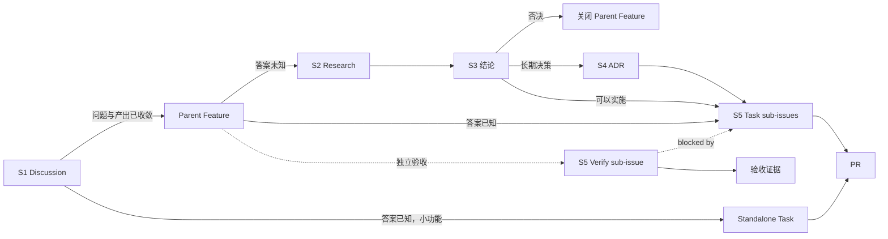

# 研发工作流

**从 Discussion 到 PR：一套 GitHub 原生对象，七步闭环。**

版本 0.14 · 2026-10-29

---

## 1. 适用范围

| 项目 | 内容 |
|---|---|
| 仓库 | `wyz541/kmp-Covio` |
| 账号类型 | 个人账号 |
| 团队规模 | 2 到 15 人。此数字是经验值 |
| 不适用 | 需要外部合规取证的组织，例如 ISO 27001、SOC 2 |

本流程只依赖 GitHub 原生能力。

- 对象用标签区分。
- 字段用 Project 8 保存。
- 不用 issue types，也不用 issue fields。

---

## 2. 核心模型

```text
Discussion（开放探索）
      │ 收敛
      ▼
Parent Feature（Issue）
      ├── Research sub-issue → 结论
      ├── Task sub-issue → PR
      └── Verify sub-issue → 验收证据

答案明确的小功能 → standalone Task issue → PR
```

### 2.1 对象

| 对象 | 载体 | 标签 | 层级 | 产出 | 完成条件 |
|---|---|---|---|---|---|
| Discussion | Discussions | `idea` | 来源节点 | 问题、场景和候选方向 | 已转 Issue，或已写明关闭原因 |
| Parent Feature | Issue | `feature` | 根 Issue | 工作容器 | 全部 Task 完成，适用 Verify 通过，或明确取消 |
| Research | Issue | `research` | Parent Feature 的 sub-issue | 结论、依据和后续动作 | 结论写回正文 |
| Task | Issue | `task` | Parent Feature 的 sub-issue，或独立 Issue | 代码与一个 PR | PR 已合并 |
| Verify | Issue | `verify` | Parent Feature 的 sub-issue | 可复核的验收证据 | 全部验收场景通过 |
| ADR | 仓库文件 | 无 | 决策记录 | 长期决策 | ADR 的 PR 已合并 |
| PR | Pull Request | 无 | 交付记录 | 代码、测试和 UI 证据 | 已合并并关闭对应 Task |

### 2.2 层级规则

1. Discussion 是来源节点，不是 GitHub 原生 parent。
2. Parent Feature 必须是 Issue。
3. Research、Task 与 Verify 都是 Parent Feature 的 sub-issue。
4. Verify 与 Task 同级，不是 Task 的 child。
5. Parent Feature、Research、Task 和 Verify 的层级不超过 3 层，从 Parent Feature 数起。
6. 原生 sub-issue 关系是层级的唯一来源。不要在正文维护第二份层级清单。

### 2.3 完成边界

| 对象 | 负责什么 | 不负责什么 |
|---|---|---|
| Research | 降低未知 | 不交付代码，不要求 PR |
| Task | 实现一个可交付改动 | 不承担跨多个 Task 的最终验收 |
| Verify | 验证合入后的端到端结果 | 不重复保存每个 PR 的 Before/After 截图 |
| PR `Proof` | 当前 PR 的测试与 CI 证据 | 不承担 Feature 级验收 |
| PR `Visual verification` | 当前 PR 的 UI Before/After 证据 | 不承担跨 PR 的最终 UI 验收 |

**Verify 的创建条件：** 满足任一条才创建。

1. 验收跨越多个 Task 或 PR。
2. 验收需要真机、外接设备、人工交互或不易复现的环境。
3. 验收需要在合并后或发布前再次执行。
4. 验收证据需要独立保存并长期追踪。

单个 Task 的验收能在对应 PR 中完成时，不创建 Verify。

---

## 3. 流程



S6 与 S7 贯穿全部步骤。

---

## 4. 七个步骤

### S1 开放式想法进 Discussions

**何时用：** 问题、做法或预期产出尚未收敛。

**谁做：** 提交人。

1. 建 Discussion，选择 `Ideas` 或 `Q&A`。
2. 写问题、受影响的人和一个具体场景。不要写实施细节。
3. 加 `idea` 标签。没有 triage 权限时，请维护人代加。
4. 在 Discussion 中补上下文、约束和候选方向。
5. 不要提前创建 Research issue。
6. 收敛后，按 4.1 的映射创建 Issue。
7. 在原 Discussion 写最终评论：结论、Issue 链接和下一动作。
8. 关闭 Discussion。
9. 30 天没有进展时，维护人提醒提交人。提醒后仍无动作时，关闭 Discussion 并写原因。

#### 4.1 Discussion 收敛条件

以下四项必须同时成立。

1. 可以用一句话写出一个待答问题或交付目标。
2. 可以写清预期产出。
3. 有人担任负责人。
4. Research 可以放入不超过 3 个工作日的 timebox；或者 Task 可以在一个会话内完成。

#### 4.2 Discussion 转入映射

| 收敛结果 | 创建对象 |
|---|---|
| 有一个明确问题待回答 | Parent Feature，再挂 Research sub-issue |
| 答案已知，一个会话能完成 | Standalone Task issue |
| 答案已知，需要多个 PR 或先改设计 | Parent Feature，再拆 Task sub-issue |

**完成标准：** Discussion 已转 Issue，并且原帖有回链；或者 Discussion 已写明关闭原因。

> **警告：** Discussions 不进 Projects，也不能排期。需要排期时，必须转成 Issue。

> **警告：** Discussion 不能作为 GitHub 原生 parent。Parent Feature 必须是 Issue。

### S2 建 Research sub-issue

**何时用：** S1 已收敛为一个明确问题；问题有负责人、时间盒和预期产出。

**谁做：** 负责人。

1. 确认 Parent Feature 已存在。没有时，先按 S5 创建。
2. 用 `.github/ISSUE_TEMPLATE/research.yml` 建 issue。
3. 命令行创建时，加 `--label research --parent <Feature 编号>`。
4. 在 Parent Feature 的 `Sub-issues` 中添加 Research issue。
5. 标题写成 `research: <要回答的问题>`。
6. 填待答问题、时间盒和预期产出。
7. 在背景字段写原 Discussion 链接。
8. 时间盒默认 2 个工作日，上限 3 个工作日。
9. 到期时做一次 15 分钟评审。评审只决定结题或延长。
10. 延长只允许一次，且不超过原时长。

**完成标准：** 内容齐全，issue 有 assignee，Parent Feature 的 `Sub-issues` 已显示 Research issue。

**规则：**

- 一个 Research 只回答一个问题。
- Research 的代码不合并到 `main`。
- Research 不要求一条分支和一个 PR。

### S3 把结论写回 Research

**何时用：** Research 到期，或调研可以收尾。

**谁做：** 负责人。

1. 编辑 Research 正文。
2. 写结论、依据和后续动作。
3. 依据包含数据、命令输出或链接。
4. 加一行 `decision:` 指向。格式见 S6。
5. 结论可以实施时，在 Parent Feature 下创建 Task sub-issue。
6. 结论否决时，关闭未完成的 Task 和 Parent Feature，原因写 `not planned`。
7. 关闭 Research。原因写 `completed` 或 `not planned`。
8. 在原 Discussion 补一条评论：结论、Research 链接和下一步。

**完成标准：** 只读 Research 正文就能理解结论。Parent Feature 已有后续 Task，或者已关闭。

**规则：** 结论写在正文，不写评论。结论未写回正文前，不关闭 Research。

**何时进入 S4：** 决策影响多个模块、实施成本高，或半年后仍会被问到。

### S4 长期决策写成 ADR

**何时用：** S3 判定为长期决策。

**谁做：** 负责人。

1. 从 `docs/adr/adr-template.md` 复制模板。
2. 文件名写成 `adr-NNNN-<slug>.md`。
3. 编号取现有最大值加一。编号不复用。
4. 按模板填写。
5. 提交 PR。合并前把 Status 改成 `accepted`。
6. 合并后把 Research 的 `decision: pending` 改成实际 ADR 编号。

| 字段 | 取值 |
|---|---|
| Status | `proposed`、`accepted`、`deprecated`、`superseded` |
| Kind | `architecture`、`process` |

**推翻旧决策：** 新 ADR 写 `Supersedes`，旧 ADR 写 `Superseded by`，旧 ADR 的 Status 改成 `superseded`。三个改动放在同一个 PR。

### S5 建 Parent Feature 与 sub-issues

**何时用：** 需要先调研；需要 2 个以上 PR；预计超过 5 个工作日；需要先改设计。

**谁做：** 负责人。

#### 5.1 Parent Feature

1. 用 `.github/ISSUE_TEMPLATE/feature.yml` 建 Parent Feature。
2. 加标签 `feature`。
3. 标题写成英文祈使句，例如 `Add the workbench store`。
4. 负责人写入 assignee。
5. 有 Discussion 来源时，正文写 `discussion: <URL>`。没有时写 `discussion: none`。
6. 决策未定时写 `decision: pending`。
7. 在 Project 8 补 Start date 与 Target date。

Parent Feature 是工作容器，不表示已经承诺实施。

#### 5.2 Research

需要回答未知问题时，先创建 Research sub-issue，进入 S2。

#### 5.3 Task

Research 完成后，把可独立交付的实现工作拆成 Task sub-issue。

1. 用 `.github/ISSUE_TEMPLATE/task.yml` 建 issue。
2. 加标签 `task`。
3. 在 Parent Feature 的 `Sub-issues` 中添加 Task。
4. 每个 Task 写验收标准。
5. 每个 Task 预计工期 1 到 3 天。
6. 一个 Task 对应一条分支和一个 PR。
7. 从 Research 产生的 Task，用 `blocked by` 指向 Research。
8. 有其他技术依赖时，用 `blocked by` 指向前置 Task。

#### 5.4 Verify

需要独立验收时，创建 Verify sub-issue。

1. 用 `.github/ISSUE_TEMPLATE/verify.yml` 建 issue。
2. 加标签 `verify`。
3. 在 Parent Feature 的 `Sub-issues` 中添加 Verify。
4. 写验收目标、验收场景、环境和证据要求。
5. 用 `blocked by` 指向被验收的 Task。
6. Verify 与 Task 同级，不放在 Task 下面。

Verify 不要求分支和 PR。完成条件是验收场景通过，并且证据写回正文。

#### 5.5 UI

UI issue 写可判断的 `表现预期`。UI 决策可以在 issue 的 `预览` 段放候选方案。代码交付后的单个 PR 真机证据写在 PR 的 `Visual verification`。

#### 5.6 完成与取消

Parent Feature 的完成条件：

1. 所有 Task 的 PR 已合并。
2. 所有适用的 Verify 已通过。
3. 关联 ADR 已生效。

取消工作时，把 Parent Feature 和未完成 sub-issue 关闭为 `not planned`。Parent Feature 正文写取消原因。

#### 5.7 小功能

答案明确且一个会话能完成时，建 standalone Task issue，不需要 Parent Feature。

单个 Task 的验收证据写在对应 PR。跨多个 Task、需要真机或需要发布前复验时，再建 Verify。

---

### S6 用文本约定回链

**何时用：** 引用另一个对象时。

**谁做：** 负责人。引用写在正文或表单字段里，只写一次。

| 当前对象 | 写法 | 指向 |
|---|---|---|
| Parent Feature | `discussion: <URL>` 或 `discussion: none` | Discussion 来源 |
| Parent Feature 与 Research | `decision: ADR-0042`、`decision: pending` 或 `decision: none` | 决策状态 |
| ADR | `Implements: #123` 或 `Implements: pending` | 执行的 Parent Feature |
| ADR | `Supersedes: ADR-0003` 或 `Supersedes: none` | 旧 ADR |
| PR | `Closes #123` | 当前交付 issue |
| Commit | `Refs #123` | 关联 issue |

规则：

1. 本仓库引用写 `#123`。
2. 跨仓库引用写 `owner/repo#123`。
3. 未定值写 `pending`，5 个工作日内回填。
4. 每行只放一个引用。
5. 原生 sub-issue、`blocked by` 和 linked PR 关系不重复写进正文。
6. `Closes #123` 只用于合并后应自动关闭的 issue。

检索待回填项：

```bash
gh issue list --state all --search "decision"
gh issue list --state all --search "decision pending"
gh search issues "decision" --owner wyz541
```

GitHub 搜索不保证支持标点。命令里只写关键词。

---

### S7 用 Project 8 看进度

**何时用：** Parent Feature 建好后配置一次。之后每周检查。

**谁做：** 维护人。

1. 核对字段。字段的唯一来源是 [Project 字段](project-fields.md)。
2. 打开 table 视图，按 `Parent issue` 分组。
3. 打开隐藏字段 `Sub-issues progress`。
4. 新建 roadmap 视图，用 `Target date` 或 iteration 定位。
5. 检查自动加入。位置是 Project 的 `⋯ > Workflows > Auto-add to project`。筛选条件填 `repo:wyz541/kmp-Covio is:issue`。
6. 每周检查 `Blocked`、Research 超期、Verify 缺依赖和 Target date。

**字段规则：**

- `Status` 使用 `Todo`、`In progress`、`Done`。
- `Priority` 使用 `P0`、`P1`、`P2`。
- `Size` 使用 `XS`、`S`、`M`、`L`、`XL`。
- `Start date` 和 `Target date` 只在 Project 保存。

**完成标准：** Parent Feature 的进度直接看 `Sub-issues progress`，不需要问人。

---

## 5. 执行门禁

### 5.1 依赖

| 当前对象 | `blocked by` 指向 |
|---|---|
| Task | Research，或前置 Task |
| Verify | 被验收的 Task |
| Parent Feature | 不设置依赖。依赖写在各 sub-issue |
| Research | 通常不设置依赖 |

`blocked by` 是执行顺序的唯一来源。assignee 不表示顺序。

### 5.2 测试门禁

**何时用：** 所有代码改动、测试改动和构建配置改动。

| 层级 | 何时运行 | 必须覆盖 | 完成标准 |
|---|---|---|---|
| 相关测试 | 本地迭代 | 改动直接相关的单元测试和合同检查 | 相关用例全部通过 |
| 受影响模块 | 提交 PR 前 | 受影响模块的测试、跨边界用例和适用真机检查 | PR 写明命令和结果 |
| 全量测试 | 高风险改动和合并门禁 | `bash scripts/test-all.sh` 或等价 CI 作业集合 | 全量检查全部通过 |

1. 默认从相关测试开始。
2. 提交 PR 前至少运行受影响模块的测试。
3. 满足任一项时升级到全量测试：跨两个以上模块；改配置、合同、协议、持久化或发布脚本；改 CI 或构建配置；无法判断影响范围；准备正式发布。
4. CI 是合并门禁。CI 必须覆盖 `scripts/test-all.sh` 的自动检查。
5. 本地未运行全量测试时，PR 写明原因和对应 CI 作业。
6. 全量测试出现偶发失败时，先单独复跑。持续失败时阻塞合并。
7. 修改测试本身时，必须运行相关测试。改变门禁覆盖范围时，必须运行全量测试或等待全部 CI 通过。

跨多个 Task 的端到端验收不写在单个 PR 的 `Proof` 里。负责人把各 PR 的测试证据链接到 Verify。

### 5.3 PR `Proof`

每个 PR 写测试证据：

- 本地运行的命令和结果。
- CI 作业和结果。
- 真机验收结果或「不适用」。
- 剩余风险。

### 5.4 PR `Visual verification`

**何时用：** PR 包含 UI 代码变更。

**谁做：** PR 作者提供证据。评审人在 PR 核对。

Issue 只写问题、范围、表现预期和验收标准。Issue 不放 After 截图。UI 代码变更只有在实现后才能生成 After 截图。

单个 PR 的 UI 代码变更的 `Visual verification` 只写在 PR。

PR 使用固定格式：

```markdown
## Visual verification

**亮色**

| Before | After |
| --- | --- |
| Light before | Light after |

**深色**

| Before | After |
| --- | --- |
| Dark before | Dark after |
```

1. 截图归档到 `docs/design/previews/`。
2. 文件名遵守该目录的 `README.md`。
3. PR 正文嵌入同一文件的固定 commit GitHub 图片地址。
4. PR 记录截图来源、日期、设备型号、系统版本、页面、状态和 commit。
5. 旧图不删除。同一场景重截后，序号加一。
6. 不涉及 UI 的 PR 在 `Visual verification` 段写「不适用」。
7. UI 代码 PR 缺少截图或图片链接失效时，不得转入 ready 或合并。
8. 仓库是公开仓库。截图使用测试数据，并遮挡个人信息。
9. 跨多个 PR 的最终 UI 验收写在 Verify。Verify 链接 PR 证据，不复制截图。

---

## 6. 角色与权限

| 角色 | 谁 | 做什么 | 权限 |
|---|---|---|---|
| 提交人 | 任何人 | 提想法、提 issue | read。加标签需要 triage |
| 负责人 | issue 的 assignee | 推进 issue、写结论、回填链接 | write |
| 维护人 | 1 到 2 人 | 每周检查、管理 Project 与标签 | maintain |

issue 的创建人默认担任负责人。改派时更换 assignee。

ADR 与 workflow 的 PR 通常需要一名非作者批准。单人仓库只有一名协作者时，作者自查并记录结论后可以合并。非作者评审不阻塞合并。

---

## 7. 目录

```text
repo/
├─ .github/
│  ├─ ISSUE_TEMPLATE/
│  │  ├─ feature.yml
│  │  ├─ research.yml
│  │  ├─ task.yml
│  │  └─ verify.yml
│  └─ pull_request_template.md
└─ docs/
   ├─ adr/
   │  ├─ adr-template.md
   │  └─ adr-NNNN-<slug>.md
   ├─ design/
   │  └─ previews/
   ├─ process/
   │  ├─ project-fields.md
   │  └─ workflow.md
   └─ research/
      ├─ AUTHORING.md
      ├─ workflow-research.md
      └─ <主题>/
```

- ADR、流程和研究文档都放在 `docs/`。
- 调研报告遵守 `docs/research/AUTHORING.md`。
- 本流程自身的调研依据是 `docs/research/workflow-research.md`。

---

## 8. 每周检查

**维护人执行。**

1. 搜索 `decision pending`，通知负责人回填。
2. 检查 `Blocked` issue，解除失效阻塞。
3. 检查打开超过 3 个工作日的 Research，提醒负责人结题。
4. 检查打开超过 30 天的 Discussion，提醒收敛、转 Issue 或关闭。
5. 检查 Research 是否都有 Parent Feature。
6. 检查 Verify 是否都有 Parent Feature 和 `blocked by`。
7. 检查 Parent Feature 的 `Sub-issues progress`。
8. 检查已合并 ADR 是否仍有 `proposed`。
9. 检查 roadmap 的 `Target date`。
10. 检查 UI 代码 PR 的 `Visual verification` 是否完整。

---

## 9. 参数与来源

| 参数 | 值 | 位置 | 来源 |
|---|---:|---|---|
| 团队规模 | 2 到 15 人 | 适用范围 | 经验值 |
| Research 默认时间盒 | 2 个工作日 | S2 | 业界常见区间是 1 到 3 个工作日 |
| Research 最长时间盒 | 3 个工作日 | S2 | 同上 |
| Task 工期 | 1 到 3 天 | S5 | 团队约定 |
| Discussion 无进展提醒 | 30 天 | S1 | 团队约定 |

完整依据见 `docs/research/workflow-research.md`。
