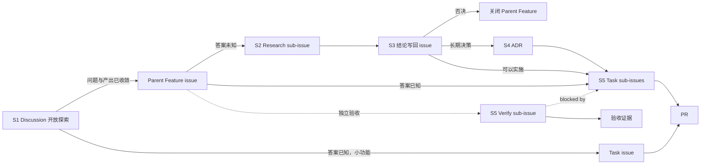

# 研发工作流

**把想法变成可追踪的 issue。七步，只用 GitHub 原生能力。**

版本 0.13 · 2026-10-29

---

## 适用范围

| 项 | 内容 |
|---|---|
| 仓库 | `wyz541/kmp-Covio`。个人账号仓库。 |
| 团队 | 2 到 15 人。此数字是经验值。 |
| 不适用 | 需要外部合规取证的组织，例如 ISO 27001、SOC 2。 |

**对象用标签区分，字段用 Project 字段。** 个人账号没有 issue types，也没有 issue fields。这两项只在组织账号存在。标签与 Project 字段在两种账号下都可用，所以本流程只用这两样。组织仓库若已有类型，可以另加，但不作为本流程的依赖。

**前置（一次性）。**

1. 启用 Discussions，保留默认的 `Ideas` 与 `Q&A` 分类。
2. 建标签 `idea`、`research`、`feature`、`task`、`verify`。
3. 建 1 个 Project，挂上本仓库。字段与视图见 S7。

**本仓库的完成状态：**

| 项 | 状态 | 办法 |
|---|---|---|
| 标签 `idea`、`research`、`feature`、`task`、`verify` | 已完成 | `gh label create` |
| Discussions | 已完成 | 仓库 Settings 页 |
| Project | 已完成 | [Project 8](https://github.com/users/wyz541/projects/8) |
| Project 字段名 | 已核对 | 见 [Project 字段](project-fields.md) |
| 自动加入 | 已完成 | 见 S7 第 5 步 |

> issue forms 仍是 public preview，结构可能变动。

---

## 角色

| 角色 | 谁 | 做什么 | 权限 |
|---|---|---|---|
| 提交人 | 任何人 | 提想法、提 issue | read。打标签需要 triage |
| 负责人 | issue 的 assignee | 推进 issue、写结论、回填链接 | write |
| 维护人 | 1 到 2 人，由团队指定 | 每周检查、管 Project 与标签 | maintain |

issue 的创建人默认担任负责人。改派时换 assignee。
Project 的权限单独授予，与仓库权限无关。
ADR 的 PR 与本文件的 PR，通常需要一名非作者批准。
单人仓库只有一名协作者时，作者自查并记录结论后可以合并。非作者评审不阻塞合并。

---

## 流程



主线是 `Discussion → Parent Feature → Research sub-issue → Task sub-issue → PR`。Research、Task 与 Verify 都是 Parent Feature 的 sub-issue，靠标签与完成标准区分。Verify 与 Task 同级，不是 Task 的 child。答案已知的小功能可以直接建 task issue。S6 与 S7 贯穿全部步骤。

**Parent Feature 是工作容器，不表示已经承诺实施。** 调研结论可以在 S3 否决 Parent Feature。

---

## 七个步骤

### S1 开放式想法进 Discussions

**何时用：** 任何人想到一件事；问题、做法或产出还没有收敛。
**谁做：** 提交人。

1. 建帖，选 `Ideas` 或 `Q&A` 分类。
2. 写三样：问题、受影响的人、一个具体场景。不写解法。
3. 打上 `idea` 标签。没有 triage 权限就请维护人代打。
4. 在 Discussion 中补上下文、约束和候选方向。不要提前创建 Research issue。
5. 每周检查一次是否收敛。收敛后执行第 6 条或第 7 条。
6. 如果仍有一个明确问题待回答，创建 Parent Feature。再创建 Research issue，并把 Research 设为 Parent Feature 的 sub-issue。进入 S2。
7. 如果答案已经明确，选择直接交付或拆分交付。功能小且一个会话能完成时，创建一个 task issue。功能大且需要多个 PR 时，创建 Parent Feature，再拆 task sub-issue。进入 S5。
8. 在 Discussion 写最终评论：结论、Parent Feature 或 task issue 链接、下一动作。然后关闭 Discussion。
9. 30 天内没有收敛，维护人提醒原提交人。无人处理时，维护人关闭讨论并写一行原因。

**收敛条件：** 以下四项必须同时成立。

1. 可以用一句话写出一个待答问题或交付目标。
2. 可以写清预期产出。
3. 有人担任负责人。
4. Research 的时间盒不超过 3 个工作日；或者 task 可以在一个会话内完成。

**完成标准：** Discussion 已转入一个 task issue 或 Parent Feature，并且原帖有回链；或者 Discussion 已写明关闭原因。

> **警告：** Discussions 不进 Projects，也不能排期。需要排期时必须转成 issue。官方文档只列出 issue、PR 与 draft issue。

> **警告：** Discussion 不能作为 GitHub 原生 parent。Parent Feature 必须是 Issue。Discussion 只保存来源和探索过程。

### S2 调研开一个 Research sub-issue

**何时用：** S1 已收敛为一个明确问题；问题有负责人、时间盒和预期产出。
**谁做：** 负责人。

1. 确认 Parent Feature 已存在。没有 Parent Feature 时，先按 S5 创建。
2. 用 `.github/ISSUE_TEMPLATE/research.yml` 建 issue。表单自动加标签 `research`。命令行建的话，加 `--label research --parent <Feature 编号>`。
3. 在 GitHub 的 Parent Feature 页面打开 `Sub-issues`，把 Research issue 添加为子项。命令行建时检查 `--parent` 是否生效。
4. 标题写成 `research: <要回答的问题>`。
5. 填满三项：待答问题、时间盒、预期产出。背景字段填原 Discussion 链接。
6. 时间盒默认 2 个工作日，上限 3 个工作日。
7. 到期时召集一次 15 分钟评审。评审只决定一件事：结题，或延长。
8. 延长只允许一次，且不超过原时长。延长用尽仍未答出，按第 9 条结题。
9. 答不出的问题写进结论，关闭 issue，由新的 Research issue 或 Parent Feature 承接。

**完成标准：** 三项内容齐全，issue 有 assignee，并且 Parent Feature 的 `Sub-issues` 已显示 Research issue。

**规则：** 一个 Research issue 只回答一个问题。Research 的代码不合并到 `main`。Research 不要求一条分支和一个 PR。

### S3 结论写回 issue

**何时用：** Research 到期，或调研可以收尾。
**谁做：** 负责人。

1. 编辑正文，填「结论」段。写三样：结论、依据、后续动作。
2. 依据含数据或链接。例如基准测试结果、文档链接、失败日志。
3. 结论是否决时，写明理由。
4. 加一行决策指向。格式见 S6。编号未知时写 `pending`。
5. 结论允许实施时，在 Parent Feature 下创建 task sub-issue。每个 task 使用 `blocked by` 指向 Research issue。
6. 结论否决时，把未完成的 Task sub-issue 关闭为 `not planned`。
7. 关闭 Research issue。原因填 `completed`（调研已结题）或 `not planned`（否决）。
8. 结论否决时，关闭 Parent Feature。原因填 `not planned`，正文写否决原因。
9. 有原 Discussion 时，在原帖补一条评论：一句话结论、Research issue 链接和下一步。

**完成标准：** 只读 Research 正文就能懂结论。Parent Feature 已记录后续 task，或者已关闭。

**规则：** 结论写在正文，不写评论。评论按时间排列，结论会被后续讨论淹没。结论未写入正文前，不关闭 Research issue。

**判断「长期留存」：** 影响多个模块；改起来成本高；半年后还会被问到。满足任一条进入 S4。

### S4 长期决策写成 ADR

**何时用：** S3 判定为长期决策。
**谁做：** 负责人。

1. 从 `docs/adr/adr-template.md` 复制，文件名写成 `adr-NNNN-<slug>.md`。
2. 编号取现有最大值加一。编号不复用。
3. 按模板填写。
4. 提交 PR。合并前把 Status 改成 `accepted`。PR 合并即生效。
5. 合并后把 S3 里的 `decision: pending` 改成实际编号。

| 字段 | 取值 |
|---|---|
| Status | `proposed`（只在未合并的 PR 里）、`accepted`（生效）、`deprecated`（不再推荐）、`superseded`（被替代） |
| Kind | `architecture`（技术决策）、`process`（流程决策） |

**改既有 ADR：** 只追加「补充」行，不删原文。见 S3 实测记录的做法。

**推翻旧决策：** 写新 ADR；旧 ADR 的 Status 改 `superseded`，头部写 `Superseded by: ADR-NNNN`；新 ADR 头部写 `Supersedes: ADR-NNNN`；三个改动放在同一个 PR。

**完成标准：** PR 已合并。回填编号由每周检查追踪。

> **警告：** 不要删除或改写旧 ADR 的正文。删除会丢失决策历史。

### S5 建 Parent Feature 和 sub-issues

**何时用：** Discussion 已收敛为需要跟踪的工作；或者答案明确，但工作预计涉及多个步骤。做法清楚的小功能直接建 task issue。
**谁做：** 负责人。

1. 用 `.github/ISSUE_TEMPLATE/feature.yml` 建 Parent Feature。表单自动加标签 `feature`。标题写成 `<动词> <对象>`。命令行建的话，加 `--label feature`。
2. 负责人记在 assignee 字段里，不写进正文。
3. 有 Discussion 来源时，在 Parent Feature 正文写 `discussion: <URL>`。没有时写 `discussion: none`。
4. 需要回答未知问题时，先创建 Research sub-issue，进入 S2。Parent Feature 暂时只跟踪 Research。
5. Research 完成后，把实施工作拆成 task sub-issue。每个 task 加标签 `task`，写验收标准，预计工期 1 到 3 天。
6. 从 Research 产生的 task，用 `blocked by` 指向 Research issue。其他技术顺序也用 `blocked by` 记录。
7. 需要独立验收时，建 Verify sub-issue。Verify 与 Task 同级，并用 `blocked by` 指向被验收的 Task。
8. Verify 使用 `.github/ISSUE_TEMPLATE/verify.yml`，加标签 `verify`。填写验收场景、环境、依赖和证据要求。
9. UI issue 写 `表现预期`。UI 决策可在 issue 的 `预览` 段放候选方案。代码交付后，单个 PR 的真机证据仍写在 PR 的 `Visual verification`。

Verify 不要求分支和 PR。完成条件是验收场景通过，并且证据写回 Verify 正文。

**何时建 Verify：** 满足以下任一条。

1. 验收跨越多个 Task 或 PR。
2. 验收需要真机、外接设备、人工交互或不易复现的环境。
3. 验收需要在合并后或发布前再次执行。
4. 验收证据需要独立保存并长期追踪。

单个 Task 的验收能在对应 PR 的 `Proof` 或 `Visual verification` 中完成时，不建 Verify issue。

**判断「大功能」：** 需要 2 个以上 PR；预计超过 5 个工作日；需要先改设计。满足任一条就建 Parent Feature。需要调研的工作直接创建 Parent Feature，不等待最终规模判断。

**层级：** 不超过 3 层，从 Feature 数起。工具支持 8 层，但第 4 层开始没人看。层级不表示工期。

**完成标准：** Parent Feature 至少有一个 Research、Task 或 Verify sub-issue。每个 task 都有验收标准，且工期不超过 3 天。涉及 UI 变化时，正文写有可判断的表现预期。Parent Feature 交付前，所有 Task 已合并，所有适用的 Verify 已通过。

**小功能：** 答案明确且一个会话能完成时，建 task issue，不需要 Parent Feature。单个 Task 的验收证据写在对应 PR。跨多个 Task、需要真机或需要发布前复验时，再建 Verify。

**规则：** issue 不要求写满需求。issue 是讨论的起点，细节在评论与 PR 里补齐。同一条信息只维护一处，不建并行的 PRD。

> **注意：** Research、Task 和 Verify 都可以分配给负责人。执行顺序只用 `blocked by` 表达，不用 assignee 表达。

**取消工作时：**

1. Parent Feature 与未完成的 sub-issue 关闭为 `not planned`。Parent Feature 正文写取消原因。
2. 关联的 ADR 加一行 `Cancelled by: #123`。决策本身作废时，Status 另改成 `deprecated`。

### S6 用文本约定回链

**何时用：** 引用另一个对象时。
**谁做：** 负责人。写在正文或表单字段里，只写一次。

| 对象 | 写法 | 指向 |
|---|---|---|
| Parent Feature | `discussion: <URL>` 或 `discussion: none` | Discussion 来源 |
| Parent Feature | `decision: ADR-0042` 或 `decision: none` | 决策记录 |
| ADR | `Implements: #123` 或 `Implements: pending` | 执行的 Feature |
| ADR | `Supersedes: ADR-0003` 或 `Supersedes: none` | 被推翻的旧决策 |
| Research issue | `decision: pending`、`decision: ADR-0042` 或 `decision: none` | 决策状态 |

**规则：** 未定的值写 `pending`，5 个工作日内回填。本仓库引用写 `#123`，跨仓库写 `owner/repo#123`。每行只放一个引用。

Research、Task、Verify 与 Parent Feature 的原生 sub-issue 关系是唯一层级来源。不要在 sub-issue 正文重复写 Parent Feature 编号。

**检索：**

```bash
gh issue list --state all --search "decision"          # 全部回链
gh issue list --state all --search "decision pending"  # 待回填
gh search issues "decision" --owner wyz541             # 跨仓库
```

GitHub 的 issue 搜索不保证支持标点。命令里只写关键词 `decision`。

**为什么用文本：** GitHub、Linear、Jira 都没有原生的决策对象。回链只能靠约定。

### S7 用 Projects 看进度

**何时用：** 建好 Parent Feature 之后配置一次。之后每周看一次。
**谁做：** 维护人。

1. 核对字段。字段的唯一来源是 [Project 字段](project-fields.md)。该文件记录实测的名字与取值。
2. 打开 table 视图，按 `Parent issue` 分组。
3. 打开隐藏字段 `Sub-issues progress`。
4. 新建 roadmap 视图，用 `Target date` 或 iteration 字段定位。
5. 打开自动加入。位置是 Project 的 `⋯` 菜单，`Workflows`，`Auto-add to project`。筛选条件填 `repo:wyz541/kmp-Covio is:issue`。
6. 每周过一遍带 `Blocked` 标记的 issue。

> **警告：** 关闭第 5 步的自动加入后，`gh` 建的 issue 不会出现在 Project 里。表单建的 issue 也不会。只有手工添加或开自动加入才会进。

> **关于权限：** 读字段需要 `read:project`。用 `gh project item-add` 手工加条目需要 `project`。开了自动加入就不需要后者。

**完成标准：** Parent Feature 的进度看 Sub-issues progress 就能读到，不需要问人。

> **警告：** roadmap 视图不能展开子项。要看子项进度时切回 table 视图。

---

## 约定

### 对象

| 对象 | 承载 | 标签 | 标题前缀 |
|---|---|---|---|
| 想法与开放探索 | Discussion | 分类 `Ideas` 或 `Q&A`，标签 `idea` | 无 |
| Parent Feature | Issue | `feature` | 无 |
| 调研 | Parent Feature 的 sub-issue | `research` | `research:` |
| 小功能或实施任务 | Issue 或 Parent Feature 的 sub-issue | `task` | 无 |
| 验收 | Parent Feature 的 sub-issue | `verify` | `verify:` |
| 决策 | 仓库文件 | `docs/adr/` | 无 |

GitHub 默认只有 task、bug、feature 三种 issue type，且只在组织账号可用。本流程不依赖 type。区分对象看标签。

**三类 sub-issue 的差异：** Research 的产出是结论，Task 的产出是 PR，Verify 的产出是验收证据。Verify 与 Task 同级。

### 字段

个人账号没有 issue fields。Priority 与 Size 由 `feature.yml` 的表单下拉收集，写在 issue 正文里。Start date 与 Target date 只在 Project 里维护，不写进正文，避免两处维护。

字段的名字与取值见 [Project 字段](project-fields.md)。

`Parent issue`、`Sub-issues progress` 与 iteration 是 Project 自带的字段，不需要另建。

### 测试门禁：按影响范围分层

**何时用：** 所有代码改动、测试改动和构建配置改动。
**谁做：** 负责人运行本地测试。CI 运行自动门禁。

| 层级 | 何时运行 | 必须覆盖 | 完成标准 |
| --- | --- | --- | --- |
| 相关测试 | 本地迭代 | 改动直接相关的单元测试和相关合同检查 | 相关用例全部通过 |
| 受影响模块 | 提交 PR 前 | 受影响模块的全部测试、跨边界用例和 UI 真机验收 | PR 写明命令和结果 |
| 全量测试 | 高风险改动和合并门禁 | `bash scripts/test-all.sh` 或等价的 CI 作业集合 | 全量检查全部通过 |

1. 默认从相关测试开始。单个局部改动不反复运行全量测试。
2. 提交 PR 前至少运行受影响模块的测试。
3. 满足任一项时升级到全量测试：跨两个以上模块；改配置、合同、协议、持久化或发布脚本；改 CI 或构建配置；无法判断影响范围；准备正式发布。
4. CI 是合并门禁。CI 作业必须覆盖 `scripts/test-all.sh` 的自动检查。
5. 本地未运行全量测试时，PR 写明原因和对应 CI 作业。
6. 全量测试出现无关偶发失败时，先单独复跑失败用例。复跑通过后记录结果；持续失败时阻塞合并。
7. 修改测试本身时，必须运行相关测试。改变测试门禁覆盖范围时，必须运行全量测试或等待全部 CI 门禁通过。

**完成标准：** 负责人识别测试层级，PR 记录命令和结果，合并前所需层级全部通过。

跨多个 Task 的端到端验收不写在单个 PR 的 `Proof` 里。负责人建 Verify sub-issue，并把各 PR 的测试证据链接到 Verify。单个 PR 的自动测试仍写在 PR。

### UI 证据与 Visual verification

**何时用：** issue 涉及 UI 决策，或 PR 涉及 UI 代码变更。
**谁做：** 负责人补证据。评审人在 PR 核对真机截图。

Issue 只写问题、范围、表现预期和验收标准。
UI 决策可以在 issue 的 `预览` 段放候选方案。
候选方案不等于真机验收。
UI 代码变更只有在实现后才能生成 After 截图。
因此，UI 代码变更的 `Visual verification` 只写在 PR。
跨多个 PR 的最终 UI 验收写在 Verify issue。Verify 可以链接各 PR 的截图，不复制图片证据。

PR 使用以下固定格式：

```markdown
## Visual verification

**亮色**

| Before | After |
| --- | --- |
| Light before | Light after |

**深色**

| Before | After |
| --- | --- |
| Dark before | Dark after |
```

把 `Light before`、`Light after`、`Dark before` 和 `Dark after` 换成 Markdown 图片。

1. 截图归档到仓库内的 `docs/design/previews/`。此目录保存 UI 证据。
2. 文件名遵守该目录的 `README.md`。UI 决策使用 `candidate`、`selected` 或 `current` 角色。UI 代码变更使用 `before` 或 `after` 角色。
3. PR 正文嵌入同一文件的固定 commit GitHub 图片地址。不写本机路径，不上传第二份权威副本。
4. PR 正文记录截图来源、日期、设备型号、系统版本、页面、状态和 commit。
5. 旧图不删除。同一场景重截后，序号加一。
6. 不涉及 UI 的 PR 在 `Visual verification` 段写「不适用」。
7. UI 代码 PR 缺少截图或图片链接失效时，不得转入 ready 或合并。
8. 仓库是公开仓库。截图必须使用测试数据，并遮挡用户名、文件名、通知和其他个人信息。

### 目录

ADR 与流程文件放在同一个仓库。跨仓库的对象用 `owner/repo#123` 引用。

文档只有一个根目录 `docs/`。ADR、流程文件和研究报告都放在它下面。

```text
repo/
├─ .github/
│  ├─ ISSUE_TEMPLATE/
│  │  ├─ feature.yml
│  │  ├─ research.yml
│  │  ├─ task.yml
│  │  └─ verify.yml
│  └─ pull_request_template.md    ← PR 的 Visual verification
└─ docs/
   ├─ adr/
   │  ├─ adr-template.md
   │  ├─ adr-0001-macos-ui-swiftui.md
   │  └─ adr-NNNN-<slug>.md
   ├─ design/
   │  └─ previews/              ← UI 截图
   ├─ process/
   │  └─ workflow.md          ← 本文件
   └─ research/
      ├─ workflow-research.md
      └─ <主题>/              ← 按 AUTHORING.md 生成
```

调研报告按 `docs/research/AUTHORING.md` 生成。
本流程自身的依据是单文件 `workflow-research.md`，不建主题目录。

---

## 每周检查

**维护人执行。** 第 1 条由维护人催办，负责人回填。

1. 搜 `decision pending`，找出超期的，通知负责人回填。
2. 过一遍带 `Blocked` 标记的 issue，有阻塞就找人解开。
3. 跑 `gh issue list --label research --state open`，找出创建超过 3 个工作日的。提醒负责人结题，不代为关闭。
4. 检查打开超过 30 天的 Discussion。提醒提交人收敛、转 Issue，或关闭。
5. 检查 Research issue 是否都有 Parent Feature。缺父级时补齐原生 sub-issue 关系。
6. 检查 Verify issue 是否都有 Parent Feature 和 `blocked by`。缺少层级或依赖时补齐。
7. 检查 Parent Feature 的 Sub-issues progress。进度停滞时问一次原因。
8. 检查已合并的 ADR 是否仍带 `proposed`。带的话说明作者漏改，通知负责人。
9. 检查 roadmap 视图的 Target date。日期过期就改或删。

---

## 参数与来源

数值写在各自的步骤里。外部来源只有两处。

| 参数 | 位置 | 来源 |
|---|---|---|
| 团队规模 2 到 15 人 | 适用范围 | 经验值，来源较弱 |
| spike 时间盒 2 到 3 天 | S2 | 业界常见区间是 1 到 3 天 |

其余数值由团队约定。改数值时只改步骤，本表不用动。

---

## 调研依据

1. spike 要有时间盒和交付物。issue 装不下全部需求。这两条是 Reddit 与 Hacker News 上的多数共识。
2. 工具没有原生的决策对象，回链靠约定。实施追踪的成熟做法有两种：Rust 给每个已接受的 RFC 建 tracking issue；Kubernetes 让 KEP 编号等于 tracking issue 编号。

完整调研见 `docs/research/workflow-research.md`。
