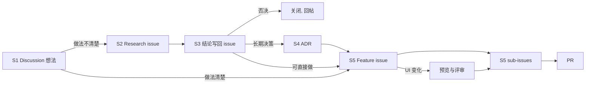

# 研发工作流

**把想法变成可追踪的 issue。七步，只用 GitHub 原生能力。**

版本 0.9 · 2026-10-22

---

## 适用范围

| 项 | 内容 |
|---|---|
| 仓库 | `wyz541/kmp-Covio`。个人账号仓库。 |
| 团队 | 2 到 15 人。此数字是经验值。 |
| 不适用 | 需要外部合规取证的组织，例如 ISO 27001、SOC 2。 |

**对象用标签区分，字段用 Project 字段。** 个人账号没有 issue types，也没有 issue fields。这两项只在组织账号存在。标签与 Project 字段在两种账号下都可用，所以本流程只用这两样。组织仓库若已有类型，可以另加，但不作为本流程的依赖。

**前置（一次性）。**

1. 启用 Discussions，保留默认的 `Ideas` 与 `Q&A` 分类。
2. 建标签 `idea`、`research`、`feature`、`task`。
3. 建 1 个 Project，挂上本仓库。字段与视图见 S7。

**本仓库的完成状态：**

| 项 | 状态 | 办法 |
|---|---|---|
| 标签 `idea`、`research`、`feature`、`task` | 已完成 | `gh label create` |
| Discussions | 已完成 | 仓库 Settings 页 |
| Project | 已完成 | [Project 8](https://github.com/users/wyz541/projects/8) |
| Project 字段名 | 已核对 | 见 [Project 字段](project-fields.md) |
| 自动加入 | **待人工打开** | 见 S7 第 5 步 |

> issue forms 仍是 public preview，结构可能变动。

---

## 角色

| 角色 | 谁 | 做什么 | 权限 |
|---|---|---|---|
| 提交人 | 任何人 | 提想法、提 issue | read。打标签需要 triage |
| 负责人 | issue 的 assignee | 推进 issue、写结论、回填链接 | write |
| 维护人 | 1 到 2 人，由团队指定 | 每周检查、管 Project 与标签 | maintain |

issue 的创建人默认担任负责人。改派时换 assignee。
Project 的权限单独授予，与仓库权限无关。
ADR 的 PR 与本文件的 PR，通常需要一名非作者批准。
单人仓库只有一名协作者时，作者自查并记录结论后可以合并。非作者评审不阻塞合并。

---

## 流程



主线两条：想法走 Discussion，交付走 Feature 与 sub-issue。调研与决策是旁挂：做法不清楚时开 Research，需要长期留存时写 ADR。S6 与 S7 贯穿全部步骤。

---

## 七个步骤

### S1 想法进 Discussions

**何时用：** 任何人想到一件事，做法还不清楚。
**谁做：** 提交人。

1. 建帖，选 `Ideas` 或 `Q&A` 分类。
2. 写三样：问题、受影响的人、一个具体场景。不写解法。
3. 打上 `idea` 标签。没有 triage 权限就请维护人代打。
4. 出现下列任一信号时，转成 Research issue，进入 S2：3 个不同的人回复；或有人在帖子里说要做调研。
5. 30 天内没有信号，维护人提醒原提交人。无人处理时，维护人关闭讨论并写一行原因。

**完成标准：** 帖子含问题、受影响的人、一个具体场景。

> **警告：** Discussions 不进 Projects，也不能排期。需要排期时必须转成 issue。官方文档只列出 issue、PR 与 draft issue。

### S2 调研开一个 spike issue

**何时用：** 问题清楚，但做法、成本、风险或可行性有未知项。
**谁做：** 负责人。

1. 用 `.github/ISSUE_TEMPLATE/research.yml` 建 issue。表单自动加标签 `research`。命令行建的话，加 `--label research`。
2. 标题写成 `research: <要回答的问题>`。
3. 填满三项：待答问题、时间盒、预期产出。背景字段填原 Discussion 链接。
4. 时间盒默认 2 个工作日，上限 3 个工作日。
5. 到期时召集一次 15 分钟评审。评审只决定一件事：结题，或延长。
6. 延长只允许一次，且不超过原时长。延长用尽仍未答出，按第 7 条结题。
7. 答不出的问题写进结论，关闭 issue，由新的 spike 或 Feature 承接。

**完成标准：** 三项内容齐全，且 issue 有 assignee。

**规则：** 一个 spike 只回答一个问题。spike 的代码不合并到 `main`。

### S3 结论写回 issue

**何时用：** spike 到期，或调研可以收尾。
**谁做：** 负责人。

1. 编辑正文，填「结论」段。写三样：结论、依据、后续动作。
2. 依据含数据或链接。例如基准测试结果、文档链接、失败日志。
3. 结论是否决时，写明理由。
4. 加一行决策指向。格式见 S6。编号未知时写 `pending`。
5. 关闭 issue。原因填 `completed`（调研已结题）或 `not planned`（否决）。
6. 有原 Discussion 时，在原帖留一条评论：一句话结论加 issue 链接。

**完成标准：** 只读正文就能懂结论，评论可以全部不看。

**规则：** 结论写在正文，不写评论。评论按时间排列，结论会被后续讨论淹没。结论未写入正文前，不关闭 issue。

**判断「长期留存」：** 影响多个模块；改起来成本高；半年后还会被问到。满足任一条进入 S4。

### S4 长期决策写成 ADR

**何时用：** S3 判定为长期决策。
**谁做：** 负责人。

1. 从 `docs/adr/adr-template.md` 复制，文件名写成 `adr-NNNN-<slug>.md`。
2. 编号取现有最大值加一。编号不复用。
3. 按模板填写。
4. 提交 PR。合并前把 Status 改成 `accepted`。PR 合并即生效。
5. 合并后把 S3 里的 `decision: pending` 改成实际编号。

| 字段 | 取值 |
|---|---|
| Status | `proposed`（只在未合并的 PR 里）、`accepted`（生效）、`deprecated`（不再推荐）、`superseded`（被替代） |
| Kind | `architecture`（技术决策）、`process`（流程决策） |

**改既有 ADR：** 只追加「补充」行，不删原文。见 S3 实测记录的做法。

**推翻旧决策：** 写新 ADR；旧 ADR 的 Status 改 `superseded`，头部写 `Superseded by: ADR-NNNN`；新 ADR 头部写 `Supersedes: ADR-NNNN`；三个改动放在同一个 PR。

**完成标准：** PR 已合并。回填编号由每周检查追踪。

> **警告：** 不要删除或改写旧 ADR 的正文。删除会丢失决策历史。

### S5 大功能建 Feature，小功能建 sub-issue

**何时用：** 结论明确，可以动工。做法清楚的想法从 S1 直接到这里。
**谁做：** 负责人。

1. 用 `.github/ISSUE_TEMPLATE/feature.yml` 建 issue。表单自动加标签 `feature`。标题写成 `<动词> <对象>`。命令行建的话，加 `--label feature`。
2. 负责人记在 assignee 字段里，不写进正文。
3. 每个 sub-issue 建好后，加标签 `task`，就地写一行验收标准，预计工期 1 到 3 天。
4. 用 blocked by 记录顺序。被阻塞的 issue 会自动显示标记。
5. 涉及 UI 变化时，第一个 sub-issue 是预览。验收标准写成「预览可打开，主路径可点」。
6. 实施 sub-issue 用 blocked by 指向预览 sub-issue。评审通过前不动工。
7. UI 决策或 UI 代码变更完成后，按「UI 证据」补截图。截图缺失时，不关闭 issue。

**判断「大功能」：** 需要 2 个以上 PR；预计超过 5 个工作日；需要先改设计。满足任一条就建 Feature。

**层级：** 不超过 3 层，从 Feature 数起。工具支持 8 层，但第 4 层开始没人看。层级不表示工期。

**完成标准：** 每个 sub-issue 都有验收标准，且工期不超过 3 天。涉及 UI 变化时，预览已通过评审，UI 截图证据齐全。

**小功能的预览：** 小功能涉及 UI 变化时，预览与结论写在同一个 issue 正文里。不另建 sub-issue。

**规则：** issue 不要求写满需求。issue 是讨论的起点，细节在评论与 PR 里补齐。同一条信息只维护一处，不建并行的 PRD。

> **注意：** sub-issue 不要按人分配。此做法有争议。反方认为按人分配妨碍协作。正方认为未完成会阻断迭代关闭。团队自行选择。

**取消工作时：**

1. Feature 与未完成的 sub-issue 关闭为 `not planned`。Feature 正文写取消原因。
2. 关联的 ADR 加一行 `Cancelled by: #123`。决策本身作废时，Status 另改成 `deprecated`。

### S6 用文本约定回链

**何时用：** 引用另一个对象时。
**谁做：** 负责人。写在正文或表单字段里，只写一次。

| 对象 | 写法 | 指向 |
|---|---|---|
| Feature issue | `decision: ADR-0042` 或 `decision: none` | 决策记录 |
| Feature issue | `research: #98` | 调研结论 |
| ADR | `Implements: #123` 或 `Implements: pending` | 执行的 Feature |
| ADR | `Supersedes: ADR-0003` 或 `Supersedes: none` | 被推翻的旧决策 |
| Research issue | `decision: pending`、`decision: ADR-0042` 或 `decision: none` | 决策状态 |

**规则：** 未定的值写 `pending`，5 个工作日内回填。本仓库引用写 `#123`，跨仓库写 `owner/repo#123`。每行只放一个引用。

**检索：**

```bash
gh issue list --state all --search "decision"          # 全部回链
gh issue list --state all --search "decision pending"  # 待回填
gh search issues "decision" --owner wyz541             # 跨仓库
```

GitHub 的 issue 搜索不保证支持标点。命令里只写关键词 `decision`。

**为什么用文本：** GitHub、Linear、Jira 都没有原生的决策对象。回链只能靠约定。

### S7 用 Projects 看进度

**何时用：** 建好 Feature 之后配置一次。之后每周看一次。
**谁做：** 维护人。

1. 核对字段。字段的唯一来源是 [Project 字段](project-fields.md)。该文件记录实测的名字与取值。
2. 打开 table 视图，按 `Parent issue` 分组。
3. 打开隐藏字段 `Sub-issues progress`。
4. 新建 roadmap 视图，用 `Target date` 或 iteration 字段定位。
5. 打开自动加入。位置是 Project 的 `⋯` 菜单，`Workflows`，`Auto-add to project`。筛选条件填 `repo:wyz541/kmp-Covio is:issue`。
6. 每周过一遍带 `Blocked` 标记的 issue。

> **警告：** 不打开第 5 步的自动加入，`gh` 建的 issue 不会出现在 Project 里。表单建的 issue 也不会。只有手工添加或开自动加入才会进。

> **关于权限：** 读字段需要 `read:project`。用 `gh project item-add` 手工加条目需要 `project`。开了自动加入就不需要后者。

**完成标准：** Feature 的进度看 Sub-issues progress 就能读到，不需要问人。

> **警告：** roadmap 视图不能展开子项。要看子项进度时切回 table 视图。

---

## 约定

### 对象

| 对象 | 承载 | 标签 | 标题前缀 |
|---|---|---|---|
| 想法 | Discussions | 分类 `Ideas` 或 `Q&A`，标签 `idea` | 无 |
| 调研 | Issue | `research` | `research:` |
| 大功能 | Issue | `feature` | 无 |
| 小功能 | Issue | `task` | 无 |
| 决策 | 仓库文件 | `docs/adr/` | 无 |

GitHub 默认只有 task、bug、feature 三种 issue type，且只在组织账号可用。本流程不依赖 type。区分对象看标签。

### 字段

个人账号没有 issue fields。Priority 与 Size 由 `feature.yml` 的表单下拉收集，写在 issue 正文里。Start date 与 Target date 只在 Project 里维护，不写进正文，避免两处维护。

字段的名字与取值见 [Project 字段](project-fields.md)。

`Parent issue`、`Sub-issues progress` 与 iteration 是 Project 自带的字段，不需要另建。

### 设计闸门：UI 变化先出预览

**何时用：** 改动会改变用户可见的界面。
**谁做：** 负责人产出预览并写结论。评审人对照「表现预期」逐条判断。

界面变化在动工前先出可点的 web 预览。评审通过后才开始实施。

| 编号 | 需求 | 判据 |
|---|---|---|
| R1 | 功能涉及 UI 变化时，实施前必须产出 web 预览 | 预览可打开，主路径可点 |
| R2 | 预览用 web 的 Compose 编写 | 产物是浏览器可打开的页面 |
| R3 | 预览通过评审后，才可开始实施 | 评审结论已写回 issue |
| R4 | 评审对照需求正文的「表现预期」逐条判断 | 预期逐条有结论 |
| R5 | 评审结论写回 issue 正文，不写评论 | 只读正文就能看到结论 |
| R6 | 打回时不关闭预览 issue，列出差异，改完重评 | 差异逐条关闭 |
| R7 | 预览覆盖主路径 | 主路径无死路 |
| R8 | 预览地址与截图记入 issue | 评审人可自行打开 |
| R9 | 预览不是交付物 | 发布物不含预览 |
| R10 | 大功能的预览是第一个 sub-issue，实施 sub-issue 阻塞于它 | 依赖关系在 GitHub 上可见 |
| R11 | 小功能的预览写在同一 issue 里 | 正文含预览结论 |
| R12 | 需求正文必须有「表现预期」一栏 | 表单必填 |

**分级：**

| 档 | 用在 | 覆盖 | 工期 |
|---|---|---|---|
| 单屏预览 | 已评审界面的小改动 | 一屏 | 半天内 |
| 交互原型 | 新界面，或交互变化 | 主路径 | 2 个工作日 |

**例外：** 清单外的 UI 变化一律要预览。清单是穷举的。

1. 纯逻辑、数据、性能或构建改动，外观不变。
2. 文案与标点修正。
3. 内部重构，外观不变。
4. 依赖升级，外观不变。
5. 已评审界面的同构复制，交互不变。

**角色：**

| 角色 | 职责 |
|---|---|
| 负责人 | 产出预览，写结论 |
| 评审人 | 对照表现预期逐条判断。非作者担任；单人仓库由负责人自查 |

本仓库是个人账号，没有第二名评审人。评审由负责人自查，结论照样记录。

**本仓库的落地：**

1. 预览写在 `designPreview` 模块里，用 Compose Multiplatform 的 wasm 目标。
2. 用 `./kotlin run -m designPreview` 起本地服务。地址是 `http://127.0.0.1:8080`。
3. 截图存进 `docs/design/previews/`，路径写进 issue 正文。
4. 预览不进发布物，也不接 `kmpDomain`。

**依据：** Amper 0.12.1 能建 `wasm-js/app` 模块并在浏览器里渲染 Compose 内容。实测见 #103。

### UI 证据

**何时用：** issue 涉及 UI 决策或 UI 代码变更。
**谁做：** 负责人补齐证据。评审人核对截图。

| 类型 | issue 正文必须包含 |
|---|---|
| UI 决策 | 当前界面或候选方案截图，以及选定方案截图 |
| UI 代码变更 | 同一页面、同一状态的真机变更前后截图 |

1. 截图归档到仓库内的 `docs/design/previews/`。此目录保存 UI 证据。
2. 文件名遵守该目录的 `README.md`。UI 决策使用 `candidate`、`selected` 或 `current` 角色。UI 代码变更使用 `before` 或 `after` 角色。
3. Issue 正文嵌入同一文件的固定 commit GitHub 图片地址。不写本机路径，不上传第二份权威副本。
4. Issue 正文记录截图来源、日期、设备型号、系统版本、页面、状态和 commit。
5. 旧图不删除。同一场景重截后，序号加一。
6. 不涉及 UI 的 issue 在 UI 证据栏写「不适用」。
7. UI issue 缺少截图或证据链接失效时，不得关闭。
8. 仓库是公开仓库。截图必须使用测试数据，并遮挡用户名、文件名、通知和其他个人信息。

### 目录

ADR 与流程文件放在同一个仓库。跨仓库的对象用 `owner/repo#123` 引用。

文档只有一个根目录 `docs/`。ADR、流程文件和研究报告都放在它下面。

```text
repo/
├─ .github/ISSUE_TEMPLATE/
│  ├─ feature.yml
│  ├─ research.yml
│  └─ task.yml
└─ docs/
   ├─ adr/
   │  ├─ adr-template.md
   │  ├─ adr-0001-macos-ui-swiftui.md
   │  └─ adr-NNNN-<slug>.md
   ├─ design/
   │  └─ previews/              ← UI 截图
   ├─ process/
   │  └─ workflow.md          ← 本文件
   └─ research/
      ├─ workflow-research.md
      └─ <主题>/              ← 按 AUTHORING.md 生成
```

调研报告按 `docs/research/AUTHORING.md` 生成。
本流程自身的依据是单文件 `workflow-research.md`，不建主题目录。

---

## 每周检查

**维护人执行。** 第 1 条由维护人催办，负责人回填。

1. 搜 `decision pending`，找出超期的，通知负责人回填。
2. 过一遍带 `Blocked` 标记的 issue，有阻塞就找人解开。
3. 跑 `gh issue list --label research --state open`，找出创建超过 3 个工作日的。提醒负责人结题，不代为关闭。
4. 检查 Feature 的 Sub-issues progress。进度停滞时问一次原因。
5. 检查已合并的 ADR 是否仍带 `proposed`。带的话说明作者漏改，通知负责人。
6. 检查 roadmap 视图的 Target date。日期过期就改或删。

---

## 参数与来源

数值写在各自的步骤里。外部来源只有两处。

| 参数 | 位置 | 来源 |
|---|---|---|
| 团队规模 2 到 15 人 | 适用范围 | 经验值，来源较弱 |
| spike 时间盒 2 到 3 天 | S2 | 业界常见区间是 1 到 3 天 |

其余数值由团队约定。改数值时只改步骤，本表不用动。

---

## 调研依据

1. spike 要有时间盒和交付物。issue 装不下全部需求。这两条是 Reddit 与 Hacker News 上的多数共识。
2. 工具没有原生的决策对象，回链靠约定。实施追踪的成熟做法有两种：Rust 给每个已接受的 RFC 建 tracking issue；Kubernetes 让 KEP 编号等于 tracking issue 编号。

完整调研见 `docs/research/workflow-research.md`。
