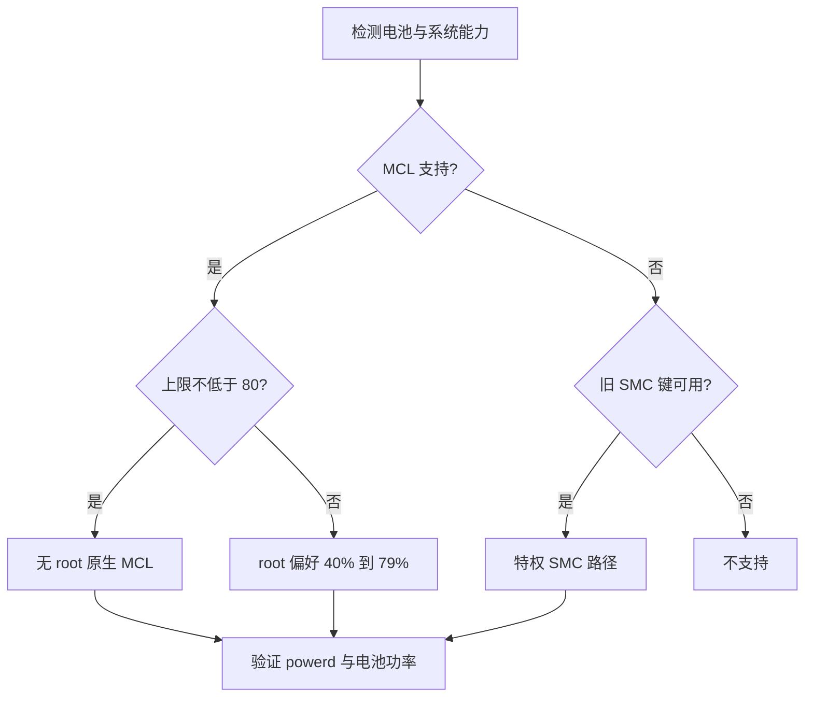

# 电池充电控制能力

## 前因

macOS 的原生充电上限可以限制电池充电。
Covio 已要求支持自定义上限和旁路供电。
公开读取接口不能回答写入、权限和恢复问题。
因此，本主题研究安全的电池充电控制路径。
详见 [context.md](context.md)。

## 背景

macOS 26 和 macOS 27 改变了旧 SMC 充电键。
新系统提供 Manual Charge Limit。
旧实现依赖 SMC 写入和特权 helper。
两条路径的权限、范围和稳定性不同。
详见 [context.md](context.md) 和 [investigation.md](investigation.md)。

## 过程

研究先检查本机只读状态。
然后核对开源实现和历史 issue。
2026-10-20 执行了 `75%` 与 `85%` 真机写入验证。
详见 [investigation.md](investigation.md) 和 [evidence.md](evidence.md)。

## 结果

完整 `40%` 到 `100%` 范围不能使用同一条安全路径实现。
macOS 27 可以在无 root 条件下控制 `80%` 到 `100%`。
真机验证确认原生 `PowerUISmartChargeClient` 可以注册 `85%`。
早期验证曾观察到 root 偏好注册 `70%`。
2026-10-22 复测未复现该结果。
早期低档位失败发生在 `4` 秒判定。PowerUIAgent 可能等待下一次 `1%` 电量步进。
主动放电使用可选开关。
开关开启时，高于上限的目标写为上限，由 macOS 放电。
开关关闭时，高于上限保持当前电量。
详见 [conclusion.md](conclusion.md) 和 [evidence.md](evidence.md)。

## 预期

第一版目标支持 `40%` 到 `100%`。
`80%` 到 `100%` 使用 `PowerUI`。
`40%` 到 `79%` 使用直接偏好路径，并持续等待 powerd 确认。
旁路状态由 macOS 管理，Covio 只读取和展示。
详见 [solution.md](solution.md) 和 [validation/README.md](validation/README.md)。

## 实现预期的手段

1. 运行时检测 `PowerUISmartChargeClient` 能力。
2. 只展示系统接受的上限值。
3. 保存并恢复用户原有系统设置。
4. 读取 `pmset -g battlimit` 和电池功率。
5. 用真机矩阵验证睡眠、重启和校准周期。
详见 [solution.md](solution.md)、[validation/README.md](validation/README.md) 和 [evidence.md](evidence.md)。

## 控制路径

下图只表示能力选择，不表示已批准实现。

## 子文档

| 文档 | 内容 |
| --- | --- |
| [context.md](context.md) | 问题、模型、状态和成功标准 |
| [investigation.md](investigation.md) | 来源、能力矩阵、候选方案和缺口 |
| [conclusion.md](conclusion.md) | 结论、限制和决策表 |
| [solution.md](solution.md) | 推荐的首期方案和实施边界 |
| [evidence.md](evidence.md) | 本机证据、源码和 issue |
| [validation/README.md](validation/README.md) | 验证矩阵、风险和清理要求 |
| [validation/case-macbookpro18-2-macos-27.md](validation/case-macbookpro18-2-macos-27.md) | 只读验证案例 |

## 证据链阅读顺序

1. 阅读 [context.md](context.md) 确认问题。
2. 阅读 [evidence.md](evidence.md) 核对事实。
3. 阅读 [investigation.md](investigation.md) 查看比较。
4. 阅读 [conclusion.md](conclusion.md) 确认边界。
5. 阅读 [solution.md](solution.md) 和 [validation/README.md](validation/README.md) 确认后续验证。

## 更新规则

新系统版本必须重做只读能力检测。
写入能力必须有单独真机案例。
未执行的项目保持 `待执行`。
不得把停止充电直接写成真实旁路供电。
