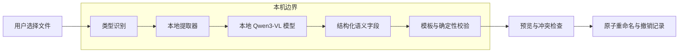

# 文件自动命名上下文

| 项目 | 内容 |
| --- | --- |
| 文档状态 | 初稿，可评审 |
| 日期 | 2026-10-20 |
| 关联 issue | #171 |
| 目标 commit | `9b80f73e7e28e7a776825911543a2089bbe1184d` |

[返回主题索引](README.md)

## 问题类别

本问题属于本地内容理解与文件操作安全。

它同时涉及四个问题：

1. 文件内容能否被可靠提取。
2. 小体积模型能否生成有用语义。
3. 配置能否稳定约束文件名。
4. 重命名能否避免覆盖和不可恢复错误。

## 研究问题

Covio 应采用哪套可复现的本地小体积 LLM 方案，在 macOS 上离线为纯文本、PDF、图片、代码及混合或未知类型文件生成安全、受配置约束的文件名，并由 GitHub 参考实现证明可落地？

## 问题定义

Covio 读取用户选中的文件。
Covio 提取可用内容。
Covio 让本地模型生成语义字段。
Covio 用配置模板生成文件名。
Covio 校验名称、冲突和文件状态。
用户预览并确认后，Covio 执行重命名。

运行时禁止调用远程 AI 服务。
文件内容禁止上传。
模型输出禁止直接成为文件路径。

## 触发条件

用户在 Files 页发起“自动命名”。
用户将一个或多个文件放入自动命名面板。
用户选择预览中的单个或批量条目。

## 问题分类

| 分类 | 判定条件 | 需要的证据 |
| --- | --- | --- |
| 纯文本 | UTType 或内容嗅探判定为文本 | 标题、段落或正文信号 |
| 文本 PDF | PDFKit 返回足够文本 | 页数、字符数和文本质量 |
| 扫描 PDF | PDFKit 返回空文本或低质量文本 | 页面渲染、OCR 和回退路径 |
| 图片 | UTType 判定为图片 | OCR、视觉描述或二者组合 |
| 代码文件 | 已知代码扩展名或语法信号 | 语言、声明、符号和注释 |
| 混合文件 | 同时存在文本、结构化数据和二进制信号 | 多提取器结果的一致性 |
| 未知文件 | 无法稳定识别的普通文件 | 证据不足时拒绝生成 |
| 异常文件 | 损坏、只读、无权限或过大 | 明确错误和恢复动作 |

## 适用范围

1. 本地普通文件。
2. 同一目录内的文件重命名。
3. 单个文件和顺序批量处理。
4. 中文和英文文件名。
5. 用户配置的模板和字符约束。
6. 模型、提取器和重命名的失败恢复。

## 范围外事项

1. 远程模型、远程 OCR 或云端文件上传。
2. 目录重命名。
3. 符号链接和硬链接的特殊处理。
4. 跨卷移动。
5. 视频和音频内容理解。
6. 文件夹自动分类。
7. 模型微调。
8. Intel Mac。
9. App Store 沙盒签名方案。
10. 无预览的静默批量重命名。

## 受影响角色

| 角色 | 关注点 |
| --- | --- |
| 用户 | 名称是否准确、操作是否可撤销、文件是否安全 |
| 平台维护人 | 模型体积、内存、构建依赖和签名 |
| 安全评审人 | 文件内容、提示注入、路径和覆盖风险 |
| 测试人员 | 文件类型矩阵、失败恢复和真机结果 |

## 系统模型

下图表示首版推荐边界。模型和提取器只产生建议值。文件系统写入由受控应用代码完成。

## 状态矩阵

| 输入状态 | 提取路径 | 模型输入 | 失败回退 | 是否允许重命名 |
| --- | --- | --- | --- | --- |
| 正常纯文本 | FileHandle 读取文本 | 文本片段 | 使用文件名或首行 | 预览后允许 |
| 文本 PDF | PDFKit 提取正文 | 标题页和前段 | 转 OCR | 预览后允许 |
| 扫描 PDF | 渲染页面并 OCR | OCR 文本 | 页面图片交给 VLM | 预览后允许 |
| 含字图片 | Vision OCR | OCR 文本加图片摘要 | VLM 直读图片 | 预览后允许 |
| 无字图片 | 图片预处理 | VLM 图片输入 | 使用元数据或拒绝 | 仅高可信建议允许 |
| 代码文件 | FileHandle 读取代码 | 文件名、语言和代码片段 | 使用符号名 | 预览后允许 |
| 混合文件 | 多提取器 | 合并摘要 | 降级或拒绝 | 仅中高可信建议允许 |
| 超大、空或超长文件 | 大小和长度门槛 | 截断或拒绝 | 保留原名 | 仅合法截断时允许 |
| 未知文件 | 内容嗅探 | 无 | 保留原名 | 拒绝 |
| 损坏或只读文件 | 校验资源状态 | 无 | 显示错误 | 拒绝 |

## 场景定义

| 编号 | 场景 | 预期 |
| --- | --- | --- |
| S1 | 用户重命名一份中文会议纪要 | 生成主题名称并保留 `.txt` |
| S2 | 用户重命名文本 PDF | PDFKit 提取正文后生成名称 |
| S3 | 用户重命名扫描 PDF | PDFKit 失败后走 OCR；证据不足再走 VLM |
| S4 | 用户重命名报销截图 | Vision OCR 优先；无文字时使用 VLM |
| S5 | 用户重命名 Swift 代码 | 结合扩展名、声明、符号和注释 |
| S6 | 用户重命名无扩展名混合文件 | 汇总信号；低可信时拒绝 |
| S7 | 文件名与现有文件冲突 | 追加编号或要求用户处理，禁止覆盖 |
| S8 | 模型输出被文件内容注入 | 只形成错误建议；不得执行指令或写任意路径 |
| S9 | 模型不可用或超时 | 保留原名并显示可恢复错误 |
| S10 | 重命名后需要撤销 | 校验身份和版本后原子改回 |

## 成功标准

1. 六类必须输入都有明确路径或明确拒绝条件。
2. 模型包不大于 2 GB。
3. 本机峰值内存不大于 4 GB。
4. 预热后，文本和代码单文件处理不超过 3 秒。
5. 预热后，图片单文件处理不超过 10 秒。
6. 预热后，扫描 PDF 单文件处理不超过 15 秒。
7. 12 个合成样例中，至少 9 个名称可直接接受。
8. 未知或低可信样例不自动应用。
9. 重命名不覆盖同名文件。
10. 每次重命名都有撤销记录。
11. 运行时只访问本机模型和本机文件。
12. 提示注入不能让 Covio 执行指令或生成路径。
