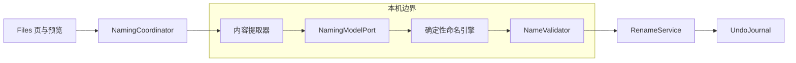
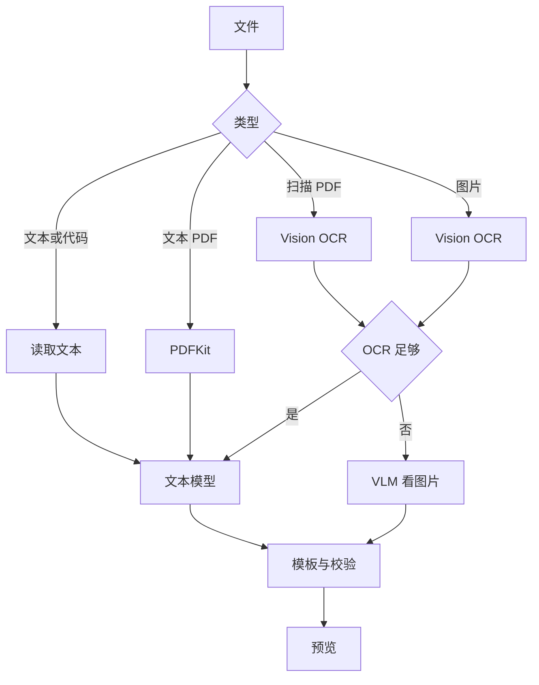

# 文件自动命名推荐方案

| 项目 | 内容 |
| --- | --- |
| 文档状态 | 初稿，可评审 |
| 推荐状态 | 条件性 go |
| 日期 | 2026-10-20 |

[返回主题索引](README.md)

## 推荐架构

首版采用单模型、双运行时接口和应用内事务层。



主实现使用 `MLX Swift + Qwen3-VL-2B-Instruct-4bit`。
备选实现使用 `llama.cpp + Qwen3-VL-2B-Instruct-Q4_K_M + mmproj`。

## 组件职责

| 组件 | 语言 | 职责 |
| --- | --- | --- |
| `NamingCoordinator` | Swift | 调度分析、取消、错误和预览 |
| `FileTypeProbe` | Swift | UTType、魔数和扩展名联合判断 |
| `TextExtractor` | Swift | 读取纯文本和代码片段 |
| `PDFExtractor` | Swift | PDFKit 文本提取和页面渲染 |
| `VisionExtractor` | Swift | 图片和 PDF 页面的 OCR |
| `NamingModelPort` | Swift | 隔离 MLX 与 llama.cpp |
| `NamingPolicy` | Kotlin | 配置、模板、字符、长度和冲突规则 |
| `NamingPlanner` | Kotlin | 把模型字段变成候选名和预览条目 |
| `RenameService` | Swift | 文件身份检查、原子重命名和撤销 |
| `AutoNamingPreview` | SwiftUI | 显示证据、风险、原名和目标名 |

## 调用路径

1. 用户选择文件。
2. `NamingCoordinator` 检查普通文件、权限、大小和是否符号链接。
3. `FileTypeProbe` 生成类型候选。
4. 提取器返回有上限的内容和信号。
5. `NamingModelPort` 返回 `title` 和 `category`。
6. `NamingPlanner` 合并模板、文件元数据和确定性字段。
7. `NameValidator` 检查字符、长度、扩展名和冲突。
8. UI 显示预览。
9. 用户确认后，`RenameService` 写入撤销计划。
10. `RenameService` 执行原子重命名。
11. 应用记录结果并允许撤销。

## 文件位置

首版使用以下位置。已实现项保留实际路径。

| 路径 | 用途 |
| --- | --- |
| `kmpDomain/src/com/wyz/covio/core/FileNamingModels.kt` | 配置、计划和建议模型 |
| `kmpDomain/src/com/wyz/covio/core/FileNamingPolicy.kt` | 模板、校验和冲突规则 |
| `kmpDomain/test/com/wyz/covio/core/FileNamingPolicyTest.kt` | 共享规则测试 |
| `macosApp/src/AutoNaming/FileNamingExtractionModels.swift` | 提取结果、来源、质量和错误码 |
| `macosApp/src/AutoNaming/FileNamingTypeProbe.swift` | 文件类型判断 |
| `macosApp/src/AutoNaming/FileNamingTextExtractor.swift` | 文本和代码提取 |
| `macosApp/src/AutoNaming/FileNamingPDFExtractor.swift` | PDF 文本、页面渲染和 OCR |
| `macosApp/src/AutoNaming/FileNamingImageExtractor.swift` | 图片解码、缩放和 OCR |
| `macosApp/src/AutoNaming/VisionTextRecognizer.swift` | 共享 Vision OCR |
| `macosApp/src/AutoNaming/FileNamingContentExtractor.swift` | 提取协调器 |
| `macosApp/src/AutoNaming/NamingModelPort.swift` | 模型端口、超时、取消和回退 |
| `macosApp/src/AutoNaming/MLXNamingModel.swift` | 本地 MLX Swift 实现 |
| `macosApp/src/AutoNaming/LlamaNamingModel.swift` | 备选运行时 |
| `macosApp/src/AutoNaming/RenameService.swift` | 原子重命名和撤销 |
| `macosApp/src/AutoNaming/AutoNamingPreviewView.swift` | 预览 UI |
| `macosApp/test/FileNamingContentExtractorTests.swift` | 提取、OCR 和失败测试 |
| `macosApp/test/NamingModelPortTests.swift` | 模型契约、超时、回退和字段测试 |
| `macosApp/test/MLXNamingModelIntegrationTests.swift` | 本地文本和图片真实模型测试 |
| `scripts/test-file-naming-model.sh` | Xcode 本地模型验收入口 |

模型资产建议放在应用资源中，例如 `Resources/Models/Qwen3VL-2B-Instruct-4bit/`。
模型资产不能进入 Git。

## 接口契约

首版使用进程内 Swift async 接口。
无网络传输。
调用权限与当前用户相同。

### 请求字段

| 字段 | 类型 | 必需 | 说明 |
| --- | --- | --- | --- |
| `candidateId` | String | 是 | 本次预览内的稳定 ID |
| `fileURL` | URL | 是 | 仅留在 Swift 层，不发送给模型 |
| `kindHint` | String | 否 | UTType 或内容探针结果 |
| `policy` | NamePolicy | 是 | 配置快照 |
| `maxInputBytes` | Int | 是 | 提取上限 |
| `allowVision` | Bool | 是 | 是否允许图片输入 |

### 响应字段

| 字段 | 类型 | 说明 |
| --- | --- | --- |
| `candidateId` | String | 对应请求 |
| `originalName` | String | 原文件名 |
| `targetName` | String | 已校验目标名 |
| `title` | String | 模型标题字段 |
| `category` | String | 模型类别字段 |
| `confidence` | Double | 由提取器和校验器计算 |
| `signals` | [String] | 使用的证据 |
| `warnings` | [String] | 风险与降级 |
| `canApply` | Bool | 是否允许应用 |
| `conflictState` | String | none、renamed、blocked |
| `runId` | String? | 撤销记录 ID |

### 操作

| 操作 | 输入 | 输出 |
| --- | --- | --- |
| `autoName.analyze` | 文件列表和配置 | 候选计划 |
| `autoName.preview` | 候选计划 | 预览条目 |
| `autoName.apply` | 已确认条目 | 重命名结果 |
| `autoName.undo` | `runId` | 恢复结果 |
| `autoName.cancel` | 任务 ID | 取消状态 |

### 错误码

| 错误码 | 含义 | 回退 |
| --- | --- | --- |
| `unsupported_type` | 类型无法处理 | 保留原名 |
| `unreadable_input` | 文件读取失败 | 显示错误 |
| `extractor_failed` | 提取器失败 | 尝试下一路径 |
| `model_unavailable` | 模型未安装或无法加载 | 保留原名 |
| `model_timeout` | 模型超时 | 取消并保留原名 |
| `malformed_output` | 模型字段不合法 | 保留原名 |
| `injection_suspected` | 内容含高风险指令 | 强制人工审查 |
| `unsafe_name` | 名称未通过校验 | 使用安全回退名 |
| `duplicate_target` | 目标名冲突 | 追加编号或阻塞 |
| `permission_denied` | 无写权限 | 显示错误 |
| `file_changed` | 文件在预览后变化 | 重新预览 |
| `rename_failed` | 文件系统改名失败 | 保留原文件 |
| `undo_conflict` | 文件身份或版本变化 | 拒绝撤销 |

## 配置模型

```json
{
  "schemaVersion": 1,
  "template": "{title}",
  "titleLanguage": "content",
  "maxUTF8Bytes": 240,
  "separator": "-",
  "lowercaseLatin": false,
  "preserveExtension": true,
  "dateSource": "none",
  "conflictPolicy": "appendNumber",
  "conflictSuffix": " ({n})",
  "minConfidence": 0.65,
  "requirePreview": true,
  "allowVision": true
}
```

首版支持的模板字段如下：

1. `{title}`：模型标题字段。
2. `{category}`：模型类别字段。
3. `{date}`：规则提取或文件元数据。
4. `{language}`：本地语言识别结果。

首版不允许模型生成模板。
首版不允许模板包含目录分隔符。
首版不允许模板移除原扩展名。

## 模型输出

模型只返回：

```json
{
  "title": "第四季度产品预算评审",
  "category": "产品规划"
}
```

约束如下：

1. `title` 长度为 1 到 80 个 Unicode 字素。
2. `category` 长度为 0 到 40 个 Unicode 字素。
3. 两者都不包含目录分隔符和控制字符。
4. 两者都不包含 Markdown 代码围栏。
5. 输出由 JSON Schema 或引导生成约束。
6. 模型报告的超长字段会被确定性截断或拒绝。

模型不返回日期、语言、置信度或完整文件名。

## 文件提取

### 纯文本和代码

1. 读取文件属性。
2. 拒绝目录、符号链接和特殊文件。
3. 按 UTF-8 读取，失败时尝试 UTF-16。
4. 最多读取 256 KB。
5. 代码文件附带扩展名和文件语言提示。
6. 对超长文件保留头部、符号区域和尾部。

### 文本 PDF

1. 用 PDFKit 打开文档。
2. 最多读取前 32 页。
3. 优先提取前 4 页正文。
4. 文本不足时进入 OCR。
5. PDF 文本提取不修改源文件。

### 扫描 PDF

1. 最多渲染前 3 页。
2. 页面分辨率最高 1600 像素长边。
3. 先调用 Vision OCR。
4. OCR 文本足够时交给文本模型。
5. OCR 文本不足时才把页面交给 VLM。
6. 预览显示“扫描件”与 OCR 置信信息。

### 图片

1. 用 UTType 和魔数判断图片。
2. 预处理到最长边 1024 或 1600 像素。
3. 先调用 Vision OCR。
4. OCR 文本足够时组合 OCR 与缩略图。
5. OCR 文本不足时直接使用 VLM。
6. EXIF 只读取允许字段，不做远程解析。

### 混合和未知文件

1. 内容嗅探最多读取 1 MB。
2. 合并文本、结构化数据和图片信号。
3. 信号冲突时降低确定性置信度。
4. 证据不足时返回 `unsupported_type` 或 `extractor_failed`。
5. 模型不能为未知文件编造内容。

## 关键流程



## 安全设计

### 提示注入

1. 模型没有工具、网络或文件写入权限。
2. 模型只输出固定 JSON 字段。
3. 文件内容按数据字段编码，不作为系统指令。
4. 检测常见指令短语。
5. 检测到风险时强制人工审查。
6. 任何文件名都先经过字符和长度校验。
7. 默认应用模式始终需要预览。

提示注入只能影响建议内容。
提示注入不能执行命令。
提示注入不能选择任意目标路径。

### 路径安全

1. 目标目录必须等于原文件目录。
2. 目标名必须是单个路径组件。
3. 禁止 `.`、`..` 和空名称。
4. 禁止包含 `/`、反斜杠、冒号和 NUL。
5. 禁止前导或尾随空格与点。
6. 禁止符号链接。
7. 禁止覆盖同名文件。

### 原子重命名

首版在 APFS 同一目录内执行重命名。
实现应使用 `renameatx_np` 和 `RENAME_EXCL`。
目标存在时，操作返回冲突。
冲突策略可以追加 ` (2)`、` (3)`。
应用不得使用覆盖式重命名。

### 撤销计划

撤销计划在重命名前写入 `~/Library/Application Support/com.wyz.covio/rename-undo/`。
每条记录包含：

1. 运行 ID。
2. 原路径。
3. 新路径。
4. 文件资源标识。
5. 文件大小。
6. 修改时间。
7. 内容摘要或版本令牌。
8. 创建时间。
9. 应用的配置摘要。

撤销前重新检查原路径、新路径、身份、大小和修改时间。
检查失败时拒绝该条撤销。
撤销不得覆盖已有原文件。

## 隐私与合规设计

1. 所有推理使用本地模型文件。
2. 不调用远程 URL。
3. 不读取或上传遥测内容。
4. 日志只记录类型、耗时、错误码和数量。
5. 日志不记录正文、OCR 全文或模型提示。
6. 模型资产记录固定 revision 和 SHA-256。
7. 离线测试使用 `--offline` 或本地路径模式。
8. 后续 App Sandbox 方案只使用用户选择授权和书签。
9. 分发 Qwen 模型时保留 Apache-2.0 许可证和 NOTICE。
10. 分发 MLX 和第三方代码时更新 `THIRD_PARTY_NOTICES.md`。

## 可靠性设计

1. 模型加载失败时回退到“保留原名”。
2. OCR 失败时尝试 VLM。
3. VLM 失败时尝试文本模型。
4. 两次失败后结束当前文件。
5. 模型超时默认 30 秒。
6. 批量任务可取消。
7. 首版默认串行处理。
8. 批量任务每完成一条就更新进度。
9. 重命名前再次检查文件身份和时间。
10. 部分失败保留成功条目和失败列表。

## 失败模式

| 失败 | 用户看到 | 系统动作 |
| --- | --- | --- |
| 模型未安装 | 模型不可用 | 保留原名 |
| 内存不足 | 无法分析 | 释放模型并重试一次 |
| OCR 空白 | 未识别到文字 | 尝试 VLM |
| 名称冲突 | 目标名已存在 | 追加编号或阻塞 |
| 文件已变化 | 文件在预览后变化 | 禁止应用并要求重试 |
| 权限拒绝 | 无写权限 | 保留原名 |
| 重命名失败 | 操作失败 | 保留原文件 |
| 撤销冲突 | 文件已变化 | 跳过该条 |

## 验收标准

- [ ] 纯文本可生成名称。
- [ ] 文本 PDF 可生成名称。
- [ ] 扫描 PDF 可走 OCR 或 VLM。
- [ ] 含文字图片可生成名称。
- [ ] 无文字图片可生成名称或明确拒绝。
- [ ] 代码文件可生成名称。
- [ ] 混合和未知文件有明确回退。
- [ ] 模型输出符合 JSON Schema。
- [ ] 日期不由模型决定。
- [ ] 语言和置信度由本地规则计算。
- [ ] 配置模板和限制可测试。
- [ ] 扩展名保持不变。
- [ ] 同名文件不被覆盖。
- [ ] 重命名可撤销。
- [ ] 运行时没有非 loopback 网络连接。
- [ ] 提示注入不能执行指令。
- [ ] 文本和代码预热后不超过 3 秒。
- [ ] 图片预热后不超过 10 秒。
- [ ] 扫描 PDF 预热后不超过 15 秒。
- [ ] MLX Swift 在 CI 和真机通过。
- [ ] `bash scripts/test-all.sh` 通过。

## 实施计划

| 顺序 | 工作 | 验收 | 工期 |
| --- | --- | --- | --- |
| 1 | 配置、模板、校验和冲突规则 | KMP 测试覆盖字符、扩展名和冲突 | 2 天 |
| 2 | 类型识别和四类提取器 | 文本、PDF、图片和代码样例有结果 | 3 天 |
| 3 | MLX Swift 模型端口和引导生成 | 模型返回合法 JSON，离线运行 | 3 天 |
| 4 | 预览、原子重命名和撤销 | 冲突不覆盖，撤销可恢复 | 3 天 |
| 5 | 批量、取消、错误和模型资产 | 失败隔离，冷启动和峰值有记录 | 2 天 |
| 6 | 真机矩阵和文档 | 8 GB 与更高内存 Mac 通过 | 2 天 |

## 产品化条件

1. Metal Toolchain 在开发机和 CI 中可用。
2. Covio Xcode 工程直接构建 MLX Swift。
3. 直接 `swift build` 的限制已记录或被绕过。
4. MLX 文本热生成不超过 3 秒。
5. MLX 图片热生成不超过 10 秒。
6. MLX 峰值内存不超过 4 GB。
7. 8 GB Mac 完成真机测试。
8. 12 个正式样例达到验收门槛。
9. 模型和第三方许可证完成评审。
10. 模型资产具有固定 revision 和 SHA-256。
11. 离线网络检查通过。
12. 原子重命名和撤销通过。
13. 提示注入无法执行工具或路径写入。
14. `bash scripts/test-all.sh` 通过。

## 回滚条件

出现以下任一条件时，停止产品化并回退到备选方案：

1. MLX Swift 在目标 macOS 无法稳定构建。
2. 峰值内存持续超过 4 GB。
3. 文本或代码热运行超过 3 秒。
4. 图片热运行超过 10 秒。
5. 扫描 PDF 热运行超过 15 秒。
6. 模型资产无法合法分发。
7. 重命名无法保证不覆盖。
8. 撤销无法校验文件身份。
9. 离线测试出现非 loopback 网络连接。
10. 真机出现数据丢失。

回退顺序如下：

1. 改接 llama.cpp。
2. 若 llama.cpp 仍不达标，缩小支持范围。
3. 若无安全重命名方案，停止功能。
