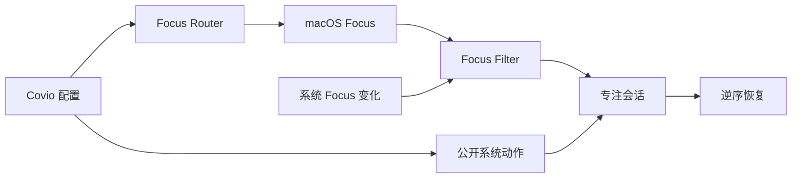

# macOS 专注模式系统调整研究

> 结论：全局最优方案是“Focus Filter 事件桥 + 单个生成式 helper Shortcut + 可选 Full Disk Access + 安全降级”。

## 文档状态

| 项目 | 内容 |
| --- | --- |
| 文档版本 | `1.1` |
| 状态 | 已完成，待评审 |
| 日期 | `2026-10-24` |
| 关联 issue | [#342](https://github.com/wyz541/kmp-Covio/issues/342) |
| 适用对象 | 产品、研发、测试和安全评审人员 |
| 当前验证环境 | Apple Silicon Mac，macOS 27.0.1，Covio 0.5.0 |
| 当前结论 | Focus Filter 负责系统事件。单个 helper 负责 Focus 切换。 |
| 验证状态 | 只读能力探针部分通过。系统调整验证尚未执行。 |

本文回答一个问题：Covio 应如何安全、可恢复地应用 video、game、coding、work、study 专注配置。

## 前因

用户希望在菜单栏快速切换专注状态。
用户希望每个状态自动调整 macOS。
视频和游戏模式需要保持屏幕唤醒。
编码、工作和学习模式需要减少干扰。

直接退出应用有数据丢失风险。
macOS Focus 没有公开写入接口。
macOS Focus 没有公开名称读取接口。

问题边界、状态矩阵和成功标准见 [context.md](context.md)。
安全约束和失败条件见 [investigation.md](investigation.md)。

## 背景

macOS 已提供 Focus 功能。
Focus 可过滤通知、Mail、Calendar、Messages 和 Safari。
公开 AppIntents 提供 `SetFocusFilterIntent`。
Shortcuts 提供 `Set Focus` 动作和命令行执行入口。

GitHub 参考实现分成两条有效路径。

1. Raycast 生成单个 helper Shortcut，控制全部 Focus。
2. Thaw、Home Assistant 和 Outer Spaces 使用 Focus Filter 把系统 Focus 映射到应用配置。

全局最优方案合并两条路径。
详细仓库分析见 [github-references.md](github-references.md)。

## 过程

调研分五步。

1. 阅读 macOS 27 SDK 和 Apple 官方帮助。
2. 检查 Shortcuts 和 Focus Filter 能力。
3. 筛选并核验 GitHub 参考仓库。
4. 运行本地只读探针。
5. 按用户结果、安全、隐私、兼容、成本和成熟度加权选型。

方法和方案对比见 [investigation.md](investigation.md)。
仓库比较和评分见 [github-references.md](github-references.md)。
命令、观察和限制见 [evidence.md](evidence.md)。

## 结果

Covio 的推荐能力分四层。

| 层 | 能力 | 实现路径 | 权限 |
| --- | --- | --- | --- |
| 事件层 | 响应 macOS Focus 变化 | `SetFocusFilterIntent` | 无新增权限 |
| 切换层 | 从 Covio 切换 Focus | 单个生成式 helper Shortcut | 可选 Full Disk Access |
| 执行层 | 启动、隐藏、保持唤醒 | macOS 公开接口 | 无新增权限 |
| 回退层 | 无 Focus 或 Helper 时运行 | 明确确认后的降级会话 | 无 |

五个模板的核心调整如下。

| 模式 | Focus 建议 | 主要调整 | 默认不调整 |
| --- | --- | --- | --- |
| video | `Do Not Disturb` 或 `Video` | 启动播放器、隐藏干扰应用、保持唤醒 | 音量、亮度、网络 |
| game | `Gaming` 或 `Game` | 启动游戏、隐藏聊天应用、保持唤醒 | 网络、蓝牙、风扇、功耗 |
| coding | `Coding` 或 `Do Not Disturb` | 启动 IDE、终端和文档浏览器 | 外观、窗口、音量、亮度 |
| work | `Work` | 启动邮件、日历和任务应用 | 邮件账户、日历、联系人 |
| study | `Study` | 启动笔记、阅读器和计时器 | 网络、音量、亮度 |

每个模式的完整动作见 [solution.md](solution.md) 第 3 节。

**警告：** 首版默认隐藏干扰应用，不退出应用。用户开启退出动作后，Covio 只发送正常退出请求。Covio 不强制退出应用。未保存文档可能阻止退出。

推荐数据路径如下。



结论、决策表和限制见 [conclusion.md](conclusion.md)。
仓库评分见 [github-references.md](github-references.md) 第 10 节。
能力证据见 [evidence.md](evidence.md)。

## 预期

用户能把系统 Focus 映射到 Covio 模板。
用户能从 Covio 切换系统 Focus。
用户能从 Control Center 或计划事件触发模板。
用户能编辑每个模板的应用和电源动作。
用户进入模式后看到执行结果。
用户退出模式后看到恢复结果。
用户拒绝 Full Disk Access 时仍能使用 Focus Filter 和降级入口。

推荐架构、接口和计划见 [solution.md](solution.md)。
测试矩阵和清理要求见 [validation/README.md](validation/README.md)。

## 实现预期的手段

1. 在 `kmpDomain` 定义专注配置、Focus 绑定和会话模型。
2. 在 Swift 宿主提供 `SetFocusFilterIntent`。
3. Focus Filter 只发布映射请求，不直接执行重动作。
4. 主应用接收请求并启动专注会话。
5. 主应用生成并签名单个 helper Shortcut。
6. 应用只运行自己记录的 helper ID。
7. Full Disk Access 只用于可选的 Focus 模式发现和回读。
8. 启动会话前写入恢复日志。
9. 按固定顺序执行动作。
10. 退出时按相反顺序恢复。
11. 应用崩溃或启动中断后显示恢复入口。
12. 首版不申请 Accessibility 或 Screen Recording 权限。

推荐架构、接口和计划见 [solution.md](solution.md)。
系统验证计划见 [validation/README.md](validation/README.md)。
设计与实现证据见 [evidence.md](evidence.md)。

## 子文档

| 文件 | 内容 |
| --- | --- |
| [context.md](context.md) | 问题、边界、系统模型、状态矩阵和成功标准 |
| [investigation.md](investigation.md) | 调研方法、能力边界、候选方案和源码分析 |
| [github-references.md](github-references.md) | GitHub 仓库比较、评分和全局选型 |
| [conclusion.md](conclusion.md) | 结论、决策表、限制和未决项 |
| [solution.md](solution.md) | 推荐架构、接口、模式矩阵、流程和实施计划 |
| [evidence.md](evidence.md) | 来源、命令、观察、推论和缺口 |
| [validation/README.md](validation/README.md) | 验证目标、矩阵、风险和清理要求 |
| [validation/case-readonly-focus-probe.md](validation/case-readonly-focus-probe.md) | 只读能力探针记录 |
| [validation/case-focus-profile-apply.md](validation/case-focus-profile-apply.md) | 专注配置应用与恢复计划 |

## 证据链

按以下顺序阅读。

```text
context.md 的问题与状态
  -> investigation.md 的能力矩阵
  -> github-references.md 的仓库评分
  -> evidence.md 的 E-01 至 E-30
  -> conclusion.md 的决策表
  -> solution.md 的模式矩阵与接口
  -> validation/README.md 的 V01 至 V14
```

## 更新规则

1. 执行系统调整验证后更新案例状态。
2. 结论变化时更新 [conclusion.md](conclusion.md)。
3. 能力变化时更新 [investigation.md](investigation.md)。
4. 参考仓库变化时更新 [github-references.md](github-references.md)。
5. 证据变化时更新 [evidence.md](evidence.md)。
6. 实施落地后更新 [solution.md](solution.md) 和本索引。
