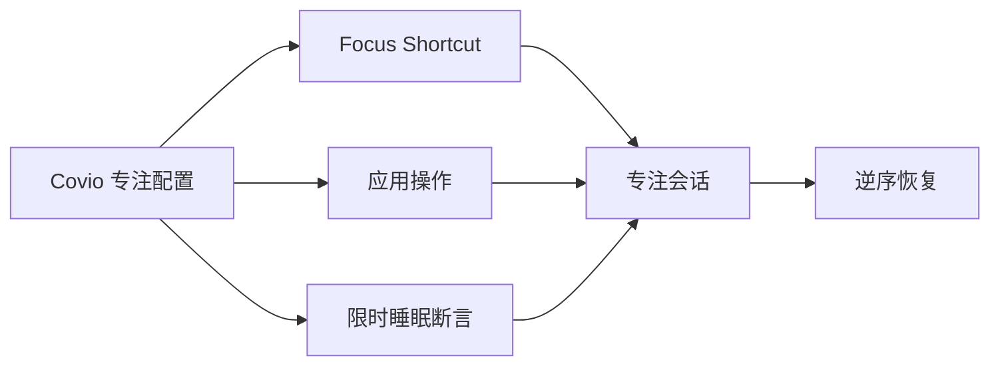

# macOS 专注模式系统调整研究

> 结论：Covio 应提供可编辑的专注配置模板。Covio 用 Shortcuts 控制 macOS Focus。Covio 用公开接口控制可恢复的应用和睡眠动作。

## 文档状态

| 项目 | 内容 |
| --- | --- |
| 文档版本 | `1.0` |
| 状态 | 已完成，待评审 |
| 日期 | `2026-10-24` |
| 关联 issue | [#342](https://github.com/wyz541/kmp-Covio/issues/342) |
| 适用对象 | 产品、研发、测试和安全评审人员 |
| 当前验证环境 | Apple Silicon Mac，macOS 27.0.1，Covio 0.5.0 |
| 当前结论 | Focus 写入交给 Shortcuts。应用与电源操作走公开接口。 |
| 验证状态 | 只读能力探针部分通过。系统调整验证尚未执行。 |

本文回答一个问题：Covio 应如何安全、可恢复地应用 video、game、coding、work、study 专注配置。

## 前因

用户希望在菜单栏快速切换专注状态。
用户希望每个状态自动调整 macOS。
视频和游戏模式需要保持屏幕唤醒。
编码、工作和学习模式需要减少干扰。

直接退出应用有数据丢失风险。
macOS Focus 没有公开写入接口。
不同系统设置的可恢复程度不同。

问题边界、状态矩阵和成功标准见 [context.md](context.md)。
安全约束和失败条件见 [investigation.md](investigation.md)。

## 背景

macOS 已提供 Focus 功能。
用户可创建 Work、Gaming 和自定义 Focus。
Focus 可过滤通知、Mail、Calendar、Messages 和 Safari。

macOS SDK 只公开 Focus 状态读取。
Shortcuts 提供 `Set Focus` 动作。
命令行工具可以运行用户创建的 Shortcut。

应用操作、睡眠断言和部分系统设置存在公开接口。
亮度、蓝牙、窗口布局和部分系统开关缺少统一安全接口。

## 过程

调研分四步。

1. 阅读 macOS 27 SDK 头文件和 Apple 官方帮助。
2. 检查 Shortcuts 动作资源和命令行能力。
3. 运行只读探针，检查 Focus 状态和 Shortcuts 环境。
4. 对比公开接口、Shortcuts、GUI 自动化和私有接口。

方法和方案对比见 [investigation.md](investigation.md)。
命令、观察和限制见 [evidence.md](evidence.md)。
只读探针结果见 [Case 1](validation/case-readonly-focus-probe.md)。

## 结果

Covio 的能力分三档。

| 档 | 能力 | 实现路径 | 是否进入首版 |
| --- | --- | --- | --- |
| 核心 | 启动应用、隐藏应用、保持唤醒 | macOS 公开接口 | 是 |
| 核心 | 切换 macOS Focus | 用户 Shortcut | 是，作为可选绑定 |
| 扩展 | 自定义快捷指令 | 用户 Shortcut | 是，需明确警告 |
| 后期 | 亮度、网络、蓝牙、窗口布局 | 私有接口或不稳定路径 | 否 |

五个模板的核心调整如下。

| 模式 | Focus 建议 | 主要调整 | 默认不调整 |
| --- | --- | --- | --- |
| video | `Do Not Disturb` 或 `Video` | 启动播放器、隐藏干扰应用、保持唤醒 | 音量、亮度、网络 |
| game | `Gaming` 或 `Game` | 启动游戏、隐藏聊天应用、保持唤醒 | 网络、蓝牙、风扇、功耗 |
| coding | `Coding` 或 `Do Not Disturb` | 启动 IDE、终端和文档浏览器 | 外观、窗口、音量、亮度 |
| work | `Work` | 启动邮件、日历和任务应用 | 邮件账户、日历、联系人 |
| study | `Study` | 启动笔记、阅读器和计时器 | 网络、音量、亮度 |

每个模式的完整动作见 [solution.md](solution.md) 第 3 节。

**警告：** 首版默认隐藏干扰应用，不退出应用。用户开启退出动作后，Covio 只发送正常退出请求。Covio 不强制退出应用。未保存文档可能阻止退出。

系统调整流程如下。



结论、决策表和限制见 [conclusion.md](conclusion.md)。
能力证据见 [evidence.md](evidence.md)。

## 预期

用户能从菜单栏切换五个模板。
用户能编辑每个模板的应用和电源动作。
用户能绑定每个模板的进入和退出 Shortcut。
用户进入模式后看到执行结果。
用户退出模式后看到恢复结果。

每个模式的动作清单见 [solution.md](solution.md)。
测试矩阵和清理要求见 [validation/README.md](validation/README.md)。

## 实现预期的手段

1. 在 `kmpDomain` 定义专注配置、动作和会话模型。
2. 在 Swift 宿主实现应用、Shortcuts 和电源端口。
3. 启动会话前保存恢复日志。
4. 按固定顺序执行动作。
5. 退出时按相反顺序恢复。
6. 应用崩溃或启动中断后显示恢复入口。
7. 首版不申请 Accessibility 或 Screen Recording 权限。

推荐架构、接口和计划见 [solution.md](solution.md)。
系统验证计划见 [validation/README.md](validation/README.md)。
设计与实现证据见 [evidence.md](evidence.md)。

## 子文档

| 文件 | 内容 |
| --- | --- |
| [context.md](context.md) | 问题、边界、系统模型、状态矩阵和成功标准 |
| [investigation.md](investigation.md) | 调研方法、能力边界、方案对比和源码分析 |
| [conclusion.md](conclusion.md) | 结论、决策表、限制和未决项 |
| [solution.md](solution.md) | 推荐架构、接口、模式矩阵、流程和实施计划 |
| [evidence.md](evidence.md) | 来源、命令、观察、推论和缺口 |
| [validation/README.md](validation/README.md) | 验证目标、矩阵、风险和清理要求 |
| [validation/case-readonly-focus-probe.md](validation/case-readonly-focus-probe.md) | 只读能力探针记录 |
| [validation/case-focus-profile-apply.md](validation/case-focus-profile-apply.md) | 专注配置应用与恢复计划 |

## 证据链

按以下顺序阅读。

```text
context.md 的问题与状态
  -> investigation.md 的能力矩阵
  -> evidence.md 的 E-01 至 E-20
  -> conclusion.md 的决策表
  -> solution.md 的模式矩阵与接口
  -> validation/README.md 的 V01 至 V10
```

## 更新规则

1. 执行系统调整验证后更新案例状态。
2. 结论变化时更新 [conclusion.md](conclusion.md)。
3. 能力变化时更新 [investigation.md](investigation.md)。
4. 证据变化时更新 [evidence.md](evidence.md)。
5. 实施落地后更新 [solution.md](solution.md) 和本索引。
