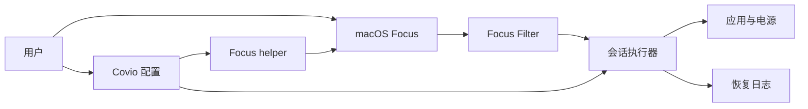

# 前因与问题边界

> 结论：研究对象是“macOS Focus 与 Covio 配置的双向映射”。研究对象不是 macOS Focus 的内部实现。

## 1. 问题类别与研究问题

### 1.1 问题类别

本研究的类别是“系统策略的可恢复自动化”。
同类问题有三个共同点。

1. 应用需要改变全局系统状态。
2. 状态变更会影响多个应用和用户数据。
3. 退出、失败和崩溃都必须能恢复。

本类别不绑定 Covio。
任何菜单栏工具都面对相同边界。

### 1.2 研究问题

Covio 应如何安全、可恢复地在 macOS 上应用 video、game、coding、work、study 专注配置，并定义每个模式的系统调整范围？

该问题包含五个决策。

1. 哪些动作使用公开接口。
2. 如何从 Covio 发起 Focus 切换。
3. 如何响应系统的 Focus 变化。
4. 哪些动作只允许用户通过扩展能力添加。
5. 哪些动作不进入首版。

### 1.3 问题定义

“专注配置”在本研究中指一个 Covio 模板。
模板包含六个部分。

| 部分 | 说明 |
| --- | --- |
| 身份 | 稳定的模板 ID、名称和图标 |
| Focus 绑定 | macOS Focus ID 与模板的映射 |
| 进入动作 | 启动应用、隐藏应用 |
| 运行策略 | 会话时长和睡眠断言 |
| 恢复动作 | 取消隐藏、关闭租约、恢复 Focus |
| 恢复日志 | 记录 Covio 改过的状态和回滚结果 |

模板不等于 macOS Focus。
模板通过 Focus Filter 和 helper Shortcut 与系统 Focus 连接。

### 1.4 触发条件

以下事件可以启动模板。

1. 用户从菜单栏选择模板。
2. 用户从工作台选择模板。
3. 用户从全局快捷键选择模板。
4. 系统 Focus Filter 报告模板已激活。
5. 用户从 Control Center 或计划事件启用已映射 Focus。

以下事件可以结束模板。

1. 用户主动退出。
2. 系统 Focus Filter 报告模板已停用。
3. 会话计时到期。
4. 应用收到退出或睡眠事件。
5. 应用重启后发现未完成会话。

## 2. 范围

### 2.1 适用范围

1. macOS 26 及后续版本。
2. Covio SwiftUI 宿主。
3. `kmpDomain` 的共享模型和策略。
4. 单用户、本地桌面会话。
5. 五个内置模板：video、game、coding、work、study。
6. 公共 `SetFocusFilterIntent`。
7. 单个生成式 helper Shortcut。
8. 可选 Full Disk Access。
9. 用户自定义 Shortcut 扩展。

### 2.2 范围外事项

1. Windows 和 iOS 宿主。
2. 跨设备同步专注状态。
3. 自动创建 macOS Focus。
4. 持续轮询 Focus 私有数据库。
5. 自动修改屏幕亮度。
6. 自动切换 Wi-Fi、VPN 或蓝牙。
7. 自动修改风扇、功耗或低电量模式。
8. 自动拖动或排列窗口。
9. 强制结束应用。
10. Mac App Store 分发改造。

## 3. 受影响角色

| 角色 | 关注点 |
| --- | --- |
| 普通用户 | 一键进入状态，退出后系统回到原样 |
| 隐私敏感用户 | 不授予 Full Disk Access 也能使用主要能力 |
| 开发者 | 可测试的接口和明确的失败结果 |
| 测试人员 | 可重放的 Focus、应用和恢复路径 |
| 安全评审人员 | 数据丢失、权限和任意脚本风险 |
| 产品维护人员 | 稳定的模板模型和可扩展动作类型 |

## 4. 系统模型

### 4.1 术语

| 术语 | 定义 |
| --- | --- |
| 专注配置 | Covio 保存的模板和动作集合 |
| Focus 绑定 | macOS Focus 与专注配置的映射 |
| Focus Filter | 系统 Focus 激活或停用时调用的 AppIntent |
| Focus helper | 包含多个 Set Focus 分支的单个 Shortcut |
| 专注会话 | 一次从进入到恢复的完整执行记录 |
| 系统动作 | 会改变应用或系统状态的操作 |
| 恢复动作 | 撤销本次会话所做改变的操作 |
| 恢复日志 | 在系统动作前写入的持久化记录 |

### 4.2 组件

### 4.3 数据路径

1. 用户建立 Focus 与模板的映射。
2. 用户选择模板或系统 Focus 变化。
3. Covio 校验模板、helper 和映射。
4. Covio 写入恢复日志。
5. Covio 执行应用与电源动作。
6. Covio 保持会话状态。
7. Focus 结束或用户退出。
8. Covio 按逆序恢复系统状态。
9. Covio 清除恢复日志。

### 4.4 信任边界

| 边界 | 风险 | 控制 |
| --- | --- | --- |
| Covio 到 helper Shortcut | helper 可能过期或被替换 | 按 ID 运行，只信任自己生成的 helper |
| Focus Filter 到主应用 | 事件可能重复或乱序 | 幂等 ID、时间戳和状态机 |
| Covio 到其他应用 | 退出请求可能丢失未保存数据 | 默认隐藏，退出需确认 |
| Covio 到系统电源 | 断言可能阻止睡眠 | 限时、可取消、退出即释放 |
| Covio 到 Focus 数据库 | 私有格式可能变化 | 可选只读、缓存、失败降级 |
| 恢复日志到磁盘 | 崩溃可能留下旧状态 | 原子写入、启动检查、人工恢复 |

## 5. 状态矩阵

| 状态 | 进入条件 | 系统结果 | 用户可见结果 |
| --- | --- | --- | --- |
| `idle` | 没有活动会话 | 系统不受 Covio 控制 | 显示可用模板 |
| `validating` | 用户选择模板或收到 Filter 事件 | 系统尚未改变 | 显示校验进度 |
| `applying` | 校验通过 | 部分动作可能已生效 | 显示当前动作 |
| `active` | 必需动作完成 | Covio 管理当前会话 | 显示退出和剩余时间 |
| `degraded` | 可选动作失败 | 核心动作继续运行 | 显示失败项 |
| `restoring` | 用户退出、Filter 停用或计时到期 | 正在恢复系统状态 | 显示恢复进度 |
| `completed` | 恢复成功 | 系统回到可确认状态 | 显示完成摘要 |
| `recovery_required` | 恢复失败或日志异常 | 系统状态部分未知 | 显示恢复入口和错误 |

### 5.1 正常状态

正常路径为 `idle -> validating -> applying -> active -> restoring -> completed`。

### 5.2 异常状态

可选动作失败时进入 `degraded`。
重复 Filter 事件只处理一次。
乱序事件由事件时间和会话 ID 丢弃。

### 5.3 边界条件

1. 模板没有绑定 macOS Focus。
2. 用户没有授予 Full Disk Access。
3. helper Shortcut 缺失或过期。
4. Focus 在 Covio 未运行时切换。
5. 应用在前台显示未保存文档。
6. Mac 使用电池供电。
7. 目标应用没有安装。

### 5.4 失败条件

1. 恢复日志无法写入。
2. helper 不存在或超时。
3. Focus Filter 无法通知主应用。
4. 睡眠断言创建失败。
5. 恢复动作失败。
6. 应用崩溃或强制退出。
7. 恢复日志损坏。

## 6. 场景定义

| 编号 | 场景 | 结果 |
| --- | --- | --- |
| S01 | 从 Covio 进入 video | helper 打开系统 Focus，Covio 进入会话 |
| S02 | 用户从 Control Center 开启 coding | Focus Filter 调用 Covio，模板自动进入 |
| S03 | 用户从 coding 切换到 work | 先恢复 coding，再进入 work |
| S04 | helper 缺失 | 阻止 Covio 主动切换，允许系统 Focus 驱动 |
| S05 | Full Disk Access 被拒绝 | 不生成 helper，保留 Filter 和降级入口 |
| S06 | 目标应用拒绝退出 | 保留应用，记录提示，继续其余动作 |
| S07 | 会话到期 | 自动恢复并显示摘要 |
| S08 | Covio 中途崩溃 | 下次启动进入恢复流程 |
| S09 | 用户手动修改音量和亮度 | Covio 不覆盖用户的新值 |
| S10 | 当前已有其他 Focus | 可读取时记录来源，退出时按冲突规则恢复 |

## 7. 成功标准

1. 每个内置模板都有独立动作清单。
2. 每个动作都有公开接口或明确的外部责任。
3. 每个可恢复动作都有恢复策略。
4. 默认路径不强制退出应用。
5. 默认路径不要求 Accessibility 权限。
6. Focus 写入不依赖私有接口。
7. Focus Filter 能处理激活、停用和模式切换。
8. 单个 helper 能覆盖全部已绑定 Focus。
9. 用户拒绝 Full Disk Access 时仍能使用 Filter 映射。
10. 重复和乱序事件不会重复执行动作。
11. 会话崩溃后能在下次启动发现。
12. 恢复失败时保留日志和错误原因。
13. 用户能预览每个模板的动作。
14. 五类模式的行为差异有测试覆盖。
