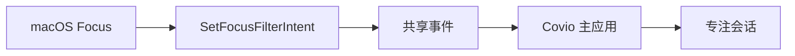
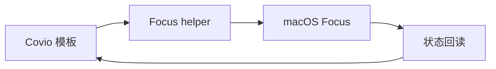

# 调研方法与技术分析

> 结论：公开 Focus Filter 负责系统事件。单个生成式 helper 负责主动切换。私有数据库读取只作可选增强。

## 1. 调研方法

本次调研使用六种证据。

1. Apple Mac Help 的 Focus 用户说明。
2. Apple Developer 的 AppIntents 和 Intents 接口。
3. macOS 27 SDK 头文件。
4. 本机 Shortcuts 命令行和动作资源。
5. 固定 commit 的 GitHub 参考实现。
6. Covio `0.5.0` 源码。

调研只读取系统状态。
本机探针没有修改 Focus、应用、音量或电源设置。
系统写入和恢复测试留到 [验证计划](validation/README.md)。

## 2. 来源范围

| 来源 | 用途 | 等级 |
| --- | --- | --- |
| macOS 27 SDK 头文件 | 判定公开接口 | A |
| Apple Mac Help | 判定用户可配置能力 | C |
| Apple Developer 文档 | 判定 Focus 状态和 Filter 权限 | A |
| Shortcuts 命令行帮助 | 判定执行方式 | A |
| Shortcuts 动作资源 | 判定 `Set Focus` 动作存在 | A |
| GitHub 固定 commit | 参考成熟架构和边界 | C |
| Covio `main` 源码 | 判定现有端口和复用边界 | B |
| 本机只读探针 | 判定当前环境事实 | D |

本机环境为 macOS 27.0.1。
Covio 目标为 macOS 26.0 及以上。
macOS 26 的 Focus Filter、Shortcut 和数据库行为仍需真机验证。

## 3. 领域模型

### 3.1 四层能力

| 层 | 责任 | 例子 |
| --- | --- | --- |
| 事件层 | 响应系统 Focus 变化 | `SetFocusFilterIntent` |
| 切换层 | 从 Covio 发起 Focus 切换 | 单个生成式 helper Shortcut |
| 执行层 | 调整应用和电源 | AppKit、IOKit |
| 扩展层 | 执行用户自定义动作 | 用户 Shortcut |

### 3.2 数据模型

| 对象 | 关键字段 |
| --- | --- |
| 专注配置 | `profile_id`、名称、模板类型 |
| Focus 绑定 | `profile_id`、Focus ID、Focus 名称 |
| helper | helper ID、生成版本、支持 Focus ID |
| 会话 | `session_id`、模板、开始和结束时间 |
| 事件 | 事件 ID、Focus ID、激活状态、时间 |

### 3.3 动作生命周期

每个动作有六个阶段。

1. 校验前置条件。
2. 读取当前状态。
3. 写入恢复日志。
4. 执行动作。
5. 回读结果。
6. 记录恢复信息。

无法回读的动作不能标为“已验证”。
无法恢复的动作必须标为“外部动作”。

### 3.4 稳定术语

| 术语 | 含义 |
| --- | --- |
| Focus Filter | 系统 Focus 变化时调用的 AppIntent |
| Focus helper | 包含多个 Set Focus 分支的单个 Shortcut |
| Focus 绑定 | macOS Focus 与 Covio 配置的映射 |
| 必需动作 | 失败时阻止会话启动 |
| 可选动作 | 失败时进入降级状态 |
| 可恢复动作 | Covio 能撤销并回读 |
| 外部动作 | Shortcut 执行，Covio 不保证撤销 |

## 4. 约束模型

### 4.1 系统约束

1. macOS Focus 没有公开写入 API。
2. `INFocusStatusCenter` 只返回是否处于 Focus。
3. Focus 状态读取需要用户授权。
4. `SetFocusFilterIntent` 由用户在每个 Focus 中配置。
5. Shortcuts 的 `Set Focus` 动作不能从变量选择 Focus。
6. helper 要为每个 Focus 写入固定分支。
7. Full Disk Access 才能读取 Focus 数据库。
8. Focus 数据库格式没有公开兼容承诺。
9. 应用退出请求可能被未保存文档阻止。
10. 系统睡眠断言不能阻止用户主动睡眠。

### 4.2 数据约束

1. 恢复日志必须先于系统写入。
2. 恢复日志要采用原子写入。
3. 会话 ID 和事件 ID 要跨进程重启保持稳定。
4. 动作结果要能识别部分成功。
5. 日志不能保存文档内容或用户输入。
6. 私有数据库内容只保存在本机。
7. 数据库内容不写入普通日志。

### 4.3 产品约束

1. 首次设置要解释 Focus Filter 和 helper 的手动步骤。
2. 缺失 helper 时不能静默切换失败。
3. Full Disk Access 被拒绝时仍要保留主要路径。
4. 默认动作要低风险。
5. 高级动作要有独立开关。
6. 用户要能在执行前预览动作。

## 5. 控制路径

### 5.1 系统 Focus 到 Covio

用户在一个系统 Focus 中添加 Covio Focus Filter。
用户选择该 Focus 对应的 Covio 模板。
Focus 激活或停用时，Filter 写入事件。
主应用读取事件并应用或恢复模板。

### 5.2 Covio 到系统 Focus

Covio 运行单个 helper Shortcut。
输入是 Focus ID，或 `off:<Focus ID>`。
helper 为每个已绑定 Focus 保存开关分支。
Covio 只运行自己记录的 helper ID。
Covio 等待状态回读或 Filter 事件确认。

### 5.3 应用与电源

| 动作 | 调用方 | 接口 |
| --- | --- | --- |
| 启动应用 | Covio 主进程 | `NSWorkspace.openApplicationAtURL` |
| 隐藏应用 | Covio 主进程 | `NSRunningApplication.hide()` |
| 请求退出 | Covio 主进程 | `NSRunningApplication.terminate()` |
| 保持唤醒 | KMP 策略与 Swift 端口 | `IOPMAssertionCreateWithName` |
| 写壁纸 | Covio 主进程 | `NSWorkspace.setDesktopImageURL` |

### 5.4 信任边界

1. Focus Filter 是系统调用的应用代码。
2. helper 是用户导入的 Shortcut。
3. Covio 只信任自己生成并记录的 helper ID。
4. Covio 不解析用户 Shortcut 内容。
5. Covio 不自动下载第三方 Shortcut。
6. Covio 不运行网络输入生成的脚本。
7. Covio 不要求管理员密码。

## 6. 原生能力矩阵

| 能力 | 公开接口或路径 | 限制 | 依赖 | 建议 | 证据 |
| --- | --- | --- | --- | --- | --- |
| 接收 Focus 变化 | `SetFocusFilterIntent` | 用户要逐个 Focus 配置 | AppIntents | 首版采用 | E-30、E-23、E-24、E-25 |
| 读取 Focus 布尔状态 | `INFocusStatusCenter` | 只返回布尔值，需要授权 | Intents | 辅助 | E-06、E-07、E-08 |
| 从 Covio 切换 Focus | 单个 helper Shortcut | helper 要生成、签名和导入 | Shortcuts | 推荐 | E-04、E-05、E-21 |
| 读取 Focus ID 和名称 | DND 数据库 | 需要 Full Disk Access，格式私有 | 文件系统 | 可选 | E-21、E-26、E-29 |
| 直接写入 Focus | 公开 API 不可用 | 私有接口无兼容承诺 | 私有框架 | 禁止 | E-06 |
| 启动应用 | `NSWorkspace` | 应用路径或 Bundle ID 必须有效 | AppKit | 采用 | E-09 |
| 隐藏应用 | `NSRunningApplication.hide()` | 应用可自行取消隐藏 | AppKit | 默认采用 | E-10 |
| 请求退出 | `NSRunningApplication.terminate()` | 可被未保存文档阻止 | AppKit | 显式开启 | E-10 |
| 强制退出 | `forceTerminate()` | 可能丢失数据 | AppKit | 禁止 | E-10 |
| 防止屏幕空闲睡眠 | `IOPMAssertionCreateWithName` | 只阻止空闲睡眠 | IOKit | 采用 | E-11 |
| 修改输出音量 | CoreAudio | 影响正在播放的媒体 | CoreAudio | 不做通用动作 | E-12 |
| 开关 Wi-Fi | CoreWLAN `setPower` | 会中断网络和远程会话 | CoreWLAN | 首版不做 | E-13 |
| 开关蓝牙 | 未发现公开写入接口 | 设备行为差异大 | IOBluetooth | 首版不做 | E-14 |
| 修改亮度 | 私有 DisplayServices | 无兼容承诺，按版本门控 | 私有框架 | 首版不做 | E-15 |
| 修改壁纸 | `NSWorkspace` | 多屏和外部变更增加恢复复杂度 | AppKit | 后期可选 | E-16 |
| 窗口布局 | Accessibility API | 需要权限，应用差异大 | Accessibility | 首版不做 | E-20 |
| 自定义系统动作 | 用户 Shortcut | 副作用不受 Covio 控制 | Shortcuts | 高级选项 | E-04 |

## 7. 模式动作策略

### 7.1 共用动作

1. 每个模板绑定一个系统 Focus。
2. 每个模板由 Focus Filter 触发。
3. 每个模板可从 Covio 通过 helper 切换 Focus。
4. 每个模板都可配置启动应用。
5. 每个模板都可配置隐藏应用。
6. 每个模板都可把隐藏改成请求退出。
7. 每个模板都可配置限时保持唤醒。

### 7.2 video

视频模式要减少通知和屏幕休眠。
视频模式不修改输出音量。
视频模式不修改亮度。
全局音量会破坏正在播放的内容。

### 7.3 game

游戏模式要减少通知和屏幕休眠。
游戏模式不修改网络、蓝牙、风扇或功耗策略。
这些设置会中断设备或影响热管理。

### 7.4 coding

编码模式要启动开发工具和隐藏社交应用。
编码模式保留浏览器。
用户可能用浏览器查文档。
编码模式默认不修改外观和快捷键。

### 7.5 work

工作模式优先使用 macOS Work Focus。
Work Focus 可接管邮件、日历和联系人过滤。
Covio 只补充应用启动、隐藏和唤醒策略。

### 7.6 study

学习模式要隐藏视频、游戏和社交应用。
学习模式默认不保持屏幕唤醒。
使用电池时保持唤醒会缩短续航。

### 7.7 系统设置覆盖表

| 设置或动作 | 首版决策 | 原因 | 证据 |
| --- | --- | --- | --- |
| macOS Focus | 支持 | Focus Filter 接收变化，helper 发起切换 | E-21、E-22 |
| 通知过滤 | 支持 | 由 Focus 的允许列表和过滤器处理 | E-02 |
| 启动应用 | 支持 | AppKit 有公开接口 | E-09 |
| 隐藏应用 | 支持 | 可恢复且不丢数据 | E-10 |
| 请求退出应用 | 可选 | 可能丢失未保存数据，需显式开启 | E-10 |
| 防止空闲睡眠 | 支持 | IOKit 有公开断言 | E-11 |
| 壁纸 | 后期 | 有公开接口，但多屏恢复复杂 | E-16 |
| 输出音量 | 不做 | 会破坏视频和游戏音频 | E-12 |
| Wi-Fi | 不做 | 会中断网络和远程会话 | E-13 |
| 蓝牙 | 不做 | 未发现稳定的公开写入接口 | E-14 |
| VPN 和网络位置 | 不做 | 副作用高，配置不统一 | 产品决策 |
| 屏幕亮度 | 不做 | 公开接口不足 | E-15 |
| 键盘背光 | 不做 | 本次未确认公开统一接口 | 已知缺口 |
| 深色与浅色外观 | 不做 | 全局设置缺少稳定公开写入路径 | 产品决策 |
| Night Shift 和 True Tone | 不做 | 本次未确认公开统一接口 | 已知缺口 |
| Dock 与菜单栏 | 不做 | 需要额外调研，系统行为差异大 | 产品决策 |
| Stage Manager | 不做 | 本次未确认公开统一接口 | 已知缺口 |
| 分辨率和显示器排列 | 不做 | 更改范围大，回滚复杂 | 产品决策 |
| 功耗模式和风扇 | 不做 | 需要特权、硬件适配和热安全设计 | E-15 |
| 窗口布局 | 不做 | 需要 Accessibility 权限，应用差异大 | E-20 |
| 自定义 Shortcut | 高级选项 | 用户可扩展，但有外部副作用 | E-04 |

## 8. 候选方案对比

| 方案 | 成本 | 风险 | 用户覆盖 | 可维护性 | 结论 |
| --- | --- | --- | --- | --- | --- |
| 每个模式手工绑定 Shortcut | 低 | 低 | 中 | 中 | 备用 |
| Raycast 式单个 helper | 中 | 中 | 较高 | 中 | 采用切换层 |
| 只用 Focus Filter | 低 | 低 | 中 | 高 | 采用事件层 |
| helper + Focus Filter + 降级 | 高 | 中 | 高 | 中高 | 全局最优 |
| 私有 Focus 直接写入 | 中 | 高 | 高 | 低 | 不采用 |
| Control Center GUI 自动化 | 高 | 高 | 中 | 低 | 不采用 |

加权分、仓库证据和许可证边界见 [github-references.md](github-references.md) 第 10 至 12 节。

## 9. 目标产品源码分析

分析对象为 `main` 的 commit `28d97d89ab192867df413e59115d19683062465a`。
Covio 版本为 `0.5.0`。

| 文件 | 当前职责 | 对本功能的影响 |
| --- | --- | --- |
| `macosApp/src/Platform/MacSleepController.swift` | 管理单条睡眠断言 | 不能直接承载 Focus 会话 |
| `macosApp/src/Power/PowerRuntime.swift` | 协调电源策略和唤醒 | 可提供运行时会话依赖 |
| `kmpDomain/src/com/wyz/covio/core/HoldLeaseManager.kt` | 管理多个来源的保持唤醒租约 | 应新增 Focus 租约来源 |
| `kmpDomain/src/com/wyz/covio/core/Ports.kt` | 定义系统端口 | 需要新增专注端口 |
| `macosApp/src/Platform/AppPaths.swift` | 解析应用数据路径 | 需要新增 Focus 配置、事件和会话路径 |
| `macosApp/src/App/AppRuntime.swift` | 组装端口与运行时 | 需要新增 Focus runtime |
| `macosApp/src/Hub/Monitor/MacMonitorReader.swift` | 枚举运行中的应用 | 可复用应用枚举边界 |
| `macosApp/src/Design/ContractCopy.swift` | 提供中英文文案 | UI 落地前要补设计合同 |

关键发现：`MacSleepController` 只保存一条断言。
直接调用 `applyIdleSleepPrevention` 会覆盖现有电源策略请求。
专注会话应使用 `HoldLeaseManager`。
新增 `FOCUS` 租约来源后，多个唤醒来源可以并存。

## 10. GitHub 参考实现分析

完整仓库矩阵、固定 commit、许可证和评分见 [github-references.md](github-references.md)。
本节只写对 Covio 架构的直接结论。

### 10.1 Raycast Focus Modes

Raycast 使用单个生成式 helper Shortcut。
helper 为每个 Focus 写入开启和关闭分支。
Covio 应采用单个 helper，不采用每模式两个 Shortcut。
Covio 应记录 helper ID，并按 ID 运行。
Covio 应在状态回读成功后才显示成功。

Raycast 读取 Focus 数据库需要 Full Disk Access。
Covio 应把 Full Disk Access 设为可选能力。
Covio 不持续轮询数据库。

### 10.2 Thaw

Thaw 使用公共 `SetFocusFilterIntent`。
Filter 保存配置 ID 并通知主应用。
主应用应用对应配置档案。
Covio 应采用 Focus Filter 事件桥和幂等事件。
Thaw 使用 GPL-3.0，Covio 不复制代码。

### 10.3 Home Assistant 和 Outer Spaces

Home Assistant 证明精确 Focus 名称来自 Focus Filter 映射。
`INFocusStatusCenter` 只适合辅助状态。
Outer Spaces 证明 Filter 可以调用应用配置。
两者都需要验证后台执行和空参数结束事件。

### 10.4 Sapphire

Sapphire 使用 Full Disk Access 和 DND 数据库监视器。
该路径可读取名称和状态，但权限和私有 schema 成本高。
Covio 只采用“可选只读发现”部分。

### 10.5 Hammerspoon

Hammerspoon 把 Shortcuts、应用和窗口能力拆成模块。
Covio 应采用能力分层。
Covio 不引入 Lua 运行时。

### 10.6 全局选择

加权分最高的是“helper + Focus Filter + 降级”。
该方案覆盖 Covio 主动切换和系统 Focus 主动变化。
该方案保留无 Full Disk Access 的可用路径。
该方案不新增私有写入接口。

## 11. 反证和限制

### 11.1 反证一：Wi-Fi 有公开开关

CoreWLAN 公开 `setPower:error:`。
但关闭 Wi-Fi 会中断云服务、消息、远程登录和同步。
因此该接口可用，不代表应成为专注动作。

### 11.2 反证二：亮度存在私有可写路径

Covio 已有一条实验性私有亮度路径。
该路径按 macOS 版本和 Apple Silicon 门控。
该路径也没有 App Store 兼容性。
专注模式不应扩大这条风险。

### 11.3 反证三：Focus 状态可读

`INFocusStatus` 可返回布尔状态。
该状态没有 Focus 名称。
该状态需要授权。
因此只能用于提示，不能用于精确映射。

### 11.4 反证四：Focus 数据库可读

Raycast 和 Sapphire 证明数据库可读。
但数据库是私有格式。
Full Disk Access 权限范围很大。
因此只能作为可选增强。

### 11.5 限制：Focus Filter 后台行为

公开 SDK 提供 `SetFocusFilterIntent`。
macOS 的后台启动和唤醒行为尚未实测。
必须在主应用运行和应用未运行两种状态测试。

### 11.6 限制：helper 的 Shortcut schema

`Set Focus` 动作存在。
helper 的文件结构没有公开文档。
实现必须用固定 fixture 和真机导入验证。
每次 macOS 升级都要回归。

## 12. 已知缺口

| 缺口 | 原因 | 下一步 |
| --- | --- | --- |
| Focus Filter 真实激活和停用 | 尚未实现 | 在 Case 2 验证 |
| Focus Filter 后台唤醒 | 未验证 | 增加应用未运行场景 |
| helper 真实导入和运行 | 当前用户没有 Shortcut | 在 Case 2 验证 |
| Covio 进程运行 Shortcut | 只验证了终端 CLI | 在 Case 2 从应用内运行 |
| macOS 26 行为 | 当前机器为 macOS 27 | 在 macOS 26 真机运行 |
| Focus 数据库读取 | 当前终端没有 Full Disk Access | 授权后运行只读探针 |
| 数据库跨系统版本变化 | 私有格式 | 固定 fixture 和版本门控 |
| 应用隐藏与恢复 | 只验证了头文件 | 在 Case 2 运行 |
| 未保存文档退出提示 | 需要真实文档应用 | 在 Case 2 运行 |
| 崩溃恢复 | 需要注入中断 | 在 Case 2 运行 |
| 键盘背光、Night Shift、True Tone | 公开接口未深挖 | 单独调研 |
| Stage Manager、Dock、菜单栏 | 公开接口未深挖 | 单独调研 |
| 用户修改音量后的恢复 | 首版不改音量 | 保留为自定义 Shortcut 风险 |
