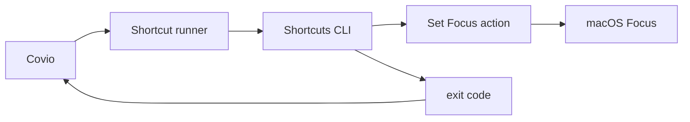

# 调研方法与技术分析

> 结论：macOS Focus 由 Shortcuts 控制。应用、电源和少量桌面设置由公开接口控制。其他系统开关不进入首版。

## 1. 调研方法

本次调研使用五种证据。

1. Apple Mac Help 的 Focus 用户说明。
2. Apple Developer 的公开接口说明。
3. macOS 27 SDK 头文件。
4. 本机 Shortcuts 命令行和动作资源。
5. Covio `0.5.0` 源码。

调研只读取系统状态。
本机探针没有修改 Focus、应用、音量或电源设置。
系统写入和恢复测试留到 [验证计划](validation/README.md)。

## 2. 来源范围

| 来源 | 用途 | 等级 |
| --- | --- | --- |
| macOS 27 SDK 头文件 | 判定公开接口 | A |
| Apple Mac Help | 判定用户可配置能力 | C |
| Apple Developer 文档 | 判定 Focus 状态权限 | A |
| Shortcuts 命令行帮助 | 判定执行方式 | A |
| Shortcuts 动作资源 | 判定 `Set Focus` 动作存在 | A |
| Covio `main` 源码 | 判定现有端口和复用边界 | B |
| 本机只读探针 | 判定当前环境事实 | D |

本机环境为 macOS 27.0.1。
Covio 目标为 macOS 26.0 及以上。
macOS 26 的 Shortcut 和 API 行为仍需真机验证。

## 3. 领域模型

### 3.1 三层能力

| 层 | 责任 | 例子 |
| --- | --- | --- |
| Covio 配置层 | 保存模板、动作和恢复策略 | video、game、coding |
| 系统编排层 | 调用 Shortcuts 和公开 API | Focus、应用、睡眠 |
| 用户扩展层 | 执行用户自定义 Shortcut | 音量、VPN、外部设备 |

### 3.2 动作生命周期

每个动作有六个阶段。

1. 校验前置条件。
2. 读取当前状态。
3. 写入恢复日志。
4. 执行动作。
5. 回读结果。
6. 记录恢复信息。

无法回读的动作不能标为“已验证”。
无法恢复的动作必须标为“外部动作”。

### 3.3 稳定术语

| 术语 | 含义 |
| --- | --- |
| 必需动作 | 失败时阻止会话启动 |
| 可选动作 | 失败时进入降级状态 |
| 可恢复动作 | Covio 能撤销并回读 |
| 外部动作 | Shortcut 执行，Covio 不保证撤销 |
| 会话记录 | 一次执行的动作、结果和恢复数据 |

## 4. 约束模型

### 4.1 系统约束

1. macOS Focus 没有公开写入 API。
2. `INFocusStatusCenter` 只返回是否处于 Focus。
3. Focus 状态读取需要用户授权。
4. Shortcuts 只能运行已存在的 Shortcut。
5. macOS 26 和 macOS 27 的 Shortcut 行为可能不同。
6. 用户可能删除或改名 Shortcut。
7. 应用退出请求可能被未保存文档阻止。
8. 系统睡眠断言不能阻止用户主动睡眠。

### 4.2 数据约束

1. 恢复日志必须先于系统写入。
2. 恢复日志要采用原子写入。
3. 会话 ID 要跨进程重启保持稳定。
4. 动作结果要能识别部分成功。
5. 日志不能保存文档内容或用户输入。

### 4.3 产品约束

1. 首次设置要解释 Shortcut 的手动步骤。
2. 缺失 Shortcut 时不能静默降级。
3. 默认动作要低风险。
4. 高级动作要有独立开关。
5. 用户要能在执行前预览动作。

## 5. 控制路径

### 5.1 Focus 写入路径

Covio 只负责运行用户绑定的 Shortcut。
Shortcut 负责选择 Focus 和时长。
Covio 不解析 Control Center。
Covio 不调用私有 Focus 框架。

### 5.2 应用与电源路径

| 动作 | 调用方 | 接口 |
| --- | --- | --- |
| 启动应用 | Covio 主进程 | `NSWorkspace.openApplicationAtURL` |
| 隐藏应用 | Covio 主进程 | `NSRunningApplication.hide()` |
| 请求退出 | Covio 主进程 | `NSRunningApplication.terminate()` |
| 保持唤醒 | KMP 策略与 Swift 端口 | `IOPMAssertionCreateWithName` |
| 写壁纸 | Covio 主进程 | `NSWorkspace.setDesktopImageURL` |

### 5.3 信任边界

1. Shortcut 是用户代码。
2. Covio 只信任显式绑定的 Shortcut 名称。
3. Covio 不解析 Shortcut 内容。
4. Covio 不自动下载 Shortcut。
5. Covio 不运行网络输入生成的脚本。
6. Covio 不要求管理员密码。

## 6. 原生能力矩阵

| 能力 | 公开接口或路径 | 限制 | 依赖 | 建议 | 证据 |
| --- | --- | --- | --- | --- | --- |
| Focus 开关 | Shortcuts `Set Focus` 动作 | 用户要先创建 Shortcut | Shortcuts | 首版采用 | E-04、E-05 |
| Focus 状态 | `INFocusStatusCenter` | 只返回布尔值，需要授权 | Intents | 可选提示 | E-06、E-07 |
| 启动应用 | `NSWorkspace` | 应用路径或 Bundle ID 必须有效 | AppKit | 首版采用 | E-09 |
| 隐藏应用 | `NSRunningApplication.hide()` | 应用可自行取消隐藏 | AppKit | 默认采用 | E-10 |
| 请求退出 | `NSRunningApplication.terminate()` | 可被未保存文档阻止 | AppKit | 仅显式开启 | E-10 |
| 强制退出 | `forceTerminate()` | 可能丢失数据 | AppKit | 禁止 | E-10 |
| 防止屏幕空闲睡眠 | `IOPMAssertionCreateWithName` | 只阻止空闲睡眠 | IOKit | 首版采用 | E-11 |
| 修改输出音量 | CoreAudio | 影响正在播放的媒体 | CoreAudio | 不做通用动作 | E-12 |
| 开关 Wi-Fi | CoreWLAN `setPower` | 会中断网络和远程会话 | CoreWLAN | 首版不做 | E-13 |
| 开关蓝牙 | 未发现公开写入接口 | 设备行为差异大 | IOBluetooth | 首版不做 | E-14 |
| 修改亮度 | 私有 DisplayServices | 无兼容承诺，按系统版本门控 | 私有框架 | 首版不做 | E-15 |
| 修改壁纸 | `NSWorkspace` | 多屏和外部变更增加恢复复杂度 | AppKit | 后期可选 | E-16 |
| 窗口布局 | Accessibility API | 需要权限，应用差异大 | Accessibility | 首版不做 | E-20 |
| 自定义系统动作 | 用户 Shortcut | 副作用不受 Covio 控制 | Shortcuts | 高级选项 | E-04 |

## 7. 模式动作策略

### 7.1 共用动作

1. 完整模板默认要求进入和退出 Shortcut。
2. 每个模板都可配置启动应用。
3. 每个模板都可配置隐藏应用。
4. 每个模板都可把隐藏改成请求退出。
5. 每个模板都可配置限时保持唤醒。

### 7.2 video

视频模式要减少通知和屏幕休眠。
视频模式不修改输出音量。
视频模式不修改亮度。
全局音量会破坏正在播放的内容。

### 7.3 game

游戏模式要减少通知和屏幕休眠。
游戏模式不修改网络、蓝牙、风扇或功耗策略。
这些设置会中断设备或影响热管理。

### 7.4 coding

编码模式要启动开发工具和隐藏社交应用。
编码模式保留浏览器。
用户可能用浏览器查文档。
编码模式默认不修改外观和快捷键。

### 7.5 work

工作模式优先使用 macOS Work Focus。
Work Focus 可接管邮件、日历和联系人过滤。
Covio 只补充应用启动、隐藏和唤醒策略。

### 7.6 study

学习模式要隐藏视频、游戏和社交应用。
学习模式默认不保持屏幕唤醒。
使用电池时保持唤醒会缩短续航。

### 7.7 系统设置覆盖表

| 设置或动作 | 首版决策 | 原因 | 证据 |
| --- | --- | --- | --- |
| macOS Focus | 支持 | Shortcuts 有 `Set Focus` 动作 | E-04、E-05 |
| 通知过滤 | 支持 | 由 Focus 的允许列表和过滤器处理 | E-02 |
| 启动应用 | 支持 | AppKit 有公开接口 | E-09 |
| 隐藏应用 | 支持 | 可恢复且不丢数据 | E-10 |
| 请求退出应用 | 可选 | 可能丢失未保存数据，需显式开启 | E-10 |
| 防止空闲睡眠 | 支持 | IOKit 有公开断言 | E-11 |
| 壁纸 | 后期 | 有公开接口，但多屏恢复复杂 | E-16 |
| 输出音量 | 不做 | 会破坏视频和游戏音频 | E-12 |
| Wi-Fi | 不做 | 会中断网络和远程会话 | E-13 |
| 蓝牙 | 不做 | 未发现稳定的公开写入接口 | E-14 |
| VPN 和网络位置 | 不做 | 副作用高，配置不统一 | 产品决策 |
| 屏幕亮度 | 不做 | 公开接口不足 | E-15 |
| 键盘背光 | 不做 | 本次未确认公开统一接口 | 已知缺口 |
| 深色与浅色外观 | 不做 | 全局设置缺少稳定公开写入路径 | 产品决策 |
| Night Shift 和 True Tone | 不做 | 本次未确认公开统一接口 | 已知缺口 |
| Dock 与菜单栏 | 不做 | 需要额外调研，系统行为差异大 | 产品决策 |
| Stage Manager | 不做 | 本次未确认公开统一接口 | 已知缺口 |
| 分辨率和显示器排列 | 不做 | 更改范围大，回滚复杂 | 产品决策 |
| 功耗模式和风扇 | 不做 | 需要特权、硬件适配和热安全设计 | E-15 |
| 窗口布局 | 不做 | 需要 Accessibility 权限，应用差异大 | E-20 |
| 自定义 Shortcut | 高级选项 | 用户可扩展，但有外部副作用 | E-04 |

## 8. 候选方案对比

| 方案 | 成本 | 风险 | 成熟度 | 可维护性 | 结果 |
| --- | --- | --- | --- | --- | --- |
| 公开 API 加 Shortcuts | 中 | 中 | 高 | 高 | 推荐 |
| 只做应用和电源动作 | 低 | 低 | 高 | 高 | 功能不完整 |
| Control Center GUI 自动化 | 高 | 高 | 中 | 低 | 不采用 |
| 私有 Focus 框架 | 中 | 高 | 低 | 低 | 不采用 |
| 用户手动切换 Focus | 低 | 低 | 高 | 高 | 备用路径 |

推荐方案把 Focus 写入交给 Shortcuts。
推荐方案把应用和电源动作放在 Covio。
推荐方案把不可恢复动作标为外部动作。

## 9. 目标产品源码分析

分析对象为 `main` 的 commit `28d97d89ab192867df413e59115d19683062465a`。
Covio 版本为 `0.5.0`。

| 文件 | 当前职责 | 对本功能的影响 |
| --- | --- | --- |
| `macosApp/src/Platform/MacSleepController.swift` | 管理单条睡眠断言 | 不能直接承载 Focus 会话 |
| `macosApp/src/Power/PowerRuntime.swift` | 协调电源策略和唤醒 | 可提供运行时会话依赖 |
| `kmpDomain/src/com/wyz/covio/core/HoldLeaseManager.kt` | 管理多个来源的保持唤醒租约 | 应新增 Focus 租约来源 |
| `kmpDomain/src/com/wyz/covio/core/Ports.kt` | 定义系统端口 | 需要新增专注端口 |
| `macosApp/src/Platform/AppPaths.swift` | 解析应用数据路径 | 需要新增 Focus 配置和会话路径 |
| `macosApp/src/App/AppRuntime.swift` | 组装端口与运行时 | 需要新增 Focus runtime |
| `macosApp/src/Hub/Monitor/MacMonitorReader.swift` | 枚举运行中的应用 | 可复用应用枚举边界 |
| `macosApp/src/Design/ContractCopy.swift` | 提供中英文文案 | UI 落地前要补设计合同 |

关键发现：`MacSleepController` 只保存一条断言。
直接调用 `applyIdleSleepPrevention` 会覆盖现有电源策略请求。
专注会话应使用 `HoldLeaseManager`。
新增 `Focus` 租约来源后，多个唤醒来源可以并存。

## 10. 参考实现分析

### 10.1 Apple Focus

Apple Help 提供以下能力。

1. Work、Gaming 和 Custom Focus。
2. 最多十个自定义 Focus。
3. 通知静音和允许列表。
4. Mail、Calendar、Messages 和 Safari 过滤器。
5. 控制中心手动开关。

这些能力足以承载“减少干扰”的核心需求。
第三方应用不应重新实现通知过滤。

### 10.2 Shortcuts

Shortcuts 提供 `Set Focus` 动作。
动作可以开启或关闭 Focus。
动作可以按时间或事件结束。
命令行支持列出和运行 Shortcut。
CLI 成功返回 `0`，失败返回 `1`。

### 10.3 用户环境

本机只读探针显示两个事实。

1. `INFocusStatusCenter` 授权状态为未决定。
2. 当前用户没有可列出的 Shortcut。

因此首版必须有 Shortcut 设置向导。
首版不能假设 Focus 控制已经配置。

## 11. 反证和限制

### 11.1 反证一：Wi-Fi 有公开开关

CoreWLAN 公开 `setPower:error:`。
但关闭 Wi-Fi 会中断云服务、消息、远程登录和同步。
因此该接口可用，不代表应成为专注动作。

### 11.2 反证二：亮度存在私有可写路径

Covio 已有一条实验性私有亮度路径。
该路径按 macOS 版本和 Apple Silicon 门控。
该路径也没有 App Store 兼容性。
专注模式不应扩大这条风险。

### 11.3 反证三：Focus 状态可读

`INFocusStatus` 可返回布尔状态。
该状态没有 Focus 名称。
该状态需要授权。
因此只能用于提示，不能用于精确回滚。

### 11.4 限制：用户 Shortcut 可执行任意动作

Covio 无法知道 Shortcut 是否改动了音量、VPN 或网络。
Covio 也无法保证这些改动能恢复。
UI 必须警告用户。

## 12. 已知缺口

| 缺口 | 原因 | 下一步 |
| --- | --- | --- |
| 五个 Focus Shortcut 的真实运行 | 当前用户没有 Shortcut | 在 Case 2 配置临时 Shortcut |
| Covio 进程运行 Shortcut | 只验证了终端 CLI | 在 Case 2 从应用内运行 |
| macOS 26 行为 | 当前机器为 macOS 27 | 在 macOS 26 真机运行 V08 |
| 应用隐藏与恢复 | 只验证了头文件 | 在 Case 2 运行 V09 |
| 未保存文档退出提示 | 需要真实文档应用 | 在 Case 2 运行 V09 |
| 崩溃恢复 | 需要注入中断 | 在 V10 运行恢复用例 |
| 多显示器壁纸恢复 | 后期能力 | 不在首版验证 |
| 键盘背光、Night Shift、True Tone | 公开接口未深挖 | 单独调研 |
| Stage Manager、Dock、菜单栏 | 公开接口未深挖 | 单独调研 |
| 用户修改音量后的恢复 | 首版不改音量 | 保留为自定义 Shortcut 风险 |
