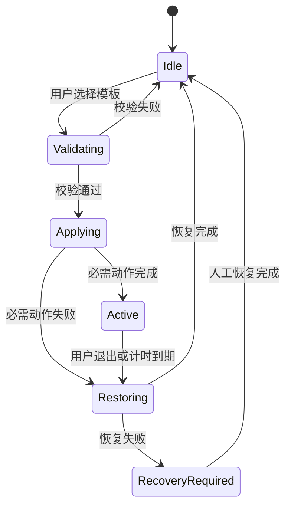

# 推荐架构、模式矩阵与实施计划

> 结论：首版使用“配置模板 + 会话执行器 + 恢复日志”。Focus 由 Shortcut 控制。Covio 只自动执行可恢复的公开接口动作。

## 1. 推荐架构

### 1.1 路径选择

推荐路径分三层。

1. `kmpDomain` 保存专注配置、动作和状态机。
2. Swift 宿主执行 macOS 动作。
3. Shortcuts 执行 macOS Focus 和用户扩展动作。

不采用以下路径。

1. Control Center 点击自动化。
2. 私有 Focus 写入接口。
3. 全局脚本执行器。
4. 强制退出应用。
5. 永久保持唤醒。

### 1.2 组件职责

| 组件 | 职责 | 不负责 |
| --- | --- | --- |
| `FocusProfileStore` | 保存模板和用户配置 | 执行系统动作 |
| `FocusPolicy` | 校验动作组合和时长 | 访问 macOS |
| `FocusSessionCoordinator` | 管理会话状态和恢复顺序 | 调用具体系统接口 |
| `FocusShortcutRunner` | 运行进入和退出 Shortcut | 解析 Shortcut 内容 |
| `FocusApplicationController` | 启动、隐藏和请求退出应用 | 强制结束应用 |
| `FocusWakeLease` | 申请限时保持唤醒 | 修改系统睡眠策略 |
| `FocusSessionJournal` | 原子保存会话和恢复数据 | 保存文档内容 |
| `FocusSettingsView` | 展示和编辑模板 | 自动执行高级动作 |

### 1.3 调用路径



### 1.4 文件位置

| 文件 | 内容 |
| --- | --- |
| `kmpDomain/src/com/wyz/covio/core/FocusModels.kt` | 配置、动作、会话和结果模型 |
| `kmpDomain/src/com/wyz/covio/core/FocusPolicy.kt` | 校验、排序和恢复规则 |
| `kmpDomain/src/com/wyz/covio/core/FocusStore.kt` | 配置文件读写 |
| `macosApp/src/Focus/FocusRuntime.swift` | 组装焦点运行时 |
| `macosApp/src/Focus/FocusShortcutRunner.swift` | 运行 `shortcuts` 命令 |
| `macosApp/src/Focus/FocusApplicationController.swift` | 应用启动、隐藏和退出 |
| `macosApp/src/Focus/FocusSessionJournal.swift` | 恢复日志原子写入 |
| `macosApp/test/FocusRuntimeTests.swift` | 宿主测试 |
| `kmpDomain/test/.../FocusPolicyTest.kt` | 纯策略测试 |

配置和建议使用独立文件。
建议文件名为 `focus-profiles.json` 和 `focus-session.json`。
路径由 `AppPaths` 解析。
两个文件不写入现有 `config.json`。

## 2. 接口契约

### 2.1 传输与权限

| 项目 | 约定 |
| --- | --- |
| 传输 | Swift 与 KMP 的进程内调用 |
| 外部服务 | 无 |
| 网络 | 无 |
| 权限 | 当前登录用户 |
| 辅助功能 | 首版不申请 |
| 屏幕录制 | 首版不申请 |
| Shortcuts | 只运行用户显式绑定的名称 |
| 协议版本 | `focus.v1` |

接口不暴露给网络。
接口不接受任意 shell 命令。
高级动作只能是显式绑定的 Shortcut。

### 2.2 领域模型

```text
FocusProfile
  profile_id
  display_name
  template_kind
  focus_enter_shortcut
  focus_exit_shortcut
  launch_apps[]
  hide_apps[]
  quit_apps[]
  keep_display_awake
  duration_minutes
  custom_shortcut

`duration_minutes` 默认值为 120。
允许范围为 1 至 480。

FocusSession
  session_id
  profile_id
  state
  started_at
  expires_at
  applied_actions[]
  warnings[]
  errors[]
```

### 2.3 操作列表

| 操作 | 用途 |
| --- | --- |
| `focus.profile.list` | 读取模板和配置 |
| `focus.profile.save` | 保存一个模板 |
| `focus.capabilities` | 查询 Shortcut 和应用能力 |
| `focus.session.start` | 进入专注模式 |
| `focus.session.stop` | 退出并恢复 |
| `focus.session.status` | 查询当前会话 |
| `focus.session.recover` | 从恢复日志继续恢复 |

### 2.4 请求字段

| 字段 | 类型 | 规则 |
| --- | --- | --- |
| `request_id` | string | 每次请求唯一 |
| `profile_id` | string | 必须是已保存模板 |
| `duration_seconds` | integer | 60 至 28800 |
| `dry_run` | boolean | 只校验，不改变系统 |
| `allow_degraded` | boolean | 允许无 Focus 降级进入 |
| `expected_revision` | integer | 防止覆盖新配置 |

### 2.5 响应字段

| 字段 | 类型 | 含义 |
| --- | --- | --- |
| `ok` | boolean | 请求是否完成 |
| `session_id` | string 或 null | 当前会话 ID |
| `state` | string | 会话状态 |
| `applied_actions` | array | 已执行动作 |
| `warnings` | array | 可继续的问题 |
| `errors` | array | 已发生的错误 |
| `rollback_status` | string | 未开始、进行中、完成或失败 |

### 2.6 错误码

| 错误码 | 条件 | 可重试 |
| --- | --- | --- |
| `profile_not_found` | 模板不存在 | 否 |
| `profile_invalid` | 动作或时长无效 | 否 |
| `journal_write_failed` | 恢复日志无法写入 | 是 |
| `focus_shortcut_missing` | 进入或退出 Shortcut 缺失 | 是 |
| `focus_shortcut_failed` | Shortcut 返回失败 | 是 |
| `focus_shortcut_timeout` | Shortcut 超时 | 是 |
| `focus_status_denied` | Focus 状态未授权 | 否 |
| `app_not_found` | Bundle ID 不存在 | 是 |
| `app_launch_failed` | 应用启动失败 | 是 |
| `app_hide_failed` | 隐藏请求失败 | 是 |
| `app_quit_cancelled` | 用户取消了退出 | 否 |
| `wake_lease_failed` | 睡眠断言失败 | 是 |
| `restore_conflict` | 系统状态已被用户改变 | 否 |
| `restore_failed` | 恢复动作失败 | 是 |
| `journal_corrupt` | 恢复日志损坏 | 否 |
| `session_expired` | 会话已过期 | 否 |

## 3. 模式动作矩阵

图例：`●` 默认开启，`○` 可选，`—` 不做。

| 动作 | video | game | coding | work | study |
| --- | --- | --- | --- | --- | --- |
| 进入 Focus Shortcut | ● | ● | ● | ● | ● |
| 退出 Focus Shortcut | ● | ● | ● | ● | ● |
| 启动配置应用 | ● | ● | ● | ● | ● |
| 隐藏干扰应用 | ● | ● | ● | ● | ● |
| 请求退出应用 | ○ | ○ | ○ | ○ | ○ |
| 保持屏幕唤醒 | ● | ● | ○ | ○ | ○ |
| 自定义 Shortcut | ○ | ○ | ○ | ○ | ○ |
| 修改音量 | — | — | — | — | — |
| 修改亮度 | — | — | — | — | — |
| 修改 Wi-Fi 或 VPN | — | — | — | — | — |
| 修改蓝牙 | — | — | — | — | — |
| 修改风扇或功耗 | — | — | — | — | — |

### 3.1 video

| 项目 | 默认动作 |
| --- | --- |
| macOS Focus | `Do Not Disturb` 或自定义 `Video` |
| 启动应用 | 用户选择的播放器 |
| 隐藏应用 | 消息、邮件、聊天和社交应用 |
| 保持唤醒 | 开启，最多到会话结束 |
| 退出方式 | 优先运行 `Covio Exit Video` |
| 禁止动作 | 静音、降亮度、断网、改蓝牙 |

视频模式不修改音量。
全局静音会破坏视频播放。
视频模式不关闭播放器。
用户可能需要继续播放。

### 3.2 game

| 项目 | 默认动作 |
| --- | --- |
| macOS Focus | `Gaming` 或自定义 `Game` |
| 启动应用 | 用户选择的游戏或启动器 |
| 隐藏应用 | 消息、邮件、聊天和社交应用 |
| 保持唤醒 | 开启，最多到会话结束 |
| 退出方式 | 优先运行 `Covio Exit Game` |
| 禁止动作 | 改网络、蓝牙、风扇、功耗和音量 |

游戏模式不修改网络。
断网会中断云存档和多人游戏。
游戏模式不修改风扇和功耗。
这些设置需要单独的安全设计。

### 3.3 coding

| 项目 | 默认动作 |
| --- | --- |
| macOS Focus | 自定义 `Coding` 或 `Do Not Disturb` |
| 启动应用 | IDE、终端和文档浏览器 |
| 隐藏应用 | 邮件、消息和社交应用 |
| 保持唤醒 | 可选，建议仅接电源时开启 |
| 退出方式 | 优先运行 `Covio Exit Coding` |
| 禁止动作 | 改外观、亮度、Dock 和窗口布局 |

编码模式默认保留浏览器。
用户经常需要查文档。
Covio 不自动打开项目文件。
首版无法可靠推断正确项目。

### 3.4 work

| 项目 | 默认动作 |
| --- | --- |
| macOS Focus | `Work` |
| 启动应用 | 邮件、日历和任务应用 |
| 隐藏应用 | 游戏、视频和社交应用 |
| Focus 过滤器 | 由用户配置 Mail、Calendar 和 Messages |
| 保持唤醒 | 可选，建议仅接电源时开启 |
| 退出方式 | 优先运行 `Covio Exit Work` |
| 禁止动作 | 自动改邮件账户、日历和联系人 |

工作模式优先使用系统 Work Focus。
系统过滤器能按账户和日历减少干扰。
Covio 不复制这些过滤规则。

### 3.5 study

| 项目 | 默认动作 |
| --- | --- |
| macOS Focus | 自定义 `Study` |
| 启动应用 | 笔记、阅读器和计时器 |
| 隐藏应用 | 游戏、视频和社交应用 |
| 保持唤醒 | 默认关闭，电池供电时建议关闭 |
| 退出方式 | 优先运行 `Covio Exit Study` |
| 禁止动作 | 改网络、音量、亮度和浏览器标签 |

学习模式默认不保持唤醒。
保持唤醒会增加电池消耗。
用户可手动为长课程开启。

### 3.6 应用处理规则

每个应用选择一个动作。

1. `launch` 启动或激活应用。
2. `hide` 隐藏应用。
3. `quitGracefully` 发送正常退出请求。
4. `none` 不处理。

`quitGracefully` 只调用 `terminate()`。
Covio 不调用 `forceTerminate()`。
应用拒绝退出时保留应用。
Covio 记录 `app_quit_cancelled` 并继续。

## 4. 关键流程

### 4.1 进入流程

1. 读取模板和配置版本。
2. 检查应用 Bundle ID。
3. 检查进入和退出 Shortcut。
4. 生成 `session_id`。
5. 原子写入恢复日志。
6. 运行进入 Shortcut。
7. 启动应用。
8. 隐藏或请求退出干扰应用。
9. 通过 `HoldLeaseManager` 创建 Focus 租约。
10. 回读租约状态。
11. 标记会话为 `active`。

### 4.2 退出流程

1. 把会话改为 `restoring`。
2. 释放 Focus 租约。
3. 恢复 Covio 隐藏的应用。
4. 运行退出 Shortcut。
5. 回读 Shortcut 结果。
6. 记录恢复结果。
7. 清除恢复日志。
8. 标记会话为 `completed`。

### 4.3 崩溃恢复流程

1. 启动时读取 `focus-session.json`。
2. 校验会话 schema 和版本。
3. 把残留会话显示为待恢复。
4. 用户选择恢复或保留现场。
5. 恢复时执行逆序动作。
6. 恢复成功后清除日志。
7. 恢复失败时保留错误和日志。

### 4.4 模式切换流程

1. 用户选择另一个模板。
2. Covio 先结束当前会话。
3. Covio 等待恢复完成。
4. 恢复成功后进入新模板。
5. 恢复失败时不进入新模板。
6. 用户可选择查看错误。

## 5. 安全设计

### 5.1 数据安全

1. 默认隐藏应用。
2. 请求退出必须逐应用开启。
3. 强制退出不可用。
4. 应用退出被取消时继续会话。
5. 不自动重新打开已退出的应用。
6. 不保存文档内容和窗口标题。

### 5.2 Focus 安全

1. Covio 只运行显式绑定的 Shortcut。
2. Covio 不解析 Shortcut 内容。
3. 缺少进入 Shortcut 时阻止进入。
4. 缺少退出 Shortcut 时阻止进入。
5. 降级进入必须明确确认。
6. 退出 Shortcut 只关闭目标 Focus。
7. UI 不提供“关闭全部 Focus”动作。
8. Focus 状态可读且已有 Focus 时，Covio 先警告。
9. Covio 不自动关闭其他 Focus。
10. Focus 状态未知时，UI 显示未知状态。

### 5.3 权限安全

1. 首版不申请 Accessibility。
2. 首版不申请 Screen Recording。
3. 首版不要求管理员密码。
4. 首版不安装新 helper。
5. Focus 状态授权被拒绝时隐藏精确状态。
6. 授权被拒绝不影响其他动作。

### 5.4 电源安全

1. 使用 `HoldLeaseManager` 管理租约。
2. 新增 `FOCUS` 租约来源。
3. 默认最长 8 小时。
4. 会话到期后释放租约。
5. 应用退出时释放租约。
6. 电池低电量规则仍可否决租约。
7. 热压力仍可否决租约。

## 6. 合规设计

1. 不调用私有 Focus 接口。
2. 不读取通知内容。
3. 不读取消息内容。
4. 不读取屏幕内容。
5. 不上传应用列表。
6. 不上传模板和会话日志。
7. 不绕过系统权限。
8. 不在后台静默安装 Shortcut。
9. 不把用户 Shortcut 打包进应用。
10. 不承诺 App Store 合规。

Covio 已使用 helper 和实验性私有亮度接口。
本功能不能单独解决现有分发合规问题。
本功能自身不增加新的私有接口依赖。

## 7. 可靠性设计

1. 配置文件使用原子写入。
2. 会话日志使用原子写入。
3. 每个动作有稳定 ID。
4. 每个动作有开始时间和结果。
5. 动作按固定顺序执行。
6. 恢复按相反顺序执行。
7. 动作必须可重复执行。
8. 恢复前回读当前状态。
9. 用户修改过的状态不覆盖。
10. 失败时返回具体错误码。

### 7.1 超时

| 动作 | 超时 |
| --- | --- |
| 应用启动 | 10 秒 |
| 应用隐藏 | 2 秒 |
| 请求退出 | 10 秒 |
| 进入 Shortcut | 20 秒 |
| 退出 Shortcut | 20 秒 |
| 会话恢复 | 30 秒 |

### 7.2 恢复冲突规则

1. 只有 Covio 隐藏的应用才由 Covio 取消隐藏。
2. 原本已隐藏的应用保持隐藏。
3. 用户已手动取消隐藏时不再改变应用。
4. 应用已退出时不重新启动。
5. 用户已切换 Focus 时退出 Shortcut 只关闭目标 Focus。
6. 恢复日志保留到恢复成功。

## 8. 失败模式

| 失败 | 用户影响 | 处理 |
| --- | --- | --- |
| Shortcut 缺失 | 无法进入完整专注模式 | 打开设置向导 |
| Shortcut 超时 | Focus 状态未知 | 标记恢复待确认 |
| 应用不存在 | 少启动一个应用 | 警告并继续 |
| 应用隐藏失败 | 仍有干扰窗口 | 记录失败并继续 |
| 退出请求被取消 | 应用继续运行 | 记录取消并继续 |
| 睡眠断言失败 | 屏幕可能睡眠 | 警告并允许继续 |
| 日志写入失败 | 无法保证恢复 | 阻止进入 |
| 恢复失败 | 系统状态部分未知 | 进入 `recovery_required` |
| 日志损坏 | 无法自动恢复 | 显示原始日志和人工步骤 |
| 进程崩溃 | 断言自动释放 | 下次启动发现残留会话 |

## 9. 验收标准

1. 五个模板都能保存和重新加载。
2. 进入流程和退出流程都有自动化测试。
3. 缺少 Shortcut 时不执行任何系统动作。
4. 用户拒绝降级时不进入会话。
5. 隐藏应用后退出能恢复原可见状态。
6. 请求退出被取消时不调用强制退出。
7. 睡眠租约在退出后释放。
8. 睡眠租约在应用退出后由系统释放。
9. 应用崩溃后能发现残留会话。
10. 恢复失败时保留日志。
11. 模式切换先恢复旧会话。
12. 首版不申请 Accessibility 权限。
13. 首版不修改音量和亮度。
14. macOS 26 和 macOS 27 都完成真机验证。

## 10. 实施计划

| 阶段 | 交付 | 验收 | 工期 |
| --- | --- | --- | --- |
| 1 | 模型、配置和迁移 | 五个模板可保存和读取 | 2 天 |
| 2 | 策略和会话状态机 | 纯单元测试覆盖正常和失败路径 | 2 天 |
| 3 | 应用控制器 | 启动、隐藏、请求退出和恢复通过 | 3 天 |
| 4 | Shortcut runner | 缺失、成功、失败和超时通过 | 2 天 |
| 5 | 唤醒租约接入 | 多来源断言不互相覆盖 | 2 天 |
| 6 | 设置和执行 UI | 可预览、执行、停止和恢复 | 3 天 |
| 7 | 真机验证和文档 | V08 至 V10 通过 | 3 天 |

首版可拆成 4 个交付单元。

1. 数据与策略。
2. 系统动作。
3. 设置与执行界面。
4. 恢复与真机验收。

## 11. 回滚条件

出现以下任一情况时停止发布。

1. 退出后不能恢复应用可见状态。
2. 退出后睡眠断言仍然有效。
3. 请求退出触发强制结束。
4. Shortcut 失败仍显示成功。
5. 应用崩溃后没有恢复入口。
6. macOS 26 无法运行核心路径。
7. 首版需要 Accessibility 权限。
8. 数据日志包含通知、消息或文档内容。

## 12. 产品化条件

1. 设计合同增加专注设置和执行状态。
2. 中英文文案完成。
3. V01 至 V10 通过。
4. macOS 26 与 macOS 27 真机验收通过。
5. 崩溃恢复和失败提示通过。
6. 用户指南说明 Shortcut 创建步骤。
7. ADR 记录 Focus 写入边界。
8. Feature issue 和子 issue 已建立。
9. 发布说明列出不支持的系统动作。
10. 安全评审确认没有新增私有接口。
