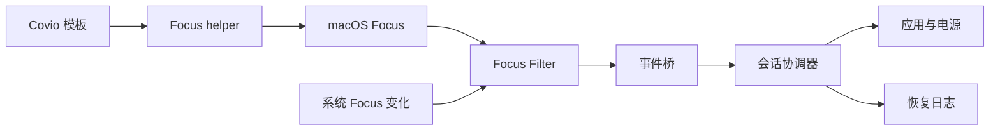

# 推荐架构、模式矩阵与实施计划

> 结论：采用“Focus Filter 事件桥 + 单个生成式 helper Shortcut + 安全降级”。这是加权选型的第一名。

## 1. 推荐架构

### 1.1 全局选择

推荐架构合并两类成熟方案。

1. Thaw、Home Assistant 和 Outer Spaces 的 Focus Filter 事件路径。
2. Raycast Focus Modes 的单个生成式 helper Shortcut 路径。

完整评分见 [github-references.md](github-references.md) 第 10 节。
加权分为 `4.53`。
第二名的 Focus Filter-only 方案为 `4.20`。
第三名的每个模式手工 Shortcut 方案为 `3.75`。

### 1.2 路径选择

推荐路径分四层。

1. Focus Filter 接收 macOS Focus 激活和停用。
2. 主应用状态机应用或恢复 Covio 模板。
3. 单个 helper Shortcut 从 Covio 发起 Focus 切换。
4. 公开 AppKit 和 IOKit 接口执行应用与电源动作。

不采用以下路径。

1. Control Center 点击自动化。
2. 私有 Focus 写入接口。
3. 持续轮询私有 Focus 数据库。
4. 每模式两个手工 Shortcut。
5. 强制退出应用。
6. 永久保持唤醒。

### 1.3 组件职责

| 组件 | 职责 | 不负责 |
| --- | --- | --- |
| `FocusProfileStore` | 保存模板和动作 | 执行系统动作 |
| `FocusBindingStore` | 保存 Focus 与模板映射 | 解析私有数据库 |
| `FocusPolicy` | 校验动作组合和时长 | 访问 macOS |
| `FocusFilterIntent` | 接收 Focus 变化并写事件 | 执行重动作 |
| `FocusEventBridge` | 把 Filter 事件送到主应用 | 读取 Focus 名称 |
| `FocusSessionCoordinator` | 管理会话状态和恢复顺序 | 调用具体系统接口 |
| `FocusHelperInstaller` | 生成、签名和登记 helper | 执行用户 Shortcut |
| `FocusShortcutRunner` | 按 ID 运行 helper | 解析 Shortcut 内容 |
| `FocusDatabaseReader` | 可选只读模式发现 | 修改 Focus 数据库 |
| `FocusApplicationController` | 启动、隐藏和请求退出应用 | 强制结束应用 |
| `FocusWakeLease` | 申请限时保持唤醒 | 修改系统睡眠策略 |
| `FocusSessionJournal` | 原子保存会话和恢复数据 | 保存文档内容 |
| `FocusSettingsView` | 展示、映射和编辑模板 | 自动执行高级动作 |

### 1.4 调用路径



### 1.5 文件位置

| 文件 | 内容 |
| --- | --- |
| `kmpDomain/src/com/wyz/covio/core/FocusModels.kt` | 配置、绑定、事件、会话和结果模型 |
| `kmpDomain/src/com/wyz/covio/core/FocusPolicy.kt` | 校验、排序和恢复规则 |
| `kmpDomain/src/com/wyz/covio/core/FocusStore.kt` | 配置、绑定和事件文件读写 |
| `macosApp/src/Focus/FocusRuntime.swift` | 组装专注运行时 |
| `macosApp/src/Focus/FocusFilterIntent.swift` | `SetFocusFilterIntent` 实现 |
| `macosApp/src/Focus/FocusEventBridge.swift` | Filter 到主应用的事件传递 |
| `macosApp/src/Focus/FocusHelperInstaller.swift` | helper 生成、签名和信任 |
| `macosApp/src/Focus/FocusShortcutRunner.swift` | 按 ID 运行 helper |
| `macosApp/src/Focus/FocusDatabaseReader.swift` | 可选只读模式发现 |
| `macosApp/src/Focus/FocusApplicationController.swift` | 应用启动、隐藏和退出 |
| `macosApp/src/Focus/FocusSessionJournal.swift` | 恢复日志原子写入 |
| `macosApp/test/FocusRuntimeTests.swift` | 宿主测试 |
| `kmpDomain/test/.../FocusPolicyTest.kt` | 纯策略测试 |

配置建议使用独立文件。
建议文件名为 `focus-profiles.json`、`focus-bindings.json`、`focus-events.json` 和 `focus-session.json`。
路径由 `AppPaths` 解析。
这些文件不写入现有 `config.json`。

## 2. 接口契约

### 2.1 传输与权限

| 项目 | 约定 |
| --- | --- |
| 主接口传输 | Swift 与 KMP 的进程内调用 |
| Filter 到主应用 | 本地共享事件和分布式通知 |
| 外部服务 | 无 |
| 网络 | 无 |
| 权限 | 当前登录用户 |
| Full Disk Access | 可选，只读 Focus 数据库 |
| 辅助功能 | 首版不申请 |
| 屏幕录制 | 首版不申请 |
| Shortcuts | 只运行 Covio 生成并登记的 helper |
| 协议版本 | `focus.v1` |

接口不暴露给网络。
接口不接受任意 shell 命令。
Filter 不直接启动应用、隐藏应用或创建电源断言。

### 2.2 领域模型

```text
FocusProfile
  profile_id
  display_name
  template_kind
  focus_id
  focus_name
  launch_apps[]
  hide_apps[]
  quit_apps[]
  keep_display_awake
  duration_minutes
  custom_shortcut

FocusEvent
  event_id
  profile_id
  focus_id
  active
  created_at
  source

FocusHelper
  helper_id
  helper_name
  supported_focus_ids[]
  generated_at
  protocol_version

FocusSession
  session_id
  profile_id
  state
  started_at
  expires_at
  applied_actions[]
  warnings[]
  errors[]
```

`duration_minutes` 默认值为 120。
允许范围为 1 至 480。

### 2.3 操作列表

| 操作 | 用途 |
| --- | --- |
| `focus.profile.list` | 读取模板和配置 |
| `focus.profile.save` | 保存一个模板 |
| `focus.binding.list` | 读取 Focus 映射 |
| `focus.binding.save` | 保存一个 Focus 映射 |
| `focus.capabilities` | 查询 Filter、FDA、helper 和应用能力 |
| `focus.helper.status` | 查询 helper ID、版本和覆盖范围 |
| `focus.helper.install` | 生成、签名并引导安装 helper |
| `focus.helper.refresh` | 重新生成过期 helper |
| `focus.event.accept` | 接收 Focus Filter 事件 |
| `focus.session.start` | 进入专注模式 |
| `focus.session.stop` | 退出并恢复 |
| `focus.session.status` | 查询当前会话 |
| `focus.session.recover` | 从恢复日志继续恢复 |

### 2.4 请求字段

| 字段 | 类型 | 规则 |
| --- | --- | --- |
| `request_id` | string | 每次请求唯一 |
| `event_id` | string 或 null | Filter 事件唯一 |
| `profile_id` | string | 必须是已保存模板 |
| `source` | string | `app`、`focus_filter` 或 `recovery` |
| `duration_seconds` | integer | 60 至 28800 |
| `dry_run` | boolean | 只校验，不改变系统 |
| `allow_degraded` | boolean | 允许无 Focus 降级进入 |
| `expected_revision` | integer | 防止覆盖新配置 |

### 2.5 响应字段

| 字段 | 类型 | 含义 |
| --- | --- | --- |
| `ok` | boolean | 请求是否完成 |
| `session_id` | string 或 null | 当前会话 ID |
| `state` | string | 会话状态 |
| `applied_actions` | array | 已执行动作 |
| `warnings` | array | 可继续的问题 |
| `errors` | array | 已发生的错误 |
| `rollback_status` | string | 未开始、进行中、完成或失败 |

### 2.6 错误码

| 错误码 | 条件 | 可重试 |
| --- | --- | --- |
| `profile_not_found` | 模板不存在 | 否 |
| `profile_invalid` | 动作或时长无效 | 否 |
| `focus_binding_missing` | 模板没有系统 Focus | 是 |
| `focus_filter_missing` | 系统 Focus 没有 Covio Filter | 是 |
| `focus_filter_unavailable` | Filter 无法运行 | 是 |
| `focus_event_duplicate` | 收到已处理事件 | 否 |
| `focus_event_stale` | 事件顺序落后 | 否 |
| `full_disk_access_denied` | 无法读取 Focus 数据库 | 是 |
| `focus_database_changed` | 数据库格式不兼容 | 否 |
| `helper_missing` | 没有 helper | 是 |
| `helper_untrusted` | helper ID 不在信任列表 | 否 |
| `helper_update_required` | helper 不包含目标 Focus | 是 |
| `helper_install_cancelled` | 用户未完成安装 | 是 |
| `helper_failed` | Shortcut 返回失败 | 是 |
| `helper_timeout` | Shortcut 超时 | 是 |
| `journal_write_failed` | 恢复日志无法写入 | 是 |
| `app_not_found` | Bundle ID 不存在 | 是 |
| `app_launch_failed` | 应用启动失败 | 是 |
| `app_hide_failed` | 隐藏请求失败 | 是 |
| `app_quit_cancelled` | 用户取消了退出 | 否 |
| `wake_lease_failed` | 睡眠断言失败 | 是 |
| `restore_conflict` | 用户已切换其他 Focus | 否 |
| `restore_failed` | 恢复动作失败 | 是 |
| `journal_corrupt` | 恢复日志损坏 | 否 |
| `session_expired` | 会话已过期 | 否 |

## 3. 模式动作矩阵

图例：`●` 默认开启，`○` 可选，`—` 不做。

| 动作 | video | game | coding | work | study |
| --- | --- | --- | --- | --- | --- |
| 系统 Focus 绑定 | ● | ● | ● | ● | ● |
| Focus Filter 响应 | ● | ● | ● | ● | ● |
| helper 主动切换 | ● | ● | ● | ● | ● |
| 启动配置应用 | ● | ● | ● | ● | ● |
| 隐藏干扰应用 | ● | ● | ● | ● | ● |
| 请求退出应用 | ○ | ○ | ○ | ○ | ○ |
| 保持屏幕唤醒 | ● | ● | ○ | ○ | ○ |
| 自定义 Shortcut | ○ | ○ | ○ | ○ | ○ |
| 修改音量 | — | — | — | — | — |
| 修改亮度 | — | — | — | — | — |
| 修改 Wi-Fi 或 VPN | — | — | — | — | — |
| 修改蓝牙 | — | — | — | — | — |
| 修改风扇或功耗 | — | — | — | — | — |

### 3.1 video

| 项目 | 默认动作 |
| --- | --- |
| macOS Focus | `Do Not Disturb` 或自定义 `Video` |
| 启动应用 | 用户选择的播放器 |
| 隐藏应用 | 消息、邮件、聊天和社交应用 |
| 保持唤醒 | 开启，最多到会话结束 |
| 退出方式 | Focus Filter 停用或运行 helper 关闭目标 Focus |
| 禁止动作 | 静音、降亮度、断网、改蓝牙 |

视频模式不修改音量。
全局静音会破坏视频播放。
视频模式不关闭播放器。
用户可能需要继续播放。

### 3.2 game

| 项目 | 默认动作 |
| --- | --- |
| macOS Focus | `Gaming` 或自定义 `Game` |
| 启动应用 | 用户选择的游戏或启动器 |
| 隐藏应用 | 消息、邮件、聊天和社交应用 |
| 保持唤醒 | 开启，最多到会话结束 |
| 退出方式 | Focus Filter 停用或运行 helper 关闭目标 Focus |
| 禁止动作 | 改网络、蓝牙、风扇、功耗和音量 |

游戏模式不修改网络。
断网会中断云存档和多人游戏。
游戏模式不修改风扇和功耗。
这些设置需要单独的安全设计。

### 3.3 coding

| 项目 | 默认动作 |
| --- | --- |
| macOS Focus | 自定义 `Coding` 或 `Do Not Disturb` |
| 启动应用 | IDE、终端和文档浏览器 |
| 隐藏应用 | 邮件、消息和社交应用 |
| 保持唤醒 | 可选，建议仅接电源时开启 |
| 退出方式 | Focus Filter 停用或运行 helper 关闭目标 Focus |
| 禁止动作 | 改外观、亮度、Dock 和窗口布局 |

编码模式默认保留浏览器。
用户经常需要查文档。
Covio 不自动打开项目文件。
首版无法可靠推断正确项目。

### 3.4 work

| 项目 | 默认动作 |
| --- | --- |
| macOS Focus | `Work` |
| 启动应用 | 邮件、日历和任务应用 |
| 隐藏应用 | 游戏、视频和社交应用 |
| Focus 过滤器 | 由用户配置 Mail、Calendar 和 Messages |
| 保持唤醒 | 可选，建议仅接电源时开启 |
| 退出方式 | Focus Filter 停用或运行 helper 关闭目标 Focus |
| 禁止动作 | 自动改邮件账户、日历和联系人 |

工作模式优先使用系统 Work Focus。
系统过滤器能按账户和日历减少干扰。
Covio 不复制这些过滤规则。

### 3.5 study

| 项目 | 默认动作 |
| --- | --- |
| macOS Focus | 自定义 `Study` |
| 启动应用 | 笔记、阅读器和计时器 |
| 隐藏应用 | 游戏、视频和社交应用 |
| 保持唤醒 | 默认关闭，电池供电时建议关闭 |
| 退出方式 | Focus Filter 停用或运行 helper 关闭目标 Focus |
| 禁止动作 | 改网络、音量、亮度和浏览器标签 |

学习模式默认不保持唤醒。
保持唤醒会增加电池消耗。
用户可手动为长课程开启。

### 3.6 应用处理规则

每个应用选择一个动作。

1. `launch` 启动或激活应用。
2. `hide` 隐藏应用。
3. `quitGracefully` 发送正常退出请求。
4. `none` 不处理。

`quitGracefully` 只调用 `terminate()`。
Covio 不调用 `forceTerminate()`。
应用拒绝退出时保留应用。
Covio 记录 `app_quit_cancelled` 并继续。

## 4. 关键流程

### 4.1 首次设置

1. 用户创建或选择五个系统 Focus。
2. 用户允许 Covio 读取 Focus 模式列表。
3. Covio 读取 `ModeConfigurations.json`。
4. Covio 显示 Focus 名称和 ID。
5. 用户把每个 Focus 映射到 Covio 模板。
6. Covio 生成一个 helper Shortcut。
7. Covio 签名 helper。
8. Covio 打开 Shortcuts。
9. 用户点击“Add Shortcut”。
10. Covio 按随机名称找到 helper。
11. Covio 记录 helper ID。
12. 用户在每个系统 Focus 中添加 Covio Focus Filter。
13. Covio 校验映射和 helper 覆盖范围。

### 4.2 拒绝 Full Disk Access

1. 用户拒绝 Full Disk Access。
2. Covio 不读取 Focus 名称和 ID。
3. Covio 不生成 helper。
4. 用户仍可在系统 Focus 中配置 Covio Filter。
5. 用户在 Covio 中手工选择模板。
6. Covio 只应用模板动作。
7. UI 明确说明系统 Focus 未由 Covio 切换。

### 4.3 从 Covio 切换

1. 用户选择模板。
2. Covio 校验 Focus 绑定和 helper。
3. Covio 生成 `pending_event_id`。
4. Covio 运行 helper 的开启分支。
5. Covio 等待 Focus Filter 事件或状态回读。
6. 会话只启动一次。
7. 会话超时仍未确认时显示警告。

### 4.4 从系统切换

1. 系统 Focus 激活。
2. Focus Filter 写入激活事件。
3. Filter 发布本地通知。
4. 主应用读取事件。
5. 主应用丢弃重复和乱序事件。
6. 主应用恢复旧会话。
7. 主应用启动新模板。
8. 新会话进入 `active`。

### 4.5 Focus 停用

1. 系统 Focus 停用。
2. Focus Filter 写入空模板事件。
3. 主应用确认当前会话属于该 Focus。
4. 主应用执行退出流程。
5. 主应用恢复应用、租约和原 Focus。

### 4.6 原 Focus 恢复

1. 进入新 Focus 前读取当前 Focus。
2. 记录原 Focus ID。
3. 退出时读取当前 Focus。
4. 当前 Focus 仍为目标 Focus 时恢复原 Focus。
5. 当前 Focus 已由用户切换时跳过恢复。
6. 跳过时记录 `restore_conflict`。

### 4.7 helper 更新

1. Focus 配置新增或删除模式。
2. Covio 检测 helper 不支持目标 Focus。
3. Covio 生成新 helper 名称。
4. Covio 签名并引导用户导入。
5. Covio 记录新 helper ID。
6. 新 helper 成功后才移除旧 ID。
7. 导入取消时保留旧 helper。

### 4.8 崩溃恢复

1. 启动时读取 `focus-session.json`。
2. 校验会话 schema 和版本。
3. 把残留会话显示为待恢复。
4. 用户选择恢复或保留现场。
5. 恢复时执行逆序动作。
6. 恢复成功后清除日志。
7. 恢复失败时保留错误和日志。

## 5. 安全设计

### 5.1 数据安全

1. 默认隐藏应用。
2. 请求退出必须逐应用开启。
3. 强制退出不可用。
4. 应用退出被取消时继续会话。
5. 不自动重新打开已退出的应用。
6. 不保存文档内容和窗口标题。
7. 不保存 Focus 数据库原文。

### 5.2 Focus 安全

1. Covio 只运行已登记的 helper ID。
2. Covio 不按 Shortcut 名称运行 helper。
3. helper 必须覆盖目标 Focus ID。
4. Filter 事件必须有唯一 ID。
5. Filter 事件必须校验模板 ID。
6. 重复事件只处理一次。
7. 旧事件不能覆盖新事件。
8. 退出只关闭目标 Focus 或恢复已记录 Focus。
9. Covio 不关闭用户后来切换到的 Focus。
10. UI 不提供“关闭全部 Focus”动作。

### 5.3 权限安全

1. 首版不申请 Accessibility。
2. 首版不申请 Screen Recording。
3. 首版不要求管理员密码。
4. 首版不安装新 helper 进程。
5. Full Disk Access 只用于只读 Focus 发现。
6. FDA 被拒绝不影响 Filter 映射。
7. Focus 状态授权被拒绝时隐藏精确状态。
8. 事件日志不包含通知、消息或文档内容。

### 5.4 电源安全

1. 使用 `HoldLeaseManager` 管理租约。
2. 新增 `FOCUS` 租约来源。
3. 默认最长 8 小时。
4. 会话到期后释放租约。
5. 应用退出时释放租约。
6. 电池低电量规则仍可否决租约。
7. 热压力仍可否决租约。

### 5.5 许可证安全

1. Raycast 和 Hammerspoon 使用 MIT。
2. Home Assistant 使用 Apache-2.0。
3. Thaw 和 Outer Spaces 使用 GPL-3.0。
4. Sapphire 使用 AGPL-3.0。
5. GPL 和 AGPL 代码不复制进 MIT Covio。
6. 复制 MIT 或 Apache-2.0 代码时记录来源和许可证。

## 6. 隐私与合规设计

1. 不调用私有 Focus 写入接口。
2. 不读取通知内容。
3. 不读取消息内容。
4. 不读取屏幕内容。
5. 不上传应用列表。
6. 不上传模板、事件和会话日志。
7. 不上传 Focus 数据库内容。
8. 不绕过系统权限。
9. 不在后台静默安装 Shortcut。
10. 不把用户 Shortcut 打包进应用。
11. 不承诺 App Store 合规。

Covio 已使用 helper 和实验性私有亮度接口。
本功能不能单独解决现有分发合规问题。
本功能自身不增加新的私有写入接口。
Full Disk Access 读取是可选只读能力。

## 7. 可靠性设计

1. 配置文件使用原子写入。
2. 会话日志使用原子写入。
3. Filter 事件使用原子写入。
4. 每个动作有稳定 ID。
5. 每个动作有开始时间和结果。
6. 动作按固定顺序执行。
7. 恢复按相反顺序执行。
8. 动作必须可重复执行。
9. 恢复前回读当前状态。
10. 用户修改过的状态不覆盖。
11. 失败时返回具体错误码。
12. 私有数据库读取使用缓存和版本门控。

### 7.1 超时

| 动作 | 超时 |
| --- | --- |
| 应用启动 | 10 秒 |
| 应用隐藏 | 2 秒 |
| 请求退出 | 10 秒 |
| helper 运行 | 20 秒 |
| helper 导入等待 | 90 秒 |
| Focus Filter 事件确认 | 10 秒 |
| 会话恢复 | 30 秒 |

### 7.2 恢复冲突规则

1. 只有 Covio 隐藏的应用才由 Covio 取消隐藏。
2. 原本已隐藏的应用保持隐藏。
3. 用户已手动取消隐藏时不再改变应用。
4. 应用已退出时不重新启动。
5. 用户已切换 Focus 时跳过旧 Focus 恢复。
6. 恢复日志保留到恢复成功。

## 8. 失败模式

| 失败 | 用户影响 | 处理 |
| --- | --- | --- |
| Focus Filter 未配置 | 系统 Focus 不会驱动 Covio | 打开设置向导 |
| Focus Filter 未运行 | 模板不自动应用 | 显示事件不可用 |
| Filter 事件重复 | 可能重复执行动作 | 按事件 ID 去重 |
| Filter 事件乱序 | 可能错误恢复 | 按时间戳丢弃旧事件 |
| helper 缺失 | Covio 不能主动切换 Focus | 打开 helper 安装 |
| helper 过期 | 新 Focus 无法切换 | 生成新 helper |
| Full Disk Access 被拒绝 | 无法自动发现 Focus | 使用手工 Filter 映射 |
| 数据库格式变化 | 无法读取模式列表 | 显示错误并保留旧映射 |
| 应用不存在 | 少启动一个应用 | 警告并继续 |
| 应用隐藏失败 | 仍有干扰窗口 | 记录失败并继续 |
| 退出请求被取消 | 应用继续运行 | 记录取消并继续 |
| 睡眠断言失败 | 屏幕可能睡眠 | 警告并允许继续 |
| 日志写入失败 | 无法保证恢复 | 阻止进入 |
| 恢复失败 | 系统状态部分未知 | 进入 `recovery_required` |
| 日志损坏 | 无法自动恢复 | 显示原始日志和人工步骤 |
| 进程崩溃 | 断言自动释放 | 下次启动发现残留会话 |

## 9. 验收标准

1. 五个模板都能保存和重新加载。
2. 每个模板都能绑定一个系统 Focus。
3. Focus Filter 能接收激活、停用和切换。
4. Focus Filter 在应用运行和未运行时行为明确。
5. 单个 helper 覆盖全部已绑定 Focus。
6. helper 按 ID 运行，不按名称运行。
7. helper 更新失败时保留旧 helper。
8. 重复 Filter 事件只执行一次。
9. 旧 Filter 事件不会覆盖新状态。
10. 拒绝 Full Disk Access 时仍可配置 Filter。
11. 缺少 helper 时不执行主动切换。
12. 隐藏应用后退出能恢复原可见状态。
13. 请求退出被取消时不调用强制退出。
14. 睡眠租约在退出后释放。
15. 睡眠租约在应用退出后由系统释放。
16. 应用崩溃后能发现残留会话。
17. 恢复失败时保留日志。
18. 模式切换先恢复旧会话。
19. 首版不申请 Accessibility 权限。
20. 首版不修改音量和亮度。
21. macOS 26 和 macOS 27 都完成真机验证。
22. 许可证审计记录所有复用代码。

## 10. 实施计划

| 阶段 | 交付 | 验收 | 工期 |
| --- | --- | --- | --- |
| 1 | 模型、配置、绑定和事件 | schema 与 fixture 测试通过 | 2 天 |
| 2 | Focus Filter 与事件桥 | 激活、停用、重复和乱序通过 | 3 天 |
| 3 | helper 生成、签名和信任 | 导入、按 ID 运行和更新通过 | 3 天 |
| 4 | 应用控制器 | 启动、隐藏、请求退出和恢复通过 | 3 天 |
| 5 | 数据库只读发现 | FDA、拒绝、损坏和版本门控通过 | 2 天 |
| 6 | 设置与映射 UI | 五个模板、Filter 和 helper 可配置 | 3 天 |
| 7 | 唤醒租约接入 | 多来源断言不互相覆盖 | 2 天 |
| 8 | 真机验证和文档 | V01 至 V14 通过 | 3 天 |

首版可拆成 5 个交付单元。

1. 模型、配置和事件。
2. Focus Filter 与事件桥。
3. helper 与可选 FDA。
4. 系统动作和恢复。
5. 设置、真机验收和文档。

### 10.1 发布门槛

1. Focus Filter 可在主应用运行时完成激活和停用。
2. helper 可在 Covio 进程内运行。
3. 标签和 ID 不受本地化影响。
4. 用户拒绝 FDA 时没有崩溃或死循环。
5. 主应用崩溃后恢复路径可操作。
6. GitHub 参考代码的许可证已审计。

## 11. 回滚条件

出现以下任一情况时停止发布。

1. 退出后不能恢复应用可见状态。
2. 退出后睡眠断言仍然有效。
3. 请求退出触发强制结束。
4. helper 失败仍显示成功。
5. Focus Filter 无法可靠处理停用。
6. 应用崩溃后没有恢复入口。
7. macOS 26 无法运行核心路径。
8. 首版需要 Accessibility 权限。
9. 数据日志包含通知、消息或文档内容。
10. GPL 或 AGPL 代码进入 MIT 仓库。

## 12. 产品化条件

1. 设计合同增加 Focus 映射、设置和执行状态。
2. 中英文文案完成。
3. V01 至 V14 通过。
4. macOS 26 与 macOS 27 真机验收通过。
5. 崩溃恢复和失败提示通过。
6. 用户指南说明 Focus Filter 和 helper 创建步骤。
7. ADR 记录 Focus 写入和可选 FDA 边界。
8. Feature issue 和子 issue 已建立。
9. 发布说明列出不支持的系统动作。
10. 安全评审确认没有新增私有写入接口。
11. 许可证清单和第三方声明完成。
