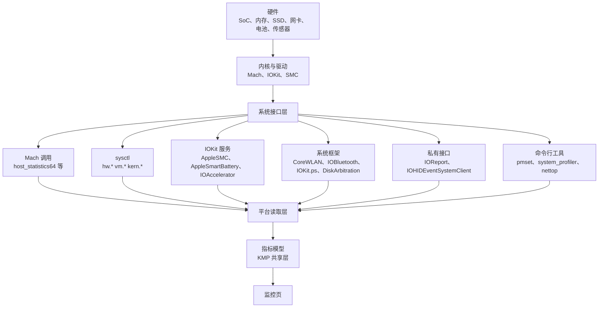

# 前因与问题边界

> 本文件承载问题类别、研究问题、范围、系统模型、状态矩阵、场景和成功标准。

## 1. 问题类别与研究问题

### 1.1 问题类别

本研究的类别是「系统硬件遥测的能力边界」。
这类问题问的是：应用能读到什么，读到的东西从哪来，读的代价是什么。
类别不绑定 Covio。任何要在 macOS 或 Windows 上显示硬件指标的应用都面对同一类问题。

### 1.2 研究问题

主问题：在 macOS 与 Windows 上，应用能监听到哪些硬件信息，每项信息的来源是什么？

子问题：

| 编号 | 子问题 |
| --- | --- |
| Q1 | 哪些指标不需要额外权限就能读到？ |
| Q2 | 哪些指标需要位置服务、蓝牙或管理员授权？ |
| Q3 | 哪些指标只能通过私有接口读到？私有接口的上架风险是什么？ |
| Q4 | 每项指标的刷新方式是什么？推送还是轮询？ |
| Q5 | 哪些指标在 Apple Silicon 与 Intel 上不同？ |
| Q6 | 哪些指标在 macOS 27 上已经变化或消失？ |

### 1.3 问题定义

监控页要显示实时硬件指标。
指标的可用性由操作系统决定，不由应用决定。
因此页面能显示什么，取决于三件事：接口是否公开、权限是否拿到、硬件是否上报。

### 1.4 触发条件

以下任一情况触发本研究。

1. 监控页要定指标清单。
2. 应用要申请新的系统权限。
3. macOS 大版本升级后指标消失。
4. 发行方式变化，私有接口不能再使用。

## 2. 范围

### 2.1 适用范围

| 项目 | 范围 |
| --- | --- |
| 平台 | macOS 写到接口级。Windows 只列骨架。 |
| 硬件 | MacBook 系列。台式机差异单独标注。 |
| 指标 | CPU、GPU、内存、磁盘、网络、电池、电源、传感器、蓝牙、显示、系统、进程 |
| 接口 | 公开框架、公开 C API、IOKit 服务、私有接口、命令行工具 |
| 权限 | 无权限、位置服务、蓝牙、管理员、完全磁盘访问 |

### 2.2 范围外事项

1. 指标的历史存储与图表渲染。
2. 指标告警与阈值策略。
3. 远程监控与多机聚合。
4. 风扇控制等写操作。本研究只覆盖读取。
5. Windows 的接口级调研。本版只留骨架。
6. iOS 与 Android。

## 3. 受影响角色

| 角色 | 关心什么 |
| --- | --- |
| 用户 | 页面显示的数据是否准确、是否耗电 |
| 研发 | 每项指标用哪个接口、要不要权限 |
| 测试 | 换机型、换系统版本后指标是否还在 |
| 安全与合规 | 私有接口是否可用、权限说明是否充分 |
| 产品 | 第一版做哪些指标、哪些留到后面 |

## 4. 系统模型

### 4.1 组件

| 组件 | 职责 | 位置 |
| --- | --- | --- |
| 指标采样器 | 按周期取数，算出速率与差值 | macOS 宿主 |
| 平台读取层 | 封装每类指标的接口调用 | macOS 宿主 |
| 指标模型 | 定义指标标识、单位、精度和采样时刻 | KMP 共享层 |
| 权限探测器 | 探测位置服务与蓝牙授权状态 | macOS 宿主 |
| 降级策略 | 取不到数时隐藏或标注该指标 | 监控页 |

### 4.2 数据路径



### 4.3 参与者

| 参与者 | 动作 |
| --- | --- |
| 用户 | 打开工作台，切到监控页 |
| 系统 | 提供接口，弹出授权对话框 |
| 硬件 | 上报或不报某个传感器值 |

### 4.4 状态变化

```text
挂帘收起
  -> 打开工作台
  -> 切到监控页
  -> 采样器启动
  -> 有权限：显示全部指标
  -> 无权限：显示可用指标，其余标注
  -> 切走或收起：采样器停止
```

## 5. 状态矩阵

| 状态 | 触发 | 页面表现 | 采样器 |
| --- | --- | --- | --- |
| 未启动 | 挂帘收起 | 不显示 | 停止 |
| 正常 | 进入监控页，全部接口可用 | 显示全部指标 | 运行 |
| 部分可用 | 位置服务或蓝牙未授权 | 显示其余指标，缺的项标注原因 | 运行 |
| 硬件不支持 | 机型无该传感器 | 隐藏该项 | 运行 |
| 接口失效 | 系统升级后接口变化 | 隐藏该项，写日志 | 运行 |
| 采样失败 | 单次调用返回错误 | 保留上一次的值，标注过期 | 运行 |
| 高负载 | 系统热压力升高 | 拉长采样间隔 | 降频运行 |
| 电池供电 | 拔掉电源 | 拉长采样间隔 | 降频运行 |

边界条件：

1. 合盖状态下监控页不显示。
2. 台式机没有电池与合盖状态，这两项不显示。
3. Intel 机型与 Apple Silicon 机型的传感器键不同。

## 6. 场景定义

| 编号 | 场景 | 期望 |
| --- | --- | --- |
| S1 | 用户在 MacBook 上打开监控页 | 显示 CPU、内存、磁盘、网络和电池 |
| S2 | 用户拒绝位置服务授权 | Wi-Fi 名称不显示，其余指标正常 |
| S3 | 用户把 Mac 接到外接显示器并合盖 | 监控页不显示，采样停止 |
| S4 | 用户拔掉电源 | 采样间隔变长，数值仍更新 |
| S5 | 系统升级后某项指标消失 | 该项隐藏，其余指标正常 |
| S6 | 温度传感器机型不支持 | 温度分组不显示 |

## 7. 成功标准

1. 每项要显示的指标都有确定的数据源。
2. 每项数据源都有权限结论：需要什么，不需要什么。
3. 每项数据源都有刷新方式：推送还是轮询，周期多少。
4. 每项结论都有证据编号。
5. 私有接口单独列出，并写出上架影响。
6. 未验证的项目写进未决项，不写成结论。
