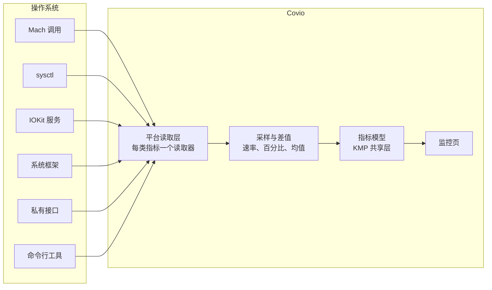
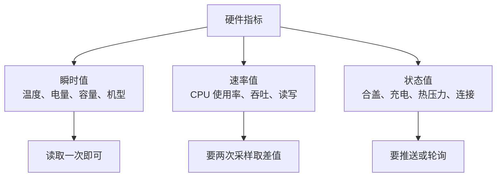
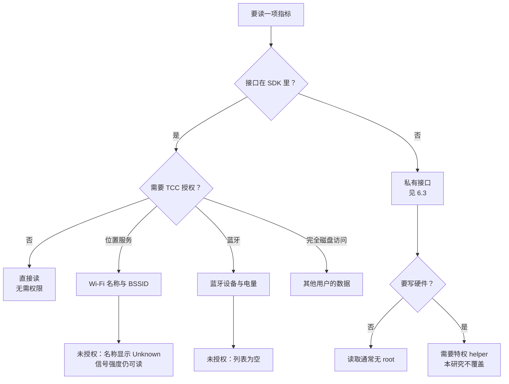

# 调研方法与技术分析

> 本文件承载调研方法、来源范围、领域模型、约束模型、能力矩阵、权限模型、参考实现分析、目标产品分析、候选方案、反证和缺口。

## 1. 调研方法

三步。

| 步骤 | 方法 | 产出 |
| --- | --- | --- |
| 1 | 读 macOS SDK 的头文件清单，判断接口是否公开 | 公开性结论 |
| 2 | 读参考实现 `exelban/stats` 的源码，得到模块到接口的映射 | 数据源候选 |
| 3 | 在本机跑只读探针，核对读数是否可得 | 环境事实 |

第 3 步只读，不改系统状态。需要 root 的项目不执行，写进未决项。
命令与输出见 [evidence.md](evidence.md)。

## 2. 来源范围

| 等级 | 来源 | 用途 |
| --- | --- | --- |
| A | 本机 macOS SDK 头文件、`man` 手册 | 接口是否公开 |
| B | `exelban/stats` 源码，pin 到 commit | 数据源与权限的实际用法 |
| B | 本仓库的 `macosApp/src/Platform/` 实现 | 已有的硬件读取路径 |
| C | Apple 官方文档与框架说明 | 接口语义 |
| D | 本机只读探针 | 当前环境事实 |
| E | 社区讨论 | 线索 |

高影响结论只使用 A、B、D。
C 与 E 不单独支持决策。

## 3. 领域模型

### 3.1 分层

### 3.2 指标分类

分类决定实现方式。速率值必须保存上一次采样。状态值优先用推送。

### 3.3 数据源清单

| 数据源 | 类型 | 公开性 | 覆盖指标 | 权限 | 稳定性 |
| --- | --- | --- | --- | --- | --- |
| `host_statistics` / `host_statistics64` | Mach 调用 | 公开 | CPU 使用率、内存 | 无 | 高 |
| `host_processor_info` | Mach 调用 | 公开 | 每核使用率 | 无 | 高 |
| `sysctl` | C API | 公开 | 核数、内存、交换、负载、机型 | 无 | 高 |
| `IOKit.ps` | 框架 | 公开 | 电池、电源、适配器 | 无 | 高 |
| `IORegistry` | IOKit | 公开 | 合盖、GPU、HID、磁盘统计 | 无 | 中，键名随系统变 |
| `AppleSmartBattery` | IOKit 服务 | 公开服务，键未文档化 | 电池细节 | 无 | 中 |
| `AppleSMC` | IOKit 服务 | 服务公开，协议未文档化 | 温度、风扇、电压、功耗 | 读取无 root | 低，键随 SoC 变 |
| `IOReport` | 私有框架 | 私有 | CPU 频率、功耗、ANE | 无 | 低，本机不可解析 |
| `IOHIDEventSystemClient` | 私有 C API | 私有 | HID 传感器 | 无 | 低 |
| `CoreWLAN` | 框架 | 公开 | Wi-Fi 信号、信道、名称 | 名称需位置服务 | 高 |
| `IOBluetooth` / `CoreBluetooth` | 框架 | 公开 | 蓝牙设备与电量 | 蓝牙授权 | 高 |
| `DiskArbitration` + `IOBlockStorageDriver` | 框架 + IOKit | 公开 | 卷信息、读写速率 | 无 | 高 |
| `libproc` | C API | 公开 | 每进程 CPU、内存、磁盘 | 无 | 高 |
| `ProcessInfo` | 框架 | 公开 | 系统版本、热压力 | 无 | 高 |
| `pmset` / `system_profiler` | 命令行工具 | 公开 | 配件电量、热限、机型 | 无 | 中，输出格式会变 |

## 4. 约束模型

| 约束 | 内容 | 影响 |
| --- | --- | --- |
| 权限 | 位置服务、蓝牙、管理员 | 未授权时指标缺失 |
| 私有接口 | 无 SDK 头文件，符号可能消失 | 上架与升级风险 |
| 硬件差异 | 传感器键按 SoC 变化，台式机无电池 | 需要按机型分支 |
| 采样成本 | 每次采样要唤醒 CPU | 影响续航 |
| 命令开销 | `pmset`、`system_profiler` 要起进程 | 不放进高频轮询 |
| 版本差异 | 大版本升级可能移除接口 | 需要降级路径 |

## 5. 现有能力矩阵

macOS 上可监听的硬件信息清单。
`接口类型` 取值：公开框架、公开 C API、IOKit 服务、私有接口、命令行工具。

### 5.1 CPU

| 指标 | 粒度 | 数据源 | 接口类型 | 权限 | 刷新方式 | 备注 | 证据 |
| --- | --- | --- | --- | --- | --- | --- | --- |
| 总使用率 | 全局 | `host_statistics(HOST_CPU_LOAD_INFO)` | 公开 C API | 无 | 轮询 1 秒取差值 | 首次调用只作基线 | E-02、E-17 |
| 每核使用率 | 每逻辑核 | `host_processor_info(PROCESSOR_CPU_LOAD_INFO)` | 公开 C API | 无 | 轮询 1 秒取差值 | 用完要 `vm_deallocate` | E-02、E-17 |
| 核心数 | 全局 | `sysctl hw.ncpu`、`hw.physicalcpu`、`hw.logicalcpu` | 公开 C API | 无 | 一次 | 本机三者都是 10 | E-08 |
| 核心分组 | 每簇 | `sysctl hw.perflevel0.*` | 公开 C API | 无 | 一次 | 本机未核对 | 缺口 |
| 频率 | 每簇 | IOReport | 私有接口 | 无 | 轮询 | 本机无法解析符号 | E-05、E-09 |
| 负载均值 | 1/5/15 分钟 | `sysctl vm.loadavg` | 公开 C API | 无 | 轮询 15 秒 | 本机 3.89/3.34/3.55 | E-11 |
| 运行时间 | 全局 | `sysctl kern.boottime` | 公开 C API | 无 | 一次 | 本机已运行 4 天 17 小时 | E-11 |
| 温度 | 每传感器 | SMC 键 `TC0D` 等 | 私有接口 | 读取无 root | 轮询 5 秒 | 键随 SoC 变化 | E-04、E-17 |
| 热限 | 全局 | `pmset -g therm` | 命令行工具 | 无 | 轮询 30 秒 | 本机无记录 | E-12 |

Apple Silicon 上 `hw.cpufrequency_max` 无输出。频率只能走 IOReport。见 E-09。

### 5.2 GPU

| 指标 | 粒度 | 数据源 | 接口类型 | 权限 | 刷新方式 | 备注 | 证据 |
| --- | --- | --- | --- | --- | --- | --- | --- |
| 使用率 | 设备级 | `IOAccelerator` 的 `PerformanceStatistics["Device Utilization %"]` | IOKit 服务 | 无 | 轮询 1 秒 | 本机有该键 | E-15 |
| 渲染器使用率 | 设备级 | 同上 `Renderer Utilization %` | IOKit 服务 | 无 | 轮询 1 秒 | 本机有该键 | E-15 |
| 切片器使用率 | 设备级 | 同上 `Tiler Utilization %` | IOKit 服务 | 无 | 轮询 1 秒 | 本机有该键 | E-15 |
| 显存占用 | 设备级 | 同上 `Alloc system memory`、`In use system memory` | IOKit 服务 | 无 | 轮询 1 秒 | 单位字节 | E-15 |
| 核心数 | 设备级 | IORegistry `gpu-core-count` | IOKit 服务 | 无 | 一次 | 本机 24 | E-15 |
| 温度 | 设备级 | SMC `TGDD`、`TCGC` | 私有接口 | 读取无 root | 轮询 5 秒 | Apple Silicon 无该键 | E-15、E-17 |
| 频率 | 设备级 | `PerformanceStatistics["Core Clock(MHz)"]` | IOKit 服务 | 无 | 轮询 | 独显才有 | E-17 |
| ANE 功耗 | 设备级 | IOReport `Energy Model` | 私有接口 | 无 | 轮询 | 本机未验证 | E-05、E-17 |

本机 `AGXAcceleratorG13X` 的 `PerformanceStatistics` 没有温度、风扇和频率键。见 E-15。

### 5.3 内存

| 指标 | 粒度 | 数据源 | 接口类型 | 权限 | 刷新方式 | 备注 | 证据 |
| --- | --- | --- | --- | --- | --- | --- | --- |
| 总容量 | 全局 | `host_info(HOST_BASIC_INFO).max_mem` | 公开 C API | 无 | 一次 | 本机 64 GiB | E-10 |
| 已用与空闲 | 全局 | `host_statistics64(HOST_VM_INFO64)` | 公开 C API | 无 | 轮询 1 秒 | 页数乘页大小 | E-10 |
| 联动与压缩 | 全局 | 同上 | 公开 C API | 无 | 轮询 1 秒 | | E-10 |
| 内存压力 | 全局 | `sysctl kern.memorystatus_vm_pressure_level` | 公开 C API | 无 | 轮询 5 秒 | 本机返回 1 | E-10 |
| 交换区用量 | 全局 | `sysctl vm.swapusage` | 公开 C API | 无 | 轮询 5 秒 | 本机为 0 | E-10 |
| 换入换出次数 | 全局 | `vm_statistics64.swapins/swapouts` | 公开 C API | 无 | 轮询 5 秒 | | E-17 |

### 5.4 磁盘

| 指标 | 粒度 | 数据源 | 接口类型 | 权限 | 刷新方式 | 备注 | 证据 |
| --- | --- | --- | --- | --- | --- | --- | --- |
| 卷列表与容量 | 每卷 | `statfs` | 公开 C API | 无 | 轮询 30 秒 | 本机根卷 926 GiB | E-13 |
| 卷型号与协议 | 每卷 | DiskArbitration `DADiskCopyDescription` | 公开框架 | 无 | 一次 | | E-03、E-17 |
| 读写速率 | 每卷 | `IOBlockStorageDriver` 统计 | IOKit 服务 | 无 | 轮询 1 秒取差值 | 按注册表项 ID 记状态 | E-17 |
| 温度 | 每盘 | NVMe SMART | IOKit 插件 | 无 | 轮询 30 秒 | 不支持 SMART 的盘没有 | E-17 |
| 每进程 I/O | 每进程 | `proc_pid_rusage` | 公开 C API | 无 | 轮询 5 秒 | | E-02、E-17 |

### 5.5 网络

| 指标 | 粒度 | 数据源 | 接口类型 | 权限 | 刷新方式 | 备注 | 证据 |
| --- | --- | --- | --- | --- | --- | --- | --- |
| 上下行速率 | 每接口 | `getifaddrs` + `sysctl NET_RT_IFLIST2` | 公开 C API | 无 | 轮询 1 秒取差值 | 计数回绕要处理 | E-14、E-17 |
| 接口类型与状态 | 每接口 | SystemConfiguration | 公开框架 | 无 | 轮询 5 秒 | 本机 en0 为 active | E-03、E-14 |
| 主接口 | 全局 | `SCDynamicStore` 的 `State:/Network/Global/IPv4` | 公开框架 | 无 | 轮询 5 秒 | 本机为 en0 | E-14、E-17 |
| 本机地址 | 每接口 | `getnameinfo` | 公开 C API | 无 | 轮询 5 秒 | | E-17 |
| Wi-Fi 信号与噪声 | 每接口 | CoreWLAN `rssiValue`、`noiseMeasurement` | 公开框架 | 无 | 轮询 1 秒 | | E-03、E-17 |
| Wi-Fi 名称与 BSSID | 每接口 | CoreWLAN `ssid`、`bssid` | 公开框架 | 位置服务 | 事件 | 未授权时显示 Unknown | E-17 |
| 公网地址 | 全局 | 外部服务 | 网络 | 无 | 轮询 10 分钟 | 有隐私影响，默认关 | E-17 |

### 5.6 电池与电源

| 指标 | 粒度 | 数据源 | 接口类型 | 权限 | 刷新方式 | 备注 | 证据 |
| --- | --- | --- | --- | --- | --- | --- | --- |
| 电量与充电状态 | 全局 | `IOPSCopyPowerSourcesInfo` | 公开框架 | 无 | 推送加轮询 5 秒 | 仓库已有实现 | E-07、E-19 |
| 剩余时间 | 全局 | `kIOPSTimeToEmptyKey` | 公开框架 | 无 | 同上 | 计算中可能缺 | E-07 |
| 循环次数 | 全局 | `AppleSmartBattery` 的 `CycleCount` | IOKit 服务 | 无 | 轮询 60 秒 | 本机 82 | E-07 |
| 健康度与满充容量 | 全局 | 同上 `BatteryData` | IOKit 服务 | 无 | 轮询 60 秒 | 键名按架构不同 | E-07、E-17 |
| 温度 | 全局 | 同上 `Temperature` | IOKit 服务 | 无 | 轮询 60 秒 | 单位是百分之一摄氏度 | E-07 |
| 电压与电流 | 全局 | 同上 `Voltage`、`Amperage` | IOKit 服务 | 无 | 轮询 5 秒 | 本机 12235 毫伏 | E-07 |
| 适配器功率 | 全局 | `IOPSCopyExternalPowerAdapterDetails` | 公开框架 | 无 | 事件 | 未接电源时没有 | E-17 |
| 电池功率 | 全局 | SMC `PPBR` | 私有接口 | 读取无 root | 轮询 5 秒 | 本机未验证 | E-17 |
| 睡眠断言 | 全局 | `IOKit.pwr_mgt` | 公开框架 | 无 | 轮询 5 秒 | 仓库已有实现 | E-19 |

### 5.7 传感器

| 指标 | 粒度 | 数据源 | 接口类型 | 权限 | 刷新方式 | 备注 | 证据 |
| --- | --- | --- | --- | --- | --- | --- | --- |
| 温度传感器组 | 每传感器 | SMC 键 `T` 前缀 | 私有接口 | 读取无 root | 轮询 5 秒 | 键随 SoC 变化 | E-04、E-17 |
| 风扇转速 | 每风扇 | SMC 键 `F0Ac` 等 | 私有接口 | 读取无 root | 轮询 5 秒 | MacBook Air 无风扇 | E-17 |
| 电压与电流 | 每传感器 | SMC 键 `V`、`I` 前缀 | 私有接口 | 读取无 root | 轮询 5 秒 | | E-17 |
| 整机功耗 | 全局 | SMC `PSTR` | 私有接口 | 读取无 root | 轮询 5 秒 | 本机未验证 | E-17 |
| HID 传感器 | 每传感器 | `IOHIDEventSystemClient` | 私有接口 | 无 | 轮询 5 秒 | 符号可解析，未取数 | E-06、E-17 |
| 环境光 | 设备级 | 未验证 | 未定 | 未定 | 未定 | | 缺口 |

### 5.8 蓝牙与配件

| 指标 | 粒度 | 数据源 | 接口类型 | 权限 | 刷新方式 | 备注 | 证据 |
| --- | --- | --- | --- | --- | --- | --- | --- |
| 已配对设备 | 列表 | `IOBluetoothDevice.pairedDevices()` | 公开框架 | 蓝牙授权 | 轮询 10 秒 | | E-03、E-17 |
| 连接状态 | 每设备 | `isConnected()` | 公开框架 | 蓝牙授权 | 轮询 10 秒 | | E-17 |
| BLE 设备电量 | 每设备 | CoreBluetooth 服务 `0x180F` | 公开框架 | 蓝牙授权 | 推送 | | E-17 |
| HID 设备电量 | 每设备 | `AppleDeviceManagementHIDEventService` | IOKit 服务 | 无 | 轮询 10 秒 | 本机当前无设备 | E-17 |
| 配件电量 | 每配件 | `pmset -g accps` | 命令行工具 | 无 | 轮询 10 秒 | | E-17 |

### 5.9 显示与系统

| 指标 | 粒度 | 数据源 | 接口类型 | 权限 | 刷新方式 | 备注 | 证据 |
| --- | --- | --- | --- | --- | --- | --- | --- |
| 分辨率与刷新率 | 每屏 | `NSScreen`、`CGDisplayMode` | 公开框架 | 无 | 事件 | | E-03 |
| 亮度 | 每屏 | 未验证 | 未定 | 未定 | 未定 | Apple Silicon 走 DCP | 缺口 |
| 机型与芯片 | 全局 | `sysctl hw.model`、`machdep.cpu.brand_string` | 公开 C API | 无 | 一次 | 本机 MacBookPro18,2 | E-08 |
| 系统版本 | 全局 | `ProcessInfo.operatingSystemVersion` | 公开框架 | 无 | 一次 | 本机 27.0.1 | E-08 |
| 合盖状态 | 全局 | `IOPMrootDomain` 的 `AppleClamshellState` | IOKit 服务 | 无 | 推送 | 台式机返回 UNKNOWN | E-16、E-19 |
| 热压力 | 全局 | `ProcessInfo.thermalState` | 公开框架 | 无 | 推送 | 只有四档 | E-12 |

### 5.10 进程

| 指标 | 粒度 | 数据源 | 接口类型 | 权限 | 刷新方式 | 备注 | 证据 |
| --- | --- | --- | --- | --- | --- | --- | --- |
| 按 CPU 排序 | 前 N 个 | `libproc` 的 `proc_pid_rusage` | 公开 C API | 无 | 轮询 5 秒 | 进程名要另取 | E-02、E-17 |
| 按内存排序 | 前 N 个 | 同上 | 公开 C API | 无 | 轮询 5 秒 | | E-17 |

## 6. 权限模型

### 6.1 决策路径

### 6.2 权限矩阵

| 权限 | 影响的指标 | 未授权的后果 | 申请方式 |
| --- | --- | --- | --- |
| 无 | CPU、内存、磁盘、网络吞吐、电池、合盖、热压力 | 无 | 不需要 |
| 位置服务 | Wi-Fi 名称与 BSSID | 名称显示 Unknown | 系统对话框 |
| 蓝牙 | 蓝牙设备列表与电量 | 列表为空 | 系统对话框 |
| 管理员 | 风扇控制等写操作 | 不适用 | 特权 helper |

读取 SMC 键不需要 root。只有写风扇转速需要特权 helper。见 E-17。

### 6.3 私有接口清单

| 接口 | 用途 | 本机状态 | 上架影响 |
| --- | --- | --- | --- |
| IOReport | CPU 频率、功耗、ANE | 符号在共享缓存，磁盘无框架，dlopen 失败 | 不可上架 |
| `IOHIDEventSystemClient` | HID 传感器 | 符号可解析 | 不可上架 |
| `AppleSMC` 用户客户端 | 温度、风扇、电压、功耗 | 服务存在，未取数 | 不可上架 |
| `responsibility_get_pid_responsible_for_pid` | 进程归组 | 未验证 | 不可上架 |

`AppleSMC` 是系统自带服务，但键名没有文档。键名按 SoC 变化。见 E-04、E-17。

## 7. 参考实现分析

参考实现是 [exelban/stats](https://github.com/exelban/stats)，MIT 许可。
分析固定在 `master` 的 `4ecf4f736056eb488c75aa2fa62e749abd87c4a4`，最新发布版 `v3.0.21`。
最低系统要求是 macOS 12。

### 7.1 模块到数据源

| 模块 | 指标 | 数据源 | 权限 |
| --- | --- | --- | --- |
| CPU | 总使用率、每核使用率 | `host_statistics`、`host_processor_info` | 无 |
| CPU | 频率 | IOReport | 无 |
| CPU | 温度 | SMC `TC0D` 等 | 无 |
| CPU | 负载、运行时间 | `uptime`、`sysctl` | 无 |
| GPU | 使用率、显存 | `IOAccelerator` 的 `PerformanceStatistics` | 无 |
| GPU | 温度 | `PerformanceStatistics` 或 SMC | 无 |
| GPU | ANE 功耗 | IOReport `Energy Model` | 无 |
| RAM | 用量、压力、交换 | `host_statistics64`、`sysctl` | 无 |
| Disk | 容量、读写、SMART | `statfs`、`IOBlockStorageDriver`、NVMe SMART | 无 |
| Net | 速率、接口、Wi-Fi | `getifaddrs` + `sysctl`、SystemConfiguration、CoreWLAN | Wi-Fi 名称需位置服务 |
| Battery | 电量、循环、健康 | `IOKit.ps`、`AppleSmartBattery` | 无 |
| Battery | 功率 | SMC `PPBR` | 无 |
| Bluetooth | 设备与电量 | IOBluetooth、CoreBluetooth、`pmset -g accps` | 蓝牙授权 |
| Sensors | 温度、风扇、电压、功耗 | SMC 全键扫描 | 读取无 root，写风扇要 helper |
| Sensors | HID 传感器 | `IOHIDEventSystemClient` | 无 |
| Clock | 时间、时区 | `Date`、`NSCalendar` | 无 |
| Remote | 远程机器 | 外部服务 | 账号 |

### 7.2 可复用的结论

| 结论 | 说明 |
| --- | --- |
| 读取 SMC 不需要 root | 只有风扇写入走 XPC 特权 helper |
| SMC 键随 SoC 变化 | 每个新芯片要更新键表 |
| Apple Silicon 缺 GPU 温度 | 加速器不报该键 |
| 温度传感器有过滤 | 超出 0 到 110 摄氏度的值丢弃 |
| 位置服务只影响 Wi-Fi 名称 | 信号强度不需要授权 |
| 命令工具用于低频项 | `pmset`、`system_profiler` 不进高频轮询 |

参考实现不是 Covio 的目标产品。它的结论要按本机复核，见 E-17。

## 8. 目标产品源码分析

仓库里已有的硬件读取实现。这些是 B 级证据。

| 文件 | 读什么 | 路径 |
| --- | --- | --- |
| `macosApp/src/Platform/MacLidSensor.swift` | 合盖状态 | IORegistry `IOPMrootDomain`，走推送 |
| `macosApp/src/Platform/MacPowerSource.swift` | 电源与电量 | `IOKit.ps`，推送加 5 秒轮询兜底 |
| `macosApp/src/Platform/MacSleepWatcher.swift` | 睡眠唤醒 | `IOKit.pwr_mgt` 消息 |
| `macosApp/src/Platform/MacSleepController.swift` | 睡眠断言 | `IOKit.pwr_mgt` |
| `macosApp/src/Platform/MacIdleSensor.swift` | 空闲时间 | 未在本研究范围 |
| `kmpDomain/src/com/wyz/covio/core/PmsetWakeLogParser.kt` | 唤醒原因 | 解析 `pmset` 日志 |

已有实现只覆盖合盖、电源与睡眠。CPU、内存、磁盘、网络、GPU 和传感器都没有读取代码。

## 9. Windows 占位

Windows 部分本版不展开。以下表格只列骨架，内容待补。

| 指标 | 数据源 | 接口类型 | 权限 | 刷新方式 | 备注 | 证据 |
| --- | --- | --- | --- | --- | --- | --- |
| CPU 使用率 | 待定 | 待定 | 待定 | 待定 | 候选是 PDH 与 WMI | 缺口 |
| 内存 | 待定 | 待定 | 待定 | 待定 | 候选是 `GlobalMemoryStatusEx` | 缺口 |
| 磁盘 | 待定 | 待定 | 待定 | 待定 | 候选是 `GetDiskFreeSpaceEx` | 缺口 |
| 网络 | 待定 | 待定 | 待定 | 待定 | 候选是 `GetIfTable2` | 缺口 |
| 电池 | 待定 | 待定 | 待定 | 待定 | 候选是 `GetSystemPowerStatus` | 缺口 |
| 温度与风扇 | 待定 | 待定 | 待定 | 待定 | 候选是 WMI `MSAcpi_ThermalZoneTemperature` | 缺口 |
| GPU | 待定 | 待定 | 待定 | 待定 | 候选是 PDH 的 GPU 计数器 | 缺口 |

展开 Windows 时补三件事：接口是否公开、是否需要管理员、是否支持笔记本与台式机。

## 10. 候选方案对比

监控页的数据获取有三条路径。

| 路径 | 成本 | 风险 | 成熟度 | 可维护性 |
| --- | --- | --- | --- | --- |
| 只用公开接口 | 中 | 低，能上架 | 高 | 高，系统升级影响小 |
| 公开接口加 SMC | 高，要维护键表 | 中，不能上架 | 中，参考实现已验证 | 低，键随 SoC 变 |
| 依赖 IOReport | 高 | 高，本机已不可解析 | 低 | 低 |

第一版走第一条路径。SMC 只用于温度与风扇，且单独开关。IOReport 不采用，见 [conclusion.md](conclusion.md)。

## 11. 反证和限制

1. 参考实现的结论不等于本机事实。SMC 读取无 root 这一条来自源码，本机没有取数验证。
2. 本机只有 Apple Silicon。Intel 机型的键名与行为未验证。
3. 本机没有独显。GPU 频率与风扇键未验证。
4. 本机当前没有连接蓝牙 HID 设备。设备电量未验证。
5. 本机是笔记本。台式机无电池与合盖状态，未验证。
6. `IOReport` 在本机不可解析，不等于在所有 macOS 27 机器上不可用。
7. 采样开销没有实测。轮询周期是参考实现的经验值。

## 12. 已知缺口

| 缺口 | 影响 | 下一步 |
| --- | --- | --- |
| IOReport 在 macOS 26 与 27 上的可用路径 | CPU 频率与整机功耗不能定 | 开 spike，见 [conclusion.md](conclusion.md) |
| SMC 读取的实际权限 | 温度与风扇能否落地 | 在案例 V05 中验证 |
| 环境光与屏幕亮度 | 显示分组缺两项 | 单独调研 |
| Intel 机型差异 | 兼容性结论不全 | 找一台 Intel Mac 验证 |
| 蓝牙设备电量 | 配件分组不全 | 连接设备后验证 |
| 采样开销 | 续航影响未知 | 实测 CPU 占用 |
| Windows 全部 | 跨平台结论缺失 | 展开第 9 节 |
