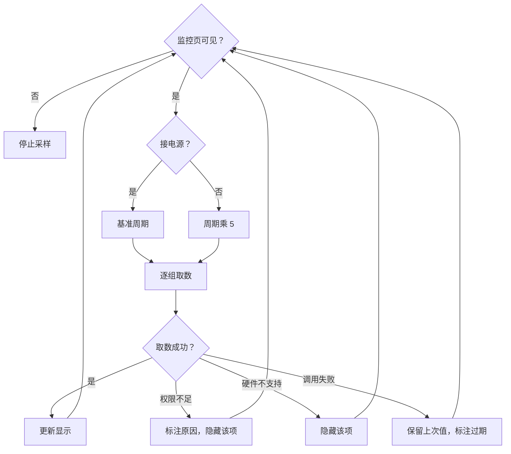

# 推荐架构、接口与实施计划

> 本文件承载推荐分层、指标模型、接口契约、刷新策略、安全、失败模式、验收和实施计划。

## 1. 推荐架构

### 1.1 路径选择

第一版只走公开接口。

| 档 | 接口 | 第一版 |
| --- | --- | --- |
| 一 | Mach 调用、`sysctl`、IOKit 服务、公开框架 | 实现 |
| 二 | CoreWLAN 名称、IOBluetooth | 留接口，不实现 |
| 三 | SMC、IOReport、HID 私有接口 | 不实现 |

### 1.2 组件

第一版在 Swift 宿主实现。指标不进 KMP 领域层，因为页面与读取接口都只服务 macOS。

| 组件 | 职责 | 位置 |
| --- | --- | --- |
| `MonitorSnapshot` | 指标快照、历史窗口、速率与格式化 | `macosApp/src/Hub/Monitor/MonitorSnapshot.swift` |
| `MacMonitorReader` | 用 Mach、`sysctl`、IOKit、`getifaddrs` 和 IOPS 取数 | `macosApp/src/Hub/Monitor/MacMonitorReader.swift` |
| `MonitorSampler` | 串行采样，保存 CPU、磁盘与网络的差值计数 | `macosApp/src/Hub/Monitor/MacMonitorReader.swift` |
| `MonitorTabView` | Stats 风格卡片、历史曲线与状态 | `macosApp/src/Hub/Monitor/MonitorTabView.swift` |

已有实现复用：`MacPowerSource.readBattery()` 提供电池、电源状态与剩余时间。

### 1.3 调用路径

```text
MonitorTabView 出现
  -> MonitorSampler.sample()
  -> MacMonitorReader.read()
  -> MonitorSnapshot
  -> MonitorTabView 渲染
MonitorTabView 消失
  -> SwiftUI 取消 .task
  -> 采样停止
```

### 1.4 刷新与降级



## 2. 接口契约

### 2.1 传输

进程内调用。没有跨进程传输，没有特权 helper。
本方案不定义 wire 协议。理由：第一版全部走公开接口，不需要 helper。

### 2.2 指标模型

```kotlin
enum class MetricGroup { CPU, MEMORY, DISK, NETWORK, BATTERY, POWER, GPU, SYSTEM, PROCESS }

enum class MetricAvailability { AVAILABLE, DENIED, UNSUPPORTED, FAILED, STALE }

data class MetricSample(
    val id: String,
    val group: MetricGroup,
    val value: Double,
    val unit: String,
    val availability: MetricAvailability,
    val sampledAtEpochMillis: Long,
)

data class HardwareSnapshot(
    val samples: List<MetricSample>,
    val missing: Map<String, MetricAvailability>,
)
```

### 2.3 端口

```kotlin
interface HardwareMetricsPort {
    suspend fun snapshot(groups: Set<MetricGroup>): HardwareSnapshot
    fun observe(groups: Set<MetricGroup>, onUpdate: (HardwareSnapshot) -> Unit): Cancellable
}
```

### 2.4 指标标识

标识是稳定字符串。显示名走设计合同，不写进标识。

| 标识 | 单位 | 分组 | 第一版 |
| --- | --- | --- | --- |
| `cpu.total` | 百分比 | CPU | 是 |
| `cpu.perCore` | 百分比列表 | CPU | 是 |
| `cpu.load1` | 无量纲 | CPU | 是 |
| `cpu.uptime` | 秒 | CPU | 是 |
| `mem.used` | 字节 | MEMORY | 是 |
| `mem.pressure` | 枚举 | MEMORY | 是 |
| `mem.swapUsed` | 字节 | MEMORY | 是 |
| `disk.volumeUsed` | 字节 | DISK | 是 |
| `disk.readRate` | 字节每秒 | DISK | 是 |
| `disk.writeRate` | 字节每秒 | DISK | 是 |
| `net.rxRate` | 字节每秒 | NETWORK | 是 |
| `net.txRate` | 字节每秒 | NETWORK | 是 |
| `net.interfaceType` | 枚举 | NETWORK | 是 |
| `battery.level` | 百分比 | BATTERY | 是 |
| `battery.charging` | 布尔 | BATTERY | 是 |
| `battery.cycles` | 次 | BATTERY | 是 |
| `battery.health` | 百分比 | BATTERY | 是 |
| `battery.temperature` | 摄氏度 | BATTERY | 是 |
| `power.source` | 枚举 | POWER | 是 |
| `power.adapterWatts` | 瓦 | POWER | 是 |
| `gpu.utilization` | 百分比 | GPU | 是 |
| `gpu.memoryUsed` | 字节 | GPU | 是 |
| `system.lidState` | 枚举 | SYSTEM | 是 |
| `system.thermalState` | 枚举 | SYSTEM | 是 |
| `cpu.temperature` | 摄氏度 | CPU | 否 |
| `sensor.fanRpm` | 转每分 | CPU | 否 |
| `cpu.frequency` | 赫兹 | CPU | 否 |
| `power.systemWatts` | 瓦 | POWER | 是（`AppleSmartBattery` 遥测） |
| `power.appEnergy60m` | 毫瓦时 | POWER | 是（`proc_pid_rusage`） |

### 2.5 错误码

| 错误码 | 触发条件 | 可重试 | 页面处理 |
| --- | --- | --- | --- |
| `metrics.denied_location` | 位置服务未授权 | 用户改设置后 | 隐藏 Wi-Fi 名称 |
| `metrics.denied_bluetooth` | 蓝牙未授权 | 用户改设置后 | 隐藏蓝牙分组 |
| `metrics.unsupported_hardware` | 机型无该传感器 | 否 | 隐藏该项 |
| `metrics.read_failed` | 单次调用失败 | 是 | 保留上次值，标注过期 |
| `metrics.interface_missing` | 系统升级后接口消失 | 否 | 隐藏该项，写日志 |

## 3. 刷新策略

| 分组 | 方式 | 接电源周期 | 电池周期 | 理由 |
| --- | --- | --- | --- | --- |
| CPU 使用率 | 轮询取差值 | 1 秒 | 5 秒 | 变化快，用户最关心 |
| 内存 | 轮询 | 2 秒 | 10 秒 | 变化慢 |
| 磁盘 | 轮询取差值 | 2 秒 | 10 秒 | 变化慢 |
| 网络 | 轮询取差值 | 1 秒 | 5 秒 | 变化快 |
| 电池与电源遥测 | 轮询 | 1 秒 | 1 秒 | Monitor 电源卡片要求 1 秒内切换状态 |
| 进程能耗 | 累计差值加分钟桶 | 10 秒 | 10 秒 | 计算近 60 分钟 Top3 |
| 合盖 | 推送 | 事件 | 事件 | 系统有通知 |
| GPU | 轮询 | 1 秒 | 5 秒 | 变化快 |
| 系统信息 | 一次 | 启动时 | 启动时 | 不变 |
| 进程列表 | 轮询 | 5 秒 | 30 秒 | 开销大 |

## 4. 安全设计

1. 只读。不写硬件，不发 SMC 写命令。
2. 不申请特权 helper。
3. 不采集序列号。
4. 公网地址默认关。
5. 数据不出本机。不上传。

## 5. 合规设计

1. 第一版不使用私有接口，不影响上架。
2. 位置服务与蓝牙在需要时单独申请，说明用途。
3. 采样只在监控页可见时进行。

## 6. 失败模式

| 失败 | 表现 | 处理 |
| --- | --- | --- |
| 单次取数失败 | 某项无值 | 保留上次值，标注过期 |
| 接口消失 | 系统升级后某项一直失败 | 隐藏该项，写日志 |
| 采样过密 | CPU 占用升高 | 按供电状态降频 |
| 计数器回绕 | 速率为负或极大 | 丢弃该次采样 |
| 权限被撤销 | 蓝牙或位置服务中途关闭 | 下次采样时转为隐藏 |

## 7. 验收标准

1. 监控页在 MacBook 上显示 CPU、内存、磁盘、网络和电池五组。
2. 未授权位置服务时，页面不弹窗，网络分组只显示吞吐。
3. 拔掉电源后采样周期变长，页面仍更新。
4. 合盖或挂帘收起后采样停止。
5. 台式机上不显示电池与合盖。
6. 采样时应用自身 CPU 占用低于 1%。

## 8. 实施计划

| 阶段 | 内容 | 前置 |
| --- | --- | --- |
| 1 | 定义 `MetricId`、`MetricSample`、`HardwareMetricsPort` | 无 |
| 2 | 实现 CPU、内存、磁盘、网络四个读取器 | 阶段 1 |
| 3 | 接上已有的电池与合盖实现 | 阶段 1 |
| 4 | 实现 `MetricSampler` 与供电降频 | 阶段 2 |
| 5 | 监控页接端口，替换占位 | 阶段 4 |
| 6 | GPU 与进程分组 | 阶段 5 |
| 7 | CPU 温度与风扇，需要 SMC | 未决项解决后 |

每个阶段一条分支一个 PR。

## 9. 回滚条件

1. 采样导致应用自身 CPU 占用超过 1% 时，回滚到占位页。
2. 某项接口导致崩溃时，关闭该分组。
3. 权限申请引发用户投诉时，去掉该权限。

## 10. 产品化条件

1. 五组指标在 Apple Silicon 与 Intel 机型都验证过。
2. 采样开销实测通过。
3. 设计合同补上监控页的文案与组件条目。
4. CPU 温度与风扇的未决项有结论。
