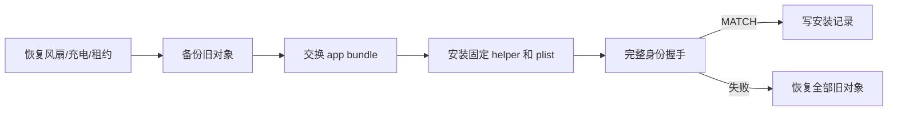

# 本机发布和回滚方案

## 发布身份

release manifest 是唯一版本来源。
app、helper 和 PKG 使用同一 `releaseId`。
本机记录至少包含：

- `releaseId`
- `productVersion`
- `buildNumber`
- `gitCommit`
- `helperProtocolVersion`
- `helperSHA256`
- `channel`

## 安装布局

```text
/Applications/Covio.app
/Library/Application Support/Covio/bin/CovioHelper
/Library/Application Support/Covio/installed-release.json
/Library/LaunchDaemons/com.wyz.covio.helper.plist
```

helper 为 `root:wheel`。
plist 为 `root:wheel` 且模式 `0644`。
helper 为 `root:wheel` 且模式 `0755`。

## PKG 事务



PKG 使用空 component plist。
Installer 不重定位 staged app。

## 安全模式

只读安全模式触发条件：

- helper 缺失。
- helper 身份不一致。
- helper SHA-256 不一致。
- helper 不可信。
- XPC 握手失败。
- LaunchDaemon 未加载。

状态非 MATCH 时，正常写入被拒绝。
Debug `restore` 命令保留为安全恢复入口。

## 回滚

事务备份：

- app。
- 固定 helper。
- LaunchDaemon plist。
- `allowed_uid`、`client-requirement`、`version`、app path marker。
- 安装记录。

回滚后必须重新完成身份握手。
如果旧安装使用 `SMAppService`，回滚时清除 Legacy helper 元数据并恢复旧注册路径。

## 发布检查

1. `bash scripts/test-all.sh` 通过。
2. internal PKG 不含 Developer ID 或 notarization 假设。
3. `PackageInfo` 没有 bundle 重定位条目。
4. `scripts/verify-helper-cutover.sh verify` 通过。
5. app、helper 和记录 releaseId 相同。
6. 重复安装通过。
7. N-1 升级通过。
8. 不匹配和缺失 helper 禁止写入。
9. 失败注入后回滚结果可验证。
10. 测试后 `SleepDisabled=0` 且没有充电状态残留。
