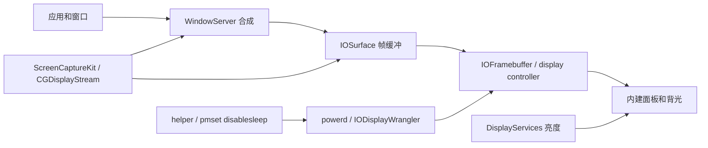

# macOS 合盖黑屏与 framebuffer 显示链路

> 结论：物理面板亮度为 `0.0` 时，WindowServer 和显示输出链路可能仍提供合成帧。Computer Use 等工具可能通过系统捕获 API 取得画面，但它们不直接读取物理面板。合盖黑屏下的 Computer Use 截图仍是未验证项。

## 文档状态

| 项目 | 内容 |
| --- | --- |
| 版本 | `1.0` |
| 状态 | 系统报告，可评审 |
| 日期 | `2026-10-23` |
| Issue | #306、#310 |
| 源码基线 | `f7e6322` |
| 关联 PR | #299、#300、#307 |
| 环境 | MacBook Pro，Apple M1 Max，macOS 27.0.1 |

## 1. 先给答案

用户问：

> Computer Use 等可以通过 framebuffer 拿到屏幕画面，但屏幕实际没点亮吗？

准确回答分为三句：

1. 物理屏幕可以看起来是黑的。
2. 逻辑显示器和合成输出可能仍然在线。
3. Computer Use 可能通过 macOS 捕获 API 得到合成画面，但它不直接读取物理面板。

这不是“相机看见黑屏但软件有图像”。
这是“显示缓冲中存在像素，但面板亮度为 `0.0`”。

## 2. 最重要的概念

### 2.1 面板亮度不等于显示电源

| 状态 | 含义 |
| --- | --- |
| 面板亮度 | 人眼看到多亮 |
| 显示 online | 显示器已连接 |
| 显示 active | 显示器已连接、awake、可绘制 |
| 显示 asleep | 显示器 asleep、不可绘制 |
| 系统睡眠 | WindowServer 和用户进程可能暂停 |

亮度 `0.0` 只说明最终面板不可见。
它不自动等于显示器 asleep。

### 2.2 framebuffer 是简称

传统图形系统把待输出像素放在 framebuffer。
现代 macOS 更接近 WindowServer、IOSurface 和多缓冲队列的组合。
因此本报告中的“framebuffer 保持活动”表示：

1. 显示输出仍有有效帧资源。
2. WindowServer 仍可生成或交付合成帧。
3. 显示器可能仍为 online、active、未 asleep。

它不表示存在一个公开叫 `framebuffer-active` 的 macOS 属性。

### 2.3 屏幕捕获不是拍摄物理屏幕

Computer Use 和远程桌面通常读取合成结果。
它们不拍摄背光、面板或外壳。
所以捕获路径可能绕过最终亮度层。

## 3. 系统分层



图中的连线表达概念关系。
Apple 没有公开 WindowServer 的全部内部实现。

### 3.1 各层职责

| 层 | 职责 | 是否直接决定面板可见 |
| --- | --- | --- |
| App | 生成窗口和视图 | 否 |
| WindowServer | 合成窗口、生成显示帧 | 否 |
| IOSurface | 共享像素缓冲 | 否 |
| IOFramebuffer | 连接图形输出和显示硬件 | 是，参与电源控制 |
| display controller | 扫描输出和模式管理 | 是 |
| panel/backlight | 最终可见亮度 | 是 |
| 捕获 API | 读取合成结果 | 否 |

## 4. 完整工作路径

```text
用户开启实验性合盖黑屏
  → Covio 启动合盖租约
  → helper 执行 pmset -a disablesleep 1
  → 系统保持 awake
  → 上盖关闭
  → Covio 找到内建屏
  → 保存原亮度
  → DisplayServicesSetBrightness(displayID, 0.0)
  → 回读亮度
  → 检查 online / active / asleep
  → 不调用公开 displaysleepnow
  → WindowServer 和 IOSurface 可能继续提供帧
  → Computer Use 或捕获 API 可能取得画面
  → 开盖、结束或退出时恢复亮度
```

关键点：

1. `pmset disablesleep` 解决系统睡眠。
2. `DisplayServicesSetBrightness(0.0)` 解决面板可见亮度。
3. 不调用 `displaysleepnow` 保留显示电源路径。
4. helper 租约负责崩溃和超时恢复。
5. ScreenCaptureKit 负责验证捕获结果。

## 5. 为什么黑屏仍可能有图像

```text
像素生成
  → 合成
  → 帧缓冲
  → display controller
  → 面板亮度
  → 人眼
```

捕获点在“合成或帧缓冲”。
人眼观察点在“面板亮度”。

所以两个结果可以同时成立：

| 层 | 状态 |
| --- | --- |
| WindowServer | 有合成画面 |
| IOSurface | 有帧资源 |
| 面板亮度 | `0.0` |
| 人眼 | 看不到 |
| 捕获 API | 可能读到画面 |

## 6. 状态矩阵

| 场景 | 系统 | online | active | asleep | 亮度 | 捕获 |
| --- | --- | --- | --- | --- | --- | --- |
| 开盖正常 | awake | 1 | 1 | 0 | 用户值 | 可用 |
| 无租约合盖 | 睡眠 | 过渡 | 过渡 | 过渡 | 过渡 | 不可用 |
| 有租约并关屏 | awake | 可能 1 | 0 | 1 | 0 或驱动值 | 空白或失败 |
| 有租约并黑屏 | awake | 1 | 1 | 0 | 0.0 | 可能可用 |
| 外接屏 clamshell | awake | 外接屏 1 | 外接屏 1 | 内建屏可变 | 分开读取 | 以外接屏为准 |

本机已经验证黑屏场景的 online、active、asleep 和亮度。
ScreenCaptureKit 和 Computer Use 的合盖结果仍是待验证项。

## 7. 公开 API 的精确含义

### 7.1 显示状态

`CoreGraphics/CGDisplayConfiguration.h` 给出以下语义：

| API | 含义 |
| --- | --- |
| `CGDisplayIsOnline` | 显示器已连接或在线 |
| `CGDisplayIsActive` | 显示器已连接、awake、可用于绘制 |
| `CGDisplayIsAsleep` | 显示器 asleep，因此不可绘制 |
| `CGDisplayIsBuiltin` | 显示器是内建屏 |

因此：

1. online 不等于 active。
2. active 是捕获路径最关键的状态之一。
3. asleep 为真时，捕获应被视为不可用。
4. online 但 asleep 的显示器不能被当作正常显示。

### 7.2 帧交付

`CoreGraphics/CGDisplayStream.h` 明确写明：

1. 帧由 WindowServer 为特定显示器生成。
2. 回调收到包含像素数据的 `IOSurfaceRef`。
3. 帧状态包括 `FrameComplete`、`FrameIdle` 和 `FrameBlank`。

`FrameBlank` 很重要。
它表示显示器已经进入空白状态。
因此捕获实现不能把“流已连接”误判成“图像有效”。

### 7.3 ScreenCaptureKit

`ScreenCaptureKit/SCStream.h` 和 `SCScreenshotManager.h` 支持：

1. 按 display 捕获。
2. 按 window 捕获。
3. 按 application 捕获。
4. 捕获单帧 CGImage 或 CMSampleBuffer。

ScreenCaptureKit 读取合成内容。
它不读取物理面板亮度。

### 7.4 旧窗口捕获

`CGWindowListCreateImage` 可以合成指定窗口或屏幕区域。
该 API 在 macOS 15 起过时。
WindowServer 不可用或调用方不在 Quartz GUI 会话时，它会失败。

## 8. 电源管理边界

### 8.1 公开 IOPM 断言

`IOKit/pwr_mgt/IOPMLib.h` 说明：

1. `PreventUserIdleSystemSleep` 不阻止合盖睡眠。
2. `PreventUserIdleDisplaySleep` 只阻止空闲显示睡眠。
3. 用户合盖仍可以关闭显示。
4. 已经关闭的显示不会因为 display assertion 自动点亮。

因此公开断言不能单独实现“合盖后系统运行、面板黑、显示链路保持”。

### 8.2 `pmset disablesleep`

`pmset disablesleep` 是系统级设置。
它没有出现在当前 `man pmset` 的设置列表中。
本机真机验证显示：
合盖租约保持时，`SleepDisabled=1`，系统启动时间不变。

### 8.3 合盖状态

`AppleClamshellState` 提供上盖是否关闭。
合盖状态未知时不能写亮度。
外接显示器存在时不能把外接屏状态误当成内建屏状态。

## 9. DisplayServices 私有亮度路径

Covio 动态加载：

```text
/System/Library/PrivateFrameworks/DisplayServices.framework/DisplayServices
```

动态符号：

```text
DisplayServicesGetBrightness(displayID, *value)
DisplayServicesSetBrightness(displayID, value)
```

本机观察：

1. `dlopen` 成功。
2. Get 和 Set 符号都存在。
3. macOS 27 上 `GetBrightness` 返回 `0`。
4. 开盖亮度样例为 `0.08575986`。
5. 合盖黑屏矩阵中 6 次回读均为 `0.0`。

限制：

1. 私有框架没有公开头文件。
2. 没有 ABI 兼容承诺。
3. 只验证了 macOS 27 和当前 Apple Silicon 机型。
4. 无法从公开接口证明它改变的是背光、面板控制器还是其它亮度层。
5. macOS 更新后必须重新验证符号和行为。

## 10. Covio 当前实现

### 10.1 helper 租约

`HelperLeaseCoordinator` 负责：

1. 获取、续租和释放合盖租约。
2. 限制最大并发租约。
3. 60 秒租约有效期。
4. 外接屏存在时拒绝租约。
5. Covio 崩溃后租约到期恢复 `SleepDisabled=0`。

### 10.2 显示策略

`PowerRuntime.applyClosedLidZeroBrightness`：

1. 检查配置和合盖会话。
2. 检查内建屏和 DisplayServices。
3. 检查外接屏数量。
4. 私有路径可用时关闭公开 display sleep 路径。
5. 私有路径失败时回退公开合盖关屏。

### 10.3 亮度和恢复

`ClosedLidZeroBrightnessController`：

1. 合盖后保存原亮度。
2. 写恢复记录。
3. 设置亮度 `0.0`。
4. 回读并校验。
5. 开盖、结束或退出时恢复。
6. 启动时恢复未完成记录。
7. `SIGKILL` 后下一次启动恢复。

### 10.4 现有真机结果

| 项目 | 结果 |
| --- | --- |
| 合盖状态 | Yes |
| helper 租约 | 持续续租 |
| `SleepDisabled` | 1 |
| 内建屏 | online、active、未 asleep |
| 亮度 | 6 次采样为 `0.0` |
| 开盖恢复 | 通过 |
| 会话结束 | `SleepDisabled=0` |
| 所有权文件 | 不存在 |
| `SIGKILL` 恢复 | 下一次启动恢复亮度 |

## 11. 参考实现

### Keepresso

Keepresso 定义三种显示策略：

| 策略 | 行为 |
| --- | --- |
| `displayOff` | 合盖后让显示睡眠 |
| `zeroBrightness` | 保存亮度并设为 `0.0` |
| `leaveAlone` | 不修改显示 |

Keepresso 的 `zeroBrightness` 注释明确写到：
面板看起来关闭，但 framebuffer 保持活动，远程会话可以继续工作。

### Insomnia

Insomnia 使用：

1. `pmset disablesleep 1` 保持系统运行。
2. `AppleClamshellState` 监听合盖。
3. `DisplayServicesSetBrightness(0)` 压暗面板。
4. 保存并恢复原亮度。

### DontSleep

DontSleep 说明：
只设置 `disablesleep` 会让合盖后的内建屏继续亮着。
它需要额外关闭面板和键盘背光。

### LidAwake

LidAwake 说明：

1. `displaysleepnow` 在 `SleepDisabled=1` 时不可靠。
2. 使用 `DisplayServicesSetBrightness(0)` 更符合需求。

## 12. 证据

### 12.1 本机环境

| 项目 | 值 |
| --- | --- |
| 硬件 | MacBook Pro，Apple M1 Max |
| 系统 | macOS `27.0.1 (26A434)` |
| Xcode | `27.1 (27A9275)` |
| 显示 ID | `1` |
| 内建屏 | 是 |
| 帧尺寸 | `3456 x 2234` |
| 刷新率 | `120 Hz` |

### 12.2 开盖探针

```text
display_id=1
builtin=1
online=1
active=1
asleep=0
main=1
pixel_width=3456
pixel_height=2234
refresh_rate=120.000
display_services_dlopen=1
get_brightness_symbol=1
set_brightness_symbol=1
get_brightness_result=0
brightness=0.08575986
```

### 12.3 开盖捕获基线

1. `screencapture -x` 成功。
2. PNG 尺寸为 `3456 x 2234`。
3. 画面包含可识别窗口。
4. 截图没有提交到仓库。

### 12.4 事实、推论和假设

| 类型 | 内容 |
| --- | --- |
| 事实 | active 表示 awake 和可绘制 |
| 事实 | CGDisplayStream 交付 WindowServer 生成的 IOSurface |
| 事实 | ScreenCaptureKit 支持 display、window 和 application 捕获 |
| 事实 | 合盖黑屏后内建屏仍 online、active、未 asleep |
| 推论 | 亮度 0 与合成帧存在可以同时成立 |
| 推论 | Computer Use 可能通过捕获 API 得到画面 |
| 假设 | 具体 Computer Use 工具使用 ScreenCaptureKit 或等价合成路径 |
| 未知 | Computer Use 在合盖黑屏下是否一定成功 |

## 13. 置信度

| 结论 | 置信度 |
| --- | --- |
| 面板亮度和合成帧不是同一层 | 高 |
| WindowServer 向捕获 API 提供 IOSurface | 高 |
| 合盖黑屏时显示器仍 active | 高 |
| ScreenCaptureKit 在该状态返回非空图像 | 待验证 |
| 具体 Computer Use 工具返回非空图像 | 未验证 |
| 所有 macOS 和机型行为一致 | 低，禁止这样声明 |

## 14. 限制和风险

1. `DisplayServices` 是私有接口。
2. 面板黑屏不等于 framebuffer 一定有效。
3. active 不等于捕获权限已授予。
4. WindowServer 可能只在内容变化时生成新帧。
5. 锁屏和安全输入可能阻止捕获。
6. DRM 内容可能返回黑帧。
7. 外接显示器会改变显示组合。
8. 合盖后不同机型可能移除内建屏 ID。
9. 恢复失败可能留下过暗屏幕。
10. 强制终止可能留下恢复记录。

## 15. 验证计划

### 15.1 必测场景

| 场景 | 目标 |
| --- | --- |
| 开盖基线 | 证明捕获路径正常 |
| 合盖黑屏 | 证明 online、active、未 asleep、亮度 0.0 |
| 合盖关屏 | 证明 asleep 和捕获失败 |
| 外接屏 | 证明内建屏和外接屏分开判断 |
| 锁屏 | 证明安全边界 |
| DRM | 证明受保护内容行为 |
| 开盖恢复 | 证明亮度恢复 |
| 崩溃恢复 | 证明下次启动恢复 |

### 15.2 合盖黑屏步骤

1. 记录开盖亮度和截图。
2. 启动 15 分钟合盖会话。
3. 合上上盖。
4. 读取 `AppleClamshellState`。
5. 读取 online、active、asleep。
6. 读取亮度。
7. 用 ScreenCaptureKit 捕获主显示。
8. 用 `screencapture` 捕获主显示。
9. 用 Computer Use 截图。
10. 比较画面和错误码。
11. 打开上盖。
12. 恢复亮度和系统状态。

### 15.3 验收标准

1. 系统保持 awake。
2. online 为 `1`。
3. active 为 `1`。
4. asleep 为 `0`。
5. 亮度回读接近 `0.0`。
6. 至少一个捕获 API 返回非空图像。
7. 失败时返回明确错误。
8. 开盖后亮度恢复。
9. `SleepDisabled=0`。
10. `sleep_owner` 不存在。

## 16. 清理

1. 打开上盖。
2. 结束合盖会话。
3. 恢复原亮度。
4. 释放 helper 租约。
5. 检查 `SleepDisabled=0`。
6. 检查 `sleep_owner` 不存在。
7. 删除临时截图。
8. 不把截图提交到仓库。

## 17. 结论

Covio 的“实验性合盖黑屏”可以实现：

```text
系统保持运行
+ 面板亮度 0.0
+ 逻辑显示器 active
+ framebuffer 和捕获链路可能继续工作
```

这条路径值得保留为实验能力。
它不应被描述成稳定公开 API。
Computer Use 合盖截图必须单独验证。

## 18. 附件

主题索引：

- [README.md](README.md)

详细上下文：

- [context.md](context.md)

调查和参考实现：

- [investigation.md](investigation.md)

结论和限制：

- [conclusion.md](conclusion.md)

推荐方案：

- [solution.md](solution.md)

证据表：

- [evidence.md](evidence.md)

验证总表：

- [validation/README.md](validation/README.md)

开盖捕获案例：

- [validation/case-open-display-capture.md](validation/case-open-display-capture.md)

合盖黑屏捕获计划：

- [validation/case-closed-lid-zero-brightness-capture.md](validation/case-closed-lid-zero-brightness-capture.md)

## 19. 参考资料

- [CoreGraphics](https://developer.apple.com/documentation/coregraphics)
- [ScreenCaptureKit](https://developer.apple.com/documentation/screencapturekit)
- [IOSurface](https://developer.apple.com/documentation/iosurface)
- [IOKit](https://developer.apple.com/documentation/iokit)
- [Keepresso](https://github.com/gyorgysh/keepresso)
- [Insomnia](https://github.com/krishhgg/Insomnia)
- [DontSleep](https://github.com/innocarpe/dontsleep)
- [LidAwake](https://github.com/richardlinq/lidawake)
- [Covio issue #203](https://github.com/wyz541/kmp-Covio/issues/203)
- [Covio PR #300](https://github.com/wyz541/kmp-Covio/pull/300)
- [Covio PR #307](https://github.com/wyz541/kmp-Covio/pull/307)
