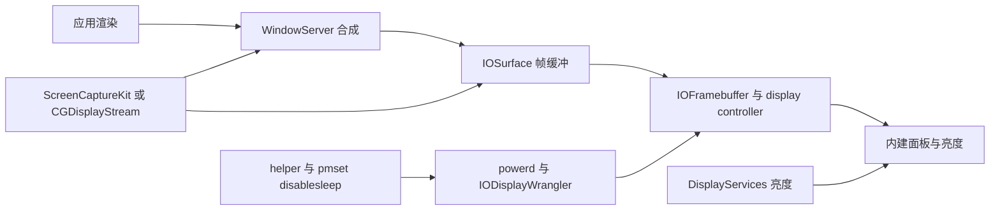

# 上下文与系统模型

## 文档状态

| 项目 | 内容 |
| --- | --- |
| 版本 | `1.0` |
| 状态 | 初稿，可评审 |
| 日期 | `2026-10-23` |
| Issue | #306 |
| 目标 commit | `b7065b2` |

## 1. 问题类别

本问题属于 macOS 图形栈、显示电源管理、屏幕捕获和私有 API 风险研究。

## 2. 研究问题

macOS 合盖后“面板黑屏但 framebuffer 保持活动”具体指什么？
Computer Use、ScreenCaptureKit 或远程桌面为什么可能在物理屏幕不可见时仍取得画面？
哪些结论已被本机证据支持？

## 3. 问题定义

用户看到的结果有三层：

| 层 | 用户可见结果 |
| --- | --- |
| 系统运行 | Mac 不睡眠，进程继续运行 |
| 物理面板 | 屏幕看起来是黑色 |
| 图形输出 | 合成器和捕获 API 可能仍能取得画面 |

问题不在于“屏幕是否发光”。
问题在于“逻辑显示器和合成输出是否仍然可用”。

## 4. 触发条件

1. 用户开启“实验性合盖黑屏”。
2. 用户启动合盖会话。
3. 上盖关闭。
4. 没有外接显示器。
5. helper 合盖租约有效。
6. DisplayServices 私有亮度接口可用。

## 5. 问题分类

| 类别 | 核心区别 | 观察方法 |
| --- | --- | --- |
| 系统睡眠 | macOS 是否进入睡眠 | `pmset -g`、启动时间 |
| 合盖状态 | 上盖是否关闭 | `AppleClamshellState` |
| 显示连接 | 显示器是否仍连接 | `CGDisplayIsOnline` |
| 显示可绘制 | 显示器是否 awake 且可绘制 | `CGDisplayIsActive` |
| 显示睡眠 | 显示器是否 asleep、不可绘制 | `CGDisplayIsAsleep` |
| 面板亮度 | 用户看到多亮 | `DisplayServicesGetBrightness` |
| 帧生成 | WindowServer 是否提供帧 | `CGDisplayStream` 状态、ScreenCaptureKit |
| 捕获权限 | 工具能否读取内容 | TCC 和捕获 API 返回值 |

## 6. 适用范围

1. Apple Silicon Mac 内建屏。
2. macOS 27 已验证环境。
3. 无外接显示器的合盖场景。
4. 本机图形会话和当前登录用户。
5. ScreenCaptureKit、`CGDisplayStream` 和 `screencapture` 的机制分析。

## 7. 范围外事项

1. 显示器驱动和固件实现。
2. 绕过 SIP、TCC、DRM 或安全输入。
3. 为任意 macOS 版本承诺私有符号可用。
4. 虚拟显示器的产品设计。
5. App Store 审核结论。
6. 修改系统安全设置。

## 8. 受影响角色

| 角色 | 影响 |
| --- | --- |
| 用户 | 需要知道屏幕黑不等于系统停止 |
| Computer Use 工具 | 可能依赖逻辑显示器和合成帧 |
| 远程桌面 | 可能依赖 display capture 或 virtual display |
| Covio | 负责合盖租约、亮度写入和恢复 |
| WindowServer | 负责图形会话和帧交付 |
| powerd | 负责系统与显示电源状态 |

## 9. 系统模型

图中的连线表示概念关系。
公开头文件没有暴露 WindowServer 的全部内部实现。

## 10. 术语

| 术语 | 定义 |
| --- | --- |
| framebuffer | 保存待显示像素并供显示输出使用的内存或图形资源 |
| IOSurface | macOS 用户态和图形服务共享像素缓冲的公开对象 |
| WindowServer | 合成窗口并生成显示帧的系统图形服务 |
| display controller | 从显示缓冲读取像素并驱动扫描输出的硬件或驱动层 |
| online | 显示器已连接 |
| active | 显示器已连接、awake，并可用于绘制 |
| asleep | 显示器 asleep，并且不可绘制 |
| panel brightness | 面板最终可见亮度，不决定合成帧是否存在 |

## 11. 状态矩阵

| 场景 | 系统 | 合盖 | online | active | asleep | 亮度 | 捕获判断 |
| --- | --- | --- | --- | --- | --- | --- | --- |
| 正常开盖 | awake | No | 1 | 1 | 0 | 用户值 | 预期可用 |
| 无租约合盖 | 进入睡眠 | Yes | 过渡 | 过渡 | 过渡 | 过渡 | 预期不可用 |
| 有租约并关屏 | awake | Yes | 可能在线 | 0 | 1 | 0 或驱动值 | 预期空白或失败 |
| 有租约并黑屏 | awake | Yes | 1 | 1 | 0 | 0.0 | 可能在合成器路径可用 |
| 外接屏 clamshell | awake | Yes | 外接屏在线 | 外接屏 active | 内建屏可变 | 内建屏可变 | 以外接屏为准 |

表中的“预期”不是验收结果。
本机已经验证黑屏场景的 online、active、asleep 和亮度。
Computer Use 捕获仍是待验证项。

## 12. 场景

### 场景 A：开盖基线

屏幕可见。
逻辑显示器 active。
捕获工具应能取得合成画面。

### 场景 B：合盖黑屏

面板亮度为 `0.0`。
逻辑显示器应保持 active。
捕获工具可能取得画面。

### 场景 C：合盖关屏

Covio 请求 display sleep。
显示器 asleep 后不可绘制。
捕获可能返回空白、`FrameBlank` 或错误。

### 场景 D：外接屏

内建屏和外接屏状态必须分开判断。
不能把外接屏 active 当成内建屏 active。

## 13. 成功标准

1. 层模型能解释“黑屏”和“可捕获”为什么不矛盾。
2. 状态矩阵覆盖 normal、display-off、zero-brightness 和 external-display。
3. 每个事实有 SDK、源码或本机观察。
4. Computer Use 未知项明确保留。
5. 文档给出可重跑验证步骤。
