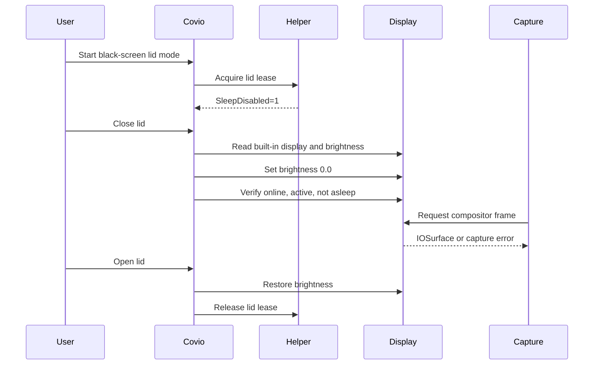

# 推荐控制流程与验证手段

## 1. 推荐流程

## 2. 不变量

1. 只操作内建屏。
2. 外接屏数量必须为 `0`。
3. 合盖状态必须为 closed。
4. 系统必须保持 awake。
5. 显示必须 online 和 active。
6. 显示必须未 asleep。
7. 亮度必须回读为接近 `0.0`。
8. 恢复记录必须先写后改亮度。
9. 失败必须回退公开 display sleep。
10. 开盖后必须恢复原亮度。

## 3. 控制接口

| 接口 | 作用 | 失败处理 |
| --- | --- | --- |
| helper `lidLeaseAcquire` | 阻止合盖系统睡眠 | 不进入零亮度 |
| `CGGetOnlineDisplayList` | 找内建屏 ID | 能力不可用 |
| `CGDisplayIsActive` | 判断是否可绘制 | 回退关屏 |
| `CGDisplayIsAsleep` | 判断显示器是否睡眠 | 回退关屏 |
| `DisplayServicesSetBrightness` | 设面板亮度 | 恢复并回退 |
| `DisplayServicesGetBrightness` | 回读亮度 | 恢复并失败 |
| ScreenCaptureKit | 捕获验证 | 显示不可保证 |
| `screencapture` | 独立对照 | 记录空白或错误 |

## 4. 捕获自检

可选自检分两段：

1. 捕获整个 display。
2. 捕获指定窗口。

验收要求：

1. 图片尺寸有效。
2. 图片不是全黑。
3. 图片包含可识别窗口或菜单。
4. 捕获失败有明确错误码。
5. 不保存敏感画面到仓库。

## 5. 捕获失败分类

| 失败 | 可能原因 | 用户动作 |
| --- | --- | --- |
| display 不在列表 | 合盖后系统移除内建屏 | 回退关屏 |
| display asleep | 显示电源已进入睡眠 | 回退关屏 |
| 全黑图片 | 捕获无内容或受保护内容 | 检查权限和内容 |
| 权限错误 | TCC 未授权 | 打开系统设置 |
| 窗口不在线 | 窗口不可见或被隐藏 | 使用窗口捕获或恢复窗口 |
| 锁屏 | 安全边界阻止内容 | 解锁后再测 |

## 6. 安全

1. 不关闭 SIP。
2. 不请求私有 entitlement。
3. 不绕过 Screen Recording 权限。
4. 不捕获锁屏秘密。
5. 不把截图提交到仓库。
6. 恢复记录设置 root-only 权限。
7. 外接屏存在时不写内建屏。

## 7. 自动化测试

1. online、active、asleep 状态映射。
2. 外接屏拒绝逻辑。
3. 亮度写入、回读和恢复。
4. 恢复记录原子写入。
5. 私有符号缺失。
6. 版本不在白名单。
7. 合盖未知状态。
8. 捕获失败分类。
9. 回退公开关屏。

## 8. 真机测试

1. 开盖基线截图。
2. 合盖黑屏截图。
3. 合盖关屏对照。
4. 开盖恢复。
5. 正常退出恢复。
6. `SIGKILL` 后启动恢复。
7. 外接屏组合。
8. 锁屏和 DRM。
9. Intel 和其它 Apple Silicon。

## 9. 发布建议

1. 保持实验标记。
2. 默认关闭。
3. 在 UI 中写“可能支持 Computer Use 或远程截图”。
4. 不写“保证捕获”。
5. 失败时写具体原因。
6. 采集匿名诊断：macOS 版本、机型和接口返回码。
