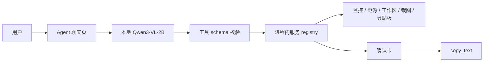

# 离线本地服务 Agent：上下文

## 问题类别

本课题研究本地模型的受控工具调用。  
研究范围包含权限、确认、失败处理和进程边界。  

## 研究问题

Covio 如何让本地 Agent 访问离线服务，同时避免模型直接控制系统？

## 问题定义

Agent 需要理解用户意图。  
Agent 需要选择正确的本地服务。  
Agent 需要生成可校验的参数。  
有副作用时必须得到用户确认。  
服务不得访问任意路径、网络或 shell。

## 触发条件

用户在 Agent 页输入本地服务请求。  
请求可能包含普通对话、只读查询或副作用操作。  
请求也可能包含提示注入。  

## 适用范围

1. Covio 主应用进程内服务。
2. 本地模型。
3. 固定工具 schema。
4. 用户可见确认。
5. 单元测试和低内存验收。

## 范围外事项

1. 第三方 MCP 市场。
2. 任意 shell。
3. 任意路径。
4. 远程 AI 服务。
5. 后台自主任务。
6. 跨设备 Agent。

## 受影响角色

| 角色 | 影响 |
| --- | --- |
| 用户 | 通过对话访问本地服务 |
| 隐私审查 | 确认内容不出本机 |
| 工程维护 | 维护工具 schema 和 registry |
| 测试 | 覆盖误调用、越权和确认 |

## 系统模型

## 状态矩阵

| 状态 | 条件 | 结果 |
| --- | --- | --- |
| idle | 没有生成任务 | 可发送新请求 |
| thinking | 模型生成中 | 可停止 |
| awaitingConfirmation | 有副作用 pending call | 只允许确认或取消 |
| executing | 用户已确认 | 执行一次 |
| error | 模型或工具失败 | 停止当前动作 |

## 场景

1. 用户查询监控。
2. 用户查询电池。
3. 用户搜索工作区。
4. 用户查询截图元数据。
5. 用户查询剪贴板元数据。
6. 用户要求复制文本。
7. 文档包含提示注入。
8. 模型生成非法工具名。
9. 模型缺少参数。
10. 用户取消副作用。

## 成功标准

1. 只读服务可完成。
2. 副作用未经确认不执行。
3. 工具名和参数在 registry 再校验。
4. 提示注入不能越权。
5. 运行时不产生非 loopback 网络连接。
6. 8 GB Apple Silicon 可运行。
