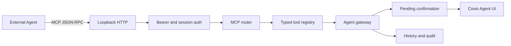

# 外部本地 Agent 服务协议

> 结论：首版采用 MCP `2025-06-18` 的 Streamable HTTP transport。
> 服务只监听 `127.0.0.1` 的动态端口。
> 每次启动使用随机 bearer token。
> 外部请求复用 typed tool registry。
> 副作用只生成 pending action，必须由本机用户确认。

| 项目 | 内容 |
| --- | --- |
| 文档状态 | 通过 |
| 调研日期 | 2026-10-22 |
| 关联 | #237、#248、#249 |
| 协议 | MCP `2025-06-18` |
| 决策 | [ADR-0015](../../adr/adr-0015-external-agent-protocol.md) |

## 问题

Covio Agent 已有进程内 typed gateway。
外部本地 Agent 需要发现和调用同一批本地服务。
服务不能开放 shell。
服务不能接受任意文件路径。
服务不能监听公网接口。
外部调用不能绕过确认和审计。

## 候选协议

| 方案 | 认证 | 权限边界 | 生命周期 | 安装成本 | 审计 | 跨 Agent 兼容 |
| --- | --- | --- | --- | --- | --- | --- |
| MCP stdio | 用户启动的进程身份 | 强 | 客户端拥有子进程 | 高，需要 IPC shim | 强 | 高 |
| MCP over XPC 或 Unix socket | 同用户和代码签名 | 最强 | 主应用拥有会话 | 高，需要专用客户端 | 强 | 低 |
| 带认证的 loopback MCP HTTP | bearer token 和 loopback | 强 | 主应用拥有服务 | 低，配置 URL 和 token | 强 | 高 |
| App Intents 或 Shortcuts | 系统授权 | 强 | 系统控制 | 低 | 中 | 低，不是通用 Agent 工具协议 |

### 方案说明

#### MCP stdio

MCP 官方推荐客户端尽可能支持 stdio。
stdio 不经过网络。
客户端负责启动和关闭服务进程。
Covio 需要一个额外 CLI。
CLI 还需要通过 XPC 或 Unix socket 连接正在运行的 App。
因此首版工作量高于 loopback HTTP。

#### MCP over XPC 或 Unix socket

XPC 适合 Apple 平台。
Unix socket 适合同用户进程。
两者能缩小权限边界。
通用外部 Agent 不能直接连接这些接口。
每个客户端都需要专用适配代码。
因此不作为首版通用接口。

#### 带认证的 loopback MCP HTTP

MCP Streamable HTTP 使用 JSON-RPC。
客户端通过 `tools/list` 发现服务。
客户端通过 `tools/call` 调用服务。
主应用可以独立维护服务、会话和审计。
外部 Agent 只需配置 endpoint 和 token。
服务只监听 loopback。
风险由 token、Host、Origin 和 session 限制共同控制。

#### App Intents 或 Shortcuts

App Intents 适合系统级自动化和 Shortcuts。
App Intents 不提供通用 MCP 工具发现。
App Intents 不能替代外部 Agent 的通用服务适配器。
它可以作为后续快捷指令入口。

## 证据

### E-EXT-001

MCP `2025-06-18` Transports 规范定义两种标准 transport。
两种 transport 是 stdio 和 Streamable HTTP。
规范建议客户端尽可能支持 stdio。
来源：[MCP Transports](https://modelcontextprotocol.io/specification/2025-06-18/basic/transports)

### E-EXT-002

Streamable HTTP 规范要求服务校验 `Origin`。
规范建议本地服务只绑定 `127.0.0.1`。
规范建议所有连接使用认证。
来源：[MCP Transports security warning](https://modelcontextprotocol.io/specification/2025-06-18/basic/transports#streamable-http)

### E-EXT-003

Streamable HTTP 的请求使用 HTTP POST。
客户端 `Accept` 必须同时列出 `application/json` 和 `text/event-stream`。
服务可以返回单个 JSON 对象。
服务可以使用 `Mcp-Session-Id` 管理会话。
后续请求必须带上协商的 `MCP-Protocol-Version`。
来源：[MCP Transports message rules](https://modelcontextprotocol.io/specification/2025-06-18/basic/transports#sending-messages-to-the-server)

### E-EXT-004

MCP HTTP authorization 是可选项。
支持 authorization 时，规范建议采用 OAuth 2.1 和资源元数据发现。
stdio 不应使用 HTTP authorization flow。
来源：[MCP Authorization](https://modelcontextprotocol.io/specification/2025-06-18/basic/authorization)

### E-EXT-005

MCP tools 使用 `tools/list` 和 `tools/call`。
每个工具必须提供名称、说明和 JSON Schema。
规范建议对工具调用保留人工确认能力。
来源：[MCP Tools](https://modelcontextprotocol.io/specification/2025-06-18/server/tools)

### E-EXT-006

Covio 已有进程内 allowlist、风险、确认和审计。
文件工具只接受稳定文件 ID。
当前实现来源：

- `macosApp/src/Agent/AgentServiceModels.swift`
- `macosApp/src/Agent/AgentServiceGateway.swift`
- `macosApp/src/Agent/AgentHistoryStore.swift`

## 决策

### 首版 transport

1. 使用 MCP `2025-06-18` Streamable HTTP。
2. MCP endpoint 使用 `http://127.0.0.1:<ephemeral-port>/mcp`。
3. 服务不监听 `0.0.0.0`、IPv6 wildcard 或局域网地址。
4. 首版 POST 返回 `application/json`。
5. 首版不提供 SSE GET 流，GET 返回 `405 Method Not Allowed`。
6. `initialize` 返回随机会话 ID。
7. 后续请求校验 `MCP-Protocol-Version` 和 `Mcp-Session-Id`。

### 认证

1. App 每次启动生成 256-bit 随机 token。
2. token 保存在 Keychain。
3. 外部客户端使用 `Authorization: Bearer <token>`。
4. 缺少 token 或 token 不正确时返回 `401`。
5. token 不写入日志、历史或 issue。
6. 用户可以在设置页复制配对信息。
7. 用户可以轮换 token，轮换后旧会话全部失效。

首版不使用完整 OAuth 2.1。
原因是产品是单用户、本机、loopback 服务。
静态 bearer token 足以形成认证边界。
完整 OAuth 作为后续远程或多用户方案。

### 网络与请求边界

1. 校验 `Host` 必须等于当前 loopback endpoint。
2. `Origin` 缺失或等于当前 loopback origin 时才允许。
3. 拒绝代理头和非 loopback remote address。
4. 请求体上限为 1 MiB。
5. 每会话每分钟最多 60 次请求。
6. 超限返回 `429 Too Many Requests`。
7. 会话空闲 5 分钟后过期。

### 工具边界

外部工具直接复用 `AgentToolCatalog`。
外部客户端不能使用未注册工具。
工具参数继续经过 gateway 二次校验。

| 类型 | 外部行为 | 工具示例 |
| --- | --- | --- |
| 只读 | 直接执行并审计 | `get_monitor_snapshot`、`get_power_status`、`read_setting` |
| 文件只读 | 只接受稳定文件 ID | `inspect_file`、`search_file_content` |
| 低风险 UI | 外部调用时进入确认 | `open_pane` |
| 本机副作用 | 生成 pending action | `copy_text`、`request_setting_change` |
| 文件副作用 | 生成 pending action | `apply_file_renames`、`undo_rename_run` |

外部调用不能直接执行任何 `.sideEffect` 工具。
`open_pane` 在内部 Agent 中可立即执行。
外部适配器把 `open_pane` 提升为确认操作。

### 会话与 pending action

1. pending action 绑定 MCP session ID。
2. 客户端发送 `DELETE /mcp` 时清理该会话的 pending action。
3. 会话超时后清理该会话的 pending action。
4. App 退出时清理所有外部会话。
5. 断开请求不能自动确认 pending action。
6. 本机用户取消后，外部调用返回 cancelled 状态。

### 审计

1. 每次 `tools/call` 保存 source、session ID、工具名、风险、状态和耗时。
2. source 固定为 `external.mcp`。
3. 审计不保存文件正文、工具结果正文、token 或请求头。
4. 认证失败只记固定原因码，不记 token。
5. 本机 Agent 和外部 Agent 使用同一审计存储。

## 架构

## 后续适配

1. 增加 MCP stdio shim。
2. shim 只负责转发到同一个 MCP router。
3. 增加 App Intents 快捷动作。
4. 当服务支持远程设备时，增加 OAuth 2.1。
5. 当客户端需要服务主动事件时，增加 SSE。

## 已知缺口

| 缺口 | 影响 | 后续动作 |
| --- | --- | --- |
| 首版没有 OAuth 2.1 | 只有本机静态 token 边界 | 远程服务前补 OAuth |
| 首版没有 SSE | 没有服务主动事件 | 有事件订阅需求时增加 |
| 首版没有 stdio | 部分 MCP 客户端偏好 stdio | #249 后增加 shim |
| token 首次配对仍需 UI | 外部客户端需要人工配置 | 设置页显示 endpoint 和 token |

## #249 实施顺序

1. 建立纯 JSON-RPC MCP router 和测试。
2. 建立 loopback HTTP transport 和认证中间件。
3. 从 `AgentToolCatalog` 生成 `tools/list` schema。
4. 将 `tools/call` 转发到现有 gateway。
5. 将 pending action 绑定本机会话并显示确认卡。
6. 为 SQLite 审计增加外部 source 和 session 字段。
7. 增加认证、限流、断连清理和审计测试。
8. 运行 `bash scripts/test-all.sh`。

## 验收映射

| #249 验收 | 方案 |
| --- | --- |
| 外部 Agent 列出允许服务 | `tools/list` |
| 未授权服务和参数被拒绝 | registry 和 gateway 双重校验 |
| 副作用需要本机确认 | pending action |
| 请求和结果有审计 | `external.mcp` 审计记录 |
| 不监听非 loopback | 固定 `127.0.0.1` |
| 全量测试通过 | #249 CI 闸门 |
