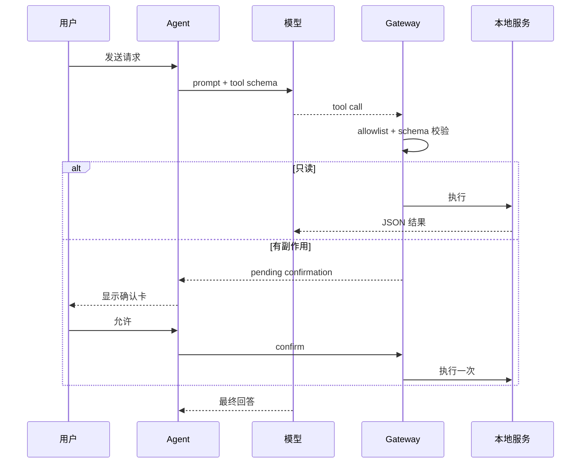

# 离线本地服务 Agent：调研

## 调研方法

1. 阅读 Covio 的 `AppRuntime` 和现有运行时。
2. 阅读 `mlx-swift-lm` tool calling 实现。
3. 用固定模型跑 30 个合成请求。
4. 比较四种服务边界。

## 来源范围

- `macosApp/src/App/AppRuntime.swift`
- `macosApp/src/Hub/Monitor/MacMonitorReader.swift`
- `macosApp/src/Clipboard/ClipboardRuntime.swift`
- `macosApp/src/Workspace/WorkspaceRuntime.swift`
- `macosApp/src/Shelf/ShelfRuntime.swift`
- `mlx-swift-lm` commit `48114eedf3c3d4a682a6b1d644cc5af5c2945d10`

## 领域模型

Agent 由四个部分组成：

1. 本地模型。
2. 工具 schema。
3. 服务 registry。
4. 确认和审计层。

## 约束模型

1. 完全离线。
2. 不开放任意代码执行。
3. 不开放任意路径。
4. 不开放网络工具。
5. 有副作用必须确认。
6. 8 GB 内存。
7. 失败时停止，不猜测。

## 控制路径

## 信任边界

模型输出是不可信输入。  
工具结果也不可信。  
registry 只接受声明过的工具和参数。  
主应用运行时是首版唯一服务提供者。

## 候选方案对比

| 方案 | 成本 | 风险 | 成熟度 | 可维护性 | 结论 |
| --- | --- | --- | --- | --- | --- |
| 进程内 typed registry | 低 | 低 | 高 | 高 | 采用 |
| Unix domain socket | 中 | 中 | 高 | 中 | 仅用于特权 helper |
| 本地 HTTP | 中 | 高 | 中 | 低 | 不采用 |
| MCP server | 高 | 中 | 中 | 中 | 后续适配 |

## 现有能力矩阵

| 能力 | 来源 | 首版用途 |
| --- | --- | --- |
| 监控快照 | `MonitorSampler` | 只读 |
| 电源状态 | `MonitorSampler.samplePowerOnly()` | 只读 |
| 工作区列表 | `WorkspaceRuntime.entries` | 只读 |
| 截图列表 | `ShelfRuntime.items` | 只读 |
| 剪贴板元数据 | `ClipboardRuntime.items` | 只读 |
| 复制文本 | `NSPasteboard` | 有副作用 |

## 工具调用矩阵

30 个请求覆盖工具选择、普通对话、缺失参数、未知工具、shell、路径、网络和提示注入。  
结果见 [validation/case-tool-calling.md](validation/case-tool-calling.md)。

## 反证和限制

模型准确率只有 90%。  
一个请求生成了非法 JSON。  
一个副本请求没有选择工具。  
一个不存在的设置在工具层被记录。  
因此不能依赖模型自身校验。

## 已知缺口

1. 没有 M5 性能数据。
2. 没有第三方 MCP 兼容测试。
3. 没有长期对话压测。
