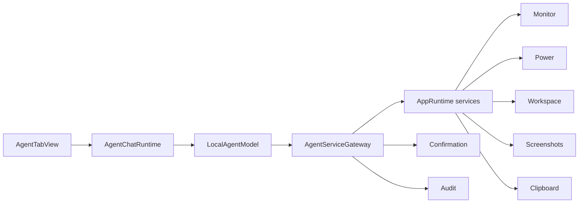

# 离线本地服务 Agent：方案

## 推荐架构



## 组件职责

| 组件 | 语言 | 职责 |
| --- | --- | --- |
| `AgentTabView` | SwiftUI | 聊天、停止、确认和错误显示 |
| `AgentChatRuntime` | Swift | 会话状态和任务生命周期 |
| `LocalAgentModel` | Swift | 模型加载、流式生成和 tool dispatch |
| `AgentServiceGateway` | Swift | allowlist、schema、确认和审计 |
| `AgentAppServices` | Swift | 连接现有 AppRuntime 服务 |
| `PaneKind.AGENT` | Kotlin | 导航级工作区种类 |

## 调用路径

1. 用户输入请求。
2. `AgentChatRuntime` 追加消息。
3. `LocalAgentModel` 调用本地模型。
4. 模型产生 tool call。
5. `AgentServiceGateway` 校验名称和参数。
6. 只读工具立即执行。
7. 副作用工具进入 pending 状态。
8. UI 显示确认卡。
9. 用户确认后执行一次。
10. 模型接收工具结果并生成最终回答。

## 文件位置

- `kmpDomain/src/com/wyz/covio/core/WorkbenchModels.kt`
- `macosApp/src/Agent/AgentServiceModels.swift`
- `macosApp/src/Agent/AgentServiceGateway.swift`
- `macosApp/src/Agent/AgentAppServices.swift`
- `macosApp/src/Agent/LocalAgentModel.swift`
- `macosApp/src/Agent/AgentChatRuntime.swift`
- `macosApp/src/Agent/AgentTabView.swift`

## 接口契约

### 工具

| 字段 | 类型 | 说明 |
| --- | --- | --- |
| name | String | allowlist 名称 |
| risk | enum | `readOnly` 或 `sideEffect` |
| schema | ToolSpec | 输入 schema |
| audit | struct | 工具名、风险、状态 |

### 结果

| 字段 | 类型 | 说明 |
| --- | --- | --- |
| ok | Bool | 执行是否成功 |
| summary | String | 短说明 |
| data | JSONValue | 结构化结果 |

## 操作列表

1. `get_monitor_snapshot`
2. `get_power_status`
3. `list_workspace_files`
4. `list_screenshots`
5. `list_clipboard_metadata`
6. `copy_text`

## 错误码

| 错误 | 用户可见结果 |
| --- | --- |
| invalidArguments | 本地服务参数无效 |
| unknownTool | 未知本地服务 |
| toolFailed | 本地服务失败 |
| modelFailed | 本地 Agent 无法完成请求 |
| cancelled | 本轮已停止 |

## 关键流程

### 只读

```text
tool call -> validate -> execute -> JSON -> model
```

### 副作用

```text
tool call -> validate -> pending -> confirm -> execute once -> audit
```

## 安全设计

1. 工具名必须来自 allowlist。
2. 参数必须在 registry 再校验。
3. 不提供 shell。
4. 不提供任意路径。
5. 不提供网络。
6. 副作用必须确认。
7. 取消后不执行。
8. 工具结果不包含聊天正文或文件正文。

## 可靠性与失败模式

| 失败 | 处理 |
| --- | --- |
| 模型格式错误 | 拒绝调用，显示错误 |
| 工具未知 | 拒绝执行 |
| 参数越界 | 拒绝执行 |
| 用户取消 | 清空 pending |
| 用户确认 | 只执行一次 |
| 模型超时 | 停止本轮 |

## 验收标准

- [x] Agent 页签可见。
- [x] 聊天流式显示。
- [x] 停止和清空可用。
- [x] 只读服务可执行。
- [x] `copy_text` 需要确认。
- [x] 确认只执行一次。
- [x] 非法工具名和参数被拒绝。
- [x] 提示注入不触发写操作。
- [x] 设计预览完成。
- [x] 7 GB Apple Silicon 完成安装包验收。
- [x] 运行时没有非 loopback 网络连接。

## 实施计划

| 顺序 | 工作 | 状态 |
| --- | --- | --- |
| 1 | 工具矩阵研究 | 完成 |
| 2 | 服务边界研究 | 完成 |
| 3 | Agent 页签和聊天页 | 完成 |
| 4 | 服务 registry 和确认 | 完成 |
| 5 | 低内存验收 | 完成，#206 通过 |

## 回滚条件

1. 副作用未经确认执行。
2. 非 loopback 网络连接出现。
3. 工具访问任意路径或 shell。
4. 8 GB 机器无法完成基本会话。

## 产品化条件

1. [x] #206 通过。
2. [x] 设计预览通过评审。
3. [x] `bash scripts/test-all.sh` 通过。
