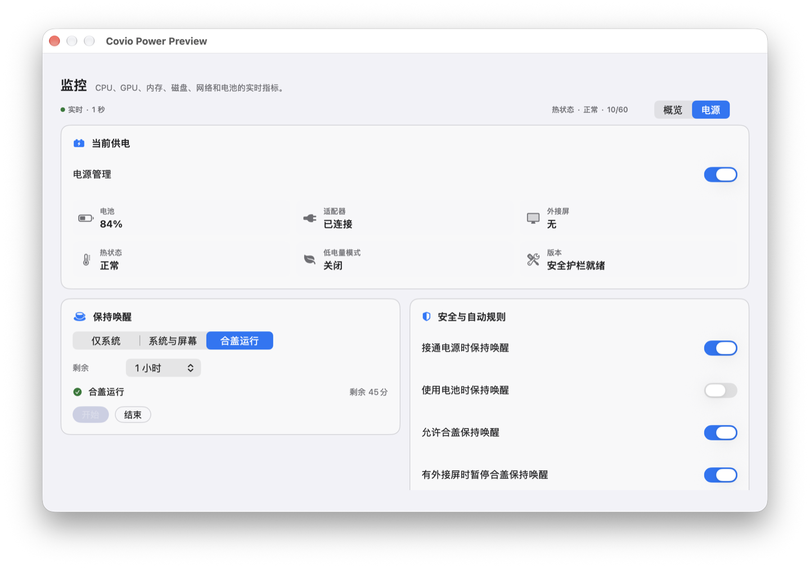
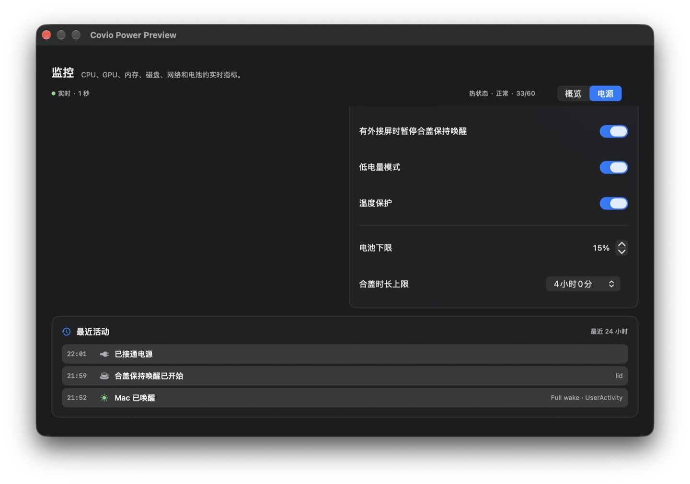

# Power 真机验证矩阵

## 文档状态

| 项目 | 内容 |
| --- | --- |
| 文档版本 | `2.1` |
| 状态 | 最终 RC 通过；低档位充电上限 no-go；分发阻塞已记录 |
| 日期 | `2026-10-22` |
| Issue | #269、#162 |
| Feature | #148 |
| 基线 | `61bf222` |
| RC | `0.5.0` Release Candidate v07 |

## 结论

Power 主线已在 `main` 的 `61bf222` 上完成最终本地验证。
helper 已切换到当前主线构建，在线版本是 `0.5.0`，协议是 `v4`。
真实合盖保持运行 `138` 秒，期间续租 `14` 次，系统启动时间没有变化。
开盖后租约正常释放，`SleepDisabled` 回到 `0`。
自动测试全部通过：790 项 XCTest，1 项跳过，0 项失败。
本地 RC 的离线文件命名 bundle 验收通过。
低档位 `20%` 到 `79%` 充电上限在当前 macOS 27 真机为 no-go。
当前实现会在 powerd 目标未生效时恢复原策略并返回失败。
Developer ID 签名和公证当前不可执行。
当前产品范围不能直接进入 Mac App Store。

## 环境

| 项目 | 值 |
| --- | --- |
| 硬件 | MacBook Pro，Apple M1 Max |
| 内存 | 64 GB |
| macOS | `27.0.1 (26A434)` |
| 基线 | `61bf222` |
| RC | `0.5.0`，arm64 |
| helper | `0.5.0`，协议 `4` |
| 签名 | ad-hoc |
| 当前供电 | AC Power |
| 电池 | 内置电池，有电池 |
| 系统 `SleepDisabled` | `0` |

## 已验证

| 场景 | 步骤 | 结果 | 证据 |
| --- | --- | --- | --- |
| 构建与测试 | 执行 `bash scripts/test-all.sh` | 通过；790 项 XCTest，1 项跳过，0 项失败 | 本地测试日志 |
| helper v4 割接 | 卸载旧 worktree helper，安装当前主线构建 | LaunchDaemon 在线；版本 `0.5.0`，协议 `4` | `verify-helper-cutover.sh all` |
| helper 在线应答 | 查询版本和协议 | 版本 `0.5.0`，协议 `4` | `verify-helper-cutover.sh verify` |
| 租约写入 | 获取、查询、续租、释放 | `SleepDisabled` 从 `0` 变为 `1`，释放后回到 `0` | `helper-lease-roundtrip.log` |
| 真实合盖保持 | 持有租约后合盖 `138` 秒 | `AppleClamshellState=Yes`，续租 `14` 次，启动时间不变 | `lid-hold.log` 与 `helper.log` |
| 开盖恢复 | 打开上盖并释放租约 | `AppleClamshellState=No`，活动租约 `0`，`SleepDisabled=0` | 系统复查 |
| 所有权恢复 | 释放后检查 marker | `sleep_owner` 不存在 | 系统复查 |
| RC bundle | 执行离线 bundle 验收 | 2 个文件命名成功，2 个撤销成功，非回环网络连接 `0` | `verify-dmg-61bf222.log` |
| 原生充电上限 | 应用 `85%`，再恢复 `80%` | `pmset` 进入 `85%`，恢复后回到 `80%` | PR #282 真机记录 |
| 低档位充电上限 | 应用 `70%`，连续采样 60 秒 | helper 返回 `70%`，`pmset` 12 次全部保持 `80%` | 低档位 no-go 记录 |
| 低档位失败关闭 | powerd 未接受目标 | helper 恢复原策略、停止重试并关闭 App 启用标记 | PR #282 |
| 键名兼容 | macOS 27 输出 `SleepDisabled` | KMP 两个平台通过 | `PmsetConfigParserTest` |
| 浅色布局 | 打开 Power 预览 | 内容可读，页面可滚动 | 窗口截图 |
| 深色布局 | 打开 Power 预览 | 内容可读，页面可滚动 | 窗口截图 |
| 无历史 | 使用空历史快照 | 显示真实空状态 | 自动化测试 |
| 有历史 | 使用最近 24 小时事件 | 事件按时间倒序显示 | 自动化测试 |
| 历史上限 | 追加超过上限的事件 | 只保留最新事件 | KMP 测试 |
| 原子写入 | 写入后检查临时文件 | 没有残留 `.tmp` | KMP 测试 |
| 写入失败 | 把普通文件当作父目录 | 策略继续执行，历史不更新 | Swift 测试 |
| 电源切换 | AC 切到电池观察 | 记录断电事件 | Swift 测试 |
| 睡眠事件 | 投递系统睡眠事件 | 记录睡眠事件 | Swift 测试 |
| 完整唤醒 | 更新唤醒日志并触发唤醒信号 | 记录完整唤醒 | Swift 测试 |
| 热危险 | 注入严重热状态 | 释放租约并记录护栏事件 | Swift 测试 |
| 外部冲突 | 注入外部 `SleepDisabled`，再解除 | 记录冲突与恢复事件 | Swift 测试 |

## 合盖结果

| 项目 | 结果 |
| --- | --- |
| 开始合盖 | Unix 时间 `1792650556` |
| 打开上盖 | Unix 时间 `1792650694` |
| 持续时长 | `138` 秒 |
| 续租次数 | `14` |
| 合盖状态 | `AppleClamshellState=Yes` |
| 合盖期间 `SleepDisabled` | `1` |
| 启动时间 | 合盖前后一致 |
| 释放结果 | `SleepDisabled=0` |
| 所有权文件 | `sleep_owner` 不存在 |

## 窗口截图

浅色模式：

深色模式：

## 待真机验证

| 场景 | 操作前条件 | 必须观察 |
| --- | --- | --- |
| 合盖超时 | 合盖会话达到上限 | 租约释放，页面显示护栏触发 |
| 外接屏冲突 | 合盖会话期间接入外接屏 | 续租失败，合盖租约立即释放 |
| 崩溃恢复 | 合盖租约有效时结束进程 | 最长 60 秒后恢复睡眠 |
| 外部设置冲突 | 其他应用设置 `SleepDisabled=1` | Covio 不清除该值，页面显示冲突 |
| 睡眠与唤醒 | 进入睡眠，再按电源键唤醒 | 历史记录睡眠与完整唤醒 |
| 合盖睡眠 | 无会话时合盖 | Mac 进入睡眠 |
| 插拔电源 | 运行中插拔适配器 | 历史记录连接与断开事件 |
| 其他 Mac | 在 macOS 26、Intel Mac 和其他 Apple Silicon 机型运行 | 行为与当前白名单一致 |

实验零亮度已由 [合盖显示与最低亮度](lid-display-minimum-brightness.md) 记录。
该实验路径使用私有 API。本次 helper v4 割接没有重新执行零亮度物理合盖矩阵。

充电上限的低档位结论见 [电池充电控制](battery-charge-control/conclusion.md)。
当前 macOS 27 Apple Silicon 不支持把 `20%` 到 `79%` 的请求稳定登记到 powerd。

## 分发结论

| 路径 | 状态 | 证据 | 解除条件 |
| --- | --- | --- | --- |
| 本地 RC | 通过 | DMG CRC、深度签名、离线模型和命名验收通过 | 无 |
| Developer ID 签名 | 阻塞 | `security find-identity -v -p codesigning` 返回 `0 valid identities found` | 安装有效 Developer ID Application 证书 |
| 公证 | 阻塞 | `notarytool` 没有 `Covio` 凭据配置 | 建立 Apple 凭据并完成公证 |
| Mac App Store | 当前范围 no-go | LaunchDaemon helper、私有 `DisplayServices` API 和沙盒路径都需要重构 | 单独设计无特权或合规替代方案 |

## 风险

1. `pmset disablesleep` 是系统级持久状态。
2. 合盖测试需要真实睡眠与唤醒，不能由单元测试代替。
3. 热状态无法稳定注入到真实硬件。
4. 当前 helper 使用 Debug 构建。LaunchDaemon 指向用户可写 worktree。该状态只适合临时测试。
5. 长期分发前，必须把 helper 放到 root 所有且受签名保护的固定路径，或者采用签名校验的正式安装器。
6. Developer ID 和公证凭据缺失，因此 Gatekeeper 仍拒绝 ad-hoc RC。
7. 私有亮度 API 可能随 macOS 更新失效。
8. App Store 需要独立产品范围和实现方案，不能在当前 RC 上直接验证。
9. `20%` 到 `79%` 的充电上限在当前 macOS 27 真机为 no-go。
10. helper 报告的新目标不能替代 powerd 的 `pmset` 回读。
