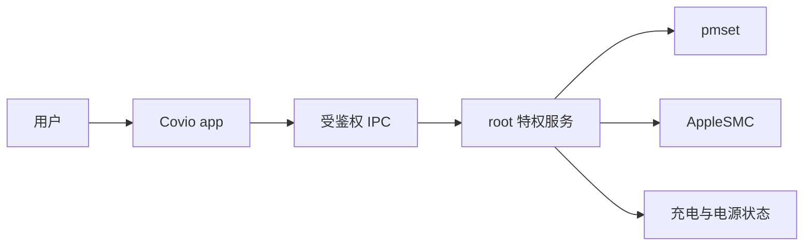

# 问题、边界与成功标准

## 问题类别

本主题研究：用户态桌面应用需要执行少量系统级写入时，应采用哪种进程与权限架构。

研究对象不是某一个 helper 实现。
研究对象是一类权限边界问题。

## 研究问题

Covio 的特权能力应采用哪种进程与权限架构？root helper 是否已经是最优解？

## 问题定义

Covio 当前提供这些需要系统级权限的能力：

| 能力 | 需要的写入 | 当前执行者 |
| --- | --- | --- |
| 合盖不睡 | `pmset -a disablesleep` | root helper |
| 休眠模式 | `pmset -a hibernatemode` | root helper |
| 低档位充电上限 | root-owned preferences 与 powerd 状态 | root helper |
| 主动放电 | root helper 与 SMC `CHIE` | root helper |
| 风扇控制 | 私有 `AppleSMC` 写入 | root helper |

其中风扇控制和主动放电会改变硬件状态。
错误写入可能影响散热、充电或系统休眠。

## 触发条件

以下任一条件出现时，必须重新评估权限架构：

- app 更新导致 helper 版本不一致。
- helper 安装、升级或卸载失败。
- app 或 helper 崩溃后系统状态未恢复。
- helper 协议增加新命令。
- 发布签名方式变化。
- macOS 修改 Service Management 或 LaunchDaemon 规则。

## 问题分类

| 类别 | 特征 | 本主题处理 |
| --- | --- | --- |
| 无特权能力 | 只用用户态公开 API | 判断能否覆盖当前功能 |
| 单次提权 | 每次操作请求管理员授权 | 判断用户体验和安全性 |
| 持久特权服务 | 安装 root 服务，长期接收请求 | 判断服务形态 |
| 系统托管服务 | 由 macOS 管理注册、运行和授权 | 判断 `SMAppService` |
| 已废弃特权接口 | 接口仍可用但 Apple 不推荐 | 判断排除条件 |

## 适用范围

- macOS 26 及后续直接分发版本。
- Apple Silicon。
- 当前 Covio 的睡眠、充电和风扇控制能力。
- root helper、XPC、LaunchDaemon 和 Service Management。

## 范围外事项

- Windows 与 iOS 特权服务。
- App Store 上架执行方案。
- 具体业务策略和阈值。
- 新版 helper 协议的命令设计。
- 代码实现和迁移执行。

## 受影响角色

| 角色 | 关注点 |
| --- | --- |
| 用户 | 授权次数、功能可用性、系统安全 |
| 研发 | 可维护性、升级、回滚、调试 |
| 测试 | 安装、升级、签名、崩溃恢复 |
| 安全评审 | 最小权限、攻击面、客户端鉴权 |
| 发布负责人 | 签名、公证、版本绑定、发布门槛 |

## 系统模型

图中的安全边界在 `APP` 与 `HELPER` 之间。
用户态 app 不能直接完成特权写入。
不为标准用户提供通用 root shell。

## 状态矩阵

| 状态 | app | helper | 允许的操作 |
| --- | --- | --- | --- |
| 正常 | 已签名且身份匹配 | 运行且签名有效 | 固定白名单读写 |
| helper 缺失 | 正常 | 不存在 | 只读；允许安装或修复 |
| helper 旧版 | 新 releaseId | 旧 releaseId | 只读；禁止特权写入 |
| 身份不一致 | 签名或摘要不同 | 运行中 | 只读；阻断连接或写入 |
| helper 崩溃 | 正常 | 不可用 | 只读；允许重试或修复 |
| 升级中 | 暂停写入 | 正在替换 | 禁止新写入 |
| 客户端未授权 | 不满足代码签名要求 | 正常 | 拒绝连接 |

## 场景定义

| 场景 | 目标 |
| --- | --- |
| 首次安装 | 用户完成一次明确授权后，app 与 helper 可工作 |
| 正常启动 | app 验证 helper 身份后才开放特权功能 |
| app 升级 | app 与 helper 不进入长期混合版本状态 |
| helper 崩溃 | 系统状态恢复，app 显示可恢复错误 |
| 卸载 | 恢复系统状态后再移除 helper |
| 恶意本机进程 | 不能借用 helper 执行任意 root 命令 |
| 无 Developer ID | 明确选择受限路径，或停止发布 |

## 成功标准

1. 全部现有特权能力仍有明确执行路径，或被明确删除。
2. root 进程只包含完成特权操作所需的代码。
3. app 与 helper 的通信有代码签名和发行身份校验。
4. app 与 helper 的版本不一致时，不开放特权写入。
5. 安装和升级可恢复风扇、充电和租约状态。
6. helper 生命周期使用可审计的 macOS 机制。
7. 失败时给出可恢复状态，不把半安装当成成功。

## 术语

| 术语 | 含义 |
| --- | --- |
| helper | 以 root 运行、执行固定特权操作的服务 |
| XPC | macOS 的进程间通信机制 |
| LaunchDaemon | 由 `launchd` 以系统级身份启动的进程 |
| `SMAppService` | macOS 13 起的 Service Management 服务注册 API |
| `SMJobBless` | 旧的特权 helper 安装 API |
| release identity | 绑定版本、build、commit 和二进制摘要的发布身份 |
