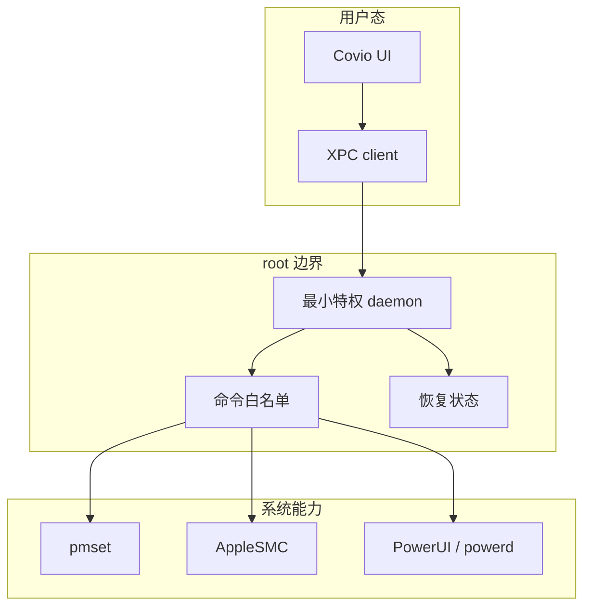

# 调研、方案矩阵与反证

## 1. 调研方法

本主题按以下顺序收集证据：

1. 阅读 macOS 27 SDK 的 `ServiceManagement`、`Foundation` 和 `Security` 头文件。
2. 阅读 Apple Service Management 文档与官方示例。
3. 阅读 `man pmset` 和 `man launchd.plist`。
4. 对照 Covio `0.5.2` 源码与当前已安装制品。
5. 复用 [合盖睡眠控制与权限边界](../lid-sleep-control/README.md) 的真机实验。
6. 记录当前环境的签名身份和 `SMAppService` 注册限制。

本主题不执行新的特权写入。
本主题不安装新 helper。
本主题不修改系统设置。

## 2. 来源范围

| 来源等级 | 来源 | 用途 |
| --- | --- | --- |
| A | macOS 27 SDK 头文件 | 硬性 API 和签名要求 |
| A | Apple 官方文档 | API 生命周期、权限和操作语义 |
| A | 本机 `man pmset` 与 `man launchd.plist` | 系统工具与 plist 约束 |
| B | Covio `0.5.2` 源码 | 当前能力、协议和实现边界 |
| B | ADR-0005、ADR-0006 | 已接受的签名和 helper 决策 |
| C | Apple Service Management 示例 | 推荐的 bundle、plist 和 XPC 结构 |
| D | 本机只读检查与既有探针结果 | 当前环境事实 |

完整来源、命令和观察见 [evidence.md](evidence.md)。

## 3. 权限需求模型

权限模型有一条硬边界。
用户态 app 负责策略和界面。
root 服务只执行固定命令。
root 服务不接受通用 shell、脚本路径或任意参数。

## 4. 能力约束

### 4.1 进程级睡眠断言

`IOPMAssertion` 可以在用户态阻止空闲睡眠。
断言随进程或断言 ID 释放而消失。
合盖判定读取系统电源设置，不读取普通进程断言。

既有真机实验验证：持有 `PreventSystemSleep` 断言时，合盖后系统仍进入完全睡眠。

结论：不能仅靠断言覆盖合盖功能。

### 4.2 `pmset`

`man pmset` 明确写明 `pmset must be run as root in order to modify any settings`。
`hibernatemode` 和 `disablesleep` 都改变全系统状态。

结论：持久写入必须有特权进程。

### 4.3 `AppleSMC`

读取 SMC 不需要 root。
受保护写入返回 `kIOReturnNotPrivileged`。
Covio 的 `SMCAccess` 已显式处理该错误。

结论：风扇控制和主动放电写入必须有特权进程。

### 4.4 充电上限

`80%` 到 `100%` 可以使用用户态原生 MCL 客户端。
`40%` 到 `79%` 需要 root-owned preferences，并等待 `powerd` 回读。
主动放电还需要 root helper 写入 SMC `CHIE`。

结论：完整充电上限能力仍依赖特权进程。

## 5. 候选方案矩阵

| 方案 | 覆盖全部能力 | 最小权限 | 升级与恢复 | 签名要求 | App Store | 结论 |
| --- | --- | --- | --- | --- | --- | --- |
| 无 helper，只用公开用户态 API | 否 | 高 | 简单 | 无 | 可能 | 必须删除合盖、风扇和部分充电功能 |
| 每次操作弹管理员授权 | 是 | 中 | 不稳定 | 无 | 否 | 不能支持持续风扇控制和租约 |
| `setuid` 工具 | 是 | 低 | 文件权限易损坏 | 弱 | 否 | 拒绝 |
| 当前 app 二进制作为 root helper | 是 | 低 | 手工脚本，易混合版本 | ad-hoc 可运行 | 否 | 不是全局最优 |
| `SMJobBless` + XPC | 是 | 中 | Apple 旧机制 | 需要签名 | 否 | API 已废弃，拒绝 |
| `SMAppService.daemon` + XPC | 是 | 高 | 系统托管，需要重新注册 | 必须签名和公证 | 否 | 全局目标方案 |
| 签名 PKG + 稳定路径 LaunchDaemon | 是 | 高 | 需要自定义事务 | 需要签名，未公证约束较弱 | 否 | 无 Developer ID 时的受限备选 |

## 6. 方案分析

### 6.1 无 helper

无 helper 是权限成本最低的方案。
该方案无法覆盖合盖、风扇和低档位充电。

如果产品接受删除这些功能，可以不使用 helper。
当前 Covio 的产品范围不接受该裁剪。

### 6.2 每次操作提权

每次操作可以运行固定工具并请求管理员授权。
该方案不适合连续控制。
风扇控制需要租约和持续更新。
充电上限需要长时间后台恢复。
频繁密码框会破坏可用性。

### 6.3 当前 app 作为 root helper

当前 `Covio --helper` 由 LaunchDaemon 以 root 启动。
该可执行文件同时也包含完整 SwiftUI 应用。

Apple 官方说明 helper 应位于签名 bundle，并由系统管理生命周期。
当前实现依赖手写 plist、`launchctl` 和 `osascript`。
helper 的 program 路径指向 `/Applications/Covio.app/Contents/MacOS/Covio`。

该路径能工作，但不是最小权限设计。
应用更新、helper 替换和代码签名身份变更需要额外事务。

### 6.4 `SMJobBless`

`SMJobBless` 可以安装特权工具。
Apple 在 macOS 13 把该 API 标记为 deprecated，并写明 `Please use SMAppService instead`。
Covio 最低系统是 macOS 26。

结论：不采用。

### 6.5 `SMAppService.daemon`

`SMAppService` 从 macOS 13 起管理 LoginItem、LaunchAgent 和 LaunchDaemon。
daemon plist 位于 app bundle 的 `Contents/Library/LaunchDaemons`。
plist 使用 `BundleProgram` 指定 app bundle 内的相对路径。
daemon 注册后需要管理员批准。
更新可执行文件后必须重新注册。

Apple 头文件要求：包含 LaunchDaemon 的应用必须 notarized。
当前机器没有 Developer ID，探针使用自签名与 ad-hoc 签名均注册失败。

结论：全局目标方案，但必须先解决签名与公证前提。

### 6.6 签名 PKG + 稳定路径 LaunchDaemon

签名 PKG 可以把独立 helper 安装到稳定路径，并执行事务脚本。
该方案不依赖 `SMAppService` 的 notarization 门槛。
代价是自定义安装、升级、卸载和 LaunchDaemon 管理。

该方案适合没有 Developer ID 的受限发布。
该方案不是权限模型本身的全局最优，只是分发约束下的可用路径。

## 7. IPC 选择

当前 helper 使用 Unix 域套接字。
socket 权限是 `0666`。
helper 在连接后校验 UID，部分命令再校验客户端签名。

替代方案是 XPC Mach service。
macOS 13 起，`NSXPCListener` 可以设置 connection code signing requirement。
不满足 requirement 的新连接会在进入 delegate 前被拒绝。

目标方案应使用 XPC 和代码签名要求。
Unix socket 只保留给迁移期间的旧协议适配。

## 8. 当前产品源码分析

| 事实 | 证据 | 影响 |
| --- | --- | --- |
| `Covio` 入口在同一二进制中分流 UI 与 helper | `E-09` | helper 携带完整应用代码 |
| LaunchDaemon 指向 `/Applications/Covio.app/Contents/MacOS/Covio` | `E-10` | app 替换与 helper 生命周期耦合 |
| helper socket 权限为 `0666` | `E-11` | 任意本机用户可尝试连接 |
| 当前只有 UID 与部分签名校验 | `E-11` | 权限边界弱于 XPC 代码签名要求 |
| 发布物为 ad-hoc 签名 | `E-12` | 无法使用 `SMAppService.daemon` |

## 9. Apple 示例分析

Apple 官方示例把 helper plist 放进签名 app bundle。
示例使用 `BundleProgram`，并通过 XPC 与 helper 通信。
示例要求开发者配置 Team ID，并使用 PKG 安装。

该结构减少对 `/Library/LaunchDaemons` 的直接写入。
该结构让系统在 Login Items 中显示 helper 所属应用。

示例是 LaunchAgent，不是本项目需要的 root LaunchDaemon。
daemon 的签名和批准要求以 SDK 头文件和 `SMAppService.daemon` 文档为准。

## 10. 反证与限制

1. 当前没有 Developer ID，因此不能实测 notarized `SMAppService.daemon`。
2. 既有自签名与 ad-hoc 探针都失败，但这不证明 Developer ID 一定成功。
3. `SMAppService` 更新后重新注册是否再次要求管理员批准，文档没有明确说明。
4. 独立 helper 仍需携带 KMP 协议或生成等价的 Swift 契约，构建成本高于当前单二进制。
5. App Store 与多数私有硬件写入路径不兼容。

## 11. 已知缺口

| 缺口 | 影响 | 下一步 |
| --- | --- | --- |
| 没有 Developer ID | 无法验证目标 daemon 注册与更新 | 取得证书后执行验证案例 |
| 没有 notarization 凭据 | 无法验证 Gatekeeper 与 daemon 批准 | 完成发布签名链 |
| 未测更新后的批准行为 | 影响升级体验 | 做两个版本连续升级试验 |
| 未测 XPC 性能 | 可能影响高频风扇状态查询 | 做吞吐和延迟测试 |
