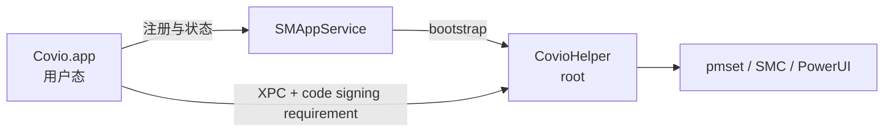

# 推荐架构、接口与实施计划

## 1. 推荐架构

### 1.1 全局目标

采用独立的最小特权 daemon。



### 1.2 采用前提

目标架构采用以下发布前提：

1. 正式版本使用 Developer ID 签名。
2. 启用 hardened runtime。
3. 完成 Apple notarization。
4. app 安装在 `/Applications`。
5. 发布流程能够维护 bundle 内 LaunchDaemon plist 的签名。

缺少任一前提时，目标架构不能进入正式实现。

### 1.3 无签名前提的受限路径

如果暂时没有 Developer ID，只能采用 Legacy LaunchDaemon。

受限路径仍采用以下原则：

1. helper 是独立最小二进制，不再复用完整 app。
2. helper 安装到 root-owned 稳定路径，不直接运行 app bundle 内的完整二进制。
3. app 与 helper 使用 XPC Mach service，不使用 `0666` socket。
4. 安装器、app 和 helper 使用同一 release identity。
5. 升级和回滚成对执行。

该路径保留自定义 LaunchDaemon 安装和迁移债务。

## 2. 组件职责

| 组件 | 职责 | 权限 |
| --- | --- | --- |
| `Covio` app | UI、策略、状态展示、用户授权 | 用户态 |
| `CovioHelper` | 固定特权命令、状态恢复、租约 | root |
| `SMAppService` | daemon 注册、批准状态、启动生命周期 | 系统 |
| Release manifest | 绑定版本、build、commit 和摘要 | 只读 |
| Installer | 安装、升级、回滚和迁移 | root |

## 3. 文件位置

### 3.1 `SMAppService` 目标结构

```text
Covio.app/
└── Contents/
    ├── MacOS/
    │   └── Covio
    ├── Library/
    │   ├── LaunchDaemons/
    │   │   └── com.wyz.covio.helper.plist
    │   └── LaunchServices/
    │       └── CovioHelper
    └── Resources/
        └── release-manifest.json
```

LaunchDaemon plist 使用 `BundleProgram`。
`BundleProgram` 指向 bundle 内的 `CovioHelper`。
plist 同时声明 Mach service 名称。

### 3.2 运行状态位置

```text
/Library/Application Support/Covio/
├── installed-release.json
├── helper-state.json
├── charge-limit/
├── fan-control/
└── helper.log
```

状态文件由 root 拥有。
普通用户只能读取脱敏状态。

## 4. IPC 契约

### 4.1 传输

- 机制：XPC Mach service。
- service 名称：`com.wyz.covio.helper`。
- 客户端：`Covio.app`。
- 服务端：`CovioHelper`。
- 连接要求：客户端 designated requirement。
- 不开放 Unix socket。

### 4.2 客户端鉴权

helper 使用 `NSXPCListener.setConnectionCodeSigningRequirement` 设置 requirement。
requirement 至少绑定：

- Team ID。
- app bundle identifier。
- Developer ID 证书链。

不匹配的连接在 XPC 层被拒绝。

### 4.3 握手

请求：

```text
handshake(clientProtocolVersion)
```

响应：

```json
{
  "releaseId": "0.6.0+12+<commit>",
  "productVersion": "0.6.0",
  "buildNumber": 12,
  "gitCommit": "<full-sha>",
  "helperProtocolVersion": 9,
  "helperSHA256": "<sha256>",
  "capabilities": ["sleep", "lid", "charge", "fan"]
}
```

app 只有在以下条件全部满足时开放特权写入：

- `releaseId` 与 app 的 manifest 相等。
- `helperSHA256` 与 manifest 相等。
- protocol 在支持范围内。
- capability 覆盖当前功能。

### 4.4 操作

首版接口只暴露固定操作：

| 操作 | 请求字段 | 结果 |
| --- | --- | --- |
| `handshake` | `clientProtocolVersion` | helper identity |
| `setDisableSleep` | `disabled`, `leaseId` | sleep state |
| `setHibernateMode` | `mode` | applied mode |
| `lidLeaseAcquire` | `leaseId`, `externalDisplayCount` | lease state |
| `lidLeaseRenew` | `leaseId`, `externalDisplayCount` | lease state |
| `lidLeaseRelease` | `leaseId` | lease state |
| `chargeLimitStatus` | 无 | charge state |
| `chargeLimitConfigure` | `percent`, `activeDischarge` | charge state |
| `chargeLimitRestore` | 无 | restore result |
| `fanControlStatus` | 无 | fan state |
| `fanControlConfigure` | normalized configuration | fan state |
| `fanControlKeepAlive` | 无 | lease state |
| `fanControlRestore` | 无 | restore result |

请求字段不得包含任意 shell、任意可执行文件路径或任意 SMC key。

### 4.5 错误码

| 错误码 | 含义 |
| --- | --- |
| `helper_unavailable` | XPC 服务不存在或无法连接 |
| `unauthorized_client` | 客户端不满足代码签名 requirement |
| `identity_mismatch` | release identity 不一致 |
| `unsupported_protocol` | XPC 协议不兼容 |
| `invalid_request` | 字段缺失或越界 |
| `unsupported_capability` | 当前 helper 不支持该操作 |
| `restore_failed` | 系统状态恢复失败 |
| `write_failed` | 特权写入失败 |
| `registration_required` | daemon 未注册或等待批准 |
| `state_unreadable` | root 状态文件损坏或不可读 |

## 5. 关键流程

### 5.1 首次安装

```text
安装签名 app
  → 启动 app
  → 检查 SMAppService.status
  → register daemon
  → 等待用户在 System Settings 批准
  → helper 启动
  → XPC handshake
  → 写入 installed-release.json
```

### 5.2 app 更新

```text
读取新 manifest
  → 验证 app 和 helper 签名
  → 恢复风扇、充电和租约状态
  → 退出 app
  → 替换 app bundle
  → unregister 旧 daemon
  → register 新 daemon
  → 等待批准或启动
  → handshake
  → 健康检查
  → 提交 installed-release.json
```

### 5.3 失败回滚

```text
替换失败
  → 删除新 bundle
  → 恢复旧 app bundle
  → 重新注册旧 daemon
  → 恢复 installed-release.json
  → 验证旧 helper handshake
```

## 6. Release identity

app、helper 和安装记录使用同一个身份：

```json
{
  "releaseId": "<version>+<build>+<commit>",
  "productVersion": "<semver>",
  "buildNumber": 1,
  "gitCommit": "<full-sha>",
  "helperProtocolVersion": 9,
  "helperSHA256": "<sha256>",
  "channel": "internal"
}
```

`helperProtocolVersion` 只在 XPC 接口不兼容时变化。
`releaseId` 每次发布变化。

## 7. 安全设计

| 风险 | 措施 |
| --- | --- |
| 任意用户连接 socket | 删除 Unix socket，改用 XPC |
| 伪造客户端 | XPC code signing requirement |
| 任意命令执行 | 固定操作枚举，不接受 shell 或路径 |
| 任意 SMC 写入 | 只开放已审查的 key 和值域 |
| root 进程过大 | 独立最小 helper target |
| 混合版本 | release identity 精确比较 |
| 降级攻击 | build number 必须递增 |
| 状态残留 | 退出、升级和卸载前恢复 |
| 安装器替换 | 签名 PKG 与成对回滚 |

## 8. 可靠性设计

- helper lease 有明确超时。
- helper 崩溃后由系统重启，并执行 stale-state 恢复。
- 风扇控制在 helper 退出前恢复系统控制。
- 充电状态跨重启保留恢复凭据。
- 所有特权写入有回读。
- XPC 请求有大小上限和超时。
- 日志记录 releaseId、操作、错误码和时间，不记录敏感值。

## 9. 失败模式

| 失败 | 用户状态 | 恢复 |
| --- | --- | --- |
| helper 未注册 | 只读 | 打开 System Settings 完成批准 |
| helper 等待批准 | 只读 | 显示批准入口 |
| helper 崩溃 | 只读 | 系统重启 helper，app 重试握手 |
| identity 不一致 | 只读 | 重新安装完整 app |
| XPC 签名失败 | 只读 | 修复 app 签名 |
| 状态恢复失败 | 禁止升级或退出 | 保留旧 helper 并显示错误 |
| 更新中断 | 回滚 | 恢复上一版 app、helper 和记录 |

## 10. 验收标准

1. 特权功能只通过独立 helper 执行。
2. helper 不链接 SwiftUI、AppKit、Vision 或模型运行库。
3. XPC 连接必须满足代码签名 requirement。
4. 非匹配 release identity 禁止所有特权写入。
5. `SMAppService` 注册、批准、重启和注销行为可观测。
6. app 与 helper 更新后保持同一 release identity。
7. 升级失败时 app、helper 和安装记录成对回滚。
8. 风扇、充电和租约状态在升级中恢复。

## 11. 实施计划

1. 决策是否把 Developer ID 与 notarization 作为发布前提。
2. 新建最小 `CovioHelper` target。
3. 定义 XPC 接口和 XPC 协议版本。
4. 加入 release manifest、build number 和精确握手。
5. 接入 `SMAppService.daemon`。
6. 迁移现有 LaunchDaemon。
7. 建立签名 PKG、Draft Release 和回滚流程。
8. 执行真机验证矩阵。

## 12. 回滚条件

出现以下任一情况时，停止迁移：

- Developer ID 或 notarization 不可用。
- daemon 注册无法稳定通过。
- app 更新后无法完成重新注册。
- XPC 无法稳定支持现有操作频率。
- 状态恢复无法证明成功。

回滚必须同时恢复 app、helper 和 installed release record。

## 13. 产品化条件

- 有 Developer ID 证书。
- 有可重复的 notarization 流水线。
- 有权限审计和签名审计。
- 有安装、升级、卸载和回滚矩阵。
- 有至少两个连续版本的升级证据。
- 有用户可见的 helper 状态与修复入口。

## 14. 当前建议

当前不直接实现 `SMAppService`。
先完成 ADR，明确是否投资 Developer ID 与 notarization。

如果答案是 yes，采用本文件的目标架构。
如果答案是 no，停止把目标架构称为全局最优，只批准受限 Legacy 路径作为过渡。
